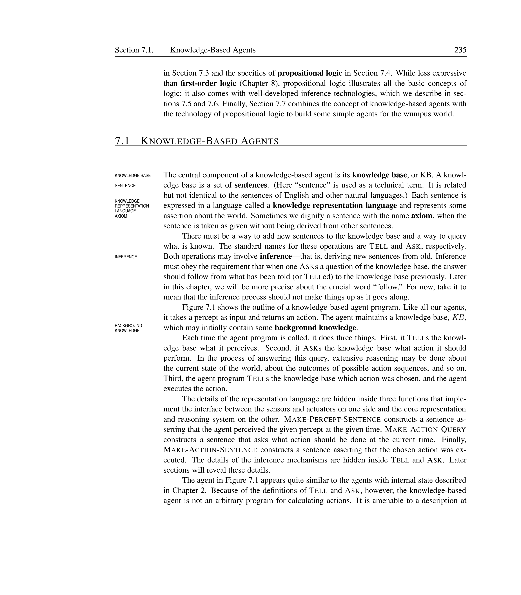
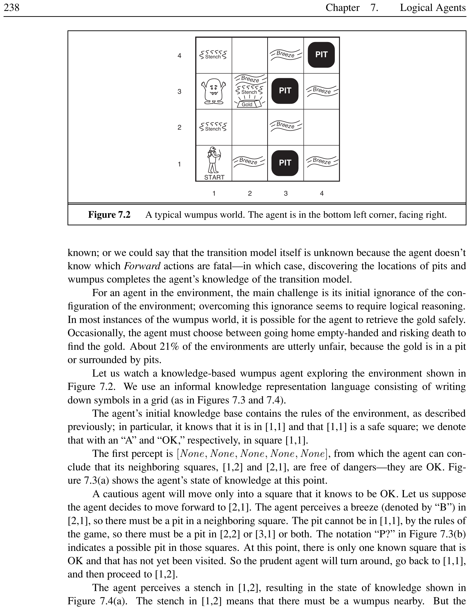
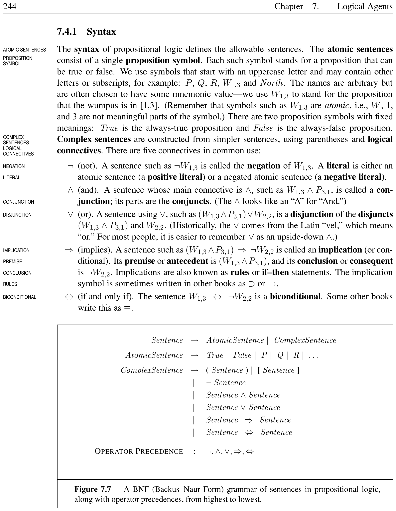
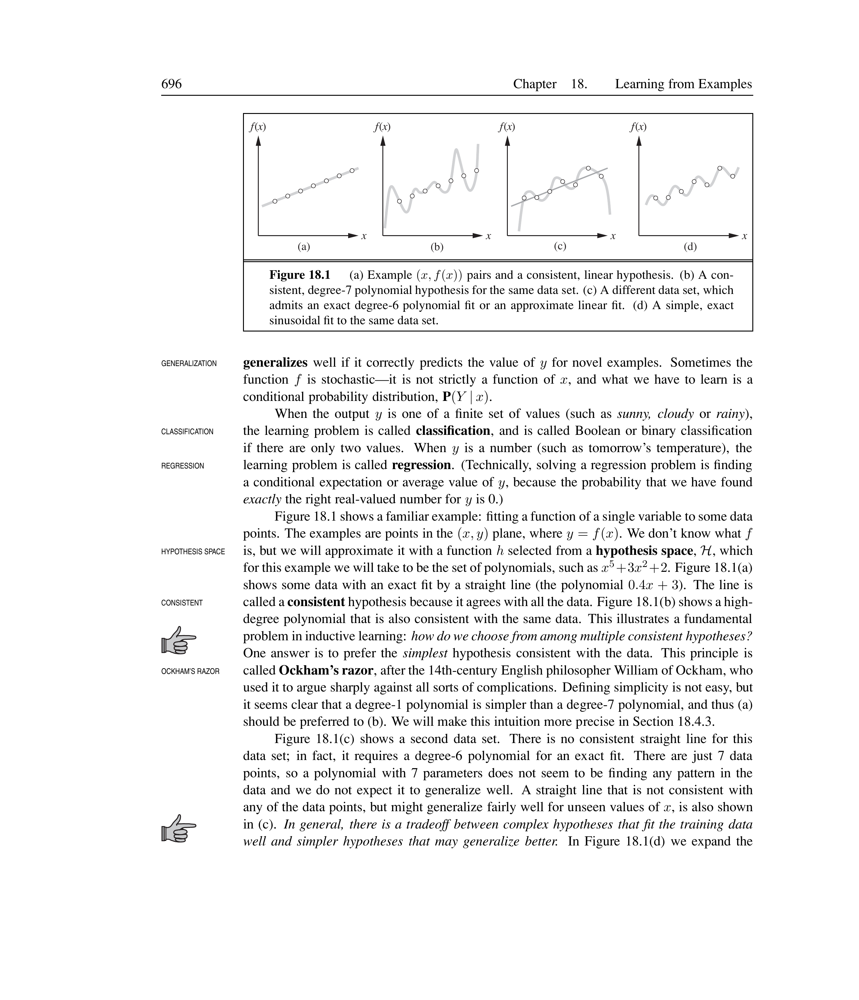
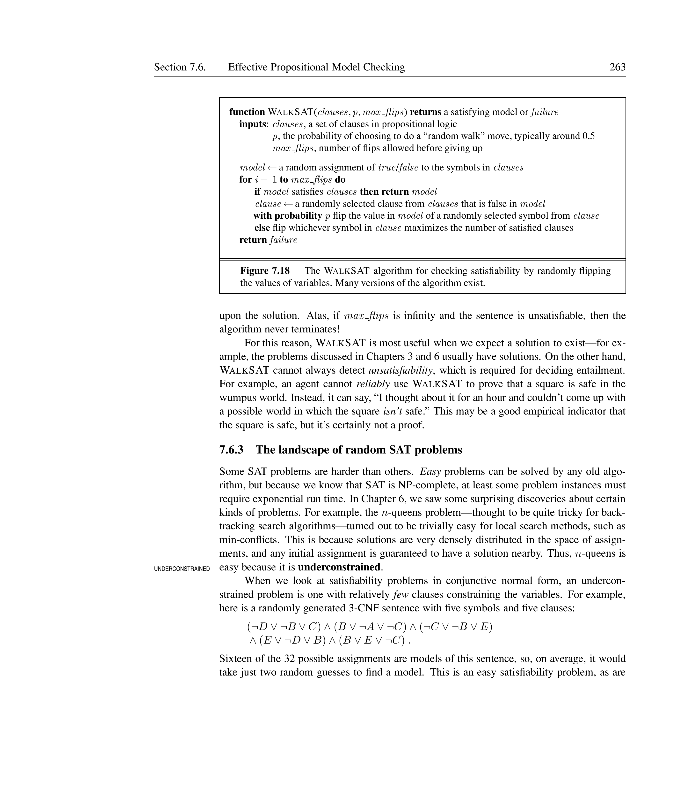
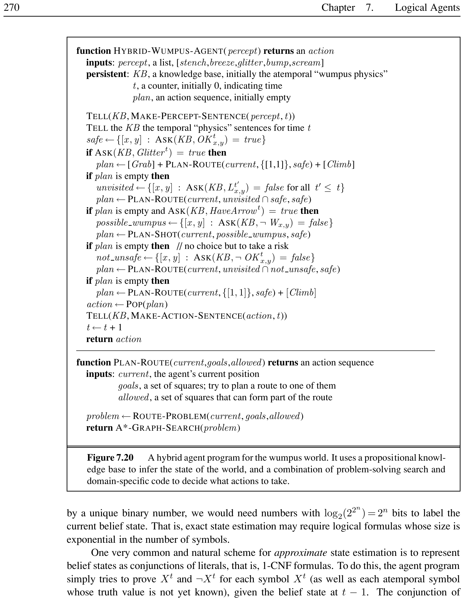
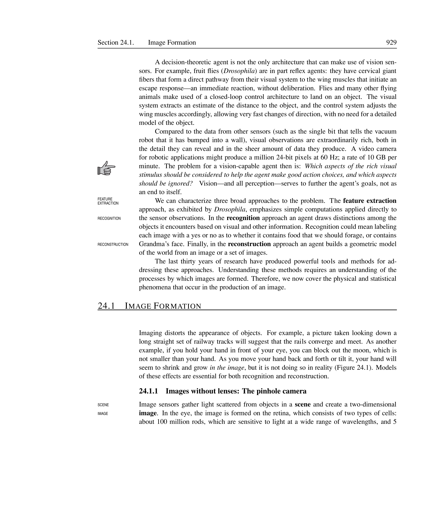


# Logical Agents

In which we design agents that can form representations of a complex world, use a process of inference to derive new representations about the world, and use these new representations to deduce what to do.

## Knowledge-Based Agents

<div markdown="1" style="border-left:4px solid #1a5c9e;background:#f0f4f8;padding:14px 18px;margin:18px 0;border-radius:6px;">

Knowledge Base (KB)

A **knowledge base** is a set of **sentences**. Each sentence is expressed in a **knowledge representation language** and represents some assertion about the world. A sentence taken as given without being derived from other sentences is called an **axiom**.

</div>

<div markdown="1" style="border-left:4px solid #1a5c9e;background:#f0f4f8;padding:14px 18px;margin:18px 0;border-radius:6px;">

Inference

**Inference** is the process of deriving new sentences from old ones. The two fundamental operations on a knowledge base are:

- **TELL**: add a new sentence to the knowledge base.

- **ASK**: query what is known; the answer should follow from what has been told.

</div>

<div markdown="1" style="border-left:4px solid #1a5c9e;background:#f0f4f8;padding:14px 18px;margin:18px 0;border-radius:6px;">

Knowledge Level vs. Implementation Level

At the **knowledge level**, we specify only what the agent knows and what its goals are, in order to fix its behavior. At the **implementation level**, we specify how the knowledge is actually represented and manipulated in code.

</div>

<figure>

<figcaption>Architecture of a knowledge-based agent. The agent tells the KB what it perceives, asks the KB what to do, and tells the KB the action it chose.</figcaption>
</figure>

A knowledge-based agent program maintains a knowledge base (KB) and a counter $t$ indicating time. Given a percept, it constructs a percept sentence, tells the KB, asks for the best action, tells the KB the chosen action, and returns it.

<div markdown="1" style="border-left:4px solid #2e7d32;background:#e8f5e9;padding:14px 18px;margin:18px 0;border-radius:6px;">

KB-Agent Pseudocode

```text
function KB-AGENT(percept) returns an action
  persistent: KB, a knowledge base
              t, a counter indicating time
  TELL(KB, MAKE-PERCEPT-SENTENCE(percept, t))
  action <- ASK(KB, MAKE-ACTION-QUERY(t))
  TELL(KB, MAKE-ACTION-SENTENCE(action, t))
  t <- t + 1
  return action
```

</div>

The **declarative approach** builds an agent by TELLing it what it needs to know, rather than writing procedural code. A successful agent often combines both declarative and procedural elements.

<figure>

<figcaption>Two approaches to building knowledge-based agents. Declarative: TELL the agent what it needs to know. Procedural: encode behavior as code. Modern agents combine both.</figcaption>
</figure>

<div markdown="1" style="border-left:4px solid #2e7d32;background:#e8f5e9;padding:14px 18px;margin:18px 0;border-radius:6px;">

Declarative vs. Procedural

An automated taxi:

- **Declarative**: TELL the agent “The Golden Gate Bridge connects San Francisco to Marin County.” The agent infers the route.

- **Procedural**: Hard-code “If destination is Marin County and location is San Francisco, cross Golden Gate Bridge.”

The declarative approach is more flexible: the same knowledge works for any query, not just a specific one.

</div>

## The Wumpus World

<div markdown="1" style="border-left:4px solid #1a5c9e;background:#f0f4f8;padding:14px 18px;margin:18px 0;border-radius:6px;">

Wumpus World

The **wumpus world** is a cave consisting of rooms connected by passageways. A beast (the wumpus) eats anyone who enters its room. Some rooms contain bottomless pits. The agent can find a heap of gold. The agent has one arrow to shoot the wumpus.

</div>

| **Agent**       | **Wumpus Hunter**                                                                                             |
|:----------------|:--------------------------------------------------------------------------------------------------------------|
| **Performance** | +1000 for climbing out with gold, $-1000$ for death (pit or wumpus), $-1$ per action, $-10$ for using arrow   |
| **Environment** | $4 \times 4$ grid of rooms, agent starts at $[1,1]$ facing right, gold and wumpus random, pits with prob. 0.2 |
| **Actuators**   | Forward, TurnLeft, TurnRight, Grab, Shoot, Climb                                                              |
| **Sensors**     | Stench (wumpus adjacent), Breeze (pit adjacent), Glitter (gold), Bump (wall), Scream (wumpus killed)          |

PEAS description of the wumpus world

The wumpus environment is **discrete**, **static**, **single-agent**, **sequential**, and **partially observable**.

<figure>

<figcaption>A typical wumpus world. The agent starts at $[1,1]$ facing right.</figcaption>
</figure>

The agent explores the world, using logical reasoning to infer safe squares. For example, no breeze in $[1,1]$ means $[1,2]$ and $[2,1]$ are safe. A breeze in $[2,1]$ suggests a pit in $[2,2]$ or $[3,1]$. A stench in $[1,2]$ implies the wumpus is nearby.

<div markdown="1" style="border-left:4px solid #2e7d32;background:#e8f5e9;padding:14px 18px;margin:18px 0;border-radius:6px;">

Wumpus Agent Trajectory

1.  Start at $[1,1]$: no percept $\Rightarrow$ $[1,2]$ and $[2,1]$ are safe.

2.  Move to $[2,1]$: breeze $\Rightarrow$ pit in $[2,2]$ or $[3,1]$.

3.  Return to $[1,1]$, move to $[1,2]$: stench $\Rightarrow$ wumpus in $[1,3]$ or $[2,2]$.

4.  No breeze in $[1,2]$ $\Rightarrow$ no pit in $[2,2]$, so pit must be in $[3,1]$.

5.  Conclude $[2,2]$ is safe, move there, then to $[2,3]$: glitter! Grab gold.

</div>

## Logic

<div markdown="1" style="border-left:4px solid #1a5c9e;background:#f0f4f8;padding:14px 18px;margin:18px 0;border-radius:6px;">

Syntax and Semantics

**Syntax** defines the allowable sentences in a representation language. **Semantics** defines the truth of each sentence with respect to each possible world. A sentence must be either true or false in each possible world.

</div>

<div markdown="1" style="border-left:4px solid #1a5c9e;background:#f0f4f8;padding:14px 18px;margin:18px 0;border-radius:6px;">

Model and Satisfaction

A **model** $m$ is a mathematical abstraction that fixes the truth or falsehood of every relevant sentence. If a sentence $\alpha$ is true in model $m$, we say $m$ **satisfies** $\alpha$ or $m$ is a **model** of $\alpha$. The notation $M(\alpha)$ denotes the set of all models of $\alpha$.

</div>

<div markdown="1" style="border-left:4px solid #1a5c9e;background:#f0f4f8;padding:14px 18px;margin:18px 0;border-radius:6px;">

Entailment

**Entailment** is the relation between sentences where one sentence follows logically from another: $$\alpha \models \beta \quad\text{iff}\quad M(\alpha) \subseteq M(\beta)$$ That is, in every model in which $\alpha$ is true, $\beta$ is also true.

</div>

<div markdown="1" style="border-left:4px solid #1a5c9e;background:#f0f4f8;padding:14px 18px;margin:18px 0;border-radius:6px;">

Inference, Soundness, Completeness

**Logical inference** is the process of deriving conclusions from premises. An inference algorithm is:

- **Sound** (truth-preserving): it derives only entailed sentences.

- **Complete**: it can derive any sentence that is entailed.

$$\text{KB} \vdash_i \alpha \quad\text{means}\quad \text{inference algorithm } i \text{ derives } \alpha \text{ from KB}$$

</div>

<figure>

<figcaption>The correspondence between world and representation. Sentences represent aspects of the real world; reasoning constructs new sentences that correspond to new aspects that actually follow.</figcaption>
</figure>

<div markdown="1" style="border-left:4px solid #1a5c9e;background:#f0f4f8;padding:14px 18px;margin:18px 0;border-radius:6px;">

Grounding

**Grounding** is the connection between logical reasoning processes and the real environment. The agent’s sensors create this connection by generating percept sentences that are true in the real world.

</div>

<figure>

<figcaption>Hierarchy of logical systems ordered by expressiveness.</figcaption>
</figure>

<div markdown="1" style="border-left:4px solid #2e7d32;background:#e8f5e9;padding:14px 18px;margin:18px 0;border-radius:6px;">

Entailment in Wumpus World

KB = rules of wumpus world + percepts (no breeze in $[1,1]$, breeze in $[2,1]$). For $\alpha_1 = \neg P_{1,2}$ (no pit in $[1,2]$): $$KB \models \alpha_1 \quad\text{because in all 3 models where KB is true, } P_{1,2} \text{ is false.}$$ For $\alpha_2 = \neg P_{2,2}$: $$KB \not\models \alpha_2 \quad\text{because } P_{2,2} \text{ is true in one model and false in another.}$$

</div>

## Propositional Logic: A Very Simple Logic

<div markdown="1" style="border-left:4px solid #1a5c9e;background:#f0f4f8;padding:14px 18px;margin:18px 0;border-radius:6px;">

Propositional Logic

**Propositional logic** is a simple logic consisting of **proposition symbols** (atomic sentences) that can be true or false, combined with **logical connectives**.

</div>

<div markdown="1" style="border-left:4px solid #1a5c9e;background:#f0f4f8;padding:14px 18px;margin:18px 0;border-radius:6px;">

Syntax of Propositional Logic

Atomic sentences: proposition symbols ($P, Q, R, W_{1,3}$) plus *True* and *False*. Complex sentences built with five connectives:

- **Negation** $\neg$ (not): $\neg P$

- **Conjunction** $\land$ (and): $P \land Q$

- **Disjunction** $\lor$ (or): $P \lor Q$

- **Implication** $\Rightarrow$ (implies): $P \Rightarrow Q$ (premise $\Rightarrow$ conclusion)

- **Biconditional** $\Leftrightarrow$ (iff): $P \Leftrightarrow Q$

Operator precedence (highest to lowest): $\neg, \land, \lor, \Rightarrow, \Leftrightarrow$.

</div>

<figure>
<table markdown="1">
<thead>
<tr class="header">
<th style="text-align: left;">$P$</th>
<th style="text-align: left;">$Q$</th>
<th style="text-align: left;">$\neg P$</th>
<th style="text-align: left;">$P \land Q$</th>
<th style="text-align: left;">$P \lor Q$</th>
<th style="text-align: left;">$P \Rightarrow Q$</th>
<th style="text-align: left;">$P \Leftrightarrow Q$</th>
<th style="text-align: left;"></th>
</tr>
</thead>
<tbody>
<tr class="odd">
<td style="text-align: left;">F</td>
<td style="text-align: left;">F</td>
<td style="text-align: left;">T</td>
<td style="text-align: left;">F</td>
<td style="text-align: left;">F</td>
<td style="text-align: left;">T</td>
<td style="text-align: left;">T</td>
<td style="text-align: left;"></td>
</tr>
<tr class="even">
<td style="text-align: left;">F</td>
<td style="text-align: left;">T</td>
<td style="text-align: left;">T</td>
<td style="text-align: left;">F</td>
<td style="text-align: left;">T</td>
<td style="text-align: left;">T</td>
<td style="text-align: left;">F</td>
<td style="text-align: left;"></td>
</tr>
<tr class="odd">
<td style="text-align: left;">T</td>
<td style="text-align: left;">F</td>
<td style="text-align: left;">F</td>
<td style="text-align: left;">F</td>
<td style="text-align: left;">T</td>
<td style="text-align: left;">F</td>
<td style="text-align: left;">F</td>
<td style="text-align: left;"></td>
</tr>
<tr class="even">
<td style="text-align: left;">T</td>
<td style="text-align: left;">T</td>
<td style="text-align: left;">F</td>
<td style="text-align: left;">T</td>
<td style="text-align: left;">T</td>
<td style="text-align: left;">T</td>
<td style="text-align: left;">T</td>
<td style="text-align: left;"></td>
</tr>
</tbody>
</table>
<figcaption>Truth tables for the five logical connectives.</figcaption>
</figure>

A **model** in propositional logic simply fixes the truth value (true or false) for every proposition symbol. For $n$ symbols, there are $2^n$ possible models. The truth of any complex sentence is computed recursively from its components.

<div markdown="1" style="border-left:4px solid #1a5c9e;background:#f0f4f8;padding:14px 18px;margin:18px 0;border-radius:6px;">

Tautology, Contradiction, Contingency

- **Tautology** (valid sentence): true in all models, e.g., $P \lor \neg P$.

- **Contradiction** (unsatisfiable sentence): false in all models, e.g., $P \land \neg P$.

- **Contingency** (satisfiable but not valid): true in some models, false in others, e.g., $P \land Q$.

</div>

<figure>

<figcaption>Classification of propositional sentences by truth in models. Every sentence is either valid (true in all models), unsatisfiable (false in all models), or contingent (true in some, false in others).</figcaption>
</figure>

<div markdown="1" style="border-left:4px solid #2e7d32;background:#e8f5e9;padding:14px 18px;margin:18px 0;border-radius:6px;">

Wumpus World Knowledge Base

Key proposition symbols:

- $P_{x,y}$: pit in $[x,y]$

- $W_{x,y}$: wumpus in $[x,y]$

- $B_{x,y}$: breeze in $[x,y]$

- $S_{x,y}$: stench in $[x,y]$

Sentences for the situation in Figure 7.3(b): $$\begin{aligned}
R_1 &: \neg P_{1,1} \\
R_2 &: B_{1,1} \Leftrightarrow (P_{1,2} \lor P_{2,1}) \\
R_3 &: B_{2,1} \Leftrightarrow (P_{1,1} \lor P_{2,2} \lor P_{3,1}) \\
R_4 &: \neg B_{1,1} \\
R_5 &: B_{2,1}
\end{aligned}$$

</div>

<div markdown="1" style="border-left:4px solid #1a5c9e;background:#f0f4f8;padding:14px 18px;margin:18px 0;border-radius:6px;">

Model Checking Inference

**Model checking** enumerates all possible models to check that $\alpha$ is true in every model in which KB is true. The TT-ENTAILS? algorithm implements this directly: $$\text{TT-ENTAILS?}(KB, \alpha) \text{ checks if } M(KB) \subseteq M(\alpha)$$ Time complexity: $O(2^n)$ for $n$ symbols. Space complexity: $O(n)$ (depth-first).

</div>

## Propositional Theorem Proving

<div markdown="1" style="border-left:4px solid #1a5c9e;background:#f0f4f8;padding:14px 18px;margin:18px 0;border-radius:6px;">

Logical Equivalence, Validity, Satisfiability

- **Logical equivalence**: $\alpha \equiv \beta$ iff $\alpha \models \beta$ and $\beta \models \alpha$.

- **Validity**: a sentence is **valid** (a **tautology**) if true in all models, e.g., $P \lor \neg P$.

- **Satisfiability**: a sentence is **satisfiable** if true in some model.

- The **SAT problem**: determine if a propositional sentence is satisfiable (NP-complete).

</div>

The **deduction theorem**: $\alpha \models \beta$ iff $(\alpha \Rightarrow \beta)$ is valid. Also: $\alpha \models \beta$ iff $(\alpha \land \neg\beta)$ is unsatisfiable (**reductio ad absurdum** or proof by contradiction).

<figure>
<table markdown="1">
<thead>
<tr class="header">
<th style="text-align: left;"><strong>Name</strong></th>
<th style="text-align: left;"><strong>Rule</strong></th>
</tr>
</thead>
<tbody>
<tr class="odd">
<td style="text-align: left;">Modus Ponens</td>
<td style="text-align: left;">$\displaystyle\frac{\alpha \Rightarrow \beta,\quad \alpha}{\beta}$</td>
</tr>
<tr class="even">
<td style="text-align: left;">Modus Tollens</td>
<td style="text-align: left;">$\displaystyle\frac{\alpha \Rightarrow \beta,\quad \neg\beta}{\neg\alpha}$</td>
</tr>
<tr class="odd">
<td style="text-align: left;">And-Elimination</td>
<td style="text-align: left;">$\displaystyle\frac{\alpha \land \beta}{\alpha}$</td>
</tr>
<tr class="even">
<td style="text-align: left;">And-Introduction</td>
<td style="text-align: left;">$\displaystyle\frac{\alpha,\quad \beta}{\alpha \land \beta}$</td>
</tr>
<tr class="odd">
<td style="text-align: left;">Or-Introduction</td>
<td style="text-align: left;">$\displaystyle\frac{\alpha}{\alpha \lor \beta}$</td>
</tr>
<tr class="even">
<td style="text-align: left;">Unit Resolution</td>
<td style="text-align: left;">$\displaystyle\frac{\ell_1 \lor \cdots \lor \ell_k,\quad m}{\ell_1 \lor \cdots \lor \ell_{i-1} \lor \ell_{i+1} \lor \cdots \lor \ell_k}$</td>
</tr>
<tr class="odd">
<td style="text-align: left;">Full Resolution</td>
<td style="text-align: left;">$\displaystyle\frac{\ell_1 \lor \cdots \lor \ell_k,\quad m_1 \lor \cdots \lor m_n}{\ell_1 \lor \cdots \lor \ell_{i-1} \lor \ell_{i+1} \lor \cdots \lor \ell_k \lor m_1 \lor \cdots \lor m_{j-1} \lor m_{j+1} \lor \cdots \lor m_n}$</td>
</tr>
</tbody>
</table>
<figcaption>Key inference rules for propositional logic. Complementary literals $\ell_i$ and $m_j$ cancel in resolution.</figcaption>
</figure>

<div markdown="1" style="border-left:4px solid #1a5c9e;background:#f0f4f8;padding:14px 18px;margin:18px 0;border-radius:6px;">

Standard Logical Equivalences

$$\begin{aligned}
(\alpha \land \beta) &\equiv (\beta \land \alpha) \\
(\alpha \lor \beta) &\equiv (\beta \lor \alpha) \\
((\alpha \land \beta) \land \gamma) &\equiv (\alpha \land (\beta \land \gamma)) \\
((\alpha \lor \beta) \lor \gamma) &\equiv (\alpha \lor (\beta \lor \gamma)) \\
\neg(\neg\alpha) &\equiv \alpha \\
(\alpha \Rightarrow \beta) &\equiv (\neg\beta \Rightarrow \neg\alpha) \\
(\alpha \Rightarrow \beta) &\equiv (\neg\alpha \lor \beta) \\
(\alpha \Leftrightarrow \beta) &\equiv ((\alpha \Rightarrow \beta) \land (\beta \Rightarrow \alpha)) \\
\neg(\alpha \land \beta) &\equiv (\neg\alpha \lor \neg\beta) \\
\neg(\alpha \lor \beta) &\equiv (\neg\alpha \land \neg\beta) \\
(\alpha \land (\beta \lor \gamma)) &\equiv ((\alpha \land \beta) \lor (\alpha \land \gamma)) \\
(\alpha \lor (\beta \land \gamma)) &\equiv ((\alpha \lor \beta) \land (\alpha \lor \gamma))
\end{aligned}$$

</div>

### Resolution

<div markdown="1" style="border-left:4px solid #1a5c9e;background:#f0f4f8;padding:14px 18px;margin:18px 0;border-radius:6px;">

Conjunctive Normal Form (CNF)

**CNF** is a conjunction of clauses, where each **clause** is a disjunction of literals. Every propositional sentence can be converted to CNF:

1.  Eliminate $\Leftrightarrow$ (replace with $(\alpha \Rightarrow \beta) \land (\beta \Rightarrow \alpha)$)

2.  Eliminate $\Rightarrow$ (replace $\alpha \Rightarrow \beta$ with $\neg\alpha \lor \beta$)

3.  Move $\neg$ inwards (De Morgan, double negation)

4.  Distribute $\lor$ over $\land$

**Factoring** (also called **pure literal elimination**) removes duplicate literals within a clause and removes clauses containing complementary literals.

</div>

<figure>

<figcaption>Resolution algorithm flow. To prove $KB \models \alpha$, show $KB \land \neg\alpha$ is unsatisfiable by deriving the empty clause.</figcaption>
</figure>

<div markdown="1" style="border-left:4px solid #2e7d32;background:#e8f5e9;padding:14px 18px;margin:18px 0;border-radius:6px;">

Wumpus Resolution Proof

Prove $\neg P_{1,2}$ from KB: $$\begin{aligned}
R_2 &: B_{1,1} \Leftrightarrow (P_{1,2} \lor P_{2,1}) \\
R_4 &: \neg B_{1,1} \\
R_6 &: (B_{1,1} \Rightarrow (P_{1,2} \lor P_{2,1})) \land ((P_{1,2} \lor P_{2,1}) \Rightarrow B_{1,1}) \\
R_7 &: (P_{1,2} \lor P_{2,1}) \Rightarrow B_{1,1} \\
R_8 &: \neg B_{1,1} \Rightarrow \neg(P_{1,2} \lor P_{2,1}) \\
R_9 &: \neg(P_{1,2} \lor P_{2,1}) \\
R_{10} &: \neg P_{1,2} \land \neg P_{2,1}
\end{aligned}$$ Resolution is **complete** for propositional logic: if a set of clauses is unsatisfiable, repeated resolution will derive the empty clause.

</div>

### Key Properties

- Resolution is **sound**: the resolvent follows logically from the parent clauses.

- Resolution is **complete** for propositional logic: if $KB \land \neg\alpha$ is unsatisfiable, resolution will derive the empty clause.

- PL-RESOLUTION always terminates because only finitely many distinct clauses can be formed from the $k$ proposition symbols.

- Resolution is refutation-complete: it proves $\alpha$ from $KB$ by deriving a contradiction from $KB \land \neg\alpha$.

### Horn Clauses and Definite Clauses

<div markdown="1" style="border-left:4px solid #1a5c9e;background:#f0f4f8;padding:14px 18px;margin:18px 0;border-radius:6px;">

Horn and Definite Clauses

- **Definite clause**: a disjunction of literals with exactly one positive literal. Equivalent to $(P_1 \land \cdots \land P_k) \Rightarrow Q$.

- **Horn clause**: a disjunction with at most one positive literal. Includes definite clauses and **goal clauses** (no positive literals).

- **Fact**: a definite clause with no negative literals (e.g., $L_{1,1}$).

Horn clauses are closed under resolution. Entailment with Horn clauses is decidable in $O(n)$ time.

</div>

<figure>

<figcaption>Classification of propositional clauses by form.</figcaption>
</figure>

<div markdown="1" style="border-left:4px solid #2e7d32;background:#e8f5e9;padding:14px 18px;margin:18px 0;border-radius:6px;">

Forward Chaining

Forward chaining is **data-driven**: start from known facts, apply Modus Ponens to derive new facts until the query is proved or no more inferences are possible.

Rules: $A \land B \Rightarrow L$, $A \land P \Rightarrow L$, $B \land L \Rightarrow M$, $L \land M \Rightarrow P$, $P \Rightarrow Q$. Facts: $A$, $B$.

1.  Start with agenda: $A, B$.

2.  Process $A$: count\[$A \land B \Rightarrow L$\] decrements from 2 to 1.

3.  Process $B$: count\[$A \land B \Rightarrow L$\] becomes 0 $\Rightarrow$ add $L$.

4.  Process $L$: count\[$B \land L \Rightarrow M$\] becomes 0 $\Rightarrow$ add $M$, count\[$L \land M \Rightarrow P$\] becomes 1.

5.  Process $M$: count\[$L \land M \Rightarrow P$\] becomes 0 $\Rightarrow$ add $P$.

6.  Process $P$: count\[$P \Rightarrow Q$\] becomes 0 $\Rightarrow$ add $Q$. Query $Q$ proved!

</div>

<div markdown="1" style="border-left:4px solid #2e7d32;background:#e8f5e9;padding:14px 18px;margin:18px 0;border-radius:6px;">

Backward Chaining

Backward chaining is **goal-directed**: start from the query and work backward through implications until known facts are reached. For query $Q$:

1.  Find $P \Rightarrow Q$. Need to prove $P$.

2.  Find $L \land M \Rightarrow P$. Need to prove $L$ and $M$.

3.  Find $A \land B \Rightarrow L$: $A$ and $B$ are known facts $\Rightarrow$ $L$ proved.

4.  Find $B \land L \Rightarrow M$: $B$ and $L$ are known $\Rightarrow$ $M$ proved.

5.  All premises satisfied $\Rightarrow$ $Q$ proved.

Backward chaining touches only relevant facts, making it more efficient for specific queries.

</div>

### Key Properties

- Forward chaining is sound and complete for Horn clauses.

- Backward chaining is sound and complete for Horn clauses.

- Both run in linear time $O(n)$.

- **Monotonicity**: if $KB \models \alpha$, then $KB \land \beta \models \alpha$ for any $\beta$.

## Effective Propositional Model Checking

<div markdown="1" style="border-left:4px solid #1a5c9e;background:#f0f4f8;padding:14px 18px;margin:18px 0;border-radius:6px;">

SAT Problem

The **SAT problem** is the problem of determining whether a propositional sentence is satisfiable. Testing entailment $KB \models \alpha$ reduces to testing unsatisfiability of $KB \land \neg\alpha$.

</div>

<figure>

<figcaption>Classification of SAT solving approaches. Complete algorithms (DPLL) can prove unsatisfiability; incomplete algorithms (WalkSAT) cannot.</figcaption>
</figure>

### DPLL

<div markdown="1" style="border-left:4px solid #1a5c9e;background:#f0f4f8;padding:14px 18px;margin:18px 0;border-radius:6px;">

DPLL Algorithm

The **DPLL** (Davis–Putnam–Logemann–Loveland) algorithm is a complete, backtracking-based SAT solver for CNF sentences. It improves over naive model checking with three key techniques:

- **Early termination**: detect if sentence is true (all clauses satisfied) or false (any clause falsified) with a partial model.

- **Pure symbol heuristic**: a symbol appearing with only one sign in all remaining clauses can be assigned to make its literals true.

- **Unit clause heuristic**: a clause with all literals false except one forces that literal to true. Cascading assignments are called **unit propagation**.

</div>

<figure>

<figcaption>DPLL algorithm flow. At each step: check termination, apply pure symbol heuristic, apply unit clause heuristic, then branch on a symbol.</figcaption>
</figure>

<div markdown="1" style="border-left:4px solid #2e7d32;background:#e8f5e9;padding:14px 18px;margin:18px 0;border-radius:6px;">

DPLL Trace

Consider clauses: $(A \lor B) \land (A \lor \neg C) \land (\neg B \lor \neg C)$.

1.  Pure symbol: $C$ appears only as negative literal $\neg C$ $\Rightarrow$ assign $C =$ false.

2.  After $C =$ false: clauses $\Rightarrow (A \lor B) \land (A \lor \text{true}) \land (\neg B \lor \text{true})$.

3.  Empty clause? No. $(A \lor \text{true})$ and $(\neg B \lor \text{true})$ are satisfied.

4.  Remaining: $(A \lor B)$. Unit clause? No. Pure symbol? $A$ and $B$ both appear positive.

5.  Split on $A =$ true $\Rightarrow$ all clauses satisfied. Model found!

</div>

### Key Properties

- DPLL is **complete**: it will eventually find a model if one exists, or prove unsatisfiability.

- Early termination, pure symbol heuristic, and unit propagation prune large portions of the search space.

- Modern SAT solvers add conflict-driven clause learning (CDCL), component analysis, and random restarts.

- DPLL with these enhancements can handle problems with tens of millions of variables.

### WalkSAT

<div markdown="1" style="border-left:4px solid #1a5c9e;background:#f0f4f8;padding:14px 18px;margin:18px 0;border-radius:6px;">

WalkSAT

**WalkSAT** is a local search algorithm for SAT. It starts with a random assignment and repeatedly flips a symbol in an unsatisfied clause, choosing randomly between:

- **Min-conflicts**: flip the symbol that maximizes the number of satisfied clauses.

- **Random walk**: flip a random symbol from the clause.

WalkSAT is sound (finds model if one exists with enough time) but not complete (cannot prove unsatisfiability).

</div>

<figure>

<figcaption>WalkSAT algorithm flow. With probability $p$ perform random walk, otherwise min-conflicts.</figcaption>
</figure>

<div markdown="1" style="border-left:4px solid #2e7d32;background:#e8f5e9;padding:14px 18px;margin:18px 0;border-radius:6px;">

WalkSAT Trace

Clauses: $(A \lor B) \land (\neg A \lor \neg B) \land (A \lor \neg B)$. Random assignment: $A=T, B=T$.

1.  Check: $(T \lor T)=T$, $(\neg T \lor \neg T)=(\neg T)=F$, $(T \lor \neg T)=T$. Clause 2 is false.

2.  Pick clause 2: $(\neg A \lor \neg B)$. Symbols: $A$ (negative), $B$ (negative).

3.  With prob $p=0.5$: flip random symbol. Or compute scores: flip $A$ $\Rightarrow$ all satisfied (score 3), flip $B$ $\Rightarrow$ all satisfied (score 3). Either flip works.

4.  New assignment: $A=F, B=T$ (or $A=T, B=F$). All clauses satisfied!

</div>

### Key Properties

- WalkSAT is **sound** (if it returns a model, the sentence is satisfiable) but **not complete** (failure does not imply unsatisfiability).

- Most useful when a solution is expected to exist (e.g., CSPs, planning).

- Performance depends on the probability parameter $p$ (typically $\approx 0.5$) and the clause/symbol ratio.

- Hardest random 3-SAT instances cluster near the satisfiability threshold ($m/n \approx 4.26$).

<div markdown="1" style="border-left:4px solid #1a5c9e;background:#f0f4f8;padding:14px 18px;margin:18px 0;border-radius:6px;">

Satisfiability Threshold Conjecture

For random $k$-CNF sentences with $n$ symbols and $m$ clauses, there exists a threshold ratio $r_k = m/n$ such that as $n \to \infty$:

- Below $r_k$: satisfiable with probability 1.

- Above $r_k$: unsatisfiable with probability 1.

- For $k=3$, the threshold is approximately $4.26$. The hardest problems cluster near this threshold.

</div>

## Agents Based on Propositional Logic

<div markdown="1" style="border-left:4px solid #1a5c9e;background:#f0f4f8;padding:14px 18px;margin:18px 0;border-radius:6px;">

Fluent and Atemporal Variable

A **fluent** is an aspect of the world that changes over time, indexed by time step (e.g., $L^t_{x,y}$, $HaveArrow^t$). An **atemporal variable** is a permanent aspect, not indexed by time (e.g., $P_{x,y}$, $W_{x,y}$).

</div>

<div markdown="1" style="border-left:4px solid #1a5c9e;background:#f0f4f8;padding:14px 18px;margin:18px 0;border-radius:6px;">

Frame Problem

The **frame problem** is the challenge of specifying what remains unchanged after an action. Solutions include:

- **Effect axioms**: explicit axioms for each fluent that changes under each action ($O(mn)$ axioms).

- **Frame axioms**: explicit axioms for each fluent that stays unchanged under each action ($O(mn)$ axioms).

- **Successor-state axioms**: for each fluent $F$, define $F^{t+1}$ in terms of $F^t$ and actions at time $t$ ($O(mk)$ axioms):

$$F^{t+1} \Leftrightarrow ActionCausesF^t \lor (F^t \land \neg ActionCausesNotF^t)$$ The **qualification problem** is the challenge of specifying all preconditions for an action to have its intended effect.

</div>

<div markdown="1" style="border-left:4px solid #2e7d32;background:#e8f5e9;padding:14px 18px;margin:18px 0;border-radius:6px;">

Successor-State Axiom for HaveArrow

$$HaveArrow^{t+1} \Leftrightarrow (HaveArrow^t \land \neg Shoot^t)$$ The arrow is present at $t+1$ iff it was present at $t$ and not used.

</div>

<figure>

<figcaption>Hybrid agent architecture for the wumpus world. The agent combines logical inference for state estimation with A* search for route planning.</figcaption>
</figure>

<div markdown="1" style="border-left:4px solid #2e7d32;background:#e8f5e9;padding:14px 18px;margin:18px 0;border-radius:6px;">

Hybrid Wumpus Agent Logic

```text
function HYBRID-WUMPUS-AGENT(percept) returns an action
  persistent: KB, t, plan
  TELL(KB, MAKE-PERCEPT-SENTENCE(percept, t))
  TELL(KB, temporal "physics" sentences for time t)
  safe <- {[x,y]: ASK(KB, OK^t_x,y) = true}
  if ASK(KB, Glitter^t) = true then
    plan <- [Grab] + PLAN-ROUTE(current, {[1,1]}, safe) + [Climb]
  if plan is empty then
    unvisited <- {[x,y]: ASK(KB, L^t_x,y) = false for all t' <= t}
    plan <- PLAN-ROUTE(current, unvisited & safe, safe)
  if plan is empty and ASK(KB, HaveArrow^t) = true then
    possible-wumpus <- {[x,y]: ASK(KB, not W_x,y) = false}
    plan <- PLAN-SHOT(current, possible-wumpus, safe)
  if plan is empty then
    not-unsafe <- {[x,y]: ASK(KB, not OK^t_x,y) = false}
    plan <- PLAN-ROUTE(current, unvisited & not-unsafe, safe)
  if plan is empty then
    plan <- PLAN-ROUTE(current, {[1,1]}, safe) + [Climb]
  action <- POP(plan)
  TELL(KB, MAKE-ACTION-SENTENCE(action, t))
  t <- t + 1
  return action
```

</div>

The hybrid agent maintains a 1-CNF belief state (conjunction of literals) as a **conservative approximation** of the true belief state. This approximation is guaranteed to include all states consistent with the percept history, but may lose disjunctive information.

### Key Properties

- The hybrid agent is **sound**: all inferences from the KB are logically guaranteed.

- **State estimation** via 1-CNF is an approximation guaranteed to include all true states but may lose disjunctive information.

- **Successor-state axioms** solve the representational frame problem with $O(mk)$ axioms instead of $O(mn)$.

- **Precondition axioms** and **action exclusion axioms** prevent spurious SATPlan solutions with illegal or simultaneous actions.

<figure>

<figcaption>Three types of agents based on propositional logic, from simplest (reflex) to most complex (SATPlan).</figcaption>
</figure>

<div markdown="1" style="border-left:4px solid #2e7d32;background:#e8f5e9;padding:14px 18px;margin:18px 0;border-radius:6px;">

Three PL Agent Types

- **Reflex agent**: condition–action rules directly map percepts to actions. No internal state. E.g., “If breeze, turn away.”

- **Hybrid agent**: logical KB for state estimation + A\* search for planning. E.g., the HYBRID-WUMPUS-AGENT (Figure [fig:hybrid-agent]).

- **Planning agent (SATPlan)**: formulates the entire planning problem as a SAT instance and uses a SAT solver to find a plan. Finds shortest plan by iterating $t = 0, 1, \dots, T_{max}$.

</div>

### SATPlan

<div markdown="1" style="border-left:4px solid #1a5c9e;background:#f0f4f8;padding:14px 18px;margin:18px 0;border-radius:6px;">

SATPlan

**SATPlan** formulates planning as SAT: construct a sentence containing initial state, successor-state axioms, precondition axioms, and action exclusion axioms for time steps $0$ to $t$, and ask a SAT solver to find a model. The actions assigned *true* in the model form the plan. SATPlan finds the shortest plan by trying $t = 0, 1, 2, \dots$ up to $T_{max}$.

</div>

## Reasoning in Propositional Logic

<div markdown="1" style="border-left:4px solid #1a5c9e;background:#f0f4f8;padding:14px 18px;margin:18px 0;border-radius:6px;">

Deductive Reasoning

**Deductive reasoning** (deduction) moves from general premises to specific conclusions. If the premises are true, the conclusion is guaranteed to be true. In propositional logic, this corresponds to entailment: $KB \models \alpha$. $$\text{General} \rightarrow \text{Specific} \quad\text{e.g., All humans are mortal; Socrates is human} \Rightarrow \text{Socrates is mortal}$$

</div>

<div markdown="1" style="border-left:4px solid #1a5c9e;background:#f0f4f8;padding:14px 18px;margin:18px 0;border-radius:6px;">

Inductive Reasoning

**Inductive reasoning** (induction) moves from specific observations to general conclusions. The conclusion is probable but not guaranteed. $$\text{Specific} \rightarrow \text{General} \quad\text{e.g., Observed 100 swans, all white} \Rightarrow \text{All swans are white}$$

</div>

<div markdown="1" style="border-left:4px solid #1a5c9e;background:#f0f4f8;padding:14px 18px;margin:18px 0;border-radius:6px;">

Abductive Reasoning

**Abductive reasoning** (abduction) infers the best explanation for observed facts. Given a rule $A \Rightarrow B$ and observed $B$, infer $A$ as a possible explanation. $$\text{Observed} \rightarrow \text{Best explanation} \quad\text{e.g., Grass is wet} \Rightarrow \text{It rained (best explanation)}$$ Abduction is not logically sound ($B$ does not entail $A$), but is essential for diagnosis and common-sense reasoning.

</div>

<figure>

<figcaption>Three types of reasoning in propositional logic.</figcaption>
</figure>

<div markdown="1" style="border-left:4px solid #2e7d32;background:#e8f5e9;padding:14px 18px;margin:18px 0;border-radius:6px;">

Knights and Knaves Puzzle

On an island, knights always tell the truth and knaves always lie. You meet two people: A and B. A says: “B is a knight.” B says: “We are different types.”

**Solution using propositional logic:** Let $A$ = “A is a knight” and $B$ = “B is a knight”.

- If A is a knight ($A$ true): A’s statement ($B$) is true $\Rightarrow$ $B$ true.

- If B is a knight ($B$ true): B’s statement ($A \oplus B$) is true $\Rightarrow$ $A \oplus B$ is true. But $A$ and $B$ are both true $\Rightarrow$ contradiction!

- Therefore A cannot be a knight; A must be a knave ($A$ false).

- A said $B$, which is false $\Rightarrow$ $B$ is false (B is a knave).

- Check: B said $A \oplus B$. With $A$ false, $B$ false: $A \oplus B$ is false, which is consistent with B being a knave.

- Conclusion: Both are knaves.

</div>

<div markdown="1" style="border-left:4px solid #f57f17;background:#fffde7;padding:14px 18px;margin:18px 0;border-radius:6px;">

Exam Question

What are the drawbacks of propositional logic?

</div>

<div markdown="1" style="border-left:4px solid #2e7d32;background:#f1f8e9;padding:14px 18px;margin:18px 0;border-radius:6px;">

Solution

- **Limited expressiveness**: cannot represent objects, relations, or quantifiers. Each fact requires a separate symbol (e.g., $P_{1,1}, P_{1,2}, \dots$ for each square).

- **No structure**: proposition symbols are atomic with no internal structure.

- **Scalability**: requires $O(n \times m)$ axioms for $n$ time steps and $m$ squares; cannot express “for all squares” or “for all times” concisely.

- **Frame problem**: must explicitly specify what stays unchanged.

- These limitations motivate first-order logic (Chapter 8), which can describe a wumpus world of any size in about ten sentences.

</div>

<div markdown="1" style="border-left:4px solid #f57f17;background:#fffde7;padding:14px 18px;margin:18px 0;border-radius:6px;">

Exam Question

What are the components of a knowledge base system? Explain with a suitable diagram.

</div>

<div markdown="1" style="border-left:4px solid #2e7d32;background:#f1f8e9;padding:14px 18px;margin:18px 0;border-radius:6px;">

Solution

A knowledge base system consists of:

- **Knowledge Base (KB)**: stores sentences (axioms and derived facts).

- **Inference Engine**: applies inference rules to derive new sentences.

- **TELL interface**: adds new sentences to the KB.

- **ASK interface**: queries the KB for entailed sentences.

- **Knowledge Acquisition**: mechanism to add domain knowledge.

See Figure [fig:kb-agent] for the architecture diagram.

</div>

### Summary

Key points from this chapter:

- **Knowledge-based agents** store sentences in a KB and use inference to derive new sentences and decide actions.

- The **wumpus world** is a benchmark environment for logical agents with PEAS: performance (gold reward), discrete $4\times4$ grid, five sensors, six actuators.

- **Logic** consists of syntax (well-formed sentences) and semantics (truth in models). Entailment ($\models$) is truth in all models of the KB.

- **Propositional logic** provides atomic sentences and truth-functional connectives ($\neg, \land, \lor, \Rightarrow, \Leftrightarrow$).

- **Theorem proving** uses inference rules (Modus Ponens, resolution) to construct proofs. **Resolution** in CNF is complete for propositional logic.

- **Horn clauses** enable efficient $O(n)$ forward and backward chaining.

- **Model checking** enumerates models (TT-ENTAILS?), or uses backtracking (DPLL) or local search (WalkSAT).

- **Agents based on PL** deal with fluents, the frame problem (solved by successor-state axioms), and the qualification problem.

- **Hybrid agents** combine logical state estimation with search-based planning.

- Propositional logic is limited in expressiveness, motivating **first-order logic** (Chapter 8).


