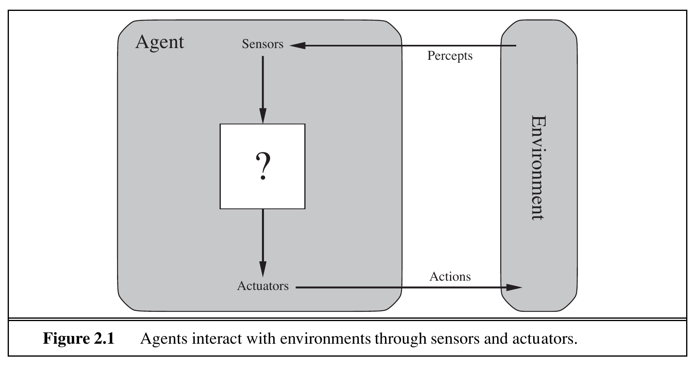
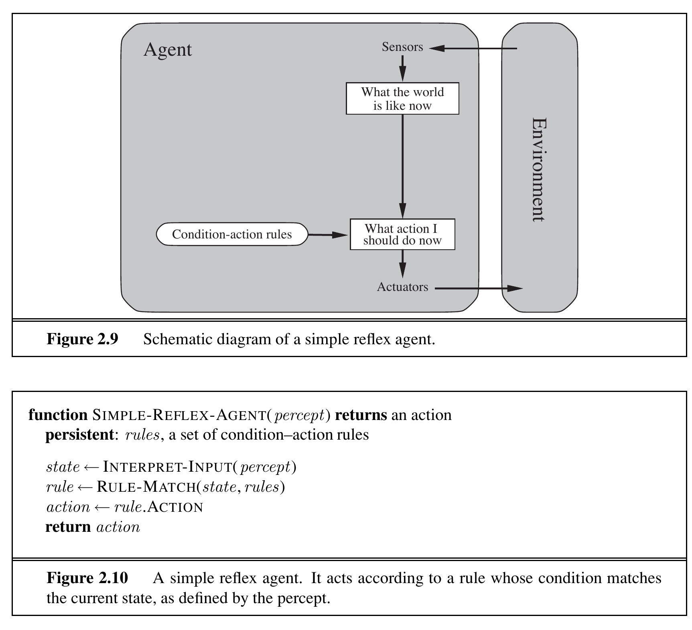
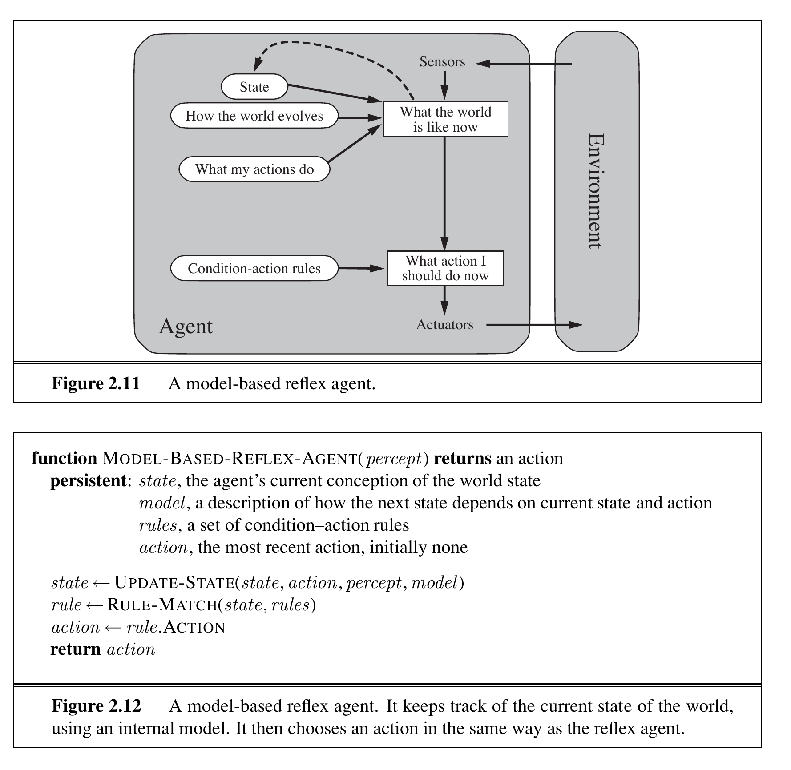
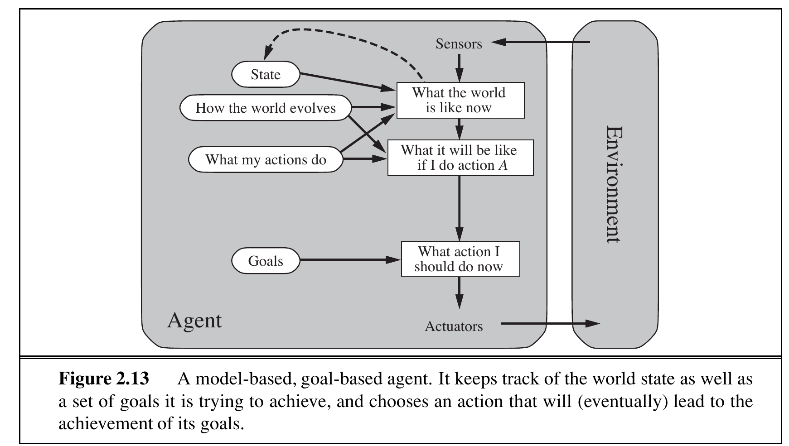
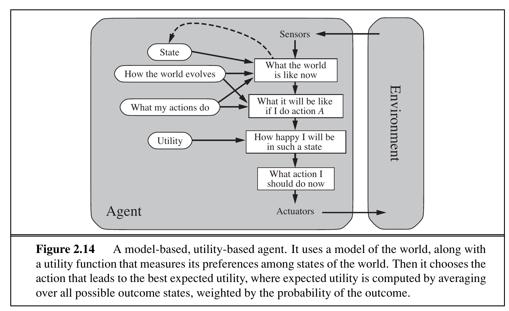
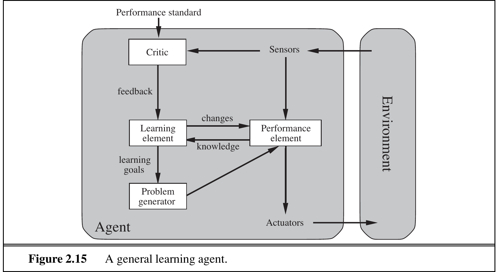
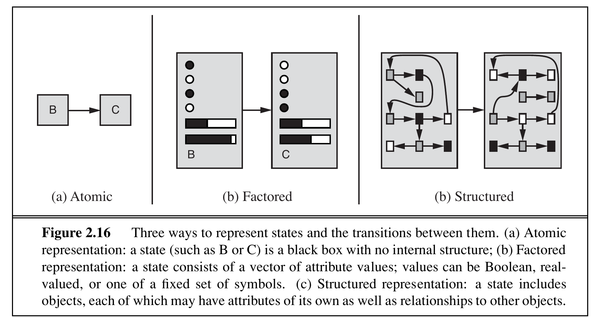


# Intelligent Agents

In which we discuss the nature of agents, perfect or otherwise, the diversity of environments, and the resulting menagerie of agent types.

## Agents and Environments

<div style="border-left:4px solid #1a5c9e;background:#f0f4f8;padding:14px 18px;margin:18px 0;border-radius:6px;">

Agent

An **agent** is anything that can be viewed as perceiving its environment through **sensors** and acting upon that environment through **actuators**.

</div>

<div style="border-left:4px solid #1a5c9e;background:#f0f4f8;padding:14px 18px;margin:18px 0;border-radius:6px;">

Percept and Percept Sequence

A **percept** is the agent’s perceptual input at any given instant. An agent’s **percept sequence** is the complete history of everything the agent has ever perceived.

</div>

<div style="border-left:4px solid #1a5c9e;background:#f0f4f8;padding:14px 18px;margin:18px 0;border-radius:6px;">

Agent Function and Agent Program

The **agent function** maps any given percept sequence to an action. The **agent program** is a concrete implementation of the agent function, running on some physical architecture.

</div>

$$f : \mathcal{P}^* \rightarrow \mathcal{A}$$

where $\mathcal{P}$ is the set of possible percepts and $\mathcal{A}$ is the set of possible actions.

<figure>

<figcaption>Agents interact with environments through sensors and actuators.</figcaption>
</figure>

An agent’s choice of action at any instant can depend on the entire percept sequence observed to date, but not on anything it hasn’t perceived. The agent function is an abstract mathematical description; the agent program is a concrete implementation running within some physical system.

<div style="border-left:4px solid #2e7d32;background:#e8f5e9;padding:14px 18px;margin:18px 0;border-radius:6px;">

Types of Agents

- **Human agent**: sensors include eyes, ears, skin; actuators include hands, legs, vocal tract.

- **Robotic agent**: sensors include cameras, infrared range finders; actuators include motors, grippers.

- **Software agent** (softbot): sensors include keystrokes, file contents, network packets; actuators include displays, file writes, network messages.

</div>

<div style="border-left:4px solid #2e7d32;background:#e8f5e9;padding:14px 18px;margin:18px 0;border-radius:6px;">

Vacuum-Cleaner World

Consider a world with two locations: squares A and B. The vacuum agent perceives which square it is in and whether there is dirt. Actions are: move left, move right, suck, or do nothing.

A simple rule: if the current square is dirty, suck; otherwise, move to the other square.

</div>

| Percept sequence           | Action   |
|:---------------------------|:---------|
| \[A, Clean\]               | Right    |
| \[A, Dirty\]               | Suck     |
| \[B, Clean\]               | Left     |
| \[B, Dirty\]               | Suck     |
| \[A, Clean\], \[A, Clean\] | Right    |
| \[A, Clean\], \[A, Dirty\] | Suck     |
| $\vdots$                   | $\vdots$ |

Partial tabulation of a simple vacuum-cleaner agent function

The notion of an agent is a tool for analyzing systems, not an absolute characterization. A hand-held calculator could be viewed as an agent, but such an analysis would hardly aid understanding. AI operates at the most interesting end of the spectrum, where artifacts have significant computational resources and the task environment requires nontrivial decision making.

## Good Behavior: The Concept of Rationality

<div style="border-left:4px solid #1a5c9e;background:#f0f4f8;padding:14px 18px;margin:18px 0;border-radius:6px;">

Rational Agent

A **rational agent** is one that does the right thing. For each possible percept sequence, a rational agent should select an action that is expected to maximize its performance measure, given the evidence provided by the percept sequence and whatever built-in knowledge the agent has.

</div>

$$a^* = \operatorname{argmax}_{a \in \mathcal{A}} \mathbb{E}\big[P(s) \mid \text{percept sequence}, \text{prior knowledge}\big]$$

where $P(s)$ is the performance measure evaluating environment state $s$, and $\mathbb{E}$ denotes expected value.

<div style="border-left:4px solid #1a5c9e;background:#f0f4f8;padding:14px 18px;margin:18px 0;border-radius:6px;">

Performance Measure

A **performance measure** evaluates any given sequence of environment states. It captures the designer’s notion of what constitutes success. The performance measure must be defined externally, not by the agent’s own opinion of its performance.

</div>

Good performance measures reward what we actually want, not how we think the agent should behave. For example, a vacuum agent rewarded for dirt cleaned up might dump and re-clean dirt repeatedly. A better measure rewards clean floors over time.

### Rationality Depends on Four Things

What is rational at any given time depends on:

1.  The **performance measure** defining success.

2.  The agent’s **prior knowledge** of the environment.

3.  The **actions** the agent can perform.

4.  The agent’s **percept sequence** to date.

<div style="border-left:4px solid #2e7d32;background:#e8f5e9;padding:14px 18px;margin:18px 0;border-radius:6px;">

Rational Vacuum Agent

Given:

- Performance measure: 1 point per clean square per time step (1000 steps).

- Known geography: two squares A and B; cleaning stays; actions move or suck.

- Actions: Left, Right, Suck.

- Percepts: location and dirt status.

The agent that sucks when dirty and moves otherwise is rational under these conditions. It would be irrational if movements carried a penalty, if dirt could reappear, or if geography were unknown.

</div>

### Omniscience, Learning, and Autonomy

<div style="border-left:4px solid #1a5c9e;background:#f0f4f8;padding:14px 18px;margin:18px 0;border-radius:6px;">

Omniscience vs. Information Gathering

An **omniscient** agent knows the actual outcome of its actions. Omniscience is impossible in reality. Rationality maximizes *expected* performance, not *actual* performance. **Information gathering** – performing actions to modify future percepts – is an important part of rationality.

</div>

<div style="border-left:4px solid #1a5c9e;background:#f0f4f8;padding:14px 18px;margin:18px 0;border-radius:6px;">

Exploration and Learning

**Exploration** is information gathering in initially unknown environments. **Learning** allows an agent to modify its behavior based on experience, compensating for partial or incorrect prior knowledge.

</div>

<div style="border-left:4px solid #1a5c9e;background:#f0f4f8;padding:14px 18px;margin:18px 0;border-radius:6px;">

Autonomy

An agent is **autonomous** to the extent that its behavior depends on its own experience rather than on the designer’s prior knowledge. A rational agent should learn what it can to compensate for incomplete prior knowledge.

</div>

<div style="border-left:4px solid #2e7d32;background:#e8f5e9;padding:14px 18px;margin:18px 0;border-radius:6px;">

Rationality vs. Perfection

Crossing a street when no traffic is visible is rational – the expected outcome is safe passage. If a cargo door falls from an airliner and strikes you mid-crossing, the outcome was bad, but the decision was still rational. Rationality is not the same as perfection.

</div>

<div style="border-left:4px solid #2e7d32;background:#e8f5e9;padding:14px 18px;margin:18px 0;border-radius:6px;">

Learning in the Sphex Wasp

The sphex wasp follows a fixed plan: dig burrow, sting caterpillar, drag it in, check burrow, lay eggs. If a researcher moves the caterpillar during the check phase, the wasp repeats the drag step endlessly. It cannot learn that its plan is failing. A rational, autonomous agent would recognize the failure and adapt.

</div>

## The Nature of Environments

<div style="border-left:4px solid #1a5c9e;background:#f0f4f8;padding:14px 18px;margin:18px 0;border-radius:6px;">

Task Environment

A **task environment** is the “problem” to which a rational agent is the “solution.” It is specified by the PEAS description: Performance measure, Environment, Actuators, Sensors.

</div>

### Specifying the Task Environment with PEAS

The first step in designing an agent is to fully specify its task environment using PEAS.

| **Agent**   | **Taxi driver**                                                                     |     |
|:------------|:------------------------------------------------------------------------------------|:----|
| Performance | Safe, fast, legal, comfortable trip; maximize profits                               |     |
| Environment | Roads, other traffic, pedestrians, customers                                        |     |
| Actuators   | Steering, accelerator, brake, signal, horn, display                                 |     |
| Sensors     | Cameras, sonar, speedometer, GPS, odometer, accelerometer, engine sensors, keyboard |     |

PEAS description for an automated taxi driver

| **Agent Type**            | **Performance**                | **Environment**                 | **Actuators**                          | **Sensors**                             |
|:--------------------------|:-------------------------------|:--------------------------------|:---------------------------------------|:----------------------------------------|
| Medical diagnosis         | Healthy patient, reduced costs | Patient, hospital, staff        | Display of questions, tests, diagnoses | Keyboard entry of symptoms              |
| Satellite image analysis  | Correct categorization         | Downlink from satellite         | Display of categorization              | Color pixel arrays                      |
| Part-picking robot        | Percentage in correct bins     | Conveyor belt with parts        | Jointed arm and hand                   | Camera, joint angle sensors             |
| Refinery controller       | Purity, yield, safety          | Refinery, operators             | Valves, pumps, heaters, displays       | Temperature, pressure, chemical sensors |
| Interactive English tutor | Student’s score on test        | Set of students, testing agency | Display of exercises, suggestions      | Keyboard entry                          |

PEAS descriptions for various agent types

### Properties of Task Environments

Task environments can be categorized along seven key dimensions. These dimensions determine the appropriate agent design and the applicability of different AI techniques.

<div style="border-left:4px solid #1a5c9e;background:#f0f4f8;padding:14px 18px;margin:18px 0;border-radius:6px;">

Environment Classifications

The seven dichotomies categorize environments along these dimensions:

1.  Fully observable vs. Partially observable vs. Unobservable

2.  Single-agent vs. Multiagent (competitive vs. cooperative)

3.  Deterministic vs. Stochastic vs. Uncertain vs. Nondeterministic

4.  Episodic vs. Sequential

5.  Static vs. Dynamic vs. Semidynamic

6.  Discrete vs. Continuous

7.  Known vs. Unknown

</div>

*Figure: The seven dimensions of task environment classification (part 1/2): observability, agents, determinism, and task structure.*

*Figure: The seven dimensions of task environment classification (part 2/2): dynamism, state/time, and prior knowledge.*

#### Fully Observable vs. Partially Observable

If an agent’s sensors give it access to the complete state of the environment at each point in time, the environment is **fully observable**. Otherwise, it is **partially observable**. An environment with no sensors at all is **unobservable**. Fully observable environments are convenient because the agent need not maintain internal state.

<div style="border-left:4px solid #2e7d32;background:#e8f5e9;padding:14px 18px;margin:18px 0;border-radius:6px;">

Observability Examples

- **Fully observable**: Chess (the board state is fully visible).

- **Partially observable**: Poker (opponents’ cards are hidden); Taxi driving (other drivers’ intentions are unknown).

- **Unobservable**: A blind agent with no sensors at all.

</div>

#### Single Agent vs. Multiagent

A **single-agent** environment contains only one agent making decisions. A **multiagent** environment contains other agents whose behavior affects performance. Multiagent environments can be **competitive** (e.g., chess) or **cooperative** (e.g., taxi driving where avoiding collisions benefits all).

<div style="border-left:4px solid #2e7d32;background:#e8f5e9;padding:14px 18px;margin:18px 0;border-radius:6px;">

Agent Count Examples

- **Single agent**: Crossword puzzle solver.

- **Competitive multiagent**: Chess (one player’s win is the other’s loss).

- **Cooperative multiagent**: Traffic (all drivers benefit from avoiding collisions).

</div>

#### Deterministic vs. Stochastic

If the next state of the environment is completely determined by the current state and the agent’s action, the environment is **deterministic**. Otherwise, it is **stochastic**. An environment is **uncertain** if it is not fully observable or not deterministic. **Nondeterministic** environments describe possible outcomes without probabilities.

<div style="border-left:4px solid #2e7d32;background:#e8f5e9;padding:14px 18px;margin:18px 0;border-radius:6px;">

Determinism Examples

- **Deterministic**: Chess (move outcomes are fixed by the rules).

- **Stochastic**: Taxi driving (traffic, weather, tire blowouts are unpredictable).

- **Nondeterministic**: An action with possible outcomes $\{a, b, c\}$ but no probabilities assigned.

</div>

#### Episodic vs. Sequential

In an **episodic** environment, each episode is independent; the next episode does not depend on previous actions. In a **sequential** environment, current decisions affect all future decisions.

<div style="border-left:4px solid #2e7d32;background:#e8f5e9;padding:14px 18px;margin:18px 0;border-radius:6px;">

Episodicity Examples

- **Episodic**: Defective part detection on an assembly line.

- **Sequential**: Chess (each move affects all subsequent moves); Taxi driving (a wrong turn can cause lasting delay).

</div>

#### Static vs. Dynamic

If the environment can change while the agent is deliberating, it is **dynamic**. Otherwise, it is **static**. In a **semidynamic** environment, the environment itself does not change, but the agent’s performance score does.

<div style="border-left:4px solid #2e7d32;background:#e8f5e9;padding:14px 18px;margin:18px 0;border-radius:6px;">

Dynamics Examples

- **Static**: Crossword puzzle.

- **Dynamic**: Taxi driving (cars move while you decide).

- **Semidynamic**: Chess with a clock (board is static but time ticks).

</div>

#### Discrete vs. Continuous

The **discrete/continuous** distinction applies to states, time, percepts, and actions. Discrete environments have a finite number of distinct states; continuous environments have smoothly varying values.

<div style="border-left:4px solid #2e7d32;background:#e8f5e9;padding:14px 18px;margin:18px 0;border-radius:6px;">

Discreteness Examples

- **Discrete**: Chess (finite board positions); Backgammon (21 dice outcomes).

- **Continuous**: Taxi driving (speed, location, steering angle vary continuously).

</div>

#### Known vs. Unknown

In a **known** environment, the outcomes of all actions are given. In an **unknown** environment, the agent must learn how the world works. This distinction refers to the agent’s state of knowledge, not the environment itself.

<div style="border-left:4px solid #2e7d32;background:#e8f5e9;padding:14px 18px;margin:18px 0;border-radius:6px;">

Known-ness Examples

- **Known**: Chess (rules are known).

- **Unknown**: A new video game (must learn what buttons do by trying).

A known environment can be partially observable (solitaire – I know the rules but not the hidden cards). An unknown environment can be fully observable (new video game – full screen display but unknown button effects).

</div>

| Task Environment    | Observable | Agents | Deterministic |  Episodic  |   Static    |  Discrete  |
|:--------------------|:----------:|:------:|:-------------:|:----------:|:-----------:|:----------:|
| Crossword puzzle    |   Fully    | Single | Deterministic | Sequential |   Static    |  Discrete  |
| Chess (with clock)  |   Fully    | Multi  | Deterministic | Sequential | Semidynamic |  Discrete  |
| Poker               | Partially  | Multi  |  Stochastic   | Sequential |   Static    |  Discrete  |
| Backgammon          |   Fully    | Multi  |  Stochastic   | Sequential |   Static    |  Discrete  |
| Taxi driving        | Partially  | Multi  |  Stochastic   | Sequential |   Dynamic   | Continuous |
| Medical diagnosis   | Partially  | Single |  Stochastic   | Sequential |   Dynamic   | Continuous |
| Image analysis      |   Fully    | Single | Deterministic |  Episodic  | Semidynamic | Continuous |
| Part-picking robot  | Partially  | Single |  Stochastic   |  Episodic  |   Dynamic   | Continuous |
| Refinery controller | Partially  | Single |  Stochastic   | Sequential |   Dynamic   | Continuous |
| Interactive tutor   | Partially  | Multi  |  Stochastic   | Sequential |   Dynamic   |  Discrete  |

Properties of selected task environments

The hardest environment type is: partially observable, multiagent, stochastic, sequential, dynamic, continuous, and unknown. Taxi driving is hard in nearly all these senses, though for the most part it is a known environment.

## The Structure of Agents

<div style="border-left:4px solid #1a5c9e;background:#f0f4f8;padding:14px 18px;margin:18px 0;border-radius:6px;">

Agent Program and Architecture

An **agent program** implements the agent function – the mapping from percepts to actions. The **architecture** is the computing device with physical sensors and actuators on which the program runs: $$\text{agent} = \text{architecture} + \text{program}$$

</div>

The job of AI is to design agent programs that produce rational behavior from a compact program rather than from a vast lookup table. For a taxi, a table-driven agent would need over $10^{250,000,000,000}$ entries for one hour of driving – larger than the number of atoms in the observable universe ($10^{80}$).

We outline five basic kinds of agent programs that embody the principles underlying almost all intelligent systems.

### Simple Reflex Agents

<div style="border-left:4px solid #1a5c9e;background:#f0f4f8;padding:14px 18px;margin:18px 0;border-radius:6px;">

Simple Reflex Agent

A **simple reflex agent** selects actions based solely on the current percept, ignoring the rest of the percept history. It uses **condition–action rules** (if–then rules) to map percepts directly to actions.

</div>

<figure>

<figcaption>Schematic diagram of a simple reflex agent</figcaption>
</figure>

```text
	function SIMPLE-REFLEX-AGENT(percept) returns an action
	persistent: rules, a set of condition--action rules
	state <- INTERPRET-INPUT(percept)
	rule <- RULE-MATCH(state, rules)
	action <- rule.ACTION
	return action
```

<div style="border-left:4px solid #2e7d32;background:#e8f5e9;padding:14px 18px;margin:18px 0;border-radius:6px;">

Simple Reflex Vacuum Agent

The vacuum agent program:

```text
		function REFLEX-VACUUM-AGENT([location, status]) returns an action
		if status = Dirty then return Suck
		else if location = A then return Right
		else if location = B then return Left
	
```

This program implements the agent function from the vacuum world table in Section <a href="#sec:agents-environments" data-reference-type="ref" data-reference="sec:agents-environments">[sec:agents-environments]</a>. It ignores percept history, reducing the table from $4^T$ entries to just $4$ rules.

</div>

Simple reflex agents are limited: they work only if the environment is fully observable. Even a little unobservability can cause infinite loops. Escape is possible through randomization, but more sophisticated agents handle this better.

### Model-Based Reflex Agents

<div style="border-left:4px solid #1a5c9e;background:#f0f4f8;padding:14px 18px;margin:18px 0;border-radius:6px;">

Model-Based Reflex Agent

A **model-based reflex agent** maintains **internal state** that depends on the percept history, allowing it to handle partial observability. It uses a **model** of the world – knowledge about how the world evolves independently of the agent and how the agent’s own actions affect the world.

</div>

<figure>

<figcaption>A model-based reflex agent with internal state</figcaption>
</figure>

```text
	function MODEL-BASED-REFLEX-AGENT(percept) returns an action
	persistent: state, the agent's current conception of the world
	model, description of how next state depends on current state and action
	rules, a set of condition--action rules
	action, the most recent action, initially none
	state <- UPDATE-STATE(state, action, percept, model)
	rule <- RULE-MATCH(state, rules)
	action <- rule.ACTION
	return action
```

<div style="border-left:4px solid #2e7d32;background:#e8f5e9;padding:14px 18px;margin:18px 0;border-radius:6px;">

Model-Based Taxi Agent

A taxi driver uses internal state to track vehicles that are temporarily out of sight. The car in front’s brake lights may be ambiguous in a single frame, but comparing the current and previous frames reveals which lights are brake lights versus turn signals. The model encodes knowledge like “an overtaking car generally gets closer behind over time.”

</div>

### Goal-Based Agents

<div style="border-left:4px solid #1a5c9e;background:#f0f4f8;padding:14px 18px;margin:18px 0;border-radius:6px;">

Goal-Based Agent

A **goal-based agent** combines a model of the world with **goal information** that describes desirable situations. It chooses actions that achieve the goal, often by searching through sequences of actions.

</div>

<figure>

<figcaption>A model-based, goal-based agent</figcaption>
</figure>

```text
	function GOAL-BASED-AGENT(percept) returns an action
	persistent: state, model, goals
	state <- UPDATE-STATE(state, action, percept, model)
	plan <- SEARCH(state, goals, model)
	if plan is not empty then
	action <- FIRST(plan)
	else
	action <- a default action
	return action
```

Goal-based agents search through possible action sequences to find one that achieves the goal. This search can be computationally expensive, but it provides enormous flexibility.

<div style="border-left:4px solid #2e7d32;background:#e8f5e9;padding:14px 18px;margin:18px 0;border-radius:6px;">

Goal-Based Taxi Agent

At a junction, the taxi can turn left, turn right, or go straight. The correct decision depends on the goal destination. The agent uses its model to predict outcomes and searches for an action sequence leading to the goal. Goal-based agents are more flexible than reflex agents: changing the destination requires only updating the goal, not rewriting all rules.

</div>

### Utility-Based Agents

<div style="border-left:4px solid #1a5c9e;background:#f0f4f8;padding:14px 18px;margin:18px 0;border-radius:6px;">

Utility-Based Agent

A **utility-based agent** uses a **utility function** that assigns a numerical measure of happiness to each state. It chooses the action that maximizes **expected utility**, weighing the likelihood of success against the importance of goals.

</div>

$$EU(a) = \sum_{s'} P(s' \mid a, s) \cdot U(s')$$

The agent selects $a^* = \operatorname{argmax}_a EU(a)$.

<div style="border-left:4px solid #1a5c9e;background:#f0f4f8;padding:14px 18px;margin:18px 0;border-radius:6px;">

Utility Function

The **utility function** $U(s)$ internalizes the performance measure. If the internal utility and external performance measure agree, then maximizing utility produces rational behavior according to the performance measure.

</div>

```text
	function UTILITY-BASED-AGENT(percept) returns an action
	persistent: state, model, utility
	state <- UPDATE-STATE(state, action, percept, model)
	for each action a do
	expected[a] <- SUM_{s'} P(s' | a, state) * U(s')
	return argmax_a expected[a]
```

<figure>

<figcaption>A model-based, utility-based agent</figcaption>
</figure>

<div style="border-left:4px solid #2e7d32;background:#e8f5e9;padding:14px 18px;margin:18px 0;border-radius:6px;">

Utility-Based Taxi Agent

Goals provide a binary distinction (happy vs. unhappy), but utility allows comparison. Multiple action sequences reach the destination, but some are quicker, safer, cheaper, or more reliable. When goals conflict (speed vs. safety), utility specifies the appropriate tradeoff. When no goal is achievable with certainty, utility weighs success likelihood against importance.

</div>

### Learning Agents

<div style="border-left:4px solid #1a5c9e;background:#f0f4f8;padding:14px 18px;margin:18px 0;border-radius:6px;">

Learning Agent

A **learning agent** improves its performance over time. It has four conceptual components: the **learning element** (responsible for making improvements), the **performance element** (selects external actions), the **critic** (provides feedback on performance), and the **problem generator** (suggests exploratory actions).

</div>

<figure>

<figcaption>A general learning agent</figcaption>
</figure>

<div style="border-left:4px solid #1a5c9e;background:#f0f4f8;padding:14px 18px;margin:18px 0;border-radius:6px;">

Learning Agent Components

- **Performance element**: the entire decision-making body; takes in percepts and selects actions.

- **Learning element**: uses feedback from the critic to modify the performance element for future improvement.

- **Critic**: evaluates the agent’s performance against a fixed **performance standard** (external to the agent).

- **Problem generator**: suggests exploratory actions that may be suboptimal short-term but discover better long-term strategies.

</div>

<div style="border-left:4px solid #2e7d32;background:#e8f5e9;padding:14px 18px;margin:18px 0;border-radius:6px;">

Learning Taxi Agent

The taxi drives using its performance element. After a sharp left turn across three lanes, the critic observes the other drivers’ reactions. The learning element formulates a rule: this was a bad action. The problem generator might suggest testing brakes on different road surfaces. Over time, the agent learns how the world evolves and what its actions do, improving overall performance.

</div>

## Knowledge Representation Concepts

<div style="border-left:4px solid #1a5c9e;background:#f0f4f8;padding:14px 18px;margin:18px 0;border-radius:6px;">

Three Levels of Representation

Agent components can represent the environment along an axis of increasing complexity and expressive power: **atomic**, **factored**, and **structured** representations.

</div>

<figure>

<figcaption>Three ways to represent states and transitions: (a) atomic, (b) factored, (c) structured</figcaption>
</figure>

<div style="border-left:4px solid #1a5c9e;background:#f0f4f8;padding:14px 18px;margin:18px 0;border-radius:6px;">

Atomic Representation

In an **atomic representation**, each state of the world is indivisible – it has no internal structure. The state is a black box whose only discernible property is being identical to or different from another state. Search algorithms (Chapters 3–5), HMMs, and MDPs work with atomic representations.

</div>

<div style="border-left:4px solid #2e7d32;background:#e8f5e9;padding:14px 18px;margin:18px 0;border-radius:6px;">

Atomic Representation Example

For the route-finding problem, each state is simply the name of a city (e.g., Arad, Sibiu, Bucharest). The representation treats each city as an indivisible atom. There is no internal structure describing population, weather, or landmarks.

</div>

<div style="border-left:4px solid #1a5c9e;background:#f0f4f8;padding:14px 18px;margin:18px 0;border-radius:6px;">

Factored Representation

A **factored representation** splits each state into a fixed set of **variables** or **attributes**, each of which can have a **value**. Different states can share attribute values, making it easier to work out how to transform one state into another. Factored representations also support representing uncertainty (blank attributes).

</div>

<div style="border-left:4px solid #2e7d32;background:#e8f5e9;padding:14px 18px;margin:18px 0;border-radius:6px;">

Factored Representation Example

A taxi’s state might include variables: location (GPS coordinates), fuel level (0–100), oil warning light (on/off), speed (mph), and radio station. Two states can share the same location but differ in fuel level. CSPs, propositional logic, planning, and Bayesian networks use factored representations.

</div>

<div style="border-left:4px solid #1a5c9e;background:#f0f4f8;padding:14px 18px;margin:18px 0;border-radius:6px;">

Structured Representation

A **structured representation** describes objects and their relationships explicitly. It can capture complex scenarios involving multiple objects with varying attributes and relationships, which would be impractical in a factored representation.

</div>

<div style="border-left:4px solid #2e7d32;background:#e8f5e9;padding:14px 18px;margin:18px 0;border-radius:6px;">

Structured Representation Example

“A large truck ahead is reversing into a dairy farm driveway, but a loose cow is blocking the truck’s path.” This scenario involves objects (truck, cow, driveway) with relationships (blocking, reversing into). Encoding this in a factored representation would require an impractical number of specific attributes. First-order logic, relational databases, and natural language understanding use structured representations.

</div>

More expressive representations are more concise but make reasoning and learning more complex. Real-world intelligent systems may need to operate at all points along this axis simultaneously.


