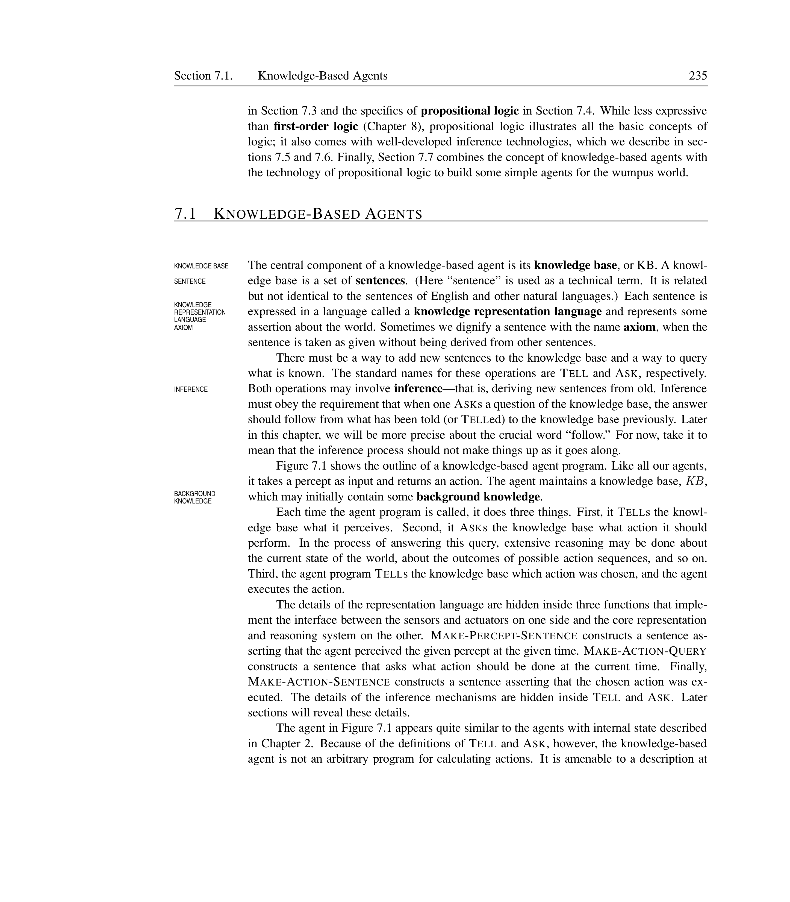
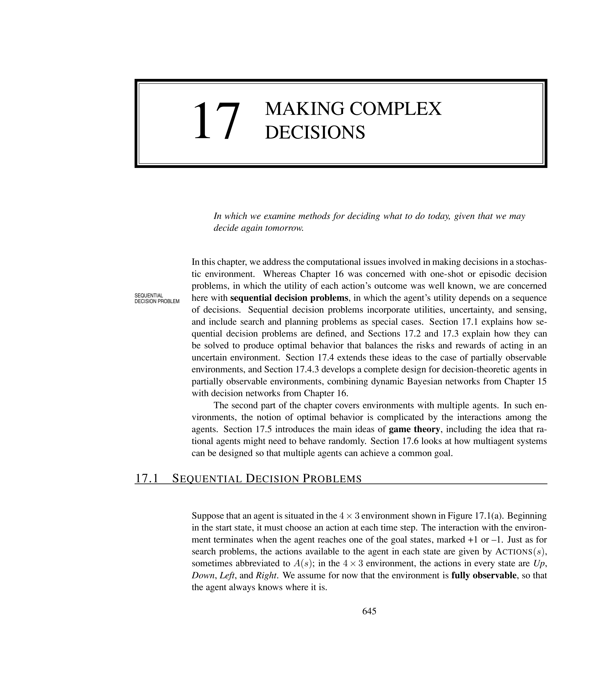

# Solving Problems by Searching


Search is the fundamental mechanism by which an intelligent agent can
deliberate about the future.  Instead of acting reflexively, a
problem-solving agent can consider multiple sequences of actions,
evaluate which ones lead to desirable states, and then execute the
best plan.  This chapter introduces the core concepts of problem
formulation, search trees, uninformed and informed search strategies,
and the heuristic functions that make informed search efficient.

% ===================================================================
## Problem-Solving Agents


<div style="border-left: 4px solid #1a5c9e; background-color: #f0f4f8; padding: 15px; margin: 20px 0; border-radius: 4px;">
<strong>📖 Problem-Solving Agent</strong>

An agent that decides \emph{what to do} by finding a sequence of
  actions that leads from the current state to a goal state.  The
  agent formulates a representation of the problem, searches for a
  solution, and then executes the resulting action sequence.

</div>


A problem-solving agent operates in four distinct phases:
**goal formulation**, **problem formulation**,
**search**, and **execution**.

\paragraph{Goal formulation.}  The agent decides which states of the
world are desirable.  A goal is a set of world states --- any state
satisfying the goal is an acceptable end point.  For example, a
vacuum-cleaning agent might adopt the goal ``both squares are clean''.

\paragraph{Problem formulation.}  The agent decides what
actions and states to consider in its search for a way to reach the
goal.  This is where **abstraction** enters: the agent removes
irrelevant details of the world and keeps only the aspects needed for
decision-making.

\paragraph{Search.}  The agent explores the space of possible action
sequences (the **search space**) to find a sequence that
transforms the initial state into a goal state.  The output of search
is a **solution** --- a sequence of actions.

\paragraph{Execution.}  The agent carries out the actions in the
solution, one by one.  In the simplest case the agent assumes its own
actions are deterministic and the environment is static, so execution
requires no additional problem-solving.

[htbp]





*Caption: The problem-solving agent cycle.  Goals drive problem
  formulation; search produces a solution; execution carries it out.
  After execution the agent may adopt a new goal.*


\end{figure}

### Abstraction

Abstraction is crucial for making problem-solving tractable.  A
**valid abstraction** preserves the essential structure --- any
action that is possible in the abstracted world must be possible to
implement in the real world, and any solution found in the abstract
space must be executable in the concrete world.


<div style="border-left: 4px solid #2e7d32; background-color: #e8f5e9; padding: 15px; margin: 20px 0; border-radius: 4px;">
<strong>💡 Abstraction in Travel Planning</strong>

When planning a trip from Boston to New York, a problem-solving
  agent abstracts away details such as which lane to drive in, which
  song is playing on the radio, or the colour of passing cars.  It
  keeps only the road network, distances, and maybe traffic
  conditions.  The resulting plan --- ``take I-95 South for 200~miles''
  --- can be executed at the concrete level because the abstraction
  preserved the essential actions (turn, accelerate, follow road) and
  removed irrelevant details.

</div>


% ===================================================================
## Example Problems


Search problems fall into two broad categories: **toy problems**
that illustrate concepts, and **real-world problems** that arise
in genuine applications.

### Toy Problems


<div style="border-left: 4px solid #1a5c9e; background-color: #f0f4f8; padding: 15px; margin: 20px 0; border-radius: 4px;">
<strong>📖 Toy Problem</strong>

A simplified, often artificial problem designed to demonstrate or
  test search algorithms.  Toy problems are small enough that the
  optimal solution can be verified by inspection, yet rich enough to
  expose the behaviour of different search strategies.

</div>


\paragraph{The Romania travel problem.}
This is the running example used throughout AIMA.  The agent is in
Arad, Romania, and wants to reach Bucharest.  Actions are driving
from one city to a neighbouring city along the road network.  The
cost of each action is the distance in kilometres.  The goal is
arriving in Bucharest.

[htbp]





*Caption: A simplified road map of part of Romania.  Edge labels are
  distances in kilometres.  The problem is to find a path from Arad to
  Bucharest.  (Based on AIMA Figure~3.2.)*


\end{figure}

\paragraph{The vacuum world.}
A two-square environment in which a vacuum cleaner can move left,
move right, or suck dirt.  The goal is to clean all squares.  This
problem is useful for comparing how different search strategies handle
a small state space ($2^2 \times 2^2 = 16$ states counting dirt
positions and the agent's location).


<div style="border-left: 4px solid #2e7d32; background-color: #e8f5e9; padding: 15px; margin: 20px 0; border-radius: 4px;">
<strong>💡 Vacuum World States</strong>

**States:** The agent is in one of two squares (Left/Right),
  and each square is either Clean or Dirty.  There are
  $2 \times 2 \times 2 = 8$ states (agent position $\times$ dirt
  status of each square), but if we also include the possibility of
  both squares dirty with the agent in either position, the full set
  is $2 \times 2^2 = 8$ reachable configurations.

  **Initial state:** Any configuration.

  **Actions:** Left, Right, Suck.

  **Goal test:** Both squares are clean.

  **Path cost:** 1 per action.

</div>


\paragraph{The 8-puzzle.}
A $3\times3$ sliding-tile puzzle with eight numbered tiles and one
blank.  The agent slides any tile adjacent to the blank into the blank
position.  The goal is to reach a specified configuration.  The
average solution depth is about 22 moves; the state space has
$9!/2 = 181{,}440$ reachable states.

\paragraph{The 8-queens problem.}
Place eight queens on a chessboard so that no two attack each other.
In the **incremental formulation**, states are partial placements
and actions add a queen to a square; in the **complete-state
  formulation**, each row has exactly one queen and the agent moves
queens to resolve conflicts.

### Real-World Problems


<div style="border-left: 4px solid #1a5c9e; background-color: #f0f4f8; padding: 15px; margin: 20px 0; border-radius: 4px;">
<strong>📖 Real-World Problem</strong>

A problem that arises from a practical application.  These problems
  are typically much larger than toy problems and often have enormous
  state spaces, requiring efficient search and powerful heuristics.

</div>


\paragraph{The travelling salesperson problem (TSP).}
Find the shortest tour that visits each city exactly once and returns
to the start.  The state space is the set of partial tours.  The
number of possible tours is $(n-1)!/2$, making exhaustive search
impossible for $n > 20$.

\paragraph{Robotic assembly.}
A robot must assemble a product from parts.  Each action changes the
configuration of parts in the workspace.  The search space includes
both the order of assembly and the trajectories of the robot arm.

\paragraph{Protein folding.}
Predict the three-dimensional structure of a protein from its amino
acid sequence.  The search is over possible conformations of the
molecule, guided by energy minimisation.  The state space is
astronomically large (Levinthal's paradox).

% ===================================================================
## Searching for Solutions


<div style="border-left: 4px solid #1a5c9e; background-color: #f0f4f8; padding: 15px; margin: 20px 0; border-radius: 4px;">
<strong>📖 Search Tree</strong>

A tree in which the root is the initial state, edges correspond to
  actions, and nodes are states reachable from the root by a sequence
  of actions.  A node in the search tree is a data structure that
  records the state, its parent node, the action that generated it,
  the path cost from the root, and its depth.

</div>


A search algorithm explores the search tree by maintaining a
**frontier** (also called the **open list**) of nodes that
have been generated but not yet expanded.  When a node is expanded,
its child nodes are generated by applying each legal action to the
node's state.  An **explored set** (or **closed list**)
records nodes that have already been expanded to avoid revisiting
them.

[htbp]


*Caption: A partial search tree for the Romania problem starting from
  Arad.  Each node shows the current city; children are generated by
  taking available roads.*


\end{figure}

### Node Data Structure

Each node in the search tree contains:

\begin{itemize}
  \item **State**: the state in the state space that this node
    corresponds to.
  \item **Parent**: the node that generated this node.
  \item **Action**: the action that was applied to the parent's
    state to produce this node's state.
  \item **Path cost** ($g(n)$): the cost of the path from the
    initial state to this node.
  \item **Depth**: the number of steps along the path from the
    initial state.
\end{itemize}

### Tree Search vs.\ Graph Search


<div style="border-left: 4px solid #1a5c9e; background-color: #f0f4f8; padding: 15px; margin: 20px 0; border-radius: 4px;">
<strong>📖 Tree Search</strong>

A search algorithm that explores the search tree without checking
  for repeated states.  The same state may appear as multiple nodes,
  leading to potentially exponential blowup in redundant paths.

</div>


<div style="border-left: 4px solid #1a5c9e; background-color: #f0f4f8; padding: 15px; margin: 20px 0; border-radius: 4px;">
<strong>📖 Graph Search</strong>

A search algorithm that maintains an **explored set** (or
  **closed list**) of states that have already been expanded.
  Before adding a new node to the frontier, graph search checks
  whether its state is already in the explored set or in the frontier.
  This eliminates redundant paths and often reduces the effective
  branching factor dramatically.

</div>


<div style="border-left: 4px solid #2e7d32; background-color: #e8f5e9; padding: 15px; margin: 20px 0; border-radius: 4px;">
<strong>💡 Repeated States in the Romania Problem</strong>

Consider the route Arad $\to$ Sibiu $\to$ Arad.  In tree search,
  the second occurrence of Arad (returning from Sibiu) generates a
  whole new subtree that duplicates everything from the original Arad
  node.  Graph search detects that Arad has already been explored and
  discards this node, saving an exponential amount of work.

</div>


\paragraph{Repeated states} come in three varieties:
\begin{itemize}
  \item **Loopy paths**: paths that revisit a state, creating a
    cycle (e.g., Arad $\to$ Sibiu $\to$ Arad).
  \item **Redundant paths**: different paths that reach the same
    state (e.g., Arad $\to$ Sibiu $\to$ R. Vilcea and
    Arad $\to$ R. Vilcea).
  \item **Transpositions**: different orderings of the same set
    of actions that lead to the same state (common in puzzles).
\end{itemize}

### Pseudocode


<div style="border-left: 4px solid #1a5c9e; background-color: #f0f4f8; padding: 15px; margin: 20px 0; border-radius: 4px;">
<strong>📖 General Search Algorithm</strong>

The following pseudocode captures the structure shared by most
  search algorithms.  The key difference between strategies is how
  nodes are selected from the frontier.

</div>


The general tree-search algorithm:


```text
function tree-search(problem, frontier) returns a solution or failure
  frontier $\leftarrow$ make-node(problem.initial-state)
  loop do
    if empty?(frontier) then return failure
    node $\leftarrow$ pop(frontier)
    if problem.goal-test(node.state) then return node
    for each action in problem.actions(node.state) do
      child $\leftarrow$ make-child-node(problem, node, action)
      frontier $\leftarrow$ insert(child, frontier)
```


The general graph-search algorithm:


```text
function graph-search(problem, frontier) returns a solution or failure
  explored $\leftarrow$ empty set
  frontier $\leftarrow$ make-node(problem.initial-state)
  loop do
    if empty?(frontier) then return failure
    node $\leftarrow$ pop(frontier)
    if problem.goal-test(node.state) then return node
    add node.state to explored
    for each action in problem.actions(node.state) do
      child $\leftarrow$ make-child-node(problem, node, action)
      if child.state not in explored and child.state not in frontier then
        frontier $\leftarrow$ insert(child, frontier)
```


% ===================================================================
## Uninformed Search Strategies


<div style="border-left: 4px solid #1a5c9e; background-color: #f0f4f8; padding: 15px; margin: 20px 0; border-radius: 4px;">
<strong>📖 Uninformed (Blind) Search</strong>

Search that has no information about the number of steps or cost
  from a state to the goal.  The algorithm can only distinguish goal
  states from non-goal states.  Variants differ in the order in which
  nodes are expanded.

</div>


### Breadth-First Search (BFS)


<div style="border-left: 4px solid #1a5c9e; background-color: #f0f4f8; padding: 15px; margin: 20px 0; border-radius: 4px;">
<strong>📖 Breadth-First Search</strong>

A tree-search strategy that expands the shallowest unexpanded node
  first.  The frontier is implemented as a **FIFO queue** (first
  in, first out), so nodes are expanded in order of increasing depth.

</div>


\[
\begin{aligned}
\text{Time: } O(b^d) &\qquad \text{Space: } O(b^d)\\
\text{Complete: } \text{Yes (if $b$ is finite)} &\qquad \text{Optimal: } \text{Yes (if all step costs are equal)}
\end{aligned}
\]

where $b$ is the branching factor and $d$ is the depth of the
shallowest goal.


```text
function bfs(problem) returns a solution or failure
  node $\leftarrow$ make-node(problem.initial-state)
  if problem.goal-test(node.state) then return node
  frontier $\leftarrow$ a FIFO queue with node
  explored $\leftarrow$ empty set
  loop do
    if empty?(frontier) then return failure
    node $\leftarrow$ pop(frontier)
    add node.state to explored
    for each action in problem.actions(node.state) do
      child $\leftarrow$ make-child-node(problem, node, action)
      if child.state not in explored and child.state not in frontier then
        if problem.goal-test(child.state) then return child
        frontier $\leftarrow$ insert(child, frontier)
```


  

<div style="border-left: 4px solid #2e7d32; background-color: #e8f5e9; padding: 15px; margin: 20px 0; border-radius: 4px;">
<strong>💡 BFS on Romania</strong>

Starting from Arad, BFS expands nodes in this order:
  \begin{enumerate}
    \item Arad (depth~0)
    \item Zerind, Sibiu, R.~Vilcea (depth~1)
    \item Oradea, Fagaras, Pitesti, Craiova (depth~2)
  \end{enumerate}
  BFS finds the shallowest goal --- Fagaras $\to$ Bucharest at depth~3
  (Arad, Sibiu, Fagaras, Bucharest) with cost~450, but this is not
  the optimal path (the optimal is Arad, Sibiu, R. Vilcea, Pitesti,
  Bucharest with cost~418).

</div>


### Uniform-Cost Search (UCS)


<div style="border-left: 4px solid #1a5c9e; background-color: #f0f4f8; padding: 15px; margin: 20px 0; border-radius: 4px;">
<strong>📖 Uniform-Cost Search</strong>

A search strategy that expands the node with the lowest path cost
  $g(n)$ first.  The frontier is implemented as a **priority
    queue** ordered by $g(n)$.  UCS is a generalisation of BFS to
  arbitrary step costs; it is equivalent to Dijkstra's algorithm.

</div>


\[
\text{Time: } O(b^{1 + \lfloor C^* / \epsilon \rfloor}) \qquad
\text{Space: } O(b^{1 + \lfloor C^* / \epsilon \rfloor}) \qquad
\text{Complete: } \text{Yes} \qquad
\text{Optimal: } \text{Yes}
\]

where $C^*$ is the optimal cost and $\epsilon$ is the minimum positive
step cost.  UCS reduces to BFS when all step costs are equal.


```text
function ucs(problem) returns a solution or failure
  node $\leftarrow$ make-node(problem.initial-state)
  frontier $\leftarrow$ a priority queue ordered by path cost, with node
  explored $\leftarrow$ empty set
  loop do
    if empty?(frontier) then return failure
    node $\leftarrow$ pop(frontier)
    if problem.goal-test(node.state) then return node
    add node.state to explored
    for each action in problem.actions(node.state) do
      child $\leftarrow$ make-child-node(problem, node, action)
      if child.state not in explored and child.state not in frontier then
        frontier $\leftarrow$ insert(child, frontier)
      else if child.state is in frontier with higher cost then
        replace frontier node with child
```


### Depth-First Search (DFS)


<div style="border-left: 4px solid #1a5c9e; background-color: #f0f4f8; padding: 15px; margin: 20px 0; border-radius: 4px;">
<strong>📖 Depth-First Search</strong>

A tree-search strategy that expands the deepest unexpanded node
  first.  The frontier is implemented as a **LIFO stack** (last
  in, first out).  DFS goes down a path until it reaches a dead end
  (a node with no successors) or the goal, then backtracks.

</div>


\[
\begin{aligned}
\text{Time: } O(b^m) &\qquad \text{Space: } O(bm)\\
\text{Complete: } \text{No} &\qquad \text{Optimal: } \text{No}
\end{aligned}
\]

where $m$ is the maximum depth of the search tree (potentially
infinite).  DFS is prized for its modest memory usage --- it only
stores one path from the root plus the sibling nodes at each level.


```text
function dfs(problem) returns a solution or failure
  node $\leftarrow$ make-node(problem.initial-state)
  frontier $\leftarrow$ a LIFO stack with node
  explored $\leftarrow$ empty set
  loop do
    if empty?(frontier) then return failure
    node $\leftarrow$ pop(frontier)
    if problem.goal-test(node.state) then return node
    add node.state to explored
    for each action in problem.actions(node.state) do
      child $\leftarrow$ make-child-node(problem, node, action)
      if child.state not in explored and child.state not in frontier then
        frontier $\leftarrow$ insert(child, frontier)
```


### Depth-Limited Search (DLS)


<div style="border-left: 4px solid #1a5c9e; background-color: #f0f4f8; padding: 15px; margin: 20px 0; border-radius: 4px;">
<strong>📖 Depth-Limited Search</strong>

A variant of DFS that imposes a depth limit $\ell$.  Nodes at depth
  $\ell$ are treated as if they have no successors.  DLS avoids the
  problem of infinite paths in DFS.

</div>


\[
\text{Time: } O(b^\ell) \qquad
\text{Space: } O(b\ell) \qquad
\text{Complete: } \text{Yes (if $\ell \geq d$)} \qquad
\text{Optimal: } \text{No}
\]

The depth limit $\ell$ is knowledge about the problem.  If $\ell$ is
set too low, DLS may miss all goals; if set too high, it wastes time.

### Iterative Deepening Search (IDS)


<div style="border-left: 4px solid #1a5c9e; background-color: #f0f4f8; padding: 15px; margin: 20px 0; border-radius: 4px;">
<strong>📖 Iterative Deepening Search</strong>

A strategy that repeatedly runs DLS with increasing depth limits:
  0, 1, 2, 3, \dots, until a goal is found.  IDS combines the memory
  efficiency of DFS ($O(bd)$) with the completeness and optimality of
  BFS (for unit step costs).

</div>


\[
\text{Time: } O(b^d) \qquad
\text{Space: } O(bd) \qquad
\text{Complete: } \text{Yes} \qquad
\text{Optimal: } \text{Yes (if step costs are equal)}
\]

The overhead of regenerating nodes at each iteration is surprisingly
small.  For a tree with branching factor~$b$, the fraction of nodes
generated at depth~$d$ relative to shallower depths is
$(b-1)/b^2$, which is less than $11%$ overhead.


```text
function ids(problem) returns a solution or failure
  for depth = 0 to $\infty$ do
    result $\leftarrow$ dls(problem, depth)
    if result $\neq$ cutoff then
      return result
```


<div style="border-left: 4px solid #2e7d32; background-color: #e8f5e9; padding: 15px; margin: 20px 0; border-radius: 4px;">
<strong>💡 IDS on a Binary Tree</strong>

Suppose the goal is at depth~3 in a binary tree ($b=2$, $d=3$).
  IDS generates:
  \begin{itemize}
    \item Depth~0: 1 node
    \item Depth~1: 1 + 2 = 3 nodes (regenerated)
    \item Depth~2: 1 + 2 + 4 = 7 nodes (regenerated)
    \item Depth~3: 1 + 2 + 4 + 8 = 15 nodes (goal found)
  \end{itemize}
  Total: 15 nodes.  BFS would generate $1 + 2 + 4 + 8 = 15$ nodes as
  well.  The space required by BFS is $8$ nodes (the last level),
  while IDS requires only $3$ (the current path plus siblings).

</div>


### Bidirectional Search


<div style="border-left: 4px solid #1a5c9e; background-color: #f0f4f8; padding: 15px; margin: 20px 0; border-radius: 4px;">
<strong>📖 Bidirectional Search</strong>

A search strategy that runs two simultaneous searches: one forward
  from the initial state and one backward from the goal state.  The
  search stops when the two frontiers meet.  The motivation is that
  $b^{d/2} + b^{d/2} \ll b^d$.

</div>


\[
\begin{aligned}
\text{Time: } O(b^{d/2}) &\qquad \text{Space: } O(b^{d/2})\\
\text{Complete: } \text{Yes} &\qquad \text{Optimal: } \text{Depends on implementation}
\end{aligned}
\]

Bidirectional search requires operators that are **reversible**
(we can compute predecessor states from a given state).  For the
Romania road map this is trivial --- roads are undirected --- but for
problems like the 8-puzzle, reversing a move requires care.  In
practice, the two searches typically use BFS or UCS, and the
meeting condition must check for optimality when costs are non-uniform.

### Comparison of Uninformed Search Strategies

[htbp]


\footnotesize
\begin{tabular}{lp{2cm}p{2.5cm}p{1.8cm}p{1.8cm}}
\toprule
Strategy       & Time          & Space          & Complete? & Optimal? \\
\midrule
BFS            & $O(b^d)$      & $O(b^d)$       & Yes       & Yes$^\dagger$ \\
UCS            & $O(b^{1+\lfloor C^*/\epsilon\rfloor})$ & same & Yes & Yes \\
DFS            & $O(b^m)$      & $O(bm)$        & No        & No \\
DLS            & $O(b^\ell)$   & $O(b\ell)$     & No$^\ddagger$ & No \\
IDS            & $O(b^d)$      & $O(bd)$        & Yes       & Yes$^\dagger$ \\
Bidirectional  & $O(b^{d/2})$  & $O(b^{d/2})$   & Yes       & Yes$^\dagger$ \\
\bottomrule
\multicolumn{5}{l}{\footnotesize $^\dagger$ Only if all step costs are equal.}\\
\multicolumn{5}{l}{\footnotesize $^\ddagger$ Yes if $\ell \geq d$, but $\ell$ is not known in advance.}\\
\end{tabular}


*Caption: Comparison of uninformed search strategies.  $b$ is the branching factor, $d$ is the depth of the shallowest goal, $m$ is the maximum search depth, $\ell$ is the depth limit for DLS, $C^*$ is the optimal cost, and $\epsilon$ is the minimum step cost.*

\end{table}

% ===================================================================
## Informed (Heuristic) Search Strategies


<div style="border-left: 4px solid #1a5c9e; background-color: #f0f4f8; padding: 15px; margin: 20px 0; border-radius: 4px;">
<strong>📖 Informed (Heuristic) Search</strong>

Search that uses **domain-specific knowledge** --- a heuristic
  function $h(n)$ --- to guide the exploration towards promising states.
  Heuristic search can dramatically reduce the number of nodes
  expanded compared with uninformed search.

</div>


<div style="border-left: 4px solid #1a5c9e; background-color: #f0f4f8; padding: 15px; margin: 20px 0; border-radius: 4px;">
<strong>📖 Heuristic Function</strong>

A function $h(n)$ that estimates the cost of the cheapest path from
  node $n$ to a goal state.  The notation $h(n)$ is standard: $h$
  for ``heuristic'' and $n$ for the current node.  The heuristic is
  the only additional knowledge an informed search algorithm has
  beyond the problem definition.

</div>


\[
h(n) = \text{estimated cost from $n$ to the nearest goal}
\]

For the Romania problem, the straight-line distance heuristic
$h_{\text{SLD}}(n)$ is the Euclidean distance from city $n$ to
Bucharest.  This is an admissible heuristic because the straight-line
distance is always $\leq$ the actual road distance.

### Greedy Best-First Search


<div style="border-left: 4px solid #1a5c9e; background-color: #f0f4f8; padding: 15px; margin: 20px 0; border-radius: 4px;">
<strong>📖 Greedy Best-First Search</strong>

A search strategy that expands the node that appears closest to the
  goal according to the heuristic.  The frontier is a priority queue
  ordered by $h(n)$ alone.  ``Greedy'' refers to the fact that the
  algorithm minimises estimated remaining cost at each step, with no
  regard for the cost already incurred.

</div>


\[
\text{Evaluation function: } f(n) = h(n)
\]

\[
\begin{aligned}
\text{Time: } O(b^m) &\qquad \text{Space: } O(b^m)\\
\text{Complete: } \text{No} &\qquad \text{Optimal: } \text{No}
\end{aligned}
\]


<div style="border-left: 4px solid #2e7d32; background-color: #e8f5e9; padding: 15px; margin: 20px 0; border-radius: 4px;">
<strong>💡 Greedy Best-First on Romania</strong>

Starting from Arad with $h_{\text{SLD}}$, greedy BFS expands:
  \begin{enumerate}
    \item Arad ($h=366$) $\to$ Sibiu ($h=253$) is the best child
    \item Sibiu ($h=253$) $\to$ Fagaras ($h=176$) is the best child
    \item Fagaras ($h=176$) $\to$ Bucharest ($h=0$) is the best child
  \end{enumerate}
  The path Arad $\to$ Sibiu $\to$ Fagaras $\to$ Bucharest has cost~450.
  While the algorithm found a solution quickly (3 steps), the solution
  is not optimal (optimal is~418).  Greedy BFS took the straightest
  path by straight-line distance, not the shortest by road.

</div>


### A* Search


<div style="border-left: 4px solid #1a5c9e; background-color: #f0f4f8; padding: 15px; margin: 20px 0; border-radius: 4px;">
<strong>📖 A* Search</strong>

The most widely known informed search algorithm.  A* evaluates
  nodes by combining the cost to reach the node ($g(n)$) and the
  estimated cost from the node to the goal ($h(n)$):
  \[
  f(n) = g(n) + h(n)
  \]
  where $f(n)$ is the estimated total cost of a path through $n$ to
  the goal.  A* is **complete** and **optimal** when $h(n)$
  is admissible (never overestimates the true cost).

</div>


\[
\begin{aligned}
\text{Time: } O(b^{\Delta}) &\qquad \text{Space: } O(b^{\Delta})\\
\text{Complete: } \text{Yes} &\qquad \text{Optimal: } \text{Yes (with admissible $h$)}
\end{aligned}
\]

where $\Delta$ is the relative error of the heuristic.


```text
function astar(problem) returns a solution or failure
  node $\leftarrow$ make-node(problem.initial-state)
  frontier $\leftarrow$ priority queue ordered by $f(n) = g(n) + h(n)$
  explored $\leftarrow$ empty set
  loop do
    if empty?(frontier) then return failure
    node $\leftarrow$ pop(frontier)
    if problem.goal-test(node.state) then return node
    add node.state to explored
    for each action in problem.actions(node.state) do
      child $\leftarrow$ make-child-node(problem, node, action)
      if child.state not in explored and child.state not in frontier then
        frontier $\leftarrow$ insert(child, frontier)
      else if child.state is in frontier with higher $f$ then
        replace frontier node with child
```


<div style="border-left: 4px solid #2e7d32; background-color: #e8f5e9; padding: 15px; margin: 20px 0; border-radius: 4px;">
<strong>💡 A* on Romania</strong>

Starting from Arad with $h_{\text{SLD}}$:
  \begin{enumerate}
    \item Arad: $f = 0 + 366 = 366$.
    \item Expand Arad: Zerind ($f = 75 + 374 = 449$), Sibiu
      ($f = 140 + 253 = 393$), Timisoara ($f = 118 + 329 = 447$).
      Choose Sibiu (lowest $f$).
    \item Expand Sibiu: R. Vilcea ($f = 220 + 193 = 413$), Fagaras
      ($f = 239 + 176 = 415$), Oradea ($f = 291 + 380 = 671$).
      Choose R. Vilcea (lowest $f = 413$).
    \item Expand R. Vilcea: Pitesti ($f = 317 + 98 = 415$),
      Craiova ($f = 366 + 160 = 526$).  Choose Pitesti (tied with
      Fagaras, tie-break by convention).
    \item Expand Pitesti: Bucharest ($f = 418 + 0 = 418$).  Goal
      found with optimal cost~418.
  \end{enumerate}
  A* finds the optimal path Arad $\to$ Sibiu $\to$ R. Vilcea $\to$
  Pitesti $\to$ Bucharest costing~418.

</div>


### Iterative Deepening A* (IDA*)


<div style="border-left: 4px solid #1a5c9e; background-color: #f0f4f8; padding: 15px; margin: 20px 0; border-radius: 4px;">
<strong>📖 Iterative Deepening A* (IDA*)</strong>

A memory-efficient variant of A* that uses the same cutoff idea as
  IDS but with a cutoff based on $f$-cost rather than depth.  At each
  iteration, IDA* performs a depth-first search bounded by an
  $f$-cost limit, which is increased in the next iteration to the
  smallest $f$-cost that exceeded the previous limit.

</div>


IDA* retains the linear memory usage of DFS while still being optimal
(provided the heuristic is admissible).  Its main weakness is that it
revisits large numbers of nodes at each iteration, especially when the
number of distinct $f$-cost values is small.

\[
\text{Space: } O(bd) \qquad
\text{Complete: } \text{Yes} \qquad
\text{Optimal: } \text{Yes (with admissible $h$)}
\]

### Recursive Best-First Search (RBFS)


<div style="border-left: 4px solid #1a5c9e; background-color: #f0f4f8; padding: 15px; margin: 20px 0; border-radius: 4px;">
<strong>📖 Recursive Best-First Search (RBFS)</strong>

A recursive search algorithm that uses only linear space but
  produces an optimal solution when the heuristic is admissible.
  RBFS keeps track of the best alternative path available from any
  ancestor node.  When the current path becomes more expensive than
  the best alternative, RBFS backtracks and updates the $f$-cost of
  the node where the cutoff occurred.

</div>


RBFS is more efficient than IDA* on many problems because it avoids
re-expanding nodes that are unlikely to be on the optimal path.
However, it can still suffer from excessive node regeneration when the
heuristic is inaccurate.

% ===================================================================
## Heuristic Functions


A heuristic function is the bridge between uninformed and informed
search.  The quality of a heuristic strongly determines how many nodes
a search algorithm expands.

### Admissibility and Consistency


<div style="border-left: 4px solid #1a5c9e; background-color: #f0f4f8; padding: 15px; margin: 20px 0; border-radius: 4px;">
<strong>📖 Admissible Heuristic</strong>

A heuristic $h(n)$ is **admissible** if it never overestimates
  the true cost to reach the goal:
  \[
  0 \leq h(n) \leq h^*(n) \quad \text{for all nodes $n$}
  \]
  where $h^*(n)$ is the true optimal cost from $n$ to the goal.  An
  admissible heuristic is **optimistic** --- it always believes the
  goal is at least as close as it really is.

</div>


Admissibility is the key property that guarantees A* optimality.  The
straight-line distance $h_{\text{SLD}}$ is admissible for road
networks because Euclidean distance never exceeds the shortest driving
route.


<div style="border-left: 4px solid #1a5c9e; background-color: #f0f4f8; padding: 15px; margin: 20px 0; border-radius: 4px;">
<strong>📖 Consistent (Monotonic) Heuristic</strong>

A heuristic $h(n)$ is **consistent** (or **monotonic**)
  if for every node $n$ and every successor $n'$ of $n$ generated by
  action $a$:
  \[
  h(n) \leq c(n, a, n') + h(n')
  \]
  where $c(n, a, n')$ is the cost of the action.  Equivalently,
  $f(n) = g(n) + h(n)$ is non-decreasing along any path.

</div>


<div style="border-left: 4px solid #0277bd; background-color: #e1f5fe; padding: 15px; margin: 20px 0; border-radius: 4px;">
<strong>ℹ️ Properties</strong>

Every consistent heuristic is admissible, but not every admissible
  heuristic is consistent.  With a consistent heuristic, A* never
  needs to re-open a closed node (the first time a node is expanded,
  it is reached via the optimal path).  The graph-search version of
  A* requires consistency for optimality; tree-search A* only requires
  admissibility.

</div>


### Effective Branching Factor


<div style="border-left: 4px solid #1a5c9e; background-color: #f0f4f8; padding: 15px; margin: 20px 0; border-radius: 4px;">
<strong>📖 Effective Branching Factor ($b^*$)</strong>

A measure of heuristic quality.  If A* expands $N$ nodes and the
  optimal solution depth is $d$, then $b^*$ is the branching factor
  that a uniform tree of depth $d$ would need to have to contain
  $N$ nodes:
  \[
  N = 1 + b^* + (b^*)^2 + \cdots + (b^*)^d
  \]
  A well-designed heuristic has $b^*$ close to~1, meaning it is nearly
  as efficient as having perfect knowledge of the goal direction.

</div>


### Relaxed Problems

A powerful technique for deriving admissible heuristics is to define a
**relaxed problem** --- a simplified version of the original
problem in which some constraints are removed.  The cost of an optimal
solution in the relaxed problem is a lower bound on the cost in the
original problem, and hence an admissible heuristic.


<div style="border-left: 4px solid #2e7d32; background-color: #e8f5e9; padding: 15px; margin: 20px 0; border-radius: 4px;">
<strong>💡 Relaxation for the 8-Puzzle</strong>

**Original problem:** A tile can move from square A to square B
  only if B is adjacent to A and B is blank.

  **Relaxation~1:** A tile can move from A to B if B is
  adjacent to A (ignore the blank condition).  The optimal solution
  cost in this relaxed problem is the Manhattan distance to the goal.

  **Relaxation~2:** A tile can move from A to B (ignore adjacency
  and blank).  The optimal solution cost is the number of misplaced
  tiles (the **misplaced tile heuristic** $h_1$).

  Both $h_1$ and $h_2$ (Manhattan distance) are admissible.  For the
  8-puzzle, $h_2$ dominates $h_1$ --- it is always at least as large and
  never overestimates --- so A* with $h_2$ expands fewer nodes.

</div>


### Pattern Databases


<div style="border-left: 4px solid #1a5c9e; background-color: #f0f4f8; padding: 15px; margin: 20px 0; border-radius: 4px;">
<strong>📖 Pattern Database (PDB)</strong>

A memory structure that stores the exact cost of solving a
  **pattern** --- a subset of the problem's state variables.  For
  example, in the 15-puzzle, a pattern might be the locations of four
  specific tiles.  The pattern database stores precomputed optimal
  solution costs for all possible configurations of the pattern.  The
  heuristic for a full state is the maximum (or sum, if disjoint) of
  the costs of its constituent patterns.

</div>


Pattern databases produce very accurate heuristics.  For the
15-puzzle, a combination of disjoint pattern databases yields a
heuristic that allows A* to find optimal solutions in milliseconds
where simpler heuristics would require millions of node expansions.

### Heuristic Domination


<div style="border-left: 4px solid #1a5c9e; background-color: #f0f4f8; padding: 15px; margin: 20px 0; border-radius: 4px;">
<strong>📖 Domination</strong>

If $h_1(n) \leq h_2(n) \leq h^*(n)$ for all nodes $n$, then $h_2$
  **dominates** $h_1$ and is said to be **more informed**.
  A* with $h_2$ will never expand more nodes than A* with $h_1$
  (assuming tie-breaking does not disadvantage the better heuristic).

</div>


In the 8-puzzle: $h_1$ (misplaced tiles, 0--8) $\leq$ $h_2$ (Manhattan
distance, 0--22) $\leq$ $h^*$ (true optimal cost, up to~31).  A* with
$h_2$ consistently expands fewer nodes than A* with $h_1$.


<div style="border-left: 4px solid #2e7d32; background-color: #e8f5e9; padding: 15px; margin: 20px 0; border-radius: 4px;">
<strong>💡 Heuristic Comparison for the 8-Puzzle</strong>

Consider the start state:
  \[
  \begin{bmatrix}
    1 & 2 & 3 \\
    4 & 5 & 6 \\
    7 & 8 & \cdot
  \end{bmatrix}
  \qquad\text{Goal:}\qquad
  \begin{bmatrix}
    1 & 2 & 3 \\
    4 & 5 & 6 \\
    7 & 8 & \cdot
  \end{bmatrix}
  \]
  This is already the goal state, so $h_1 = h_2 = h^* = 0$.  A more
  revealing example:
  \[
  \begin{bmatrix}
    1 & 2 & 3 \\
    4 & \cdot & 5 \\
    7 & 8 & 6
  \end{bmatrix}
  \]
  Misplaced tiles: tiles 5 and 6 are misplaced, so $h_1 = 2$.
  Manhattan distance: tile 5 at (2,3) needs to go to (2,2) = 1 move;
  tile 6 at (3,3) needs to go to (2,3) = 1 move; total $h_2 = 1 + 1 = 2$
  (the blank is not counted).  The true optimal cost $h^*$ is 2.
  Here $h_1 = h_2 = h^* = 2$: the two misplaced tiles each require exactly one move, so both heuristics are exact for this simple state.  In general $h_1 \leq h_2$, and $h_2$ dominates $h_1$ as discussed above.

</div>


