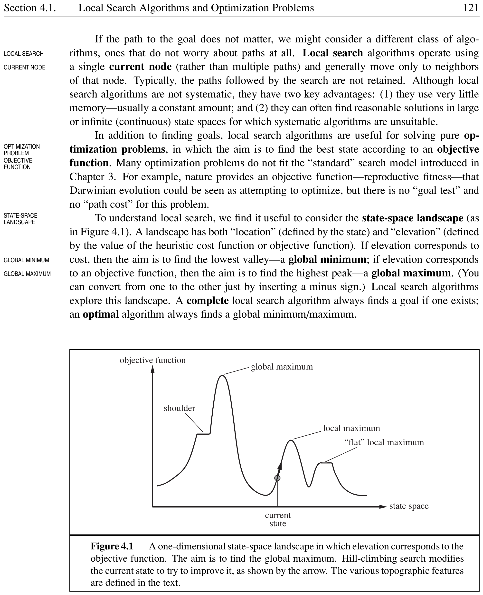
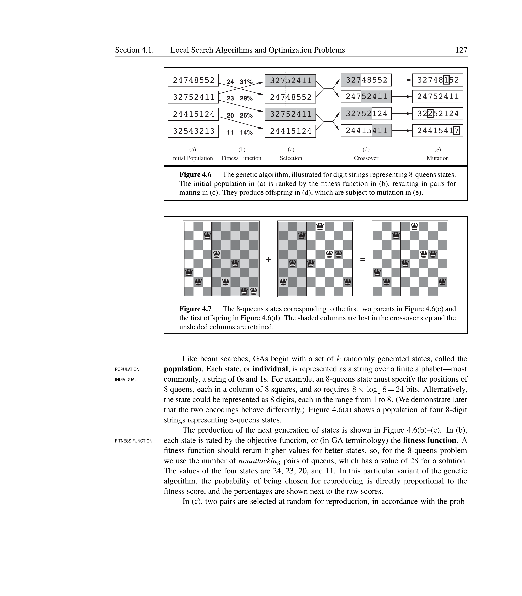
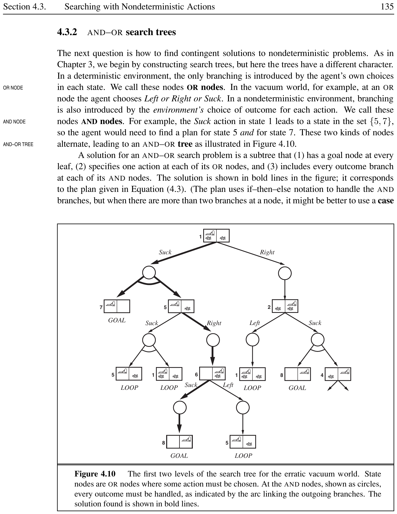
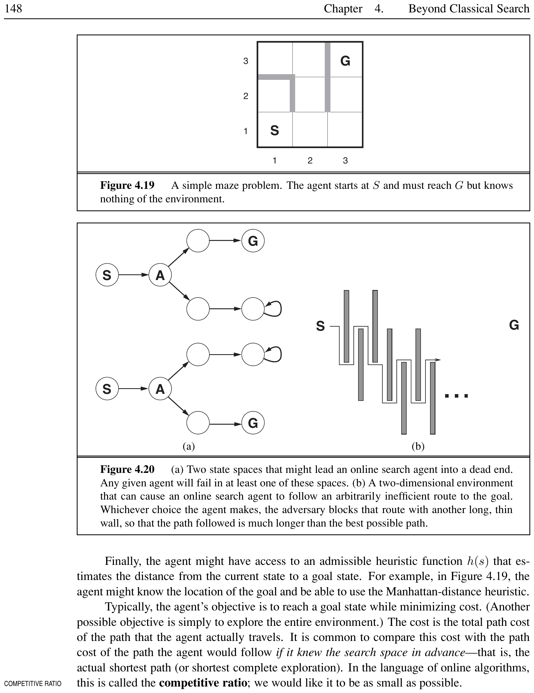

# Beyond Classical Search


Chapter~\ref{ch:solving-problems-searching} covered search in observable, deterministic, known environments where the solution is a sequence of actions. This chapter relaxes those assumptions. We cover local search algorithms that work on complete-state formulations, methods for nondeterministic and partially observable environments, and online search agents that explore unknown spaces.

% ============================================================
## Local Search Algorithms and Optimization Problems


Local search algorithms operate on a single current state (or a small number of states) and move only to neighbors. They do not keep paths in memory. This gives two key advantages: very little memory (usually constant) and the ability to find reasonable solutions in large or continuous state spaces where systematic algorithms are unsuitable.


<div style="border-left: 4px solid #1a5c9e; background-color: #f0f4f8; padding: 15px; margin: 20px 0; border-radius: 4px;">
<strong>📖 Optimization Problem</strong>

An optimization problem is a problem in which the aim is to find the best state according to an **objective function** (also called a **cost function**). The path to the solution does not matter --- only the final state. The state-space **landscape** has locations defined by states and elevation defined by the value of the objective function. A **global maximum** is the highest peak; a **global minimum** is the lowest valley.

</div>


\[
	\text{If elevation = cost: find global minimum} \qquad
	\text{If elevation = objective: find global maximum}
\]

[htbp]
	
	




	
*Caption: A one-dimensional state-space landscape. Elevation corresponds to the objective function. Hill-climbing moves uphill from the current state.*

	
\end{figure}

### Hill-Climbing Search


<div style="border-left: 4px solid #1a5c9e; background-color: #f0f4f8; padding: 15px; margin: 20px 0; border-radius: 4px;">
<strong>📖 Hill-Climbing Search (Steepest Ascent)</strong>

A local search algorithm that continually moves in the direction of increasing value. At each step, it evaluates all neighbors and moves to the best one. It terminates when no neighbor has a higher value than the current state. Also called **greedy local search**.

</div>


<div style="border-left: 4px solid #0277bd; background-color: #e1f5fe; padding: 15px; margin: 20px 0; border-radius: 4px;">
<strong>ℹ️ Hill-Climbing Pseudocode</strong>


```text
function HILL-CLIMBING(problem) returns a state
		current $\gets$ MAKE-NODE(problem.INITIAL-STATE)
		loop do
		neighbor $\gets$ highest-valued successor of current
		if neighbor.VALUE $\le$ current.VALUE then return current.STATE
		current $\gets$ neighbor
```


</div>


Hill climbing does not maintain a search tree. The data structure for the current node needs only the state and the value of the objective function. This resembles trying to find the top of Mount Everest in a thick fog while suffering from amnesia.

**Problems that plague hill climbing:**

\begin{itemize}
	\item **Local maximum:** A peak higher than all neighboring states but lower than the global maximum. The algorithm gets stuck here.
	\item **Ridge:** A sequence of local maxima that is very difficult for greedy algorithms to navigate.
	\item **Plateau:** A flat area of the landscape. It can be a **flat local maximum** (no uphill exit) or a **shoulder** (progress is possible from here).
\end{itemize}

**Variants of hill climbing:**

\begin{itemize}
	\item **Sideways move:** Allow moving to a state with equal value, hoping the plateau is a shoulder. Limit the number of consecutive sideways moves to avoid infinite loops.
	\item **Stochastic hill climbing:** Chooses randomly from among the uphill moves; probability can vary with steepness.
	\item **First-choice hill climbing:** Generates successors randomly until one is better than the current state. Good when states have thousands of successors.
	\item **Random-restart hill climbing:** Conducts a series of hill-climbing searches from randomly generated initial states until a goal is found. Trivially complete with probability approaching 1.
\end{itemize}


<div style="border-left: 4px solid #2e7d32; background-color: #e8f5e9; padding: 15px; margin: 20px 0; border-radius: 4px;">
<strong>💡 8-Queens Example</strong>

In the 8-queens problem, the heuristic cost function $h$ is the number of attacking pairs of queens. Starting from a random configuration with $h = 17$, steepest-ascent hill climbing takes about 5 steps to reach $h = 1$. However, without sideways moves, it gets stuck 86% of the time. Allowing up to 100 consecutive sideways moves raises the success rate to 94%.

</div>


### Simulated Annealing


<div style="border-left: 4px solid #1a5c9e; background-color: #f0f4f8; padding: 15px; margin: 20px 0; border-radius: 4px;">
<strong>📖 Simulated Annealing</strong>

A local search algorithm that combines hill climbing with a random walk to achieve both efficiency and completeness. It allows downhill moves with a probability that decreases over time according to a **temperature schedule**. At high temperatures, bad moves are more likely; at low temperatures, the algorithm behaves like hill climbing.

</div>


The algorithm picks a random successor. If the move improves the situation ($\Delta E > 0$), it is always accepted. Otherwise, it is accepted with probability:

\[
	P(\text{accept}) = e^{\Delta E / T}
\]

where $\Delta E$ is the change in value (negative for bad moves) and $T$ is the current temperature. If the schedule lowers $T$ slowly enough, the algorithm will find a global optimum with probability approaching 1.


<div style="border-left: 4px solid #2e7d32; background-color: #e8f5e9; padding: 15px; margin: 20px 0; border-radius: 4px;">
<strong>💡 Metallurgy Analogy</strong>

In metallurgy, annealing heats metal to a high temperature and then gradually cools it, allowing the material to reach a low-energy crystalline state. Simulated annealing applies the same idea: start by shaking hard (high temperature) and gradually reduce the intensity (lower temperature).

</div>


### Local Beam Search


<div style="border-left: 4px solid #1a5c9e; background-color: #f0f4f8; padding: 15px; margin: 20px 0; border-radius: 4px;">
<strong>📖 Local Beam Search</strong>

An algorithm that keeps track of $k$ states rather than just one. At each step, all successors of all $k$ states are generated. If any is a goal, the algorithm halts. Otherwise, it selects the $k$ best successors from the complete list and repeats.

</div>


Unlike running $k$ random restarts in parallel (independent searches), local beam search passes useful information among the parallel search threads. The states that generate the best successors attract the others.

**Stochastic beam search** chooses $k$ successors at random, with probability proportional to value. This helps maintain diversity among the $k$ states and prevents them from clustering in a small region.

### Genetic Algorithms


<div style="border-left: 4px solid #1a5c9e; background-color: #f0f4f8; padding: 15px; margin: 20px 0; border-radius: 4px;">
<strong>📖 Genetic Algorithm (GA)</strong>

A variant of stochastic beam search in which successor states are generated by combining two parent states rather than modifying a single state. It maintains a **population** of individuals (states), each represented as a string over a finite alphabet. A **fitness function** rates the quality of each individual.

</div>


\[
	\text{Fitness(8-queens)} = \text{number of nonattacking pairs of queens} \quad (\text{max } 28)
\]

[htbp]
	
	




	
*Caption: The genetic algorithm cycle: population, fitness evaluation, selection, crossover, and mutation.*

	
\end{figure}

**Key operations:**

\begin{itemize}
	\item **Selection:** Choose individuals to reproduce, with probability proportional to fitness.
	\item **Crossover:** Combine two parent strings at a randomly chosen crossover point to create offspring.
	\item **Mutation:** Alter each position with a small independent probability.
	\item **Schema:** A substring pattern (e.g., 246*****) describing a subset of states. Schemata with above-average fitness grow in the population over time.
\end{itemize}


<div style="border-left: 4px solid #2e7d32; background-color: #e8f5e9; padding: 15px; margin: 20px 0; border-radius: 4px;">
<strong>💡 8-Queens GA Example</strong>

Population of 4 states: 24748552 (fitness 24), 32752411 (fitness 23), 24415124 (fitness 20), 32543213 (fitness 11). Selection probabilities: 31%, 29%, 26%, 14%. Crossover at position 3 and 5 produces offspring like 32748552 and 24752411. Mutation changes one digit in some offspring.

</div>


[htbp]
	
	


	
*Caption: Classification of local search algorithms covered in this chapter.*

	
\end{figure}

% ============================================================
## Local Search in Continuous Spaces


<div style="border-left: 4px solid #1a5c9e; background-color: #f0f4f8; padding: 15px; margin: 20px 0; border-radius: 4px;">
<strong>📖 Continuous Optimization</strong>

Many real-world environments are continuous --- states are defined by an $n$-dimensional vector of variables $\mathbf{x} = (x_1, x_2, \ldots, x_n)$. The objective function $f(\mathbf{x})$ must be optimized over this continuous space.

</div>


[htbp]
	
	\resizebox{\textwidth}{!}{%
		\begin{tikzpicture}[level distance=1.5cm,
				level 1/.style={sibling distance=3cm},
				level 2/.style={sibling distance=2cm},
				every node/.style={draw, rectangle, rounded corners, font=\footnotesize, align=center, minimum width=1.8cm, minimum height=0.5cm}]
			\node {Continuous\\Optimization}
			child {node {Unconstrained}
					child {node {Gradient\\Descent}}
					child {node {Line Search}}
					child {node {Newton--\\Raphson}}
				}
			child {node {Constrained}
					child {node {Linear\\Programming}}
					child {node {Convex\\Optimization}}
				};
		\end{tikzpicture}%
	}
	
*Caption: Taxonomy of continuous optimization methods.*

	
\end{figure}

**Methods for continuous optimization:**

\begin{itemize}
	\item **Discretization:** Move only by a fixed amount $\pm\delta$ in each coordinate. This gives a finite set of successors for each state.
	\item **Gradient descent (steepest ascent):** Use the gradient $\nabla f$ to find the direction of steepest slope and update:
\end{itemize}

\[
	\mathbf{x} \leftarrow \mathbf{x} + \alpha \nabla f(\mathbf{x})
\]


<div style="border-left: 4px solid #1a5c9e; background-color: #f0f4f8; padding: 15px; margin: 20px 0; border-radius: 4px;">
<strong>📖 Gradient</strong>

The gradient $\nabla f$ is a vector of partial derivatives giving the magnitude and direction of the steepest slope.
	\[
		\nabla f = \left( \frac{\partial f}{\partial x_1}, \frac{\partial f}{\partial x_2}, \ldots, \frac{\partial f}{\partial x_n} \right)
	\]

</div>


**Key concepts:**

\begin{itemize}
	\item **Step size ($\alpha$):** If too small, too many steps are needed. If too large, the search may overshoot the maximum.
	\item **Empirical gradient:** When the objective function is not differentiable, calculate gradient by evaluating response to small increments and decrements in each coordinate.
	\item **Line search:** Extend the current gradient direction by repeatedly doubling $\alpha$ until $f$ starts to decrease again.
	\item **Newton--Raphson method:** Uses the Hessian matrix of second derivatives for faster convergence:
\end{itemize}

\[
	\mathbf{x} \leftarrow \mathbf{x} - \mathbf{H}_f^{-1}(\mathbf{x}) \nabla f(\mathbf{x})
\]


<div style="border-left: 4px solid #1a5c9e; background-color: #f0f4f8; padding: 15px; margin: 20px 0; border-radius: 4px;">
<strong>📖 Constrained Optimization</strong>

An optimization problem with hard constraints on variable values. **Linear programming** deals with linear constraints (forming a convex set) and a linear objective function. **Convex optimization** allows any convex constraint region and any convex objective function. Both are solvable in polynomial time.

</div>


<div style="border-left: 4px solid #2e7d32; background-color: #e8f5e9; padding: 15px; margin: 20px 0; border-radius: 4px;">
<strong>💡 Airport Siting Problem</strong>

Place three new airports anywhere in Romania to minimize the sum of squared distances from each city to its nearest airport. The state space is 6-dimensional: $(x_1, y_1, x_2, y_2, x_3, y_3)$. The objective function sums distances for cities assigned to each airport:
	\[
		f(x_1, y_1, x_2, y_2, x_3, y_3) = \sum_{i=1}^{3} \sum_{c \in C_i} \left[ (x_i - x_c)^2 + (y_i - y_c)^2 \right]
	\]
	where $C_i$ is the set of cities closest to airport $i$.

</div>


% ============================================================
## Searching with Nondeterministic Actions


<div style="border-left: 4px solid #1a5c9e; background-color: #f0f4f8; padding: 15px; margin: 20px 0; border-radius: 4px;">
<strong>📖 Contingency Plan (Strategy)</strong>

When the environment is nondeterministic, the solution to a problem is not a fixed action sequence but a **contingency plan** (or **strategy**) that specifies what to do depending on what percepts are received. Solutions become trees rather than sequences.

</div>


### The Erratic Vacuum World


In the erratic vacuum world, the Suck action is nondeterministic:
\begin{itemize}
	\item Applied to a dirty square: cleans the square and sometimes cleans dirt in an adjacent square.
	\item Applied to a clean square: sometimes deposits dirt.
\end{itemize}

Instead of a single RESULT function, we use a RESULTS function that returns a set of possible outcome states.


<div style="border-left: 4px solid #2e7d32; background-color: #e8f5e9; padding: 15px; margin: 20px 0; border-radius: 4px;">
<strong>💡 Erratic Vacuum Contingency Plan</strong>

Starting in state 1 (both squares dirty, agent in left square):
	\[
		[\text{Suck}, \text{if State} = 5 \text{ then } [\text{Right}, \text{Suck}] \text{ else } [\;]]
	\]
	This plan works for both possible outcomes of the Suck action.

</div>


### AND--OR Search Trees


<div style="border-left: 4px solid #1a5c9e; background-color: #f0f4f8; padding: 15px; margin: 20px 0; border-radius: 4px;">
<strong>📖 AND--OR Search Tree</strong>

A search tree for nondeterministic environments with two types of nodes:
	\begin{itemize}
		\item **OR nodes:** The agent chooses an action (branching by the agent's choice).
		\item **AND nodes:** The environment chooses the outcome (branching by the environment's choice). Every outcome branch must be handled.
	\end{itemize}

</div>


A solution is a subtree that (1) has a goal node at every leaf, (2) specifies one action at each OR node, and (3) includes every outcome branch at each AND node.

[htbp]
	
	




	
*Caption: The first two levels of an AND--OR search tree for the erratic vacuum world. AND nodes (circles) handle environment outcomes; OR nodes (rectangles) handle agent choices. Bold arcs connect AND branches.*

	
\end{figure}

### Cyclic Solutions


In the slippery vacuum world, movement actions sometimes fail. There are no acyclic solutions, but a **cyclic solution** exists: keep trying Right until it works.


<div style="border-left: 4px solid #2e7d32; background-color: #e8f5e9; padding: 15px; margin: 20px 0; border-radius: 4px;">
<strong>💡 Cyclic Plan (Slippery Vacuum World)</strong>

\[
		[\text{Suck}, L_1: \text{Right}, \text{if State} = 5 \text{ then } L_1 \text{ else Suck}]
	\]
	This plan loops until the action succeeds, then proceeds.

</div>


% ============================================================
## Searching with Partial Observations


<div style="border-left: 4px solid #1a5c9e; background-color: #f0f4f8; padding: 15px; margin: 20px 0; border-radius: 4px;">
<strong>📖 Belief State</strong>

The **belief state** represents the set of possible physical states the agent might be in, given the sequence of actions and percepts up to that point. In a partially observable environment, the agent uses its belief state to reason about what to do next.

</div>


[htbp]
	
	


	
*Caption: Belief state update cycle: prediction followed by update based on percept.*

	
\end{figure}

### Searching with No Observation (Sensorless Search)


<div style="border-left: 4px solid #1a5c9e; background-color: #f0f4f8; padding: 15px; margin: 20px 0; border-radius: 4px;">
<strong>📖 Sensorless (Conformant) Problem</strong>

A problem where the agent receives no percepts at all. Despite having no sensors, the agent can often solve problems by using actions to reduce uncertainty. Searching happens in the space of belief states rather than physical states.

</div>


**Key insight:** The agent can **coerce** the world into a goal state by finding an action sequence that works regardless of the actual initial state.


<div style="border-left: 4px solid #2e7d32; background-color: #e8f5e9; padding: 15px; margin: 20px 0; border-radius: 4px;">
<strong>💡 Sensorless Vacuum World</strong>

Initial belief state: $\{1, 2, 3, 4, 5, 6, 7, 8\}$ (complete ignorance). The action sequence [Right, Suck, Left, Suck] is guaranteed to reach the goal state 7 no matter what the start state. Each action reduces uncertainty about the current state.

</div>


**Prediction:** The process of generating the new belief state after an action:

\[
	b' = \text{PREDICT}(b, a) = \{ s' : s' \in \text{RESULTS}(s, a) \text{ and } s \in b \}
\]

### Searching with Observations


For general partially observable problems, transitions happen in three stages:

\begin{enumerate}
	\item **Prediction:** Given action $a$ in belief state $b$, compute $\hat{b} = \text{PREDICT}(b, a)$.
	\item **Observation prediction:** Determine the set of possible percepts:
	      \[
		      \text{POSSIBLE-PERCEPTS}(\hat{b}) = \{ o : o = \text{PERCEPT}(s) \text{ and } s \in \hat{b} \}
	      \]
	\item **Update:** For each possible percept $o$, compute the new belief state:
	      \[
		      b_o = \{ s : o = \text{PERCEPT}(s) \text{ and } s \in \hat{b} \}
	      \]
\end{enumerate}

\[
	\begin{aligned}
		\text{RESULTS}(b, a) = \{ b_o : b_o & = \text{UPDATE}(\text{PREDICT}(b, a), o)                                   \\
		                                    & \quad \text{ and } o \in \text{POSSIBLE-PERCEPTS}(\text{PREDICT}(b, a)) \}
	\end{aligned}
\]


<div style="border-left: 4px solid #1a5c9e; background-color: #f0f4f8; padding: 15px; margin: 20px 0; border-radius: 4px;">
<strong>📖 Recursive State Estimation</strong>

Maintaining the belief state over time is called **monitoring**, **filtering**, or **state estimation**. The new belief state is computed from the previous one using:
	\[
		b' = \text{UPDATE}(\text{PREDICT}(b, a), o)
	\]
	This is a **recursive state estimator** --- it does not re-examine the entire percept sequence.

</div>


<div style="border-left: 4px solid #2e7d32; background-color: #e8f5e9; padding: 15px; margin: 20px 0; border-radius: 4px;">
<strong>💡 Robot Localization</strong>

A robot with sonar sensors in a maze receives percept NSW (obstacles to north, west, south). After update, the belief state shrinks to 4 possible locations. After a Move action and a second percept NS, the belief state collapses to a single location. The robot has localized itself.

</div>


% ============================================================
## Online Search Agents and Unknown Environments


<div style="border-left: 4px solid #1a5c9e; background-color: #f0f4f8; padding: 15px; margin: 20px 0; border-radius: 4px;">
<strong>📖 Offline vs. Online Search</strong>

**Offline search** computes a complete solution before executing any actions. **Online search** interleaves computation and action: the agent acts, observes the environment, and computes the next action. Online search is necessary for **unknown environments** where the agent does not know what states exist or what its actions do --- it faces an **exploration problem**.

</div>


[htbp]
	
	




	
*Caption: Offline search computes a full plan before acting; online search interleaves computation and action.*

	
\end{figure}

### Online Search Problems

The agent knows only: ACTIONS(s), step-cost function $c(s, a, s')$, and GOAL-TEST(s). It cannot determine RESULT(s, a) without actually being in $s$ and doing $a$.


<div style="border-left: 4px solid #1a5c9e; background-color: #f0f4f8; padding: 15px; margin: 20px 0; border-radius: 4px;">
<strong>📖 Competitive Ratio</strong>

The ratio of the cost of the path the agent actually travels to the cost of the optimal path the agent would follow if it knew the search space in advance.
	\[
		\text{Competitive Ratio} = \frac{\text{Actual Path Cost}}{\text{Optimal Path Cost}}
	\]

</div>


<div style="border-left: 4px solid #1a5c9e; background-color: #f0f4f8; padding: 15px; margin: 20px 0; border-radius: 4px;">
<strong>📖 Dead End and Safely Explorability</strong>

A **dead end** is a state from which no goal state is reachable. A state space is **safely explorable** if some goal state is reachable from every reachable state. Reversible action spaces (e.g., mazes, 8-puzzle) are safely explorable.

</div>


### Online Search Agents

**Online DFS agent:** Uses depth-first exploration. Stores results in a table RESULT[s, a]. Backtracks physically to the previous state. Works only in reversible state spaces.


<div style="border-left: 4px solid #1a5c9e; background-color: #f0f4f8; padding: 15px; margin: 20px 0; border-radius: 4px;">
<strong>📖 LRTA* (Learning Real-Time A*)</strong>

An online local search agent that stores a current best estimate $H(s)$ of the cost to reach the goal from each visited state. It updates $H(s)$ based on experience:
	\[
		H[s] \leftarrow \min_{b \in \text{ACTIONS}(s)} \text{LRTA*-COST}(s, b, \text{result}[s, b], H)
	\]
	where $\text{LRTA*-COST}(s, a, s', H) = c(s, a, s') + H[s']$ for known outcomes, or $h(s)$ for untried actions.

</div>


<div style="border-left: 4px solid #1a5c9e; background-color: #f0f4f8; padding: 15px; margin: 20px 0; border-radius: 4px;">
<strong>📖 Optimism Under Uncertainty</strong>

LRTA* assumes that actions not yet tried lead immediately to the goal with the least possible cost $h(s)$. This **optimism under uncertainty** encourages the agent to explore new, potentially promising paths.

</div>


**Random walk:** Selects randomly from available actions. Eventually finds a goal in any finite space, but can be exponentially slow in some environments.


<div style="border-left: 4px solid #2e7d32; background-color: #e8f5e9; padding: 15px; margin: 20px 0; border-radius: 4px;">
<strong>💡 LRTA* Example</strong>

In a one-dimensional state space, the agent starts with heuristic estimates. When stuck in a local minimum, it updates $H$ values by observing the actual costs of neighboring states. Over several iterations, the local minimum is "flattened out" and the agent escapes to the right toward the goal. LRTA* is guaranteed to find a goal in any finite, safely explorable environment.

</div>


### Learning in Online Search

Online agents learn a map of the environment by recording action outcomes. LRTA* acquires more accurate cost estimates through local updating rules. These updates eventually converge to exact values, making pure hill climbing an optimal strategy.


<div style="border-left: 4px solid #f57f17; background-color: #fffde7; padding: 15px; margin: 20px 0; border-radius: 4px;">
<strong>❓ Exam-Style Question</strong>

Explain the difference between local search and systematic search. Why is local search useful for optimization problems? Discuss the problem of local maxima and how random-restart hill climbing addresses it.

</div>


<div style="border-left: 4px solid #2e7d32; background-color: #f1f8e9; padding: 15px; margin: 20px 0; border-radius: 4px;">
<strong>✅ Solution</strong>

Systematic search (BFS, DFS, A*) keeps multiple paths in memory and explores the state space methodically. Local search operates on a single current state, moving only to neighbors. It uses very little memory and works well in large or continuous spaces. However, it can get stuck in local maxima. Random-restart hill climbing addresses this by running multiple hill-climbing searches from random initial states, making it complete with probability approaching 1.

</div>


[htbp]
	
	\begin{tabularx}{\textwidth}{l>{\raggedright\arraybackslash}X>{\raggedright\arraybackslash}X>{\raggedright\arraybackslash}X}
		\toprule
		Algorithm           & Memory   & Completeness             & Key Feature                   \\
		\midrule
		Hill Climbing       & $O(1)$   & No                       & Moves to best neighbor        \\
		Random-Restart HC   & $O(1)$   & Yes (prob.\ 1)           & Multiple random starts        \\
		Simulated Annealing & $O(1)$   & Yes (with slow schedule) & Probabilistic downhill moves  \\
		Local Beam Search   & $O(k)$   & No                       & Tracks $k$ states in parallel \\
		Genetic Algorithm   & $O(N)$   & No                       & Crossover + mutation          \\
		LRTA*               & $O(|S|)$ & Yes (finite safe spaces) & Learns cost estimates         \\
		\bottomrule
	\end{tabularx}

	
*Caption: Comparison of Local Search Algorithms*


	\vspace{\baselineskip}
\end{table}
