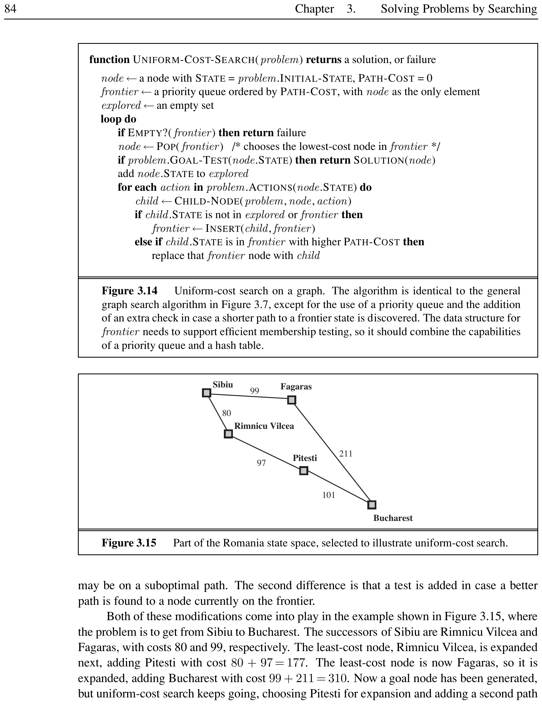
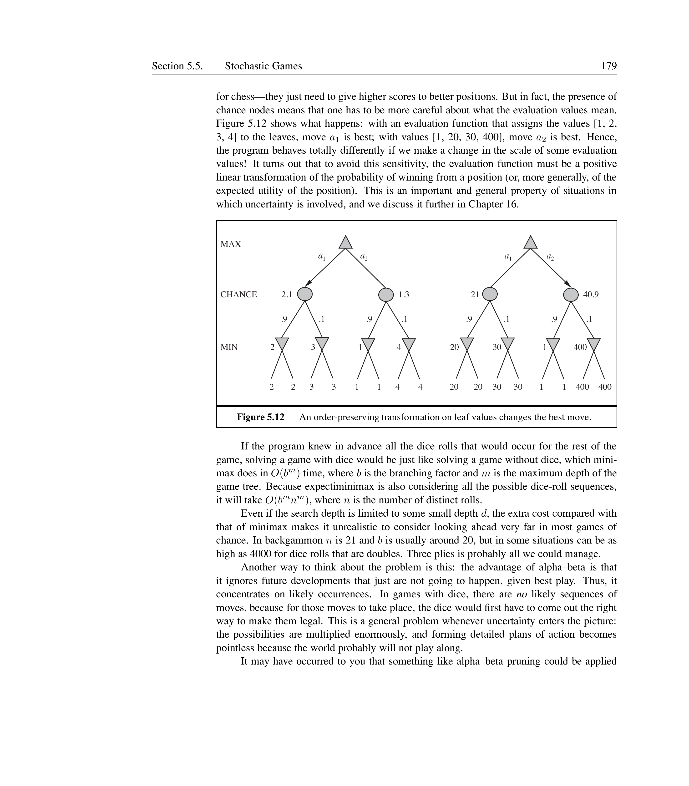
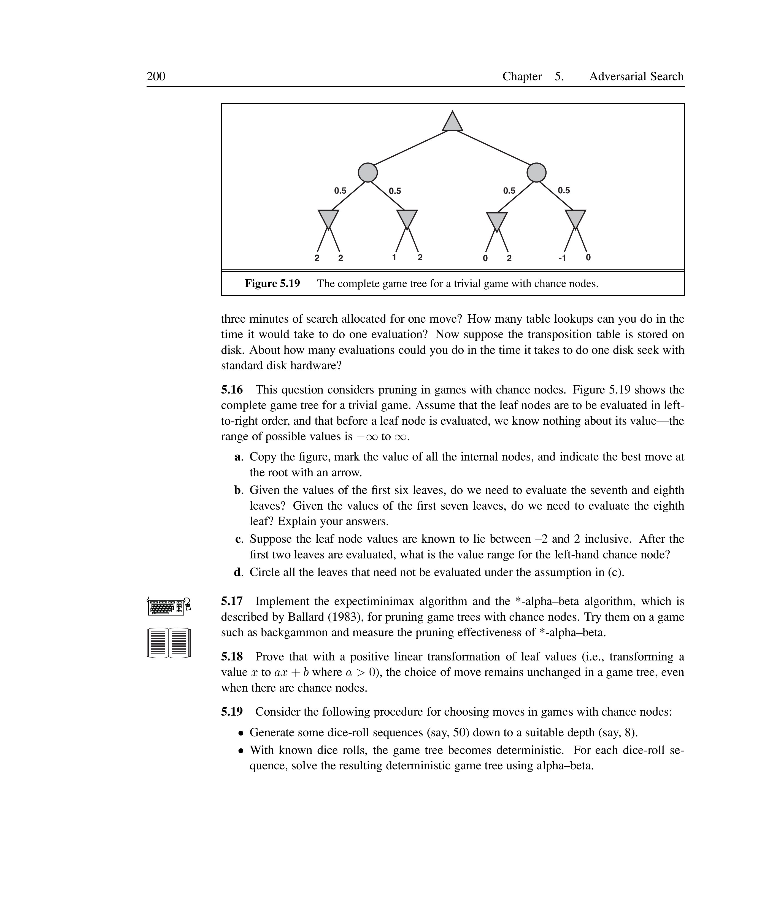

# Adversarial Search


In which we examine the problems that arise when we try to plan ahead in a world where other agents are planning against us.

## Games


<div style="border-left: 4px solid #1a5c9e; background-color: #f0f4f8; padding: 15px; margin: 20px 0; border-radius: 4px;">
<strong>📖 Game</strong>

A **game** in AI is a structured competitive environment with:
	\begin{itemize}
		\item Two or more players with opposing goals.
		\item Turn-taking actions governed by precise rules.
		\item Clearly defined states and outcomes (win, loss, or draw).
	\end{itemize}

</div>


<div style="border-left: 4px solid #1a5c9e; background-color: #f0f4f8; padding: 15px; margin: 20px 0; border-radius: 4px;">
<strong>📖 Zero-Sum Game</strong>

A **zero-sum game** is one where the total payoff to all players is the same for every instance. One player's gain is exactly the other's loss. Chess is zero-sum: if MAX wins (+1), MIN loses (0), and vice versa.

</div>


<div style="border-left: 4px solid #1a5c9e; background-color: #f0f4f8; padding: 15px; margin: 20px 0; border-radius: 4px;">
<strong>📖 Perfect Information</strong>

A game has **perfect information** if both players know the full state of the game at all times. Chess and tic-tac-toe have perfect information; poker and Kriegspiel do not.

</div>


[htbp]
	
	




	
*Caption: Classification of games by information and determinism. Each type requires a different search algorithm.*

	
\end{figure}

A game is formally defined as a search problem with these elements:
\begin{itemize}
	\item $S_0$: The **initial state** (how the game is set up).
	\item $\text{PLAYER}(s)$: Which player has the move in state $s$.
	\item $\text{ACTIONS}(s)$: The set of legal moves from state $s$.
	\item $\text{RESULT}(s, a)$: The **transition model** --- the state resulting from action $a$ in state $s$.
	\item $\text{TERMINAL-TEST}(s)$: True when the game is over. States where the game has ended are **terminal states**.
	\item $\text{UTILITY}(s, p)$: The **utility function** (or payoff function) giving the numeric outcome for player $p$ at terminal state $s$. In chess: +1 for win, 0 for loss, $\frac12$ for draw.
\end{itemize}

[htbp]
	
	


	
*Caption: A partial game tree for tic-tac-toe. Nodes represent board states; edges show moves labeled X or O. Terminal states are evaluated by the utility function.*

	
\end{figure}


<div style="border-left: 4px solid #2e7d32; background-color: #e8f5e9; padding: 15px; margin: 20px 0; border-radius: 4px;">
<strong>💡 Elements of a Game: Tic-Tac-Toe</strong>

\begin{itemize}
		\item $S_0$: Empty 3$\times$3 board, MAX (X) to move.
		\item $\text{PLAYER}(s)$: Alternates between MAX (X) and MIN (O).
		\item $\text{ACTIONS}(s)$: Place your symbol in any empty square.
		\item $\text{RESULT}(s, a)$: Board with the new symbol placed.
		\item $\text{TERMINAL-TEST}(s)$: Three in a row for either player, or all squares filled.
		\item $\text{UTILITY}(s, p)$: +1 if MAX wins, -1 if MIN wins, 0 for draw.
	\end{itemize}
	The branching factor starts at 9 and decreases. The full tree has $9! = 362{,}880$ terminal nodes --- small enough to solve completely.

</div>


### Key Properties
\begin{itemize}
	\item Games are **too hard to solve**: chess has $35^{100} \approx 10^{154}$ nodes in the search tree (though only $\approx 10^{40}$ distinct states).
	\item Game-playing requires **making decisions under time pressure** --- unlike standard search, efficiency is critical.
	\item Game-playing research has produced ideas on **pruning**, **evaluation functions**, and **selective search**.
\end{itemize}

## Optimal Decisions in Games


<div style="border-left: 4px solid #1a5c9e; background-color: #f0f4f8; padding: 15px; margin: 20px 0; border-radius: 4px;">
<strong>📖 Minimax Algorithm</strong>

The **minimax algorithm** computes the optimal move for MAX by assuming MIN will play optimally to minimize MAX's utility. It performs a complete depth-first exploration of the game tree.

</div>


The two players are called **MAX** (maximizer) and **MIN** (minimizer). MAX wants to maximize the utility; MIN wants to minimize it. The **minimax value** of a node is the utility for MAX assuming both play optimally from that point.

\[
	\text{MINIMAX}(s) =
	\begin{cases}
		\text{UTILITY}(s)                                                  & \text{if TERMINAL-TEST}(s)       \\[4pt]
		\max_{a \in \text{Actions}(s)} \text{MINIMAX}(\text{RESULT}(s, a)) & \text{if PLAYER}(s) = \text{MAX} \\[4pt]
		\min_{a \in \text{Actions}(s)} \text{MINIMAX}(\text{RESULT}(s, a)) & \text{if PLAYER}(s) = \text{MIN}
	\end{cases}
\]

[htbp]
	
	




	
*Caption: A two-ply game tree showing minimax values. MAX's best move is $a_1$ (value 3), because MIN will force the worst outcome for MAX. Dotted branches at C are pruned by alpha-beta.*

	
\end{figure}


<div style="border-left: 4px solid #2e7d32; background-color: #e8f5e9; padding: 15px; margin: 20px 0; border-radius: 4px;">
<strong>💡 Minimax Example</strong>

Consider the tree in Figure~\ref{fig:minimax-tree}:
	\begin{enumerate}
		\item Leaf nodes B1, B2, B3 have values 3, 12, 8. MIN at node B chooses 3.
		\item Leaf C1 has value 2. So MIN at C is at most 2.
		\item Leaf D1, D2, D3 have values 14, 5, 2. MIN at D chooses 2.
		\item MAX at root chooses $\max(3, 2, 2) = 3$, corresponding to move $a_1$.
	\end{enumerate}
	Optimal play: MAX plays $a_1$, MIN responds $b_1$, utility = 3.

</div>


```text
function MINIMAX-DECISION(state) returns an action
	return argmax_{a in ACTIONS(state)} MIN-VALUE(RESULT(state, a))

	function MAX-VALUE(state) returns a utility value
	if TERMINAL-TEST(state) then return UTILITY(state)
	v <- -infinity
	for each a in ACTIONS(state) do
	v <- MAX(v, MIN-VALUE(RESULT(state, a)))
	return v

	function MIN-VALUE(state) returns a utility value
	if TERMINAL-TEST(state) then return UTILITY(state)
	v <- +infinity
	for each a in ACTIONS(state) do
	v <- MIN(v, MAX-VALUE(RESULT(state, a)))
	return v
```


### Key Properties
\begin{itemize}
	\item Minimax is **complete** and **optimal** given an infallible opponent.
	\item Time complexity: $O(b^m)$ where $b$ is the branching factor and $m$ is maximum depth.
	\item Space complexity: $O(bm)$ (generate all actions) or $O(m)$ (generate one at a time).
	\item Minimax is **impractical** for real games: chess at $b \approx 35$, $m \approx 50$ means $35^{50}$ nodes.
\end{itemize}

### Optimal Decisions in Multiplayer Games

For games with three or more players, we replace the single utility value with a **vector** of values $\langle v_A, v_B, v_C \rangle$. At each node, the player whose turn it is chooses the move that maximizes their own component of the vector.


<div style="border-left: 4px solid #2e7d32; background-color: #e8f5e9; padding: 15px; margin: 20px 0; border-radius: 4px;">
<strong>💡 Three-Player Game</strong>

A three-player game with players A, B, C. At node X, player C chooses between $(1,2,6)$ and $(4,2,3)$. Since 6 $>$ 3 for C, C picks the first. The backed-up value of X is $(1,2,6)$. At the root, A chooses the move that maximizes $v_A$.

</div>


Multiplayer games naturally lead to **alliances**: if A and B are weak and C is strong, both A and B optimally attack C rather than each other. Alliances emerge from purely selfish behavior.

## Alpha-Beta Pruning


<div style="border-left: 4px solid #1a5c9e; background-color: #f0f4f8; padding: 15px; margin: 20px 0; border-radius: 4px;">
<strong>📖 Alpha-Beta Pruning</strong>

**Alpha-beta pruning** is a technique that eliminates branches of the game tree that cannot possibly influence the final minimax decision. It returns the same move as minimax but examines far fewer nodes.

</div>


Two parameters are maintained along each path:
\begin{itemize}
	\item $\alpha$: The value of the **best** (highest) choice found so far for MAX along the path.
	\item $\beta$: The value of the **best** (lowest) choice found so far for MIN along the path.
\end{itemize}

\paragraph{Pruning conditions:}
\begin{itemize}
	\item **Beta cutoff** at a MAX node: if $v \geq \beta$, prune remaining branches (MIN would never allow this).
	\item **Alpha cutoff** at a MIN node: if $v \leq \alpha$, prune remaining branches (MAX would never allow this).
\end{itemize}

[htbp]
	
	\begin{tikzpicture}[scale=0.8, transform shape,
			level distance=1.6cm,
			sibling distance=3.5cm,
			every node/.style={draw, rectangle, rounded corners, minimum width=1.5cm, align=center, font=\footnotesize},
			edge from parent/.style={draw, -stealth}
		]
		\node (A) {$\alpha=-\infty$\$\beta=+\infty$}
		child {node (B) {$\alpha=-\infty$\$\beta=3$}
				child {node[fill=green!20] {3}}
				child {node[fill=green!20] {12}}
				child {node[fill=green!20] {8}}
			}
		child {node[fill=red!20] (C) {$\alpha=-\infty$\$\beta=2$\\Pruned!}
				child {node {2}}
				child[grow=right] {node[draw=none] {...}}
			}
		child {node (D) {$\alpha=3$\$\beta=14$}
				child {node[fill=green!20] {14}}
				child {node[fill=green!20] {5}}
				child {node[fill=green!20] {2}}
			};
	\end{tikzpicture}
	\caption[Alpha-beta pruning]{Alpha-beta pruning applied to the two-ply tree. After evaluating B (value 3), $\alpha=3$. At C, the first leaf gives 2, so $\beta=2$. Since $\alpha \geq \beta$, the remaining children of C are pruned.}
	
\end{figure}


```text
function ALPHA-BETA-SEARCH(state) returns an action
	v <- MAX-VALUE(state, -infinity, +infinity)
	return the action in ACTIONS(state) with value v

	function MAX-VALUE(state, alpha, beta) returns a utility value
	if TERMINAL-TEST(state) then return UTILITY(state)
	v <- -infinity
	for each a in ACTIONS(state) do
	v <- MAX(v, MIN-VALUE(RESULT(state, a), alpha, beta))
	if v >= beta then return v    // beta cutoff
	alpha <- MAX(alpha, v)
	return v

	function MIN-VALUE(state, alpha, beta) returns a utility value
	if TERMINAL-TEST(state) then return UTILITY(state)
	v <- +infinity
	for each a in ACTIONS(state) do
	v <- MIN(v, MAX-VALUE(RESULT(state, a), alpha, beta))
	if v <= alpha then return v   // alpha cutoff
	beta <- MIN(beta, v)
	return beta
```


### Key Properties
\begin{itemize}
	\item Alpha-beta yields the **same move as minimax** but with less computation.
	\item Best-case ordering: examines $O(b^{m/2})$ nodes --- effective branching factor $\sqrt{b}$. For chess, $\sqrt{35} \approx 6$.
	\item Random ordering: $O(b^{3m/4})$ nodes.
	\item Without ordering, alpha-beta provides no benefit.
\end{itemize}

### Move Ordering

The effectiveness of alpha-beta depends on examining the best moves first. Techniques include:
\begin{itemize}
	\item **Killer moves**: moves that were found to be best in previous searches at the same depth. The killer move heuristic tries them first at each node.
	\item **History heuristic**: tracks which moves have been most successful across all positions, not just the current one. Moves that have produced cutoffs in the past are tried first.
	\item **Iterative deepening**: search to depth 1, record best moves, use them to order moves at depth 2, etc.
	\item **Captures first**: in chess, examine captures before non-captures.
\end{itemize}

### Transposition Tables

A **transposition** occurs when different sequences of moves lead to the same position. A **transposition table** caches evaluated positions in a hash table, avoiding redundant recomputation. This can double the reachable search depth in chess.


<div style="border-left: 4px solid #2e7d32; background-color: #e8f5e9; padding: 15px; margin: 20px 0; border-radius: 4px;">
<strong>💡 Transposition in Chess</strong>

The sequences [a1, b1, a2, b2] and [a2, b2, a1, b1] both result in the same position. Without a transposition table, both paths are evaluated independently. With one, the second occurrence is a hash table lookup.

</div>


## Imperfect Real-Time Decisions


<div style="border-left: 4px solid #1a5c9e; background-color: #f0f4f8; padding: 15px; margin: 20px 0; border-radius: 4px;">
<strong>📖 Evaluation Function</strong>

An **evaluation function** EVAL(s) estimates the expected utility of a state from the perspective of MAX, allowing search to be cut off before reaching terminal states.

</div>


<div style="border-left: 4px solid #1a5c9e; background-color: #f0f4f8; padding: 15px; margin: 20px 0; border-radius: 4px;">
<strong>📖 Cutoff Test</strong>

A **cutoff test** replaces TERMINAL-TEST in alpha-beta. It returns true when the search should stop (e.g., depth limit reached or position is quiescent).

</div>


The heuristic minimax replaces the utility function with EVAL and terminal test with cutoff test:

\[
	\text{H-MINIMAX}(s, d) =
	\begin{cases}
		\text{EVAL}(s)                                     & \text{if CUTOFF-TEST}(s, d)      \\[4pt]
		\max_{a} \text{H-MINIMAX}(\text{RESULT}(s,a), d+1) & \text{if PLAYER}(s) = \text{MAX} \\[4pt]
		\min_{a} \text{H-MINIMAX}(\text{RESULT}(s,a), d+1) & \text{if PLAYER}(s) = \text{MIN}
	\end{cases}
\]

### Evaluation Functions

A **weighted linear evaluation function** computes the value as:

\[
	\text{EVAL}(s) = w_1 f_1(s) + w_2 f_2(s) + \cdots + w_n f_n(s) = \sum_{i=1}^n w_i f_i(s)
\]

where $w_i$ is a weight and $f_i$ is a feature (e.g., piece count in chess).


<div style="border-left: 4px solid #2e7d32; background-color: #e8f5e9; padding: 15px; margin: 20px 0; border-radius: 4px;">
<strong>💡 Material Evaluation in Chess</strong>

Standard chess piece values:
	\begin{itemize}
		\item Pawn = 1, Knight = 3, Bishop = 3, Rook = 5, Queen = 9.
		\item Positional factors: pawn structure ($\pm 0.5$), king safety, mobility.
	\end{itemize}
	A position with one extra pawn typically gives a 72% chance of winning. Three extra pawns is almost certain victory.

</div>


### Cutting Off Search


<div style="border-left: 4px solid #1a5c9e; background-color: #f0f4f8; padding: 15px; margin: 20px 0; border-radius: 4px;">
<strong>📖 Quiescence Search</strong>

**Quiescence search** extends the search beyond the cutoff depth for positions that are not **quiescent** --- positions where wild swings in value are likely (e.g., captures available). It resolves tactical uncertainties before applying the evaluation function.

</div>


<div style="border-left: 4px solid #1a5c9e; background-color: #f0f4f8; padding: 15px; margin: 20px 0; border-radius: 4px;">
<strong>📖 Horizon Effect</strong>

The **horizon effect** occurs when delaying tactics push an unavoidable bad event beyond the search horizon. The program mistakenly thinks the delaying moves are good because it cannot see the inevitable outcome.

</div>


<div style="border-left: 4px solid #2e7d32; background-color: #e8f5e9; padding: 15px; margin: 20px 0; border-radius: 4px;">
<strong>💡 Horizon Effect in Chess</strong>

A black bishop is doomed but Black can check the white king repeatedly with pawns. Each check forces the king to capture the pawn, consuming 2 ply per check. If this pushes the bishop capture beyond the search depth, Black mistakenly thinks the pawn sacrifices saved the bishop.

</div>


### Forward Pruning

**Forward pruning** eliminates moves at a node without full evaluation. **Beam search** considers only the $n$ best moves per ply. More sophisticated methods like **PROBCUT** (probabilistic cut) use statistical models to prune nodes that are probably outside the $(\alpha, \beta)$ window.

### Key Properties
\begin{itemize}
	\item The evaluation function must **order terminal states correctly** (wins > draws > losses).
	\item The evaluation function should be **strongly correlated** with winning chances.
	\item **Nonlinear combinations** of features (e.g., pair of bishops worth more than twice a single bishop) improve accuracy.
	\item **Iterative deepening** allows the program to always have a move ready when time runs out.
	\item **Singular extensions** push the search deeper for moves that are ``clearly better'' than alternatives.
\end{itemize}

## Stochastic Games


<div style="border-left: 4px solid #1a5c9e; background-color: #f0f4f8; padding: 15px; margin: 20px 0; border-radius: 4px;">
<strong>📖 Stochastic Games</strong>

**Stochastic games** include a random element (e.g., dice rolling). In addition to MAX and MIN nodes, the game tree has **chance nodes** where the outcome depends on probability.

</div>


<div style="border-left: 4px solid #1a5c9e; background-color: #f0f4f8; padding: 15px; margin: 20px 0; border-radius: 4px;">
<strong>📖 Expectiminimax</strong>

**Expectiminimax** generalizes minimax to games with chance nodes. For chance nodes, the value is the expected utility over all outcomes, weighted by their probabilities.

</div>


\[
	\text{EE}(s) =
	\begin{cases}
		\text{UTILITY}(s)                                & \text{if TERMINAL-TEST}(s)          \\
		\max_a \text{EE}(\text{RESULT}(s, a))            & \text{if PLAYER}(s) = \text{MAX}    \\
		\min_a \text{EE}(\text{RESULT}(s, a))            & \text{if PLAYER}(s) = \text{MIN}    \\
		\sum_r P(r) \cdot \text{EE}(\text{RESULT}(s, r)) & \text{if PLAYER}(s) = \text{CHANCE}
	\end{cases}
\]
where $r$ represents a random event (e.g., dice roll) and $P(r)$ is its probability.

[htbp]
	
	




	
*Caption: A game tree with chance nodes (circles). The value of a chance node is the weighted average of its children's values.*

	
\end{figure}


<div style="border-left: 4px solid #2e7d32; background-color: #e8f5e9; padding: 15px; margin: 20px 0; border-radius: 4px;">
<strong>💡 Backgammon</strong>

In backgammon, dice are rolled at the start of each turn. White has 21 distinct dice roll outcomes, each with probability $1/36$ (doubles) or $1/18$ (non-doubles). White chooses a move knowing the roll, but not knowing Black's next roll. The branching factor from chance nodes is 21, from MAX/MIN nodes is about 20 (but can reach 4000 for doubles).

</div>


### Key Properties
\begin{itemize}
	\item Expectiminimax complexity: $O(b^m n^m)$ where $n$ is the number of distinct chance outcomes (e.g., 21 for backgammon).
	\item The evaluation function must be a **positive linear transformation** of the winning probability to avoid sensitivity to scale changes.
	\item **Monte Carlo simulation** (rollouts) can evaluate positions by playing thousands of random games from the position.
	\item Alpha-beta pruning can be extended to chance nodes if utility values are bounded.
\end{itemize}

## Partially Observable Games


<div style="border-left: 4px solid #1a5c9e; background-color: #f0f4f8; padding: 15px; margin: 20px 0; border-radius: 4px;">
<strong>📖 Imperfect Information</strong>

In **imperfect information** games, the full state of the game is not known to all players. Players must maintain a **belief state** --- the set of all possible states consistent with their percept history.

</div>


### Kriegspiel: Partially Observable Chess

Kriegspiel is chess where each player sees only their own pieces. A referee announces:
\begin{itemize}
	\item ``Illegal'' --- if the proposed move is illegal due to unseen pieces.
	\item ``Capture on square X'' --- if a capture occurs.
	\item ``Check by [direction]'' --- if the king is in check.
\end{itemize}


<div style="border-left: 4px solid #2e7d32; background-color: #e8f5e9; padding: 15px; margin: 20px 0; border-radius: 4px;">
<strong>💡 Kriegspiel KRK Endgame</strong>

White has a king and rook; Black has only a king. White cannot see Black's king. The belief state contains all possible positions of Black's king consistent with the history of announcements. White wins by **guaranteed checkmate**: playing moves that force a win regardless of Black's actual position and responses.

</div>


Three types of checkmate exist:
\begin{itemize}
	\item **Guaranteed checkmate**: a strategy that wins for every possible board state in the current belief state.
	\item **Probabilistic checkmate**: wins with probability 1 (or $1-\epsilon$) using randomized moves.
	\item **Accidental checkmate**: a move that results in checkmate because Black's pieces happened to be in the right positions --- the player could not have known.
\end{itemize}

### Card Games

Card games combine stochastic and partial observability: cards are dealt randomly at the start, and each player's hand is hidden from others.

The **averaging over clairvoyance** approach considers all possible deals:
\[
	\operatorname{argmax}_a \sum_s P(s) \cdot \text{MINIMAX}(\text{RESULT}(s, a))
\]

For large numbers of deals (e.g., $\binom{26}{13} = 10{,}400{,}600$ in bridge), **Monte Carlo sampling** approximates this:
\[
	\operatorname{argmax}_a \frac{1}{N} \sum_{i=1}^N \text{MINIMAX}(\text{RESULT}(s_i, a))
\]

### Key Properties
\begin{itemize}
	\item Optimal play in hidden-information games requires **randomized strategies** to avoid giving the opponent information.
	\item Averaging over clairvoyance fails to capture **information-gathering** and **bluffing** because it assumes perfect knowledge.
	\item Belief state tracking and AND-OR search in belief space finds guaranteed checkmates in Kriegspiel up to depth~9.
\end{itemize}

## State-of-the-Art Game Programs


[htbp]
	
	\begin{tabularx}{\textwidth}{ll>{\raggedright\arraybackslash}Xl}
		\toprule
		**Game** & **Program** & **Technique**                           & **Status**             \\
		\midrule
		Checkers      & Chinook          & Alpha-beta + 39 trillion endgame DB          & Solved (draw)               \\
		Chess         & Deep Blue        & Alpha-beta, singular extensions, custom VLSI & Beat Kasparov (1997)        \\
		Chess         & Hydra            & Null move heuristic, forward pruning, FPGA   & Rating $\approx$ 2850--3000 \\
		Chess         & Rybka            & Alpha-beta, finely tuned evaluation          & Strongest current           \\
		Othello       & Logistello       & Alpha-beta + ProbCut                         & Beats all humans            \\
		Backgammon    & TD-Gammon        & Neural network + depth 2--3 search           & World champion              \\
		Go            & MoGo             & Monte Carlo tree search (UCT)                & 2--3 dan (19$\times$19)     \\
		Bridge        & GIB              & Monte Carlo sampling + EBG                   & Expert level                \\
		Scrabble      & Quackle          & Move generation + partial observability      & Beat champion (2006)        \\
		\bottomrule
	\end{tabularx}

	
*Caption: State-of-the-art game programs and how they work.*


	\vspace{\baselineskip}
\end{table}


<div style="border-left: 4px solid #2e7d32; background-color: #e8f5e9; padding: 15px; margin: 20px 0; border-radius: 4px;">
<strong>💡 Deep Blue vs. Kasparov (1997)</strong>

IBM's Deep Blue used 30 RS/6000 processors + 480 custom VLSI chess chips. It searched 30 billion positions per move, reaching depth 14 (up to 40 with singular extensions). The evaluation function had over 8000 features. Kasparov wrote: ``The machine refused to move to a position that had a decisive short-term advantage --- showing a very human sense of danger.''

</div>


### Key Properties
\begin{itemize}
	\item Chess programs now pull ahead of all human players (Hydra, Rybka ratings $\approx$ 2900--3100 vs. Kasparov's 2851).
	\item Checkers was **solved** in 2007 by the Chinook team: perfect play leads to a draw.
	\item Go remains the grand challenge: $b \approx 361$, no effective evaluation function --- Monte Carlo methods are the current best approach.
	\item Bridge programs use Monte Carlo simulation to handle partial observability, achieving expert-level play.
\end{itemize}

## Alternative Approaches


### Pattern Databases and Endgame Lookup

Rather than searching, some game programs rely on precomputed lookup tables. In chess, **endgame databases** contain perfect evaluations for all positions with a small number of pieces (e.g., 5--6 pieces). These are built by **retrograde analysis**: starting from known checkmates, work backwards through all possible predecessor positions, marking wins/losses/draws. Chinook's checkers solution used a database of 39 trillion endgame positions with 10 or fewer pieces.

### Reinforcement Learning

**Reinforcement learning (RL)** replaces hand-crafted evaluation functions with ones learned from self-play. TD-Gammon (Tesauro, 1992) used a neural network trained by temporal-difference learning, playing millions of games against itself. After training, its evaluation function searched only depth 2--3 but achieved world-champion-level backgammon play. The same RL approach has been applied to chess, Othello, and Go (e.g., AlphaGo).

### Monte Carlo Methods

**Monte Carlo tree search (MCTS)** avoids the need for a heuristic evaluation function entirely. Instead of evaluating leaf nodes, it runs many random playouts from each position and averages the results. The UCT (upper confidence bounds on trees) algorithm guides which moves to explore more deeply. MCTS is the dominant approach for Go, where the branching factor (b $>$ 300) makes alpha-beta impractical. MoGo used MCTS with an 800-processor supercomputer to reach advanced amateur level.

### Limitations of Heuristic Minimax

Heuristic minimax assumes leaf evaluations are exact, but they are estimates with error. When evaluations have independent errors with standard deviation $\sigma$, the minimax choice may be wrong.


<div style="border-left: 4px solid #2e7d32; background-color: #e8f5e9; padding: 15px; margin: 20px 0; border-radius: 4px;">
<strong>💡 Minimax Error</strong>

A two-ply tree: left branch = 99, right branch has four nodes close to 99. With $\sigma=5$, the left branch is actually better 71% of the time despite minimax recommending the right branch (100 > 99). The right branch has more chances to ``slip below'' 99.

</div>


### Metareasoning

**Metareasoning** (reasoning about reasoning) asks which node expansions have the highest utility. If no expansion has utility greater than its cost, the algorithm should stop and make a move. This is valuable for:
\begin{itemize}
	\item **Clear-favorite situations**: one move is obviously best --- no need to evaluate others precisely.
	\item **Symmetrical positions**: no amount of search will distinguish them.
\end{itemize}

### Goal-Directed Reasoning

Humans play games using **goal-directed reasoning** (planning) rather than brute-force search. For example, a human chess player might think ``I want to trap the queen'' and generates plans to achieve that goal. The PARADISE program (Wilkins, 1980) successfully used goal-directed reasoning to solve chess problems requiring 18-move combinations.

### Key Properties
\begin{itemize}
	\item Alpha-beta is asymptotically optimal among fixed-depth game-tree algorithms (Pearl, 1982).
	\item $SSS^*$ can be viewed as a two-player $A^*$ and never expands more nodes than alpha-beta, but has higher overhead.
	\item $MGSS^*$ uses decision-theoretic techniques to estimate the value of expanding each leaf, sometimes searching an order of magnitude fewer nodes than alpha-beta in Othello.
	\item **Pattern databases** (endgame tables) eliminate search entirely for positions with few pieces, solving checkers completely in 2007.
	\item **Reinforcement learning** (TD-Gammon, AlphaGo) learns evaluation functions from self-play, removing reliance on human expert knowledge.
	\item **Monte Carlo tree search (MCTS)** handles huge branching factors ($b > 300$ for Go) where alpha-beta is infeasible.
	\item The standard alpha-beta approach dominates tournament play, but alternative methods (MCTS, RL) have surpassed it in specific domains.
\end{itemize}


<div style="border-left: 4px solid #f57f17; background-color: #fffde7; padding: 15px; margin: 20px 0; border-radius: 4px;">
<strong>❓ Exam-Style Question</strong>

Consider the following game tree where MAX moves first. The leaf values are from MAX's perspective. Apply the minimax algorithm to determine MAX's best move. Then apply alpha-beta pruning and show which branches can be pruned, assuming optimal move ordering.

	\[
		\text{Root} \rightarrow
		\begin{cases}
			\text{Node A (MIN)} \rightarrow \{3, 5, 8\} \\
			\text{Node B (MIN)} \rightarrow \{2, 9, 1\} \\
			\text{Node C (MIN)} \rightarrow \{7, 4, 6\}
		\end{cases}
	\]

</div>


<div style="border-left: 4px solid #2e7d32; background-color: #f1f8e9; padding: 15px; margin: 20px 0; border-radius: 4px;">
<strong>✅ Solution</strong>

**Minimax:**
	\begin{itemize}
		\item Node A = min(3, 5, 8) = 3
		\item Node B = min(2, 9, 1) = 1
		\item Node C = min(7, 4, 6) = 4
		\item Root = $\max(3, 1, 4) = 4$, so MAX plays to C.
	\end{itemize}

	**Alpha-beta:**
	\begin{enumerate}
		\item Explore A: first leaf 3 $\rightarrow$ $\alpha \leftarrow 3$. Remaining leaves (5, 8) don't beat 3. A = 3.
		\item Explore B: first leaf 2 $\rightarrow$ $\beta \leftarrow 2$. Since $\alpha=3 \geq \beta=2$, prune remaining branches of B (beta cutoff).
		\item Explore C: first leaf 7 $\rightarrow$ no cutoff. Second leaf 4 $\rightarrow$ $\beta \leftarrow 4$. Third leaf 6 $\rightarrow$ C = 4. Root = $\max(3, 2, 4) = 4$.
	\end{enumerate}
	Result: same move (to C), with 2 leaf nodes pruned.

</div>


\section*{Summary}

\begin{itemize}
	\item A game is defined by initial state, legal actions, transition model, terminal test, and utility function.
	\item **Minimax** selects optimal moves by depth-first exploration: $O(b^m)$.
	\item **Alpha-beta pruning** computes the same decision but examines far fewer nodes: $O(b^{m/2})$ with optimal ordering.
	\item For real-time play, we need **evaluation functions** (heuristic estimates) and **cutoff tests** (fixed depth or quiescence).
	\item **Expectiminimax** handles stochastic games with chance nodes.
	\item **Belief states** and Monte Carlo sampling handle partially observable games.
	\item State-of-the-art programs beat humans at chess, checkers, Othello, and backgammon. Go remains a challenge.
	\item **Pattern databases** and **retrograde analysis** solve endgames perfectly for small numbers of pieces.
	\item **Reinforcement learning** (TD-Gammon, AlphaGo) learns evaluation functions from self-play.
	\item **Monte Carlo tree search (MCTS)** handles games with huge branching factors (Go).
	\item **Metareasoning** and **goal-directed reasoning** offer alternatives to brute-force search.
\end{itemize}
