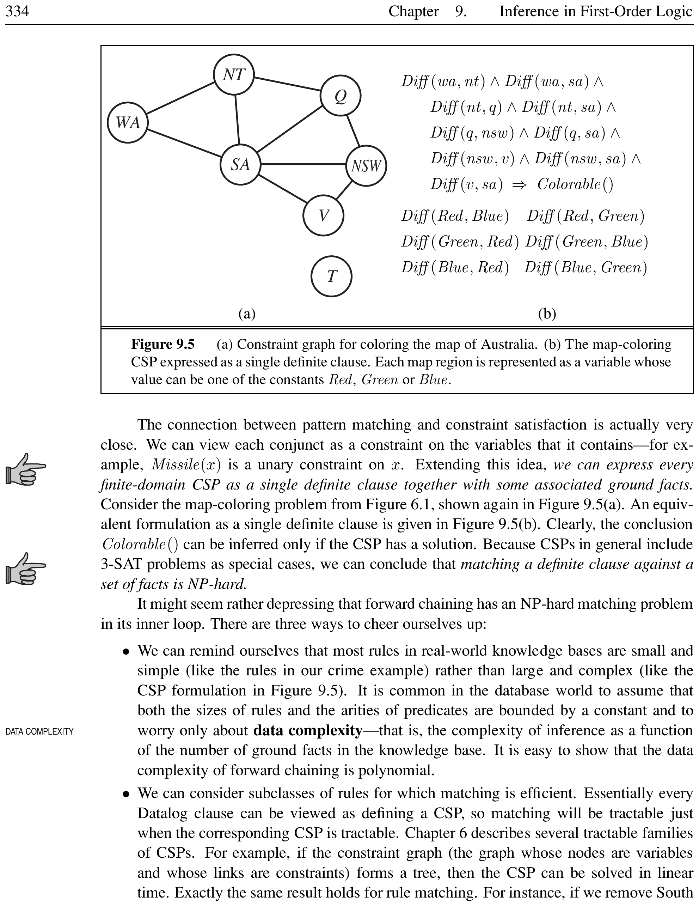
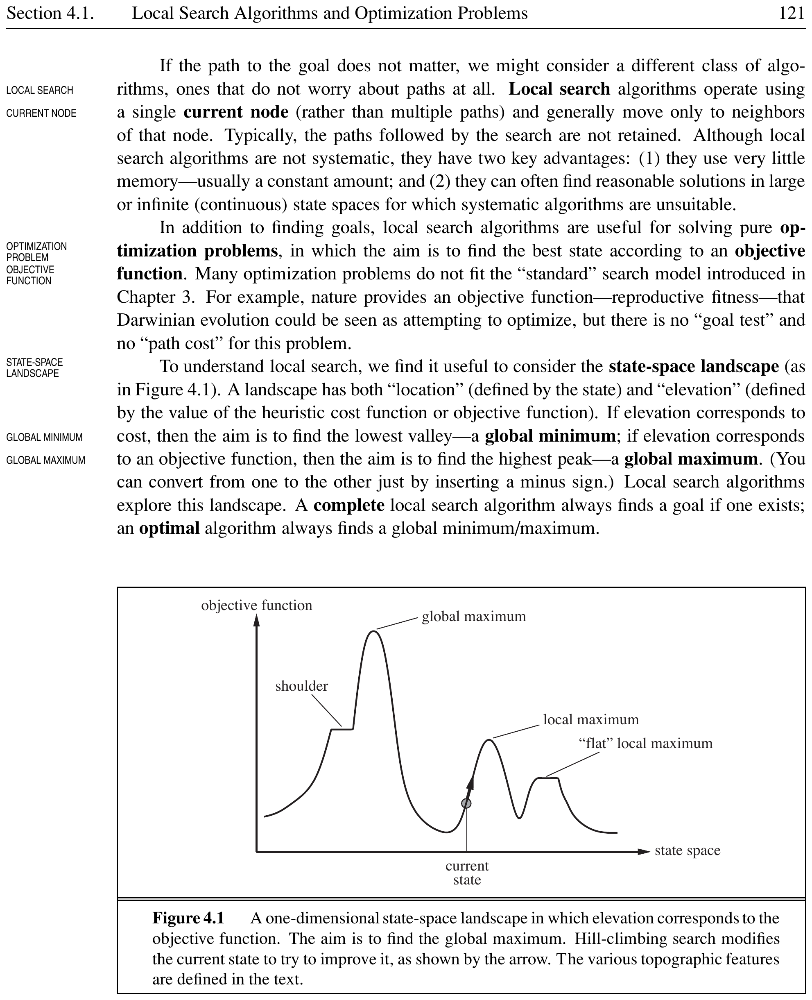
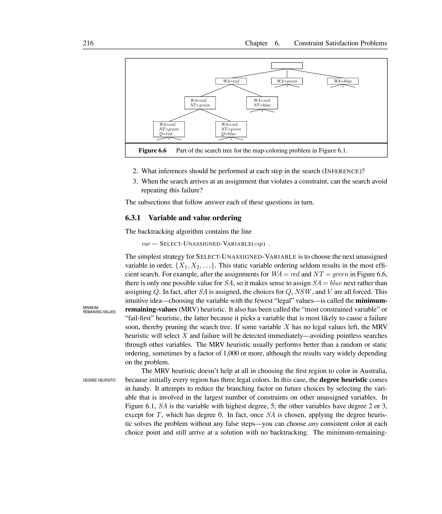
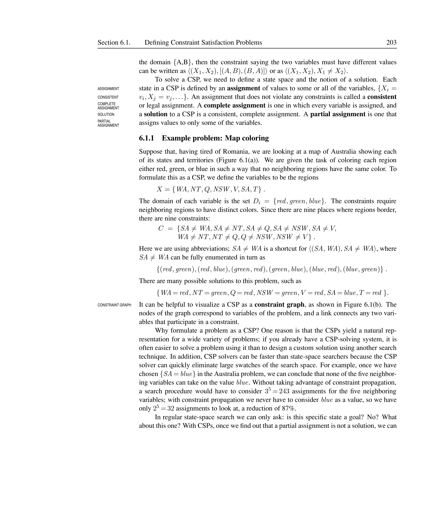
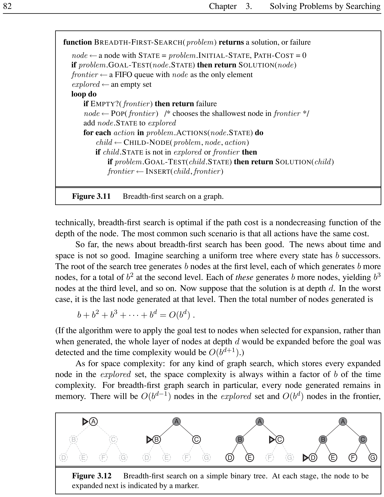
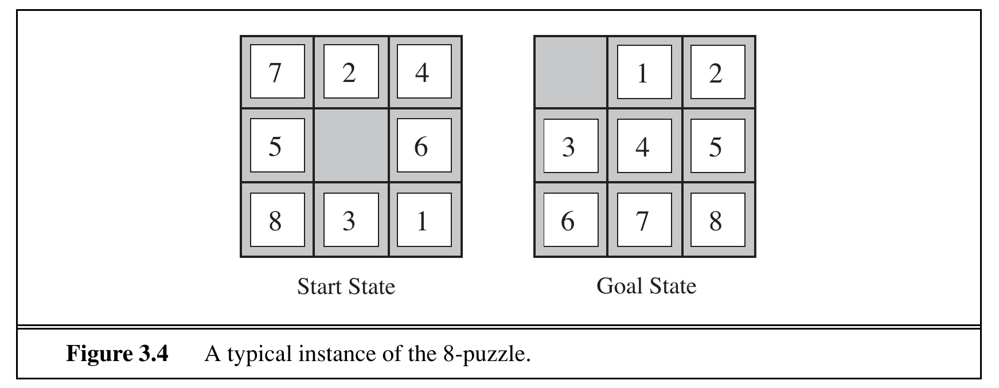
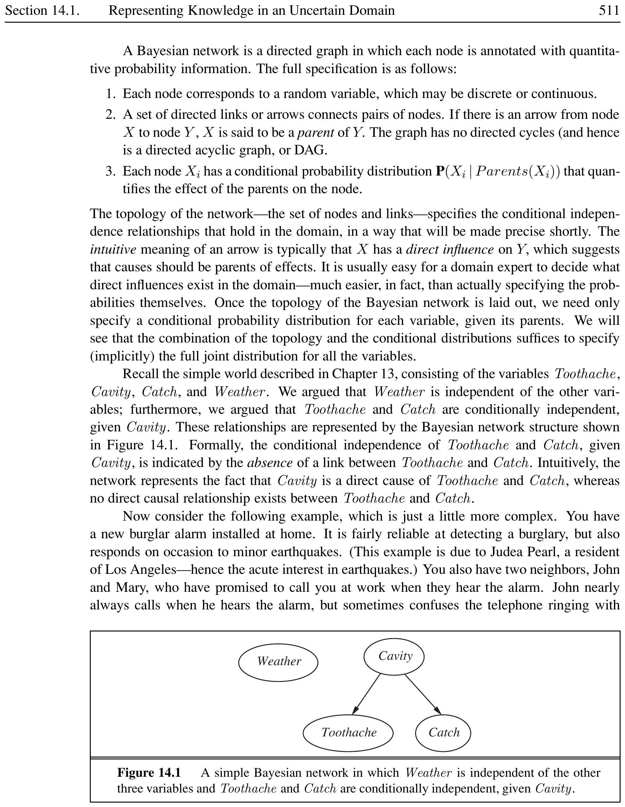

# Constraint Satisfaction Problems

## Defining Constraint Satisfaction Problems

<strong>📖 Constraint Satisfaction Problem</strong>

A **constraint satisfaction problem** (CSP) consists of three components:
\begin{itemize}
  \item **X** --- a set of variables, $\{X_1, X_2, \dots, X_n\}$.
  \item **D** --- a set of domains, $\{D_1, D_2, \dots, D_n\}$, one for each variable.
  \item **C** --- a set of constraints that specify allowable combinations of values.
\end{itemize}
Each domain $D_i$ is the set of allowable values for variable $X_i$. Each constraint $C_i$ is a pair $\langle scope, rel \rangle$, where $scope$ is a tuple of variables and $rel$ is a relation defining the values those variables may take.

\[
\text{CSP} = (X, D, C)
\]

[htbp]

*Caption: Components of a constraint satisfaction problem: variables, domains, and constraints define a problem that a CSP solver solves by finding a consistent complete assignment.*

\end{figure}

An **assignment** maps variables to values: $\{X_i = v_i, X_j = v_j, \dots\}$. A **consistent** (or **legal**) assignment does not violate any constraints. A **complete assignment** assigns every variable. A **solution** to a CSP is a consistent, complete assignment. A **partial assignment** assigns only some variables.

<strong>💡 Map Coloring</strong>

Coloring the states of Australia with three colors (red, green, blue) such that no neighboring regions share a color:
\begin{itemize}
  \item **Variables:** $X = \{WA, NT, Q, NSW, V, SA, T\}$.
  \item **Domains:** Each $D_i = \{red, green, blue\}$.
  \item **Constraints:** $SA \neq WA$, $SA \neq NT$, $SA \neq Q$, $SA \neq NSW$, $SA \neq V$, $WA \neq NT$, $NT \neq Q$, $Q \neq NSW$, $NSW \neq V$.
\end{itemize}
A solution: $\{WA = red, NT = green, Q = red, NSW = green, V = red, SA = blue, T = red\}$.

A CSP can be visualized as a **constraint graph**, where nodes represent variables and edges connect variables that share a constraint.

[htbp]

*Caption: Constraint graph for the Australia map-coloring problem. Nodes are variables (regions); edges connect neighboring regions that must have different colors.*

\end{figure}

### Variations on the CSP Formalism

[htbp]

*Caption: Classification of CSPs by domain type: discrete (finite or infinite) and continuous domains.*

\end{figure}

\paragraph{Discrete domains.} A finite domain, e.g., $\{red, green, blue\}$ for map coloring. An **infinite** discrete domain, e.g., the set of integers for job scheduling start times.

\paragraph{Continuous domains.} Common in operations research, e.g., scheduling Hubble Space Telescope observations with continuous-valued start and finish times. Linear programming is the best-known category.

\paragraph{Constraint types.}
\begin{itemize}
  \item **Unary constraint:** restricts a single variable, e.g., $SA \neq green$.
  \item **Binary constraint:** relates two variables, e.g., $SA \neq NSW$.
  \item **Global constraint:** involves an arbitrary number of variables, e.g., $Alldiff(F, T, U, W, R, O)$ in cryptarithmetic.
\end{itemize}

[htbp]

*Caption: Classification of constraints by arity: unary (one variable), binary (two variables), and global (arbitrary $n$ variables).*

\end{figure}

\paragraph{Preference constraints} indicate which solutions are preferred (soft constraints). These can be encoded as costs, leading to a **constraint optimization problem** (COP).

<strong>💡 Job-Shop Scheduling</strong>

Scheduling car assembly with 15 tasks (install axles, affix wheels, tighten nuts, attach hubcaps, inspect):
\begin{itemize}
  \item **Variables:** $\{Axle_F, Axle_B, Wheel_{RF}, \dots, Inspect\}$.
  \item **Domains:** $D_i = \{1, 2, \dots, 27\}$ (start times in minutes).
  \item **Precedence constraints:** $Axle_F + 10 \leq Wheel_{RF}$, $Wheel_{RF} + 1 \leq Nuts_{RF}$, etc.
  \item **Disjunctive constraint:** $(Axle_F + 10 \leq Axle_B)$ or $(Axle_B + 10 \leq Axle_F)$.
  \item **Inspection:** $X + d_X \leq Inspect$ for all $X \neq Inspect$.
\end{itemize}

## Constraint Propagation: Inference in CSPs

<strong>📖 Constraint Propagation</strong>

**Constraint propagation** uses the constraints to reduce the number of legal values for a variable, which in turn reduces the legal values for other variables. The key idea is **local consistency**: ensuring that each part of the constraint graph satisfies a local condition, causing inconsistent values to be eliminated throughout the graph.

[htbp]

*Caption: Hierarchy of local consistency: stronger consistency levels subsume weaker ones. **Strongly $k$-consistent*
 means consistent at all levels $1$ through $k$.**

\end{figure}

### Node Consistency

<strong>📖 Node Consistency</strong>

A variable is **node-consistent** if all values in its domain satisfy its unary constraints. A network is node-consistent if every variable is node-consistent.

\[
\forall v \in D_i : \text{unary constraint on } X_i \text{ is satisfied}
\]

<strong>💡 Node Consistency in Australia</strong>

If $SA$ cannot be green (a unary constraint), we remove green from $D_{SA}$, leaving $\{red, blue\}$. This makes $SA$ node-consistent.

### Arc Consistency

<strong>📖 Arc Consistency</strong>

$X_i$ is **arc-consistent** with respect to $X_j$ if for every value $v \in D_i$ there exists some value $w \in D_j$ satisfying the binary constraint on the arc $(X_i, X_j)$. A network is arc-consistent if every variable is arc-consistent with every other.

\[
\forall v \in D_i, \; \exists w \in D_j : \text{constraint}(X_i, X_j) \text{ is satisfied}
\]

<strong>💡 Arc Consistency with $Y = X^2$</strong>

Let $X$ and $Y$ have domain $\{0, 1, 2, 3, 4\}$, with constraint $Y = X^2$:
\[
\langle (X, Y), \{(0,0), (1,1), (2,4), (3,9)\} \rangle
\]
\begin{itemize}
  \item Make $X$ arc-consistent wrt $Y$: reduce $D_X$ to $\{0, 1, 2, 3\}$.
  \item Make $Y$ arc-consistent wrt $X$: reduce $D_Y$ to $\{0, 1, 4, 9\}$.
\end{itemize}
Now the CSP is arc-consistent.

[htbp]

*Caption: Flowchart of the AC-3 arc-consistency algorithm. The algorithm processes arcs from a queue, revising domains until no more changes occur or a domain becomes empty.*

\end{figure}

The AC-3 algorithm maintains a queue of arcs. When $D_i$ is revised, all arcs $(X_k, X_i)$ for neighbors $X_k$ are added to the queue. AC-3 runs in $O(c d^3)$ time for $n$ variables, domain size at most $d$, and $c$ binary constraints.

<strong>💡 AC-3 on Sudoku</strong>

In a Sudoku puzzle with Alldiff constraints expanded to binary constraints:
\begin{itemize}
  \item Variable $E6$ (center box): removing 2, 8, 1, 7 from box constraints, then 5, 6, 2, 8, 9, 3 from column constraints. Domain reduces to $\{4\}$.
  \item AC-3 can solve the entire easiest Sudoku puzzles without search.
\end{itemize}

### Path Consistency

<strong>📖 Path Consistency</strong>

A two-variable set $\{X_i, X_j\}$ is **path-consistent** with respect to a third variable $X_m$ if for every consistent assignment $\{X_i = a, X_j = b\}$, there exists an assignment to $X_m$ that satisfies the constraints on $\{X_i, X_m\}$ and $\{X_m, X_j\}$.

<strong>💡 Path Consistency with Two Colors</strong>

Coloring Australia with only two colors (red, blue). Arc consistency does nothing (every value has a valid neighbor). But path consistency of $\{WA, SA\}$ with respect to $NT$ reveals that no valid assignment exists --- proving the problem unsolvable.

### \texorpdfstring{$k${k}-Consistency}

<strong>📖 $k$-Consistency</strong>

A CSP is **$k$-consistent** if for any set of $k-1$ variables and any consistent assignment to those variables, a consistent value can always be assigned to any $k$th variable.
\begin{itemize}
  \item 1-consistency = node consistency.
  \item 2-consistency = arc consistency.
  \item 3-consistency = path consistency (for binary networks).
\end{itemize}
A CSP is **strongly $k$-consistent** if it is $k$-consistent and also $(k-1)$-consistent, $(k-2)$-consistent, \dots, 1-consistent.

<strong>💡 Strong $n$-Consistency</strong>

A strongly $n$-consistent CSP with $n$ variables can be solved in $O(n^2 d)$ time: assign $X_1$, then $X_2$ (guaranteed by $2$-consistency), then $X_3$ (guaranteed by $3$-consistency), and so on. However, achieving $n$-consistency is exponential in $n$, so this is rarely practical.

### Global Constraints and Bounds Propagation

<strong>📖 Alldiff Constraint</strong>

The **Alldiff** constraint requires all variables in its scope to have distinct values. If $m$ variables have $n$ possible distinct values and $m > n$, the constraint cannot be satisfied.

<strong>📖 Bounds Consistency</strong>

A CSP is **bounds consistent** if for every variable $X$, and for both the lower-bound and upper-bound values of $X$, there exists some value of $Y$ that satisfies the constraint between $X$ and $Y$ for every variable $Y$.

<strong>💡 Bounds Propagation for Two Flights</strong>

Two flights have capacities $D_1 = [0, 165]$, $D_2 = [0, 385]$ and must carry 420 people total ($F_1 + F_2 = 420$). Bounds propagation reduces domains to $D_1 = [35, 165]$, $D_2 = [255, 385]$.

## Backtracking Search for CSPs

<strong>📖 Backtracking Search</strong>

**Backtracking search** is a depth-first search that assigns values to one variable at a time and backtracks when a variable has no legal values left. It exploits **commutativity** of CSPs: the order of assignments does not affect the outcome, so we only consider one variable at each node.

<strong>💡 Commutativity in CSP Search</strong>

Without commutativity: for $n$ variables with domain size $d$, the top branching factor is $nd$, yielding $n! \cdot d^n$ leaves. With commutativity (assigning one variable at a time), only $d^n$ leaves remain. For $n=7, d=3$ (Australia): $7! \cdot 3^7 \approx 2.2 \times 10^7$ vs. $3^7 = 2187$ leaves.

[htbp]

*Caption: Partial search tree for the Australia map-coloring problem. Each node assigns one variable; backtracking occurs when no legal value remains for a variable.*

\end{figure}

### Variable and Value Ordering

<strong>📖 MRV Heuristic</strong>

The **minimum-remaining-values** (MRV) heuristic chooses the unassigned variable with the fewest legal values. Also called the ``most constrained variable'' or ``fail-first'' heuristic.

<strong>💡 MRV in Australia</strong>

After $WA=red$ and $NT=green$, $SA$ has only 1 legal value (blue). MRV selects $SA$ next rather than $Q$, immediately forcing the rest of the solution.

<strong>📖 Degree Heuristic</strong>

The **degree heuristic** selects the variable involved in the largest number of constraints on other unassigned variables. Useful as a tie-breaker for MRV.

<strong>💡 Degree in Australia</strong>

Initially all variables have 3 colors, so MRV cannot decide. The degree heuristic picks $SA$ (degree 5) over $WA, NT, Q$ (degree 2--3), eliminating the need for backtracking.

<strong>📖 Least-Constraining-Value Heuristic</strong>

The **least-constraining-value** (LCV) heuristic prefers the value that rules out the fewest choices for neighboring variables. This is a ``fail-last'' strategy.

<strong>💡 LCV for Queensland</strong>

Given $WA=red$ and $NT=green$, $Q$ can be red or blue. Blue is a bad choice --- it eliminates the last legal value for $SA$. LCV therefore prefers red, leaving maximum flexibility for $SA$.

[htbp]

*Caption: Heuristics for backtracking search: MRV and degree heuristics select variables; LCV orders values.*

\end{figure}

### Interleaving Search and Inference

<strong>📖 Forward Checking</strong>

**Forward checking** establishes arc consistency for each newly assigned variable: whenever $X$ is assigned a value, delete from each unassigned neighbor $Y$ any value inconsistent with $X$.

<strong>📖 MAC (Maintaining Arc Consistency)</strong>

**MAC** applies AC-3 after each variable assignment, starting with arcs from the assigned variable to its unassigned neighbors. MAC is strictly more powerful than forward checking because it propagates changes recursively.

<strong>💡 Forward Checking on Australia</strong>

\begin{enumerate}
  \item Assign $WA = red$: delete red from $NT$ and $SA$.
  \item Assign $Q = green$: delete green from $NT$, $SA$, $NSW$.
  \item Assign $V = blue$: delete blue from $NSW$ and $SA$ --- $SA$ domain is now empty, backtrack immediately.
\end{enumerate}

### Intelligent Backtracking

<strong>📖 Chronological Backtracking</strong>

**Chronological backtracking** reverts to the most recently assigned variable when a dead end is reached. This can be inefficient because it may backtrack to irrelevant variables.

<strong>💡 Chronological Backtracking Failure</strong>

With ordering $Q, NSW, V, T, SA, WA, NT$, suppose we reach $SA$ after assigning $Q=red, NSW=green, V=blue, T=red$ and find no legal value for $SA$. Chronological backtracking re-colors $T$, but Tasmania is irrelevant to $SA$'s failure.

<strong>📖 Conflict-Directed Backjumping</strong>

**Conflict-directed backjumping** maintains a **conflict set** for each variable (the set of prior assignments that conflict with its values). When a variable has no legal values, backjump to the most recent variable in its conflict set, merging conflict sets.

\[
conf(X_j) \leftarrow conf(X_j) \cup conf(X_i) - \{X_j\}
\]

<strong>💡 Backjumping over Tasmania</strong>

Continuing the previous example: $SA$'s conflict set is $\{Q, NSW, V\}$ (not $T$). Backjumping goes directly back to $V$, skipping the irrelevant $T$ entirely.

<strong>📖 Constraint Learning</strong>

**Constraint learning** records **no-goods** --- minimal sets of variable assignments that cause inconsistency --- preventing the search from repeating the same failure. This is one of the most important techniques in modern CSP solvers.

<strong>💡 No-Good Recording</strong>

If $\{Q=red, NSW=green, V=blue\}$ causes $SA$ to have no legal values, the no-good $\{Q=red, NSW=green, V=blue\}$ is recorded. Any future branch containing this triple is pruned immediately.

## Local Search for CSPs

<strong>📖 Min-Conflicts Heuristic</strong>

**Min-conflicts** is a local search algorithm for CSPs using a complete-state formulation:
\begin{enumerate}
  \item Start with a random assignment to every variable.
  \item At each step, choose a randomly selected conflicted variable.
  \item Assign it the value that minimizes the number of violated constraints.
\end{enumerate}

[htbp]

*Caption: The min-conflicts heuristic on the 8-queens problem. At each step, a queen is moved to the square in its column with the fewest conflicts (attacking queens).*

\end{figure}

<strong>💡 Min-Conflicts on $n$-Queens</strong>

The min-conflicts heuristic is surprisingly effective: on the $n$-queens problem, run time is roughly independent of problem size. It can solve the million-queens problem in about 50 steps on average. Solutions are densely distributed in the state space for $n$-queens.

### Constraint Weighting

<strong>📖 Constraint Weighting</strong>

**Constraint weighting** assigns a numeric weight $W_i$ to each constraint (initially 1). At each step, the algorithm chooses a variable/value pair minimizing the total weight of violated constraints, then increments weights of currently violated constraints.

Constraint weighting adds topography to plateaux and focuses search on difficult constraints over time.

<strong>💡 Constraint Weighting in Map Coloring</strong>

Initially all $W_i = 1$. The algorithm picks a coloring and increments weights of violated edges. Over multiple runs, the edge $SA$--$NT$ (which is hard to satisfy) accumulates a high weight, guiding future assignments to respect it earlier.

### Applications
Local search for CSPs is particularly effective for scheduling problems. For example, min-conflicts has been used to schedule Hubble Space Telescope observations, reducing scheduling time from three weeks to 10 minutes. It also handles online problem changes well --- repairing a schedule when conditions change, rather than rebuilding from scratch.

## The Structure of Problems

<strong>📖 Tree-Structured CSP</strong>

A constraint graph is a **tree** if any two variables are connected by only one path. Tree-structured CSPs can be solved in linear time using **directed arc consistency** (DAC).

[htbp]

*Caption: A tree-structured constraint graph. Tree-structured CSPs can be solved in $O(nd^2)$ time without backtracking by establishing directed arc consistency.*

\end{figure}

#### Solving Tree-Structured CSPs
\begin{enumerate}
  \item Choose any variable as root and perform a **topological sort**.
  \item Make the graph **directed arc-consistent**: for each variable $X_i$, ensure arc consistency with each $X_j$ for $j > i$.
  \item Assign variables in order; each assignment has a guaranteed valid choice for the next variable.
\end{enumerate}

\[
\text{Complexity: } O(nd^2)
\]

<strong>💡 Solving a Tree-Structured CSP</strong>

Given variables $A, B, C, D$ in a chain $A-B-C-D$ with domain $\{0,1\}$ and constraints $A \neq B$, $B \neq C$, $C \neq D$:
\begin{enumerate}
  \item Topological sort: $A, B, C, D$.
  \item DAC from leaves to root: enforce $A \to B$, $B \to C$, $C \to D$.
  \item Assign $A=0$ (arbitrary), then $B=1$, $C=0$, $D=1$ without backtracking.
\end{enumerate}

### Independent Subproblems

<strong>📖 Connected Components</strong>

If the constraint graph has multiple **connected components** (disjoint subgraphs with no edges between them), each component forms an **independent subproblem**. The solution to the overall CSP is the union of the solutions to each component.

Splitting a CSP into independent subproblems dramatically reduces the search complexity. If a CSP with $n$ variables and domain size $d$ is split into $m$ components of size $n_1, n_2, \dots, n_m$, the total complexity is:

\[
O(d^{n_1} + d^{n_2} + \dots + d^{n_m}) \ll O(d^n)
\]

<strong>💡 Independent Subproblems in Australia</strong>

The Australia constraint graph has two connected components: the mainland (WA, NT, Q, SA, NSW, V) and Tasmania (T). Since $T$ is only adjacent to $NSW$, we solve each separately. Complexity drops from $O(3^7) = 2187$ to $O(3^6 + 3^1) = 732$ --- a $3\times$ reduction.

[htbp]

*Caption: Connected components in the Australia constraint graph. Tasmania forms a separate independent subproblem.*

\end{figure}

### Cycle Cutset

<strong>📖 Cycle Cutset</strong>

A **cycle cutset** is a subset $S$ of variables whose removal makes the constraint graph a tree. The approach of **cutset conditioning** assigns values to $S$, then solves the remaining tree-structured CSP.

\[
\text{Total run time: } O(d^c \cdot (n - c)d^2)
\]

where $c = |S|$. Finding the smallest cycle cutset is NP-hard, but good approximation algorithms exist.

<strong>💡 Cycle Cutset on Australia</strong>

The Australia graph has cycles (e.g., WA--NT--SA--WA). Choosing $S = \{SA\}$ breaks all cycles: removing $SA$ leaves a tree (WA, NT, Q, NSW, V, T). Cutset conditioning assigns $SA = red$ (or $blue$), then solves the remaining tree in $O((n-1)d^2)$. Total: $O(d \cdot (n-1)d^2)$.

### Tree Decomposition

<strong>📖 Tree Decomposition</strong>

A **tree decomposition** partitions the constraint graph into connected subproblems (clusters) arranged in a tree. Each subproblem is solved independently, and solutions are combined via shared variables.

Three requirements:
\begin{enumerate}
  \item Every variable appears in at least one subproblem.
  \item If two variables share a constraint, they appear together in at least one subproblem.
  \item If a variable appears in two subproblems, it must appear in every subproblem along the path connecting them.
\end{enumerate}

<strong>📖 Tree Width</strong>

The **tree width** of a tree decomposition is one less than the size of the largest subproblem. The tree width of a graph is the minimum tree width over all decompositions. If tree width is $w$, the CSP can be solved in $O(n d^{w+1})$ time.

<strong>💡 Tree Decomposition of Australia</strong>

The Australia map can be decomposed into 5 subproblems:
\begin{itemize}
  \item Subproblem 1: $\{WA, SA, NT\}$ --- 3 regions.
  \item Subproblem 2: $\{SA, NT, Q\}$ --- shares $SA$ and $NT$ with subproblem 1.
  \item Subproblem 3: $\{SA, Q, NSW\}$.
  \item Subproblem 4: $\{SA, NSW, V\}$.
  \item Subproblem 5: $\{NSW, T\}$.
\end{itemize}
Each subproblem is solved independently; solutions must agree on shared variables.

### Symmetry Breaking

<strong>📖 Value Symmetry</strong>

**Value symmetry** occurs when permuting the values in a solution yields another solution. A **symmetry-breaking constraint** imposes an ordering to eliminate symmetric solutions, reducing the search space.

<strong>💡 Breaking Value Symmetry in Australia</strong>

With 3 colors (red, green, blue), the 3! = 6 solutions are just color renamings of the same structure. Adding $NT < SA < WA$ alphabetically (e.g., $NT = red$, $SA = green$, $WA = blue$) forces a canonical ordering and prunes 5 symmetric solutions.

## Optimization Problems

<strong>📖 Constraint Optimization Problem</strong>

A **constraint optimization problem** (COP) extends CSPs with **preference constraints** that assign costs to variable assignments. The goal is to find a solution that minimizes (or maximizes) an objective function while satisfying all absolute constraints.

\[
\text{COP: minimize } \sum_{i} \text{cost}(X_i = v_i) \quad \text{subject to constraints } C
\]

<strong>💡 Class Scheduling with Preferences</strong>

\begin{itemize}
  \item **Absolute constraints:** no professor teaches two classes at the same time.
  \item **Preference constraints:** Prof. R prefers morning classes (cost 1) over afternoon (cost 2).
  \item **Objective:** minimize total preference cost while satisfying all absolute constraints.
\end{itemize}

COPs can be solved with:
\begin{itemize}
  \item Branch-and-bound search (pruning branches whose partial cost exceeds the best known solution).
  \item Local search with an objective function (hill climbing, simulated annealing).
  \item Linear programming for continuous-domain COPs with linear constraints.
\end{itemize}

<strong>📖 Linear Programming</strong>

A **linear programming** problem is a COP with continuous variables, linear constraints (equalities or inequalities), and a linear objective function. It can be solved in polynomial time using algorithms such as the simplex method or interior-point methods.

<strong>💡 Production Planning as LP</strong>

A factory produces chairs ($x_1$) and tables ($x_2$). Profit: $5x_1 + 8x_2$. Constraints: $2x_1 + 3x_2 \leq 100$ (wood), $x_1 + 2x_2 \leq 60$ (labor), $x_1, x_2 \geq 0$. The simplex method finds the optimal production mix at the intersection of constraints.

\section*{Summary}

\begin{itemize}
  \item CSPs represent states as variable/value pairs and solutions as consistent complete assignments satisfying all constraints.
  \item Inference techniques (node, arc, path, $k$-consistency) propagate constraints to reduce domains.
  \item Backtracking search with MRV, degree, LCV heuristics and forward checking/MAC is the standard systematic approach.
  \item Min-conflicts local search is surprisingly effective, especially for $n$-queens and scheduling problems.
  \item Tree-structured CSPs are solvable in linear time; cycle cutset and tree decomposition methods handle more general structures.
  \item Constraint optimization problems extend CSPs with preference constraints and an objective function.
\end{itemize}
