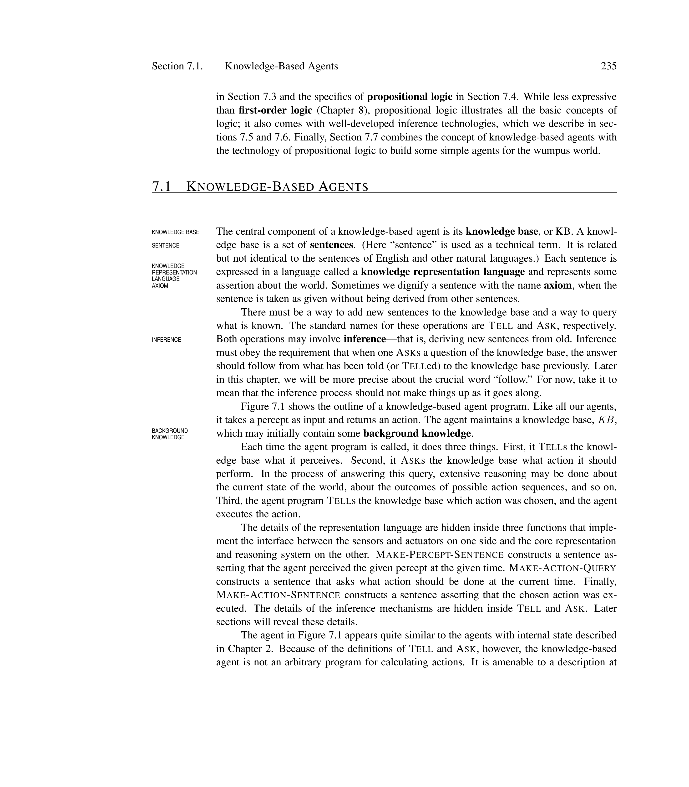
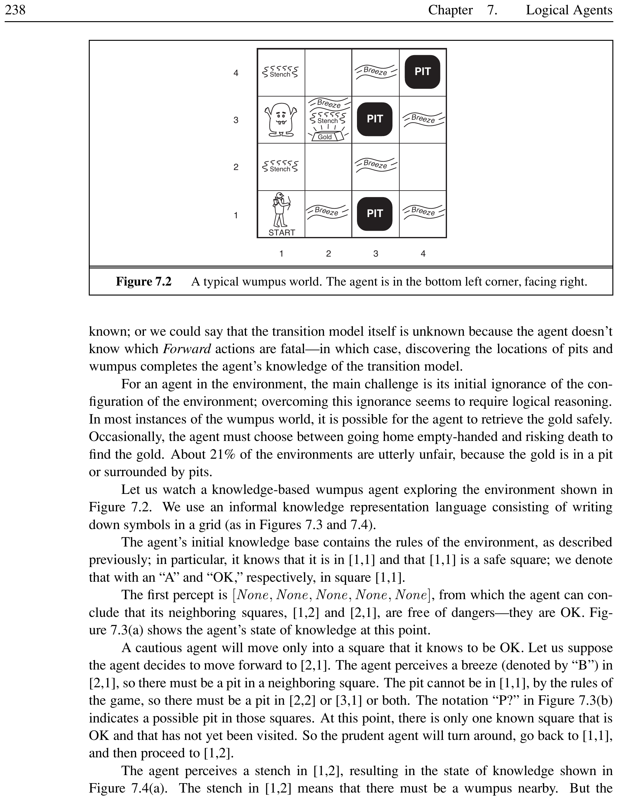
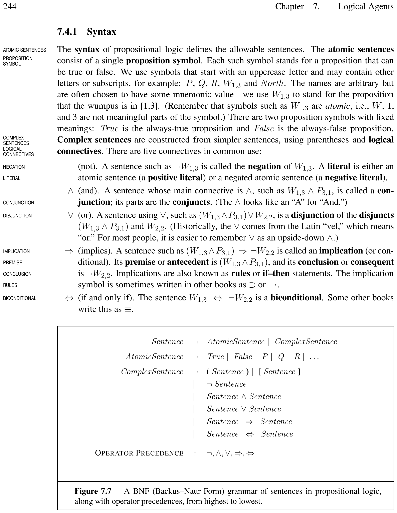
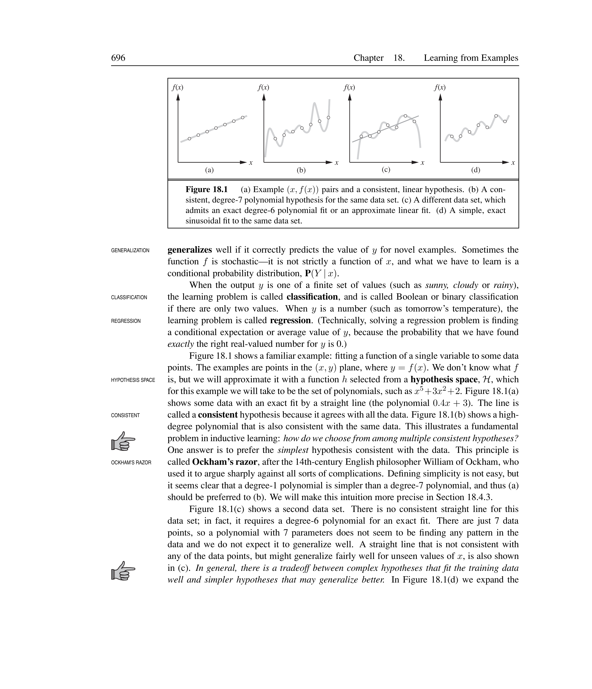
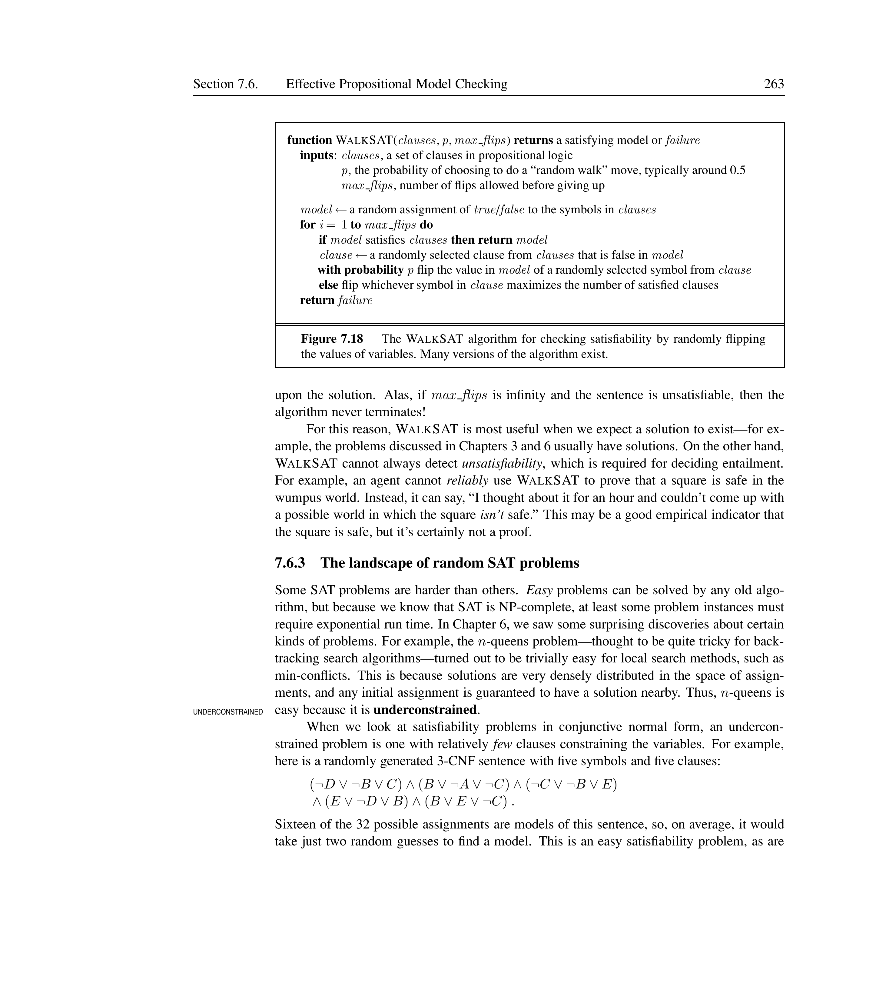
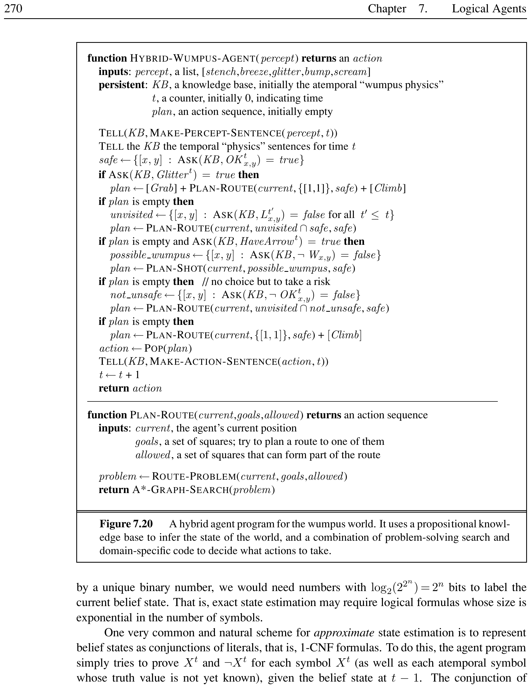
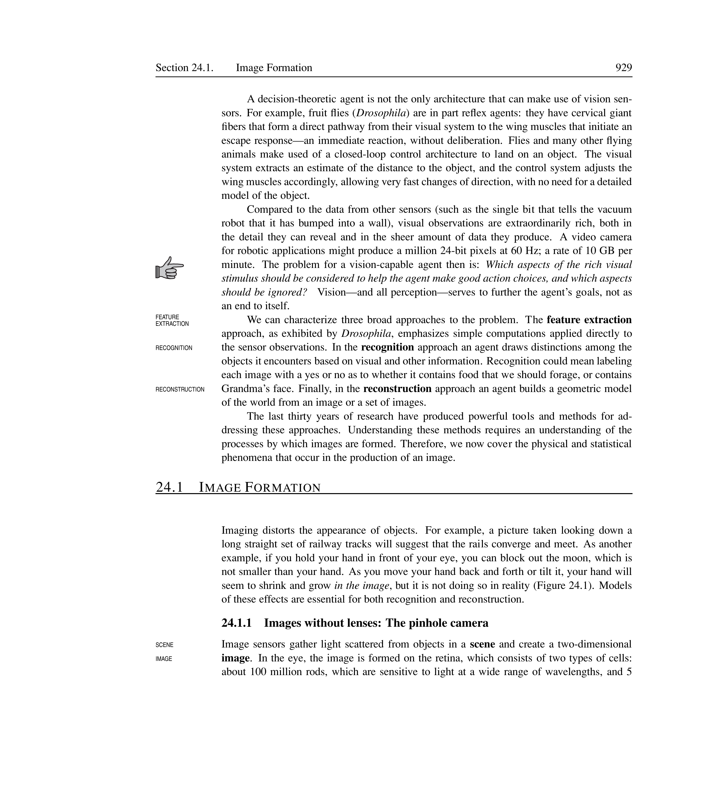

# Logical Agents


In which we design agents that can form representations of a complex world, use a process of inference to derive new representations about the world, and use these new representations to deduce what to do.

## Knowledge-Based Agents


<div style="border-left: 4px solid #1a5c9e; background-color: #f0f4f8; padding: 15px; margin: 20px 0; border-radius: 4px;">
<strong>📖 Knowledge Base (KB)</strong>

A **knowledge base** is a set of **sentences**. Each sentence is expressed in a **knowledge representation language** and represents some assertion about the world. A sentence taken as given without being derived from other sentences is called an **axiom**.

</div>


<div style="border-left: 4px solid #1a5c9e; background-color: #f0f4f8; padding: 15px; margin: 20px 0; border-radius: 4px;">
<strong>📖 Inference</strong>

**Inference** is the process of deriving new sentences from old ones. The two fundamental operations on a knowledge base are:
\begin{itemize}
    \item **TELL**: add a new sentence to the knowledge base.
    \item **ASK**: query what is known; the answer should follow from what has been told.
\end{itemize}

</div>


<div style="border-left: 4px solid #1a5c9e; background-color: #f0f4f8; padding: 15px; margin: 20px 0; border-radius: 4px;">
<strong>📖 Knowledge Level vs. Implementation Level</strong>

At the **knowledge level**, we specify only what the agent knows and what its goals are, in order to fix its behavior. At the **implementation level**, we specify how the knowledge is actually represented and manipulated in code.

</div>


[htbp]





*Caption: Architecture of a knowledge-based agent. The agent tells the KB what it perceives, asks the KB what to do, and tells the KB the action it chose.*


\end{figure}

A knowledge-based agent program maintains a knowledge base (KB) and a counter $t$ indicating time. Given a percept, it constructs a percept sentence, tells the KB, asks for the best action, tells the KB the chosen action, and returns it.


<div style="border-left: 4px solid #2e7d32; background-color: #e8f5e9; padding: 15px; margin: 20px 0; border-radius: 4px;">
<strong>💡 KB-Agent Pseudocode</strong>


```text
function KB-AGENT(percept) returns an action
  persistent: KB, a knowledge base
              t, a counter indicating time
  TELL(KB, MAKE-PERCEPT-SENTENCE(percept, t))
  action <- ASK(KB, MAKE-ACTION-QUERY(t))
  TELL(KB, MAKE-ACTION-SENTENCE(action, t))
  t <- t + 1
  return action
```


</div>


The **declarative approach** builds an agent by TELLing it what it needs to know, rather than writing procedural code. A successful agent often combines both declarative and procedural elements.

[htbp]


*Caption: Two approaches to building knowledge-based agents. Declarative: TELL the agent what it needs to know. Procedural: encode behavior as code. Modern agents combine both.*


\end{figure}


<div style="border-left: 4px solid #2e7d32; background-color: #e8f5e9; padding: 15px; margin: 20px 0; border-radius: 4px;">
<strong>💡 Declarative vs. Procedural</strong>

An automated taxi:
\begin{itemize}
    \item **Declarative**: TELL the agent ``The Golden Gate Bridge connects San Francisco to Marin County.'' The agent infers the route.
    \item **Procedural**: Hard-code ``If destination is Marin County and location is San Francisco, cross Golden Gate Bridge.''
\end{itemize}
The declarative approach is more flexible: the same knowledge works for any query, not just a specific one.

</div>


## The Wumpus World


<div style="border-left: 4px solid #1a5c9e; background-color: #f0f4f8; padding: 15px; margin: 20px 0; border-radius: 4px;">
<strong>📖 Wumpus World</strong>

The **wumpus world** is a cave consisting of rooms connected by passageways. A beast (the wumpus) eats anyone who enters its room. Some rooms contain bottomless pits. The agent can find a heap of gold. The agent has one arrow to shoot the wumpus.

</div>


[htbp]

\begin{tabularx}{\textwidth}{lX}
\toprule
**Agent** & **Wumpus Hunter** \\
\midrule
**Performance** & +1000 for climbing out with gold, $-1000$ for death (pit or wumpus), $-1$ per action, $-10$ for using arrow \\
**Environment** & $4 \times 4$ grid of rooms, agent starts at $[1,1]$ facing right, gold and wumpus random, pits with prob.\ 0.2 \\
**Actuators** & Forward, TurnLeft, TurnRight, Grab, Shoot, Climb \\
**Sensors** & Stench (wumpus adjacent), Breeze (pit adjacent), Glitter (gold), Bump (wall), Scream (wumpus killed) \\
\bottomrule
\end{tabularx}


*Caption: PEAS description of the wumpus world*


\end{table}

The wumpus environment is **discrete**, **static**, **single-agent**, **sequential**, and **partially observable**.

[htbp]





*Caption: A typical wumpus world. The agent starts at $[1,1]$ facing right.*


\end{figure}

The agent explores the world, using logical reasoning to infer safe squares. For example, no breeze in $[1,1]$ means $[1,2]$ and $[2,1]$ are safe. A breeze in $[2,1]$ suggests a pit in $[2,2]$ or $[3,1]$. A stench in $[1,2]$ implies the wumpus is nearby.


<div style="border-left: 4px solid #2e7d32; background-color: #e8f5e9; padding: 15px; margin: 20px 0; border-radius: 4px;">
<strong>💡 Wumpus Agent Trajectory</strong>

\begin{enumerate}
    \item Start at $[1,1]$: no percept $\Rightarrow$ $[1,2]$ and $[2,1]$ are safe.
    \item Move to $[2,1]$: breeze $\Rightarrow$ pit in $[2,2]$ or $[3,1]$.
    \item Return to $[1,1]$, move to $[1,2]$: stench $\Rightarrow$ wumpus in $[1,3]$ or $[2,2]$.
    \item No breeze in $[1,2]$ $\Rightarrow$ no pit in $[2,2]$, so pit must be in $[3,1]$.
    \item Conclude $[2,2]$ is safe, move there, then to $[2,3]$: glitter! Grab gold.
\end{enumerate}

</div>


## Logic


<div style="border-left: 4px solid #1a5c9e; background-color: #f0f4f8; padding: 15px; margin: 20px 0; border-radius: 4px;">
<strong>📖 Syntax and Semantics</strong>

**Syntax** defines the allowable sentences in a representation language. **Semantics** defines the truth of each sentence with respect to each possible world. A sentence must be either true or false in each possible world.

</div>


<div style="border-left: 4px solid #1a5c9e; background-color: #f0f4f8; padding: 15px; margin: 20px 0; border-radius: 4px;">
<strong>📖 Model and Satisfaction</strong>

A **model** $m$ is a mathematical abstraction that fixes the truth or falsehood of every relevant sentence. If a sentence $\alpha$ is true in model $m$, we say $m$ **satisfies** $\alpha$ or $m$ is a **model** of $\alpha$. The notation $M(\alpha)$ denotes the set of all models of $\alpha$.

</div>


<div style="border-left: 4px solid #1a5c9e; background-color: #f0f4f8; padding: 15px; margin: 20px 0; border-radius: 4px;">
<strong>📖 Entailment</strong>

**Entailment** is the relation between sentences where one sentence follows logically from another:
\[
\alpha \models \beta \quad\text{iff}\quad M(\alpha) \subseteq M(\beta)
\]
That is, in every model in which $\alpha$ is true, $\beta$ is also true.

</div>


<div style="border-left: 4px solid #1a5c9e; background-color: #f0f4f8; padding: 15px; margin: 20px 0; border-radius: 4px;">
<strong>📖 Inference, Soundness, Completeness</strong>

**Logical inference** is the process of deriving conclusions from premises. An inference algorithm is:
\begin{itemize}
    \item **Sound** (truth-preserving): it derives only entailed sentences.
    \item **Complete**: it can derive any sentence that is entailed.
\end{itemize}
\[
\text{KB} \vdash_i \alpha \quad\text{means}\quad \text{inference algorithm } i \text{ derives } \alpha \text{ from KB}
\]

</div>


[htbp]


*Caption: The correspondence between world and representation. Sentences represent aspects of the real world; reasoning constructs new sentences that correspond to new aspects that actually follow.*


\end{figure}


<div style="border-left: 4px solid #1a5c9e; background-color: #f0f4f8; padding: 15px; margin: 20px 0; border-radius: 4px;">
<strong>📖 Grounding</strong>

**Grounding** is the connection between logical reasoning processes and the real environment. The agent's sensors create this connection by generating percept sentences that are true in the real world.

</div>


[htbp]


*Caption: Hierarchy of logical systems ordered by expressiveness.*


\end{figure}


<div style="border-left: 4px solid #2e7d32; background-color: #e8f5e9; padding: 15px; margin: 20px 0; border-radius: 4px;">
<strong>💡 Entailment in Wumpus World</strong>

KB = rules of wumpus world + percepts (no breeze in $[1,1]$, breeze in $[2,1]$). For $\alpha_1 = \neg P_{1,2}$ (no pit in $[1,2]$):
\[
KB \models \alpha_1 \quad\text{because in all 3 models where KB is true, } P_{1,2} \text{ is false.}
\]
For $\alpha_2 = \neg P_{2,2}$:
\[
KB \not\models \alpha_2 \quad\text{because } P_{2,2} \text{ is true in one model and false in another.}
\]

</div>


## Propositional Logic: A Very Simple Logic


<div style="border-left: 4px solid #1a5c9e; background-color: #f0f4f8; padding: 15px; margin: 20px 0; border-radius: 4px;">
<strong>📖 Propositional Logic</strong>

**Propositional logic** is a simple logic consisting of **proposition symbols** (atomic sentences) that can be true or false, combined with **logical connectives**.

</div>


<div style="border-left: 4px solid #1a5c9e; background-color: #f0f4f8; padding: 15px; margin: 20px 0; border-radius: 4px;">
<strong>📖 Syntax of Propositional Logic</strong>

Atomic sentences: proposition symbols ($P, Q, R, W_{1,3}$) plus *True* and *False*. Complex sentences built with five connectives:
\begin{itemize}
    \item **Negation** $\neg$ (not): $\neg P$
    \item **Conjunction** $\land$ (and): $P \land Q$
    \item **Disjunction** $\lor$ (or): $P \lor Q$
    \item **Implication** $\Rightarrow$ (implies): $P \Rightarrow Q$ (premise $\Rightarrow$ conclusion)
    \item **Biconditional** $\Leftrightarrow$ (iff): $P \Leftrightarrow Q$
\end{itemize}
Operator precedence (highest to lowest): $\neg, \land, \lor, \Rightarrow, \Leftrightarrow$.

</div>


[htbp]

\begin{tabular}{cc|cccccc}
$P$ & $Q$ & $\neg P$ & $P \land Q$ & $P \lor Q$ & $P \Rightarrow Q$ & $P \Leftrightarrow Q$ \\
\midrule
F & F & T & F & F & T & T \\
F & T & T & F & T & T & F \\
T & F & F & F & T & F & F \\
T & T & F & T & T & T & T
\end{tabular}

*Caption: Truth tables for the five logical connectives.*


\end{figure}

A **model** in propositional logic simply fixes the truth value (true or false) for every proposition symbol. For $n$ symbols, there are $2^n$ possible models. The truth of any complex sentence is computed recursively from its components.


<div style="border-left: 4px solid #1a5c9e; background-color: #f0f4f8; padding: 15px; margin: 20px 0; border-radius: 4px;">
<strong>📖 Tautology, Contradiction, Contingency</strong>

\begin{itemize}
    \item **Tautology** (valid sentence): true in all models, e.g., $P \lor \neg P$.
    \item **Contradiction** (unsatisfiable sentence): false in all models, e.g., $P \land \neg P$.
    \item **Contingency** (satisfiable but not valid): true in some models, false in others, e.g., $P \land Q$.
\end{itemize}

</div>


[htbp]





*Caption: Classification of propositional sentences by truth in models. Every sentence is either valid (true in all models), unsatisfiable (false in all models), or contingent (true in some, false in others).*


\end{figure}


<div style="border-left: 4px solid #2e7d32; background-color: #e8f5e9; padding: 15px; margin: 20px 0; border-radius: 4px;">
<strong>💡 Wumpus World Knowledge Base</strong>

Key proposition symbols:
\begin{itemize}
    \item $P_{x,y}$: pit in $[x,y]$
    \item $W_{x,y}$: wumpus in $[x,y]$
    \item $B_{x,y}$: breeze in $[x,y]$
    \item $S_{x,y}$: stench in $[x,y]$
\end{itemize}
Sentences for the situation in Figure~7.3(b):
\begin{align*}
R_1 &: \neg P_{1,1} \\
R_2 &: B_{1,1} \Leftrightarrow (P_{1,2} \lor P_{2,1}) \\
R_3 &: B_{2,1} \Leftrightarrow (P_{1,1} \lor P_{2,2} \lor P_{3,1}) \\
R_4 &: \neg B_{1,1} \\
R_5 &: B_{2,1}
\end{align*}

</div>


<div style="border-left: 4px solid #1a5c9e; background-color: #f0f4f8; padding: 15px; margin: 20px 0; border-radius: 4px;">
<strong>📖 Model Checking Inference</strong>

**Model checking** enumerates all possible models to check that $\alpha$ is true in every model in which KB is true. The TT-ENTAILS? algorithm implements this directly:
\[
\text{TT-ENTAILS?}(KB, \alpha) \text{ checks if } M(KB) \subseteq M(\alpha)
\]
Time complexity: $O(2^n)$ for $n$ symbols. Space complexity: $O(n)$ (depth-first).

</div>


## Propositional Theorem Proving


<div style="border-left: 4px solid #1a5c9e; background-color: #f0f4f8; padding: 15px; margin: 20px 0; border-radius: 4px;">
<strong>📖 Logical Equivalence, Validity, Satisfiability</strong>

\begin{itemize}
    \item **Logical equivalence**: $\alpha \equiv \beta$ iff $\alpha \models \beta$ and $\beta \models \alpha$.
    \item **Validity**: a sentence is **valid** (a **tautology**) if true in all models, e.g., $P \lor \neg P$.
    \item **Satisfiability**: a sentence is **satisfiable** if true in some model.
    \item The **SAT problem**: determine if a propositional sentence is satisfiable (NP-complete).
\end{itemize}

</div>


The **deduction theorem**: $\alpha \models \beta$ iff $(\alpha \Rightarrow \beta)$ is valid. Also: $\alpha \models \beta$ iff $(\alpha \land \neg\beta)$ is unsatisfiable (**reductio ad absurdum** or proof by contradiction).

[htbp]

\begin{tabular}{ll}
\toprule
**Name** & **Rule** \\
\midrule
Modus Ponens & $\displaystyle\frac{\alpha \Rightarrow \beta,\quad \alpha}{\beta}$ \\
Modus Tollens & $\displaystyle\frac{\alpha \Rightarrow \beta,\quad \neg\beta}{\neg\alpha}$ \\
And-Elimination & $\displaystyle\frac{\alpha \land \beta}{\alpha}$ \\
And-Introduction & $\displaystyle\frac{\alpha,\quad \beta}{\alpha \land \beta}$ \\
Or-Introduction & $\displaystyle\frac{\alpha}{\alpha \lor \beta}$ \\
Unit Resolution & $\displaystyle\frac{\ell_1 \lor \cdots \lor \ell_k,\quad m}{\ell_1 \lor \cdots \lor \ell_{i-1} \lor \ell_{i+1} \lor \cdots \lor \ell_k}$ \\
Full Resolution & $\displaystyle\frac{\ell_1 \lor \cdots \lor \ell_k,\quad m_1 \lor \cdots \lor m_n}{\ell_1 \lor \cdots \lor \ell_{i-1} \lor \ell_{i+1} \lor \cdots \lor \ell_k \lor m_1 \lor \cdots \lor m_{j-1} \lor m_{j+1} \lor \cdots \lor m_n}$ \\
\bottomrule
\end{tabular}

*Caption: Key inference rules for propositional logic. Complementary literals $\ell_i$ and $m_j$ cancel in resolution.*


\end{figure}


<div style="border-left: 4px solid #1a5c9e; background-color: #f0f4f8; padding: 15px; margin: 20px 0; border-radius: 4px;">
<strong>📖 Standard Logical Equivalences</strong>

\begin{align*}
(\alpha \land \beta) &\equiv (\beta \land \alpha) \\
(\alpha \lor \beta) &\equiv (\beta \lor \alpha) \\
((\alpha \land \beta) \land \gamma) &\equiv (\alpha \land (\beta \land \gamma)) \\
((\alpha \lor \beta) \lor \gamma) &\equiv (\alpha \lor (\beta \lor \gamma)) \\
\neg(\neg\alpha) &\equiv \alpha \\
(\alpha \Rightarrow \beta) &\equiv (\neg\beta \Rightarrow \neg\alpha) \\
(\alpha \Rightarrow \beta) &\equiv (\neg\alpha \lor \beta) \\
(\alpha \Leftrightarrow \beta) &\equiv ((\alpha \Rightarrow \beta) \land (\beta \Rightarrow \alpha)) \\
\neg(\alpha \land \beta) &\equiv (\neg\alpha \lor \neg\beta) \\
\neg(\alpha \lor \beta) &\equiv (\neg\alpha \land \neg\beta) \\
(\alpha \land (\beta \lor \gamma)) &\equiv ((\alpha \land \beta) \lor (\alpha \land \gamma)) \\
(\alpha \lor (\beta \land \gamma)) &\equiv ((\alpha \lor \beta) \land (\alpha \lor \gamma))
\end{align*}

</div>


### Resolution


<div style="border-left: 4px solid #1a5c9e; background-color: #f0f4f8; padding: 15px; margin: 20px 0; border-radius: 4px;">
<strong>📖 Conjunctive Normal Form (CNF)</strong>

**CNF** is a conjunction of clauses, where each **clause** is a disjunction of literals. Every propositional sentence can be converted to CNF:
\begin{enumerate}
    \item Eliminate $\Leftrightarrow$ (replace with $(\alpha \Rightarrow \beta) \land (\beta \Rightarrow \alpha)$)
    \item Eliminate $\Rightarrow$ (replace $\alpha \Rightarrow \beta$ with $\neg\alpha \lor \beta$)
    \item Move $\neg$ inwards (De Morgan, double negation)
    \item Distribute $\lor$ over $\land$
\end{enumerate}
**Factoring** (also called **pure literal elimination**) removes duplicate literals within a clause and removes clauses containing complementary literals.

</div>


[htbp]


*Caption: Resolution algorithm flow. To prove $KB \models \alpha$, show $KB \land \neg\alpha$ is unsatisfiable by deriving the empty clause.*


\end{figure}


<div style="border-left: 4px solid #2e7d32; background-color: #e8f5e9; padding: 15px; margin: 20px 0; border-radius: 4px;">
<strong>💡 Wumpus Resolution Proof</strong>

Prove $\neg P_{1,2}$ from KB:
\begin{align*}
R_2 &: B_{1,1} \Leftrightarrow (P_{1,2} \lor P_{2,1}) \\
R_4 &: \neg B_{1,1} \\
R_6 &: (B_{1,1} \Rightarrow (P_{1,2} \lor P_{2,1})) \land ((P_{1,2} \lor P_{2,1}) \Rightarrow B_{1,1}) \\
R_7 &: (P_{1,2} \lor P_{2,1}) \Rightarrow B_{1,1} \\
R_8 &: \neg B_{1,1} \Rightarrow \neg(P_{1,2} \lor P_{2,1}) \\
R_9 &: \neg(P_{1,2} \lor P_{2,1}) \\
R_{10} &: \neg P_{1,2} \land \neg P_{2,1}
\end{align*}
Resolution is **complete** for propositional logic: if a set of clauses is unsatisfiable, repeated resolution will derive the empty clause.

</div>


### Key Properties
\begin{itemize}
    \item Resolution is **sound**: the resolvent follows logically from the parent clauses.
    \item Resolution is **complete** for propositional logic: if $KB \land \neg\alpha$ is unsatisfiable, resolution will derive the empty clause.
    \item PL-RESOLUTION always terminates because only finitely many distinct clauses can be formed from the $k$ proposition symbols.
    \item Resolution is refutation-complete: it proves $\alpha$ from $KB$ by deriving a contradiction from $KB \land \neg\alpha$.
\end{itemize}

### Horn Clauses and Definite Clauses


<div style="border-left: 4px solid #1a5c9e; background-color: #f0f4f8; padding: 15px; margin: 20px 0; border-radius: 4px;">
<strong>📖 Horn and Definite Clauses</strong>

\begin{itemize}
    \item **Definite clause**: a disjunction of literals with exactly one positive literal. Equivalent to $(P_1 \land \cdots \land P_k) \Rightarrow Q$.
    \item **Horn clause**: a disjunction with at most one positive literal. Includes definite clauses and **goal clauses** (no positive literals).
    \item **Fact**: a definite clause with no negative literals (e.g., $L_{1,1}$).
\end{itemize}
Horn clauses are closed under resolution. Entailment with Horn clauses is decidable in $O(n)$ time.

</div>


[htbp]


*Caption: Classification of propositional clauses by form.*


\end{figure}


<div style="border-left: 4px solid #2e7d32; background-color: #e8f5e9; padding: 15px; margin: 20px 0; border-radius: 4px;">
<strong>💡 Forward Chaining</strong>

Forward chaining is **data-driven**: start from known facts, apply Modus Ponens to derive new facts until the query is proved or no more inferences are possible.

Rules: $A \land B \Rightarrow L$, $A \land P \Rightarrow L$, $B \land L \Rightarrow M$, $L \land M \Rightarrow P$, $P \Rightarrow Q$.
Facts: $A$, $B$.

\begin{enumerate}
    \item Start with agenda: $A, B$.
    \item Process $A$: count[$A \land B \Rightarrow L$] decrements from 2 to 1.
    \item Process $B$: count[$A \land B \Rightarrow L$] becomes 0 $\Rightarrow$ add $L$.
    \item Process $L$: count[$B \land L \Rightarrow M$] becomes 0 $\Rightarrow$ add $M$, count[$L \land M \Rightarrow P$] becomes 1.
    \item Process $M$: count[$L \land M \Rightarrow P$] becomes 0 $\Rightarrow$ add $P$.
    \item Process $P$: count[$P \Rightarrow Q$] becomes 0 $\Rightarrow$ add $Q$. Query $Q$ proved!
\end{enumerate}

</div>


<div style="border-left: 4px solid #2e7d32; background-color: #e8f5e9; padding: 15px; margin: 20px 0; border-radius: 4px;">
<strong>💡 Backward Chaining</strong>

Backward chaining is **goal-directed**: start from the query and work backward through implications until known facts are reached. For query $Q$:
\begin{enumerate}
    \item Find $P \Rightarrow Q$. Need to prove $P$.
    \item Find $L \land M \Rightarrow P$. Need to prove $L$ and $M$.
    \item Find $A \land B \Rightarrow L$: $A$ and $B$ are known facts $\Rightarrow$ $L$ proved.
    \item Find $B \land L \Rightarrow M$: $B$ and $L$ are known $\Rightarrow$ $M$ proved.
    \item All premises satisfied $\Rightarrow$ $Q$ proved.
\end{enumerate}
Backward chaining touches only relevant facts, making it more efficient for specific queries.

</div>


### Key Properties
\begin{itemize}
    \item Forward chaining is sound and complete for Horn clauses.
    \item Backward chaining is sound and complete for Horn clauses.
    \item Both run in linear time $O(n)$.
    \item **Monotonicity**: if $KB \models \alpha$, then $KB \land \beta \models \alpha$ for any $\beta$.
\end{itemize}

## Effective Propositional Model Checking


<div style="border-left: 4px solid #1a5c9e; background-color: #f0f4f8; padding: 15px; margin: 20px 0; border-radius: 4px;">
<strong>📖 SAT Problem</strong>

The **SAT problem** is the problem of determining whether a propositional sentence is satisfiable. Testing entailment $KB \models \alpha$ reduces to testing unsatisfiability of $KB \land \neg\alpha$.

</div>


[htbp]





*Caption: Classification of SAT solving approaches. Complete algorithms (DPLL) can prove unsatisfiability; incomplete algorithms (WalkSAT) cannot.*


\end{figure}

### DPLL


<div style="border-left: 4px solid #1a5c9e; background-color: #f0f4f8; padding: 15px; margin: 20px 0; border-radius: 4px;">
<strong>📖 DPLL Algorithm</strong>

The **DPLL** (Davis--Putnam--Logemann--Loveland) algorithm is a complete, backtracking-based SAT solver for CNF sentences. It improves over naive model checking with three key techniques:
\begin{itemize}
    \item **Early termination**: detect if sentence is true (all clauses satisfied) or false (any clause falsified) with a partial model.
    \item **Pure symbol heuristic**: a symbol appearing with only one sign in all remaining clauses can be assigned to make its literals true.
    \item **Unit clause heuristic**: a clause with all literals false except one forces that literal to true. Cascading assignments are called **unit propagation**.
\end{itemize}

</div>


[htbp]


*Caption: DPLL algorithm flow. At each step: check termination, apply pure symbol heuristic, apply unit clause heuristic, then branch on a symbol.*


\end{figure}


<div style="border-left: 4px solid #2e7d32; background-color: #e8f5e9; padding: 15px; margin: 20px 0; border-radius: 4px;">
<strong>💡 DPLL Trace</strong>

Consider clauses: $(A \lor B) \land (A \lor \neg C) \land (\neg B \lor \neg C)$.
\begin{enumerate}
    \item Pure symbol: $C$ appears only as negative literal $\neg C$ $\Rightarrow$ assign $C =$ false.
    \item After $C =$ false: clauses $\Rightarrow (A \lor B) \land (A \lor \text{true}) \land (\neg B \lor \text{true})$.
    \item Empty clause? No. $(A \lor \text{true})$ and $(\neg B \lor \text{true})$ are satisfied.
    \item Remaining: $(A \lor B)$. Unit clause? No. Pure symbol? $A$ and $B$ both appear positive.
    \item Split on $A =$ true $\Rightarrow$ all clauses satisfied. Model found!
\end{enumerate}

</div>


### Key Properties
\begin{itemize}
    \item DPLL is **complete**: it will eventually find a model if one exists, or prove unsatisfiability.
    \item Early termination, pure symbol heuristic, and unit propagation prune large portions of the search space.
    \item Modern SAT solvers add conflict-driven clause learning (CDCL), component analysis, and random restarts.
    \item DPLL with these enhancements can handle problems with tens of millions of variables.
\end{itemize}

### WalkSAT


<div style="border-left: 4px solid #1a5c9e; background-color: #f0f4f8; padding: 15px; margin: 20px 0; border-radius: 4px;">
<strong>📖 WalkSAT</strong>

**WalkSAT** is a local search algorithm for SAT. It starts with a random assignment and repeatedly flips a symbol in an unsatisfied clause, choosing randomly between:
\begin{itemize}
    \item **Min-conflicts**: flip the symbol that maximizes the number of satisfied clauses.
    \item **Random walk**: flip a random symbol from the clause.
\end{itemize}
WalkSAT is sound (finds model if one exists with enough time) but not complete (cannot prove unsatisfiability).

</div>


[htbp]





*Caption: WalkSAT algorithm flow. With probability $p$ perform random walk, otherwise min-conflicts.*


\end{figure}


<div style="border-left: 4px solid #2e7d32; background-color: #e8f5e9; padding: 15px; margin: 20px 0; border-radius: 4px;">
<strong>💡 WalkSAT Trace</strong>

Clauses: $(A \lor B) \land (\neg A \lor \neg B) \land (A \lor \neg B)$. Random assignment: $A=T, B=T$.
\begin{enumerate}
    \item Check: $(T \lor T)=T$, $(\neg T \lor \neg T)=(\neg T)=F$, $(T \lor \neg T)=T$. Clause 2 is false.
    \item Pick clause 2: $(\neg A \lor \neg B)$. Symbols: $A$ (negative), $B$ (negative).
    \item With prob $p=0.5$: flip random symbol. Or compute scores: flip $A$ $\Rightarrow$ all satisfied (score 3), flip $B$ $\Rightarrow$ all satisfied (score 3). Either flip works.
    \item New assignment: $A=F, B=T$ (or $A=T, B=F$). All clauses satisfied!
\end{enumerate}

</div>


### Key Properties
\begin{itemize}
    \item WalkSAT is **sound** (if it returns a model, the sentence is satisfiable) but **not complete** (failure does not imply unsatisfiability).
    \item Most useful when a solution is expected to exist (e.g., CSPs, planning).
    \item Performance depends on the probability parameter $p$ (typically $\approx 0.5$) and the clause/symbol ratio.
    \item Hardest random 3-SAT instances cluster near the satisfiability threshold ($m/n \approx 4.26$).
\end{itemize}


<div style="border-left: 4px solid #1a5c9e; background-color: #f0f4f8; padding: 15px; margin: 20px 0; border-radius: 4px;">
<strong>📖 Satisfiability Threshold Conjecture</strong>

For random $k$-CNF sentences with $n$ symbols and $m$ clauses, there exists a threshold ratio $r_k = m/n$ such that as $n \to \infty$:
\begin{itemize}
    \item Below $r_k$: satisfiable with probability 1.
    \item Above $r_k$: unsatisfiable with probability 1.
    \item For $k=3$, the threshold is approximately $4.26$. The hardest problems cluster near this threshold.
\end{itemize}

</div>


## Agents Based on Propositional Logic


<div style="border-left: 4px solid #1a5c9e; background-color: #f0f4f8; padding: 15px; margin: 20px 0; border-radius: 4px;">
<strong>📖 Fluent and Atemporal Variable</strong>

A **fluent** is an aspect of the world that changes over time, indexed by time step (e.g., $L^t_{x,y}$, $HaveArrow^t$). An **atemporal variable** is a permanent aspect, not indexed by time (e.g., $P_{x,y}$, $W_{x,y}$).

</div>


<div style="border-left: 4px solid #1a5c9e; background-color: #f0f4f8; padding: 15px; margin: 20px 0; border-radius: 4px;">
<strong>📖 Frame Problem</strong>

The **frame problem** is the challenge of specifying what remains unchanged after an action. Solutions include:
\begin{itemize}
    \item **Effect axioms**: explicit axioms for each fluent that changes under each action ($O(mn)$ axioms).
    \item **Frame axioms**: explicit axioms for each fluent that stays unchanged under each action ($O(mn)$ axioms).
    \item **Successor-state axioms**: for each fluent $F$, define $F^{t+1}$ in terms of $F^t$ and actions at time $t$ ($O(mk)$ axioms):
\end{itemize}
\[
F^{t+1} \Leftrightarrow ActionCausesF^t \lor (F^t \land \neg ActionCausesNotF^t)
\]
The **qualification problem** is the challenge of specifying all preconditions for an action to have its intended effect.

</div>


<div style="border-left: 4px solid #2e7d32; background-color: #e8f5e9; padding: 15px; margin: 20px 0; border-radius: 4px;">
<strong>💡 Successor-State Axiom for HaveArrow</strong>

\[
HaveArrow^{t+1} \Leftrightarrow (HaveArrow^t \land \neg Shoot^t)
\]
The arrow is present at $t+1$ iff it was present at $t$ and not used.

</div>


[htbp]





*Caption: Hybrid agent architecture for the wumpus world. The agent combines logical inference for state estimation with A* search for route planning.*


\end{figure}


<div style="border-left: 4px solid #2e7d32; background-color: #e8f5e9; padding: 15px; margin: 20px 0; border-radius: 4px;">
<strong>💡 Hybrid Wumpus Agent Logic</strong>


```text
function HYBRID-WUMPUS-AGENT(percept) returns an action
  persistent: KB, t, plan
  TELL(KB, MAKE-PERCEPT-SENTENCE(percept, t))
  TELL(KB, temporal "physics" sentences for time t)
  safe <- {[x,y]: ASK(KB, OK^t_x,y) = true}
  if ASK(KB, Glitter^t) = true then
    plan <- [Grab] + PLAN-ROUTE(current, {[1,1]}, safe) + [Climb]
  if plan is empty then
    unvisited <- {[x,y]: ASK(KB, L^t_x,y) = false for all t' <= t}
    plan <- PLAN-ROUTE(current, unvisited & safe, safe)
  if plan is empty and ASK(KB, HaveArrow^t) = true then
    possible-wumpus <- {[x,y]: ASK(KB, not W_x,y) = false}
    plan <- PLAN-SHOT(current, possible-wumpus, safe)
  if plan is empty then
    not-unsafe <- {[x,y]: ASK(KB, not OK^t_x,y) = false}
    plan <- PLAN-ROUTE(current, unvisited & not-unsafe, safe)
  if plan is empty then
    plan <- PLAN-ROUTE(current, {[1,1]}, safe) + [Climb]
  action <- POP(plan)
  TELL(KB, MAKE-ACTION-SENTENCE(action, t))
  t <- t + 1
  return action
```


</div>


The hybrid agent maintains a 1-CNF belief state (conjunction of literals) as a **conservative approximation** of the true belief state. This approximation is guaranteed to include all states consistent with the percept history, but may lose disjunctive information.

### Key Properties
\begin{itemize}
    \item The hybrid agent is **sound**: all inferences from the KB are logically guaranteed.
    \item **State estimation** via 1-CNF is an approximation guaranteed to include all true states but may lose disjunctive information.
    \item **Successor-state axioms** solve the representational frame problem with $O(mk)$ axioms instead of $O(mn)$.
    \item **Precondition axioms** and **action exclusion axioms** prevent spurious SATPlan solutions with illegal or simultaneous actions.
\end{itemize}

[htbp]





*Caption: Three types of agents based on propositional logic, from simplest (reflex) to most complex (SATPlan).*


\end{figure}


<div style="border-left: 4px solid #2e7d32; background-color: #e8f5e9; padding: 15px; margin: 20px 0; border-radius: 4px;">
<strong>💡 Three PL Agent Types</strong>

\begin{itemize}
    \item **Reflex agent**: condition--action rules directly map percepts to actions. No internal state. E.g., ``If breeze, turn away.''
    \item **Hybrid agent**: logical KB for state estimation + A* search for planning. E.g., the HYBRID-WUMPUS-AGENT (Figure~\ref{fig:hybrid-agent}).
    \item **Planning agent (SATPlan)**: formulates the entire planning problem as a SAT instance and uses a SAT solver to find a plan. Finds shortest plan by iterating $t = 0, 1, \dots, T_{max}$.
\end{itemize}

</div>


### SATPlan


<div style="border-left: 4px solid #1a5c9e; background-color: #f0f4f8; padding: 15px; margin: 20px 0; border-radius: 4px;">
<strong>📖 SATPlan</strong>

**SATPlan** formulates planning as SAT: construct a sentence containing initial state, successor-state axioms, precondition axioms, and action exclusion axioms for time steps $0$ to $t$, and ask a SAT solver to find a model. The actions assigned *true* in the model form the plan. SATPlan finds the shortest plan by trying $t = 0, 1, 2, \dots$ up to $T_{max}$.

</div>


## Reasoning in Propositional Logic


<div style="border-left: 4px solid #1a5c9e; background-color: #f0f4f8; padding: 15px; margin: 20px 0; border-radius: 4px;">
<strong>📖 Deductive Reasoning</strong>

**Deductive reasoning** (deduction) moves from general premises to specific conclusions. If the premises are true, the conclusion is guaranteed to be true. In propositional logic, this corresponds to entailment: $KB \models \alpha$.
\[
\text{General} \rightarrow \text{Specific} \quad\text{e.g., All humans are mortal; Socrates is human} \Rightarrow \text{Socrates is mortal}
\]

</div>


<div style="border-left: 4px solid #1a5c9e; background-color: #f0f4f8; padding: 15px; margin: 20px 0; border-radius: 4px;">
<strong>📖 Inductive Reasoning</strong>

**Inductive reasoning** (induction) moves from specific observations to general conclusions. The conclusion is probable but not guaranteed.
\[
\text{Specific} \rightarrow \text{General} \quad\text{e.g., Observed 100 swans, all white} \Rightarrow \text{All swans are white}
\]

</div>


<div style="border-left: 4px solid #1a5c9e; background-color: #f0f4f8; padding: 15px; margin: 20px 0; border-radius: 4px;">
<strong>📖 Abductive Reasoning</strong>

**Abductive reasoning** (abduction) infers the best explanation for observed facts. Given a rule $A \Rightarrow B$ and observed $B$, infer $A$ as a possible explanation.
\[
\text{Observed} \rightarrow \text{Best explanation} \quad\text{e.g., Grass is wet} \Rightarrow \text{It rained (best explanation)}
\]
Abduction is not logically sound ($B$ does not entail $A$), but is essential for diagnosis and common-sense reasoning.

</div>


[htbp]


*Caption: Three types of reasoning in propositional logic.*


\end{figure}


<div style="border-left: 4px solid #2e7d32; background-color: #e8f5e9; padding: 15px; margin: 20px 0; border-radius: 4px;">
<strong>💡 Knights and Knaves Puzzle</strong>

On an island, knights always tell the truth and knaves always lie. You meet two people: A and B. A says: ``B is a knight.'' B says: ``We are different types.''

**Solution using propositional logic:**
Let $A$ = ``A is a knight'' and $B$ = ``B is a knight''.
\begin{itemize}
    \item If A is a knight ($A$ true): A's statement ($B$) is true $\Rightarrow$ $B$ true.
    \item If B is a knight ($B$ true): B's statement ($A \oplus B$) is true $\Rightarrow$ $A \oplus B$ is true. But $A$ and $B$ are both true $\Rightarrow$ contradiction!
    \item Therefore A cannot be a knight; A must be a knave ($A$ false).
    \item A said $B$, which is false $\Rightarrow$ $B$ is false (B is a knave).
    \item Check: B said $A \oplus B$. With $A$ false, $B$ false: $A \oplus B$ is false, which is consistent with B being a knave.
    \item Conclusion: Both are knaves.
\end{itemize}

</div>


<div style="border-left: 4px solid #f57f17; background-color: #fffde7; padding: 15px; margin: 20px 0; border-radius: 4px;">
<strong>❓ Exam Question</strong>

What are the drawbacks of propositional logic?

</div>


<div style="border-left: 4px solid #2e7d32; background-color: #f1f8e9; padding: 15px; margin: 20px 0; border-radius: 4px;">
<strong>✅ Solution</strong>

\begin{itemize}
    \item **Limited expressiveness**: cannot represent objects, relations, or quantifiers. Each fact requires a separate symbol (e.g., $P_{1,1}, P_{1,2}, \dots$ for each square).
    \item **No structure**: proposition symbols are atomic with no internal structure.
    \item **Scalability**: requires $O(n \times m)$ axioms for $n$ time steps and $m$ squares; cannot express ``for all squares'' or ``for all times'' concisely.
    \item **Frame problem**: must explicitly specify what stays unchanged.
    \item These limitations motivate first-order logic (Chapter~8), which can describe a wumpus world of any size in about ten sentences.
\end{itemize}

</div>


<div style="border-left: 4px solid #f57f17; background-color: #fffde7; padding: 15px; margin: 20px 0; border-radius: 4px;">
<strong>❓ Exam Question</strong>

What are the components of a knowledge base system? Explain with a suitable diagram.

</div>


<div style="border-left: 4px solid #2e7d32; background-color: #f1f8e9; padding: 15px; margin: 20px 0; border-radius: 4px;">
<strong>✅ Solution</strong>

A knowledge base system consists of:
\begin{itemize}
    \item **Knowledge Base (KB)**: stores sentences (axioms and derived facts).
    \item **Inference Engine**: applies inference rules to derive new sentences.
    \item **TELL interface**: adds new sentences to the KB.
    \item **ASK interface**: queries the KB for entailed sentences.
    \item **Knowledge Acquisition**: mechanism to add domain knowledge.
\end{itemize}
See Figure~\ref{fig:kb-agent} for the architecture diagram.

</div>


### Summary

Key points from this chapter:
\begin{itemize}
    \item **Knowledge-based agents** store sentences in a KB and use inference to derive new sentences and decide actions.
    \item The **wumpus world** is a benchmark environment for logical agents with PEAS: performance (gold reward), discrete $4\times4$ grid, five sensors, six actuators.
    \item **Logic** consists of syntax (well-formed sentences) and semantics (truth in models). Entailment ($\models$) is truth in all models of the KB.
    \item **Propositional logic** provides atomic sentences and truth-functional connectives ($\neg, \land, \lor, \Rightarrow, \Leftrightarrow$).
    \item **Theorem proving** uses inference rules (Modus Ponens, resolution) to construct proofs. **Resolution** in CNF is complete for propositional logic.
    \item **Horn clauses** enable efficient $O(n)$ forward and backward chaining.
    \item **Model checking** enumerates models (TT-ENTAILS?), or uses backtracking (DPLL) or local search (WalkSAT).
    \item **Agents based on PL** deal with fluents, the frame problem (solved by successor-state axioms), and the qualification problem.
    \item **Hybrid agents** combine logical state estimation with search-based planning.
    \item Propositional logic is limited in expressiveness, motivating **first-order logic** (Chapter~8).
\end{itemize}
