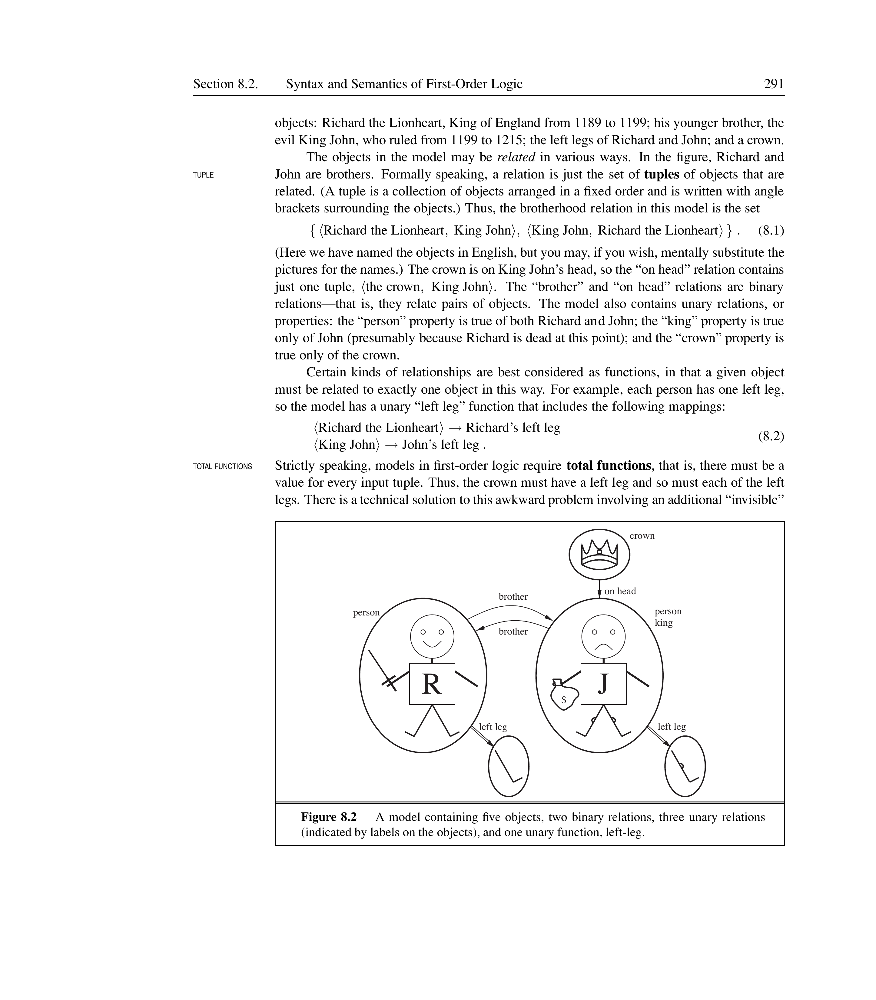
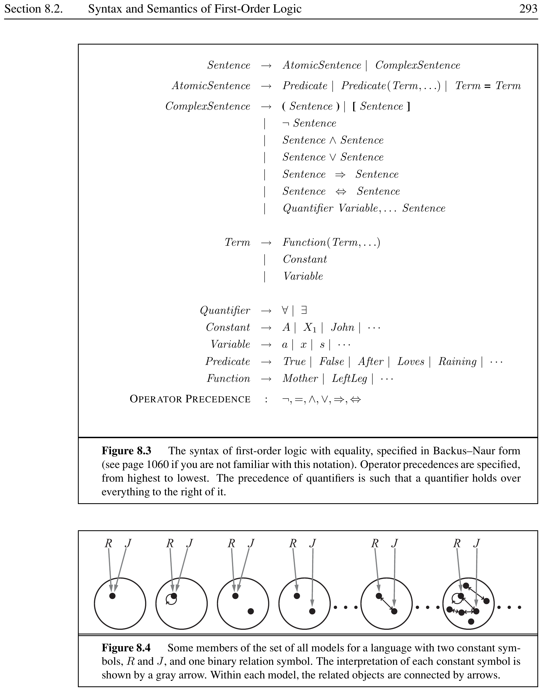
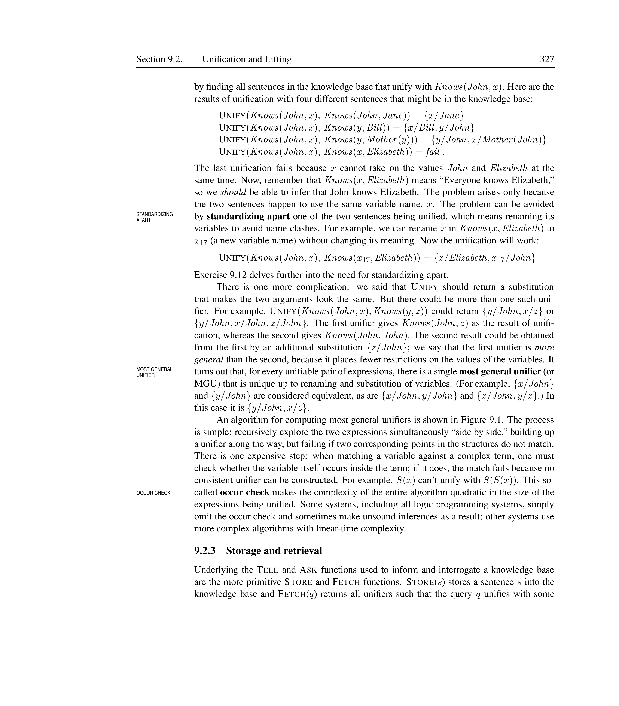
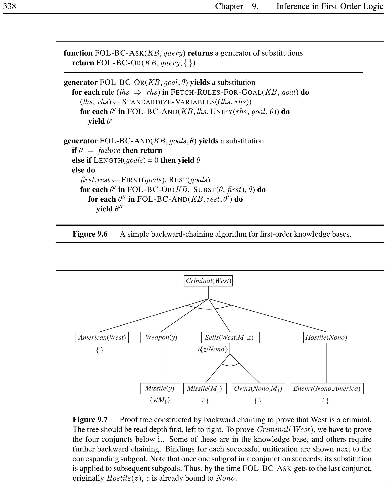


# First-Order Logic

In which we notice that the world is blessed with many objects, some of which are related to other objects, and in which we endeavor to reason about them.

## Representation Revisited

<div markdown="1" style="border-left:4px solid #1a5c9e;background:#f0f4f8;padding:14px 18px;margin:18px 0;border-radius:6px;">

Compositionality

A language is **compositional** if the meaning of a sentence is a function of the meaning of its parts. For example, the meaning of $S_{1,4} \land S_{1,2}$ is related to the meanings of $S_{1,4}$ and $S_{1,2}$ individually. Propositional logic is compositional; natural language is not always.

</div>

<div markdown="1" style="border-left:4px solid #1a5c9e;background:#f0f4f8;padding:14px 18px;margin:18px 0;border-radius:6px;">

Ambiguity

**Ambiguity** occurs when a sentence has more than one possible meaning. Natural language suffers from ambiguity (e.g., “spring” can mean a season or a coil). Formal logics are designed to be unambiguous—each sentence has exactly one interpretation.

</div>

Propositional logic has three desirable properties: it is **declarative** (meaning depends on a truth relation between sentences and possible worlds), **compositional**, and it handles partial information using disjunction and negation. However, it lacks the expressive power to concisely describe environments with many objects.

<div markdown="1" style="border-left:4px solid #2e7d32;background:#e8f5e9;padding:14px 18px;margin:18px 0;border-radius:6px;">

Limitation of Propositional Logic

In the wumpus world, we had to write a separate rule for each square: $$B_{1,1} \Leftrightarrow (P_{1,2} \lor P_{2,1})$$ In English we say once: “Squares adjacent to pits are breezy.” FOL captures this concisely: $$\forall s \; Breezy(s) \Leftrightarrow \exists r \; Adjacent(r, s) \land Pit(r)$$

</div>

<div markdown="1" style="border-left:4px solid #1a5c9e;background:#f0f4f8;padding:14px 18px;margin:18px 0;border-radius:6px;">

Object, Relation, Function, Property

In FOL, the world consists of:

- **Objects**: things with identity (people, houses, numbers, colors, etc.)

- **Relations**: ways objects relate to each other (brother of, bigger than, inside, etc.)

- **Functions**: mappings from objects to objects (father of, one more than, etc.)

- **Properties**: unary relations (red, round, prime, etc.)

</div>

<figure>

<figcaption>The three kinds of symbols in first-order logic map to the three kinds of things in the world: objects, relations, and functions.</figcaption>
</figure>

<div markdown="1" style="border-left:4px solid #1a5c9e;background:#f0f4f8;padding:14px 18px;margin:18px 0;border-radius:6px;">

Ontological Commitment

The **ontological commitment** of a logic is what it assumes about the nature of reality—what exists in the world.

- Propositional logic: facts (true or false)

- First-order logic: facts, objects, relations

- Temporal logic: facts, objects, relations, times

- Higher-order logic: relations and functions as objects

</div>

<div markdown="1" style="border-left:4px solid #1a5c9e;background:#f0f4f8;padding:14px 18px;margin:18px 0;border-radius:6px;">

Epistemological Commitment

The **epistemological commitment** of a logic is what an agent can believe about facts.

- Propositional/FOL: true, false, or unknown

- Probability theory: degree of belief in $[0,1]$

- Fuzzy logic: degree of truth in $[0,1]$

</div>

| Language            | Ontological Commitment           | Epistemological Commitment   |
|:--------------------|:---------------------------------|:-----------------------------|
| Propositional logic | facts                            | true/false/unknown           |
| First-order logic   | facts, objects, relations        | true/false/unknown           |
| Temporal logic      | facts, objects, relations, times | true/false/unknown           |
| Probability theory  | facts                            | degree of belief $\in [0,1]$ |
| Fuzzy logic         | facts with degree of truth       | known interval value         |

Formal languages and their ontological and epistemological commitments

### Key Properties of FOL vs. PL

- FOL is more expressive: it quantifies over objects, not just propositions.

- PL is decidable; FOL is only semidecidable (entailment).

- FOL requires more complex inference procedures (unification, resolution).

- Temporal logic adds time; higher-order logic adds relations as objects.

### Temporal Logic vs. First-Order Logic

<div markdown="1" style="border-left:4px solid #1a5c9e;background:#f0f4f8;padding:14px 18px;margin:18px 0;border-radius:6px;">

Temporal Logic

**Temporal logic** extends FOL with time-based operators: $\Box P$ (“always $P$”), $\Diamond P$ (“eventually $P$”), $\bigcirc P$ (“next $P$”), and $P \Until Q$ (“$P$ until $Q$”).

</div>

FOL describes a static world—it asserts what is true at a given moment but cannot directly express change over time. Temporal logic makes time a first-class citizen. While FOL can encode time by adding a time argument to every predicate ($King(x, t)$), temporal logic provides built-in operators that make temporal reasoning more natural.

The choice between FOL and temporal logic depends on the domain: static domains (family trees, mathematical theorems) are well served by FOL; dynamic domains (planning, protocols, reactive systems) benefit from temporal logic’s explicit time operators.

<div markdown="1" style="border-left:4px solid #2e7d32;background:#e8f5e9;padding:14px 18px;margin:18px 0;border-radius:6px;">

FOL vs. Temporal Logic

- FOL: $\forall x \; King(x) \Rightarrow Person(x)$  
  “All kings are persons” (timeless)

- Temporal: $\Box(\forall x \; King(x) \Rightarrow \Diamond Person(x))$  
  “Always, every king eventually becomes a person”

The temporal version captures change—kings are born as princes and become kings later.

</div>

## Syntax and Semantics of First-Order Logic

<div markdown="1" style="border-left:4px solid #1a5c9e;background:#f0f4f8;padding:14px 18px;margin:18px 0;border-radius:6px;">

Domain and Domain Elements

The **domain** of a model is the set of objects (or **domain elements**) it contains. The domain must be nonempty. A **tuple** is a collection of objects arranged in a fixed order, written $\langle o_1, o_2, \ldots, o_n \rangle$.

</div>

<div markdown="1" style="border-left:4px solid #1a5c9e;background:#f0f4f8;padding:14px 18px;margin:18px 0;border-radius:6px;">

Constant, Predicate, and Function Symbols

The basic syntactic elements of FOL are:

- **Constant symbols**: stand for objects (e.g., *Richard*, *John*)

- **Predicate symbols**: stand for relations (e.g., *Brother*, *OnHead*)

- **Function symbols**: stand for functions (e.g., *LeftLeg*)

Each predicate and function symbol has an **arity** that fixes the number of arguments.

</div>

An **interpretation** maps constant symbols to objects, predicate symbols to relations on those objects, and function symbols to functions on those objects.

<div markdown="1" style="border-left:4px solid #2e7d32;background:#e8f5e9;padding:14px 18px;margin:18px 0;border-radius:6px;">

Interpretation Example

A model with objects: Richard the Lionheart, King John, their left legs, and a crown.

- *Richard* $\rightarrow$ Richard the Lionheart

- *John* $\rightarrow$ King John

- *Brother* $\rightarrow$ $\{\langle \text{Richard}, \text{John} \rangle, \langle \text{John}, \text{Richard} \rangle\}$

- *LeftLeg(John)* $\rightarrow$ John’s left leg

</div>

### Terms and Atomic Sentences

<div markdown="1" style="border-left:4px solid #1a5c9e;background:#f0f4f8;padding:14px 18px;margin:18px 0;border-radius:6px;">

Term

A **term** is a logical expression that refers to an object. Constant symbols are terms. Complex terms are formed by a function symbol followed by a parenthesized list of terms: $$LeftLeg(John), \quad Father(Richard), \quad plus(1, 2)$$ A term with no variables is called a **ground term**.

</div>

<div markdown="1" style="border-left:4px solid #2e7d32;background:#e8f5e9;padding:14px 18px;margin:18px 0;border-radius:6px;">

Terms and Their References

- Constant term: $John$ refers to the person King John.

- Function term: $LeftLeg(John)$ refers to John’s left leg (a different object).

- Nested function term: $Father(Father(John))$ refers to John’s paternal grandfather.

- Ground term: $plus(2, 3)$ in Peano arithmetic refers to the number 5.

Every term, no matter how complex, denotes exactly one object in the domain.

</div>

<div markdown="1" style="border-left:4px solid #1a5c9e;background:#f0f4f8;padding:14px 18px;margin:18px 0;border-radius:6px;">

Atomic Sentence

An **atomic sentence** (or **atom**) is formed from a predicate symbol optionally followed by a parenthesized list of terms: $$Brother(Richard, John), \quad Married(Father(Richard), Mother(John))$$ An atomic sentence is true if the relation referred to by the predicate holds among the objects referred to by the arguments.

</div>

<div markdown="1" style="border-left:4px solid #2e7d32;background:#e8f5e9;padding:14px 18px;margin:18px 0;border-radius:6px;">

Atomic Sentence Truth Conditions

Given a model where:

- $Richard$ $\rightarrow$ Richard the Lionheart

- $John$ $\rightarrow$ King John

- $Brother$ $\rightarrow$ $\{\langle \text{Richard}, \text{John} \rangle, \langle \text{John}, \text{Richard} \rangle\}$

Then:

- $Brother(Richard, John)$ is **true**—the pair is in the relation.

- $Brother(John, Richard)$ is **true**—brotherhood is symmetric here.

- $Brother(John, LeftLeg(John))$ is **false**—John’s left leg is not his brother.

</div>

### Quantifiers

<div markdown="1" style="border-left:4px solid #1a5c9e;background:#f0f4f8;padding:14px 18px;margin:18px 0;border-radius:6px;">

Universal Quantifier

$\forall x \; P$ means $P$ is true for **every** object $x$. The natural connective with $\forall$ is $\Rightarrow$: $$\forall x \; King(x) \Rightarrow Person(x)$$ “All kings are persons.” The implication is true for objects that are not kings, so the rule only constrains kings.

</div>

<div markdown="1" style="border-left:4px solid #ef6c00;background:#fff3e0;padding:14px 18px;margin:18px 0;border-radius:6px;">

Common Mistake

Using $\land$ with $\forall$:  
$\forall x \; King(x) \land Person(x)$ means “Everything is a king and a person”—far too strong.

</div>

<div markdown="1" style="border-left:4px solid #2e7d32;background:#e8f5e9;padding:14px 18px;margin:18px 0;border-radius:6px;">

Universal Quantifier Examples

- “All humans are mortal”: $$\forall x \; Human(x) \Rightarrow Mortal(x)$$ True for all objects: if an object is human, it is mortal; non-humans satisfy the implication vacuously.

- “Every square in the wumpus world is breezy or has a pit”: $$\forall s \; Breezy(s) \lor HasPit(s)$$ Uses $\lor$ (not $\Rightarrow$) because the property applies universally without condition.

</div>

<div markdown="1" style="border-left:4px solid #1a5c9e;background:#f0f4f8;padding:14px 18px;margin:18px 0;border-radius:6px;">

Existential Quantifier

$\exists x \; P$ means $P$ is true for **at least one** object $x$. The natural connective with $\exists$ is $\land$: $$\exists x \; Crown(x) \land OnHead(x, John)$$ “King John has a crown on his head.”

</div>

<div markdown="1" style="border-left:4px solid #ef6c00;background:#fff3e0;padding:14px 18px;margin:18px 0;border-radius:6px;">

Common Mistake

Using $\Rightarrow$ with $\exists$:  
$\exists x \; Crown(x) \Rightarrow OnHead(x, John)$ is true if any object is not a crown—very weak.

</div>

<div markdown="1" style="border-left:4px solid #2e7d32;background:#e8f5e9;padding:14px 18px;margin:18px 0;border-radius:6px;">

Existential Quantifier Examples

- “Someone is a king”: $$\exists x \; King(x)$$ True if at least one object in the domain is a king.

- “Richard has a crown on his head”: $$\exists x \; Crown(x) \land OnHead(x, Richard)$$ Uses $\land$ because we need both conditions to hold for the same $x$.

</div>

#### Quantifier Equivalences (De Morgan for Quantifiers)

$$\begin{aligned}
\forall x \; \neg P &\equiv \neg \exists x \; P \\
\neg \forall x \; P &\equiv \exists x \; \neg P \\
\forall x \; P &\equiv \neg \exists x \; \neg P \\
\exists x \; P &\equiv \neg \forall x \; \neg P
\end{aligned}$$

<figure>

<figcaption>Classification of first-order logic sentences.</figcaption>
</figure>

### Nested Quantifiers

When quantifiers are mixed, order matters critically: $$\forall x \; \exists y \; Loves(x, y) \quad \text{``Everybody loves somebody.''}$$ $$\exists y \; \forall x \; Loves(x, y) \quad \text{``There is someone who is loved by everybody.''}$$

| Pattern                  | Meaning                        | Example                       |
|:-------------------------|:-------------------------------|:------------------------------|
| $\forall x \; \forall y$ | For all pairs                  | “All brothers are siblings”   |
| $\exists x \; \exists y$ | There exist some pair          | “Someone knows someone”       |
| $\forall x \; \exists y$ | Each has some (depends on $x$) | “Everyone has a mother”       |
| $\exists x \; \forall y$ | Some one for all (independent) | “There is a universal mother” |

Nested quantifier patterns

<div markdown="1" style="border-left:4px solid #2e7d32;background:#e8f5e9;padding:14px 18px;margin:18px 0;border-radius:6px;">

Nested Quantifier Example

“Everybody loves somebody” vs. “Somebody loves everybody”:

- $\forall x \; \exists y \; Loves(x, y)$: each person loves some person (possibly different for each).

- $\exists x \; \forall y \; Loves(x, y)$: there is one person who is loved by all.

These are **not** logically equivalent.

</div>

### Equality Symbol

<div markdown="1" style="border-left:4px solid #1a5c9e;background:#f0f4f8;padding:14px 18px;margin:18px 0;border-radius:6px;">

Equality

The **equality symbol** ($=$) signifies that two terms refer to the same object: $$Father(John) = Henry$$ Equality is used with negation to assert distinctness: $$\exists x, y \; Brother(x, Richard) \land Brother(y, Richard) \land \neg(x = y)$$ “Richard has at least two brothers.”

</div>

<div markdown="1" style="border-left:4px solid #2e7d32;background:#e8f5e9;padding:14px 18px;margin:18px 0;border-radius:6px;">

Using Equality

- “John is the father of Richard”: $$Father(Richard) = John$$

- “There are exactly two kings”: $$\exists x, y \; King(x) \land King(y) \land x \neq y \land \forall z \; King(z) \Rightarrow (z = x \lor z = y)$$

- “No two people have the same mother”: $$\forall x, y \; Mother(x) = Mother(y) \Rightarrow x = y$$

Equality lets us count, distinguish, and identify objects—something impossible in propositional logic.

</div>

### Database Semantics

<div markdown="1" style="border-left:4px solid #1a5c9e;background:#f0f4f8;padding:14px 18px;margin:18px 0;border-radius:6px;">

Database Semantics

**Database semantics** is an alternative to standard FOL semantics with three assumptions:

- **Unique-names assumption**: every constant symbol refers to a distinct object.

- **Closed-world assumption**: atomic sentences not known to be true are false.

- **Domain closure**: the domain contains no more objects than those named by constants.

This semantics is used in database systems and logic programming (Prolog).

</div>

<div markdown="1" style="border-left:4px solid #2e7d32;background:#e8f5e9;padding:14px 18px;margin:18px 0;border-radius:6px;">

Standard Semantics vs. Database Semantics

Given the KB: $King(John)$, no mention of $Richard$:

- **Standard FOL**: $King(Richard)$ is unknown—it may be true or false depending on the model.

- **Database semantics**: $King(Richard)$ is false—the closed-world assumption treats unmentioned facts as false.

Database semantics trades expressiveness for efficiency: query answering becomes closed-form computation rather than open-ended logical inference.

</div>

## Using First-Order Logic

<div markdown="1" style="border-left:4px solid #1a5c9e;background:#f0f4f8;padding:14px 18px;margin:18px 0;border-radius:6px;">

Assertion, Query, Goal

Sentences are added to a knowledge base using **TELL** (called **assertions**). Questions are asked using **ASK** (called **queries** or **goals**). $$\begin{aligned}
&\text{TELL}(KB, King(John)) \\
&\text{TELL}(KB, \forall x \; King(x) \Rightarrow Person(x)) \\
&\text{ASK}(KB, Person(John)) \quad \text{returns true}
\end{aligned}$$

</div>

<div markdown="1" style="border-left:4px solid #1a5c9e;background:#f0f4f8;padding:14px 18px;margin:18px 0;border-radius:6px;">

Substitution and Binding List

**ASKVARS** returns a stream of **substitutions** (or **binding lists**) that make the query true: $$\text{ASKVARS}(KB, Person(x)) \quad \text{returns } \{x/John\}, \{x/Richard\}$$ A substitution $\theta = \{v_1/t_1, v_2/t_2, \ldots\}$ maps variables to terms.

</div>

### Translating English to FOL

| English Pattern     | FOL Translation                                                | Example                 |
|:--------------------|:---------------------------------------------------------------|:------------------------|
| All $P$ are $Q$     | $\forall x \; P(x) \Rightarrow Q(x)$                           | All kings are persons   |
| Some $P$ are $Q$    | $\exists x \; P(x) \land Q(x)$                                 | Some employees are sick |
| No $P$ are $Q$      | $\forall x \; P(x) \Rightarrow \neg Q(x)$                      | No fish are mammals     |
| Only $P$ are $Q$    | $\forall x \; Q(x) \Rightarrow P(x)$                           | Only birds fly          |
| Every $P$ has a $Q$ | $\forall x \; P(x) \Rightarrow \exists y \; Q(y) \land R(x,y)$ | Everyone has a mother   |

English to FOL translation patterns

<div markdown="1" style="border-left:4px solid #2e7d32;background:#e8f5e9;padding:14px 18px;margin:18px 0;border-radius:6px;">

English to FOL Examples

1.  “All employees earning \$1400 or more per year pay taxes.” $$\forall x \; Employee(x) \land Earns(x, y) \land y \geq 1400 \Rightarrow PaysTax(x)$$

2.  “Some employees are sick today.” $$\exists x \; Employee(x) \land Sick(x, Today)$$

3.  “No employee earns more than the president.” $$\forall x, y \; Employee(x) \land President(y) \Rightarrow \neg EarnsMore(x, y)$$

</div>

### Definition, Theorem, and Peano Axioms

<div markdown="1" style="border-left:4px solid #1a5c9e;background:#f0f4f8;padding:14px 18px;margin:18px 0;border-radius:6px;">

Definition and Theorem

A **definition** is an axiom of the form $\forall x, y \; P(x,y) \Leftrightarrow \ldots$ that defines a predicate in terms of others. A **theorem** is a sentence that follows logically from the axioms; it need not be stored in the KB but can be derived when needed.

</div>

<div markdown="1" style="border-left:4px solid #1a5c9e;background:#f0f4f8;padding:14px 18px;margin:18px 0;border-radius:6px;">

Peano Axioms (Natural Numbers)

The natural numbers are defined using one constant $0$ and one function $S$ (successor):

```text
NatNum(0).
forall n NatNum(n) => NatNum(S(n)).
forall n 0 != S(n).
forall m,n m != n => S(m) != S(n).
forall m NatNum(m) => +(0, m) = m.
forall m,n NatNum(m) & NatNum(n) => +(S(m), n) = S(+(m, n)).
```

Addition is defined as repeated application of the successor function.

</div>

## Knowledge Engineering in First-Order Logic

<div markdown="1" style="border-left:4px solid #1a5c9e;background:#f0f4f8;padding:14px 18px;margin:18px 0;border-radius:6px;">

Knowledge Engineering

**Knowledge engineering** is the process of building a knowledge base. A **knowledge engineer** investigates a domain, learns what concepts are important, and creates a formal representation. **Knowledge acquisition** is the process of extracting knowledge from human experts.

</div>

### The Knowledge-Engineering Process

1.  **Identify the task**: delineate the range of questions the KB will support.

2.  **Assemble relevant knowledge**: understand how the domain works.

3.  **Decide on a vocabulary**: choose predicates, functions, and constants—this defines the **ontology**.

4.  **Encode general knowledge**: write axioms for all vocabulary terms.

5.  **Encode problem instance**: write atomic sentences about the specific instance.

6.  **Pose queries**: ask the inference procedure for answers.

7.  **Debug the KB**: fix missing or incorrect axioms.

<div markdown="1" style="border-left:4px solid #1a5c9e;background:#f0f4f8;padding:14px 18px;margin:18px 0;border-radius:6px;">

Ontology

An **ontology** is a particular theory of the nature of being or existence. The ontology determines what kinds of things exist in a domain, but not their specific properties and interrelationships.

</div>

### Diagnostic vs. Causal Rules

<div markdown="1" style="border-left:4px solid #1a5c9e;background:#f0f4f8;padding:14px 18px;margin:18px 0;border-radius:6px;">

Diagnostic Rule vs. Causal Rule

A **diagnostic rule** goes from observed effects to hidden causes: $$\forall s \; Smelly(s) \Rightarrow Adjacent(Home(Wumpus), s)$$ A **causal rule** goes from cause to effect: $$\forall r \; Pit(r) \Rightarrow (\forall s \; Adjacent(r, s) \Rightarrow Breezy(s))$$ Diagnostic rules are easier to derive from data; causal rules are more robust for prediction.

</div>

<figure>

<figcaption>Diagnostic rules infer causes from effects; causal rules predict effects from causes.</figcaption>
</figure>

### Circuit Verification Example

The digital circuit domain illustrates the knowledge engineering process. Consider a one-bit full adder (Figure 8.6 in AIMA). The KB encodes:

- Types of gates: $Type(X_1) = XOR$, $Type(A_1) = AND$, $Type(O_1) = OR$

- Connectivity: $Connected(Out(1, X_1), In(1, X_2))$

- Behavior: $\forall g \; Gate(g) \land Type(g) = AND \Rightarrow (Signal(Out(1,g)) = 0 \Leftrightarrow \exists n \; Signal(In(n,g)) = 0)$

<div markdown="1" style="border-left:4px solid #2e7d32;background:#e8f5e9;padding:14px 18px;margin:18px 0;border-radius:6px;">

Circuit Verification Query

Query: What input combinations produce sum 0 and carry 1?

```text
exists i1,i2,i3 Signal(In(1,C1)) = i1 & Signal(In(2,C1)) = i2
         & Signal(In(3,C1)) = i3 & Signal(Out(1,C1)) = 0
         & Signal(Out(2,C1)) = 1
```

Answers: $\{i_1/1, i_2/1, i_3/0\}$, $\{i_1/1, i_2/0, i_3/1\}$, $\{i_1/0, i_2/1, i_3/1\}$.

</div>

<div markdown="1" style="border-left:4px solid #1a5c9e;background:#f0f4f8;padding:14px 18px;margin:18px 0;border-radius:6px;">

Higher-Order Logic

**Higher-order logic** views relations and functions as objects themselves. This allows quantification over relations: $$\forall R \; Transitive(R) \Leftrightarrow (\forall x,y,z \; R(x,y) \land R(y,z) \Rightarrow R(x,z))$$ Higher-order logic is strictly more expressive than FOL, but inference is more complex.

</div>

*Figure: The knowledge engineering process. Dashed arrows show debugging feedback loops.*

## Properties of Statements

### Distributive and Commutative Laws

FOL inherits the same logical equivalences as propositional logic plus additional laws for quantifiers.

| Law                              | Expression                                               |
|:---------------------------------|:---------------------------------------------------------|
| Commutative $\land$              | $P \land Q \equiv Q \land P$                             |
| Commutative $\lor$               | $P \lor Q \equiv Q \lor P$                               |
| Associative $\land$              | $(P \land Q) \land R \equiv P \land (Q \land R)$         |
| Distributive $\land$ over $\lor$ | $P \land (Q \lor R) \equiv (P \land Q) \lor (P \land R)$ |
| Distributive $\lor$ over $\land$ | $P \lor (Q \land R) \equiv (P \lor Q) \land (P \lor R)$  |
| De Morgan (quantified)           | $\neg \forall x \; P \equiv \exists x \; \neg P$         |
| De Morgan (quantified)           | $\neg \exists x \; P \equiv \forall x \; \neg P$         |

Logical equivalences in FOL

### Relational Properties

<div markdown="1" style="border-left:4px solid #1a5c9e;background:#f0f4f8;padding:14px 18px;margin:18px 0;border-radius:6px;">

Relational Properties

A binary relation $R$ can be characterized by the following properties:

- **Reflexive**: $\forall x \; R(x, x)$

- **Symmetric**: $\forall x, y \; R(x, y) \Rightarrow R(y, x)$

- **Transitive**: $\forall x, y, z \; R(x, y) \land R(y, z) \Rightarrow R(x, z)$

- **Antisymmetric**: $\forall x, y \; R(x, y) \land R(y, x) \Rightarrow x = y$

- **Equivalence relation**: reflexive, symmetric, and transitive

- **Partial order**: reflexive, antisymmetric, and transitive

</div>

<figure>

<figcaption>Classification of relational properties. Equivalence relations are symmetric, reflexive, and transitive. Partial orders are reflexive, antisymmetric, and transitive.</figcaption>
</figure>

| Relation               | Reflexive | Symmetric | Transitive | Antisymmetric |
|:-----------------------|:----------|:----------|:-----------|:--------------|
| Equality ($=$)         | Yes       | Yes       | Yes        | Yes           |
| $\leq$ (less or equal) | Yes       | No        | Yes        | Yes           |
| Sibling                | No        | Yes       | No         | No            |
| Ancestor               | No        | No        | Yes        | No            |

Properties of common relations

<div markdown="1" style="border-left:4px solid #2e7d32;background:#e8f5e9;padding:14px 18px;margin:18px 0;border-radius:6px;">

Characterizing a Relation

To check whether a relation $R$ is an equivalence relation, verify:

```text
forall x R(x, x).                             % reflexive
forall x,y R(x, y) => R(y, x).                % symmetric
forall x,y,z R(x, y) & R(y, z) => R(x, z).   % transitive
```

If all three hold, $R$ is an equivalence relation that partitions the domain into equivalence classes.

</div>

## Knowledge Representation in FOL

<div markdown="1" style="border-left:4px solid #1a5c9e;background:#f0f4f8;padding:14px 18px;margin:18px 0;border-radius:6px;">

Knowledge Representation in FOL

FOL can represent complex knowledge about objects, their properties, and relationships. The classic example is the “American criminal” problem: determining whether Colonel West is a criminal based on known facts and rules.

</div>

### The Nono Missile Example

The knowledge base contains the following facts and rules:

```text
% Rules
forall x,y,z american(x) & weapon(y) & sells(x,y,z) & hostile(z)
    -> criminal(x).
forall x missile(x) & owns(nono, x) -> sells(west, x, nono).
forall x missile(x) -> weapon(x).
forall x enemy(x, america) -> hostile(x).

% Facts
american(west).
enemy(nono, america).
owns(nono, m1).
missile(m1).
```

<div markdown="1" style="border-left:4px solid #2e7d32;background:#e8f5e9;padding:14px 18px;margin:18px 0;border-radius:6px;">

Proof that Colonel West is a Criminal

Query: $criminal(West)$?

Forward chaining proof:

1.  $missile(m1) \Rightarrow weapon(m1)$ (rule 3)

2.  $enemy(Nono, America) \Rightarrow hostile(Nono)$ (rule 4)

3.  $missile(m1) \land owns(Nono, m1) \Rightarrow sells(West, m1, Nono)$ (rule 2)

4.  $american(West) \land weapon(m1) \land sells(West, m1, Nono)$  
    $\land hostile(Nono) \Rightarrow criminal(West)$ (rule 1)

Therefore $criminal(West)$ is true.

</div>

<figure>

<figcaption>Forward chaining proof that Colonel West is a criminal. Arrows show inference steps from rules and facts to the conclusion.</figcaption>
</figure>

### Key Properties of Knowledge Representation in FOL

- FOL allows **concise representation**: one quantified rule replaces many propositional ones.

- FOL supports **compositional semantics**: meaning of a sentence is a function of its parts.

- FOL is **context-independent**: meaning does not depend on the context of utterance.

- FOL is **unambiguous**: each sentence has exactly one interpretation.

- FOL reasoning is **semidecidable**: if a sentence is entailed, a proof will eventually be found; but if not, the algorithm may never terminate.

<div markdown="1" style="border-left:4px solid #f57f17;background:#fffde7;padding:14px 18px;margin:18px 0;border-radius:6px;">

Exam Question

Translate the following sentences into First-Order Logic:

1.  All employees earning below 1000 dollars do not pay taxes.

2.  Some employees are sick today.

3.  No employee earns more than the president.

4.  Every employee has a boss who is a manager.

</div>

<div markdown="1" style="border-left:4px solid #2e7d32;background:#f1f8e9;padding:14px 18px;margin:18px 0;border-radius:6px;">

Solution

1.  $\forall x \; Employee(x) \land Earns(x, y) \land y < 1000 \Rightarrow \neg PaysTax(x)$

2.  $\exists x \; Employee(x) \land Sick(x, Today)$

3.  $\forall x, y \; Employee(x) \land President(y) \Rightarrow \neg EarnsMore(x, y)$

4.  $\forall x \; Employee(x) \Rightarrow \exists y \; Boss(y, x) \land Manager(y)$

</div>

## Summary

- Knowledge representation languages should be declarative, compositional, expressive, context-independent, and unambiguous.

- Logics differ in their ontological and epistemological commitments. FOL commits to objects and relations, gaining expressive power over propositional logic.

- The syntax of FOL adds terms (for objects), universal quantifier ($\forall$), and existential quantifier ($\exists$).

- A model for FOL includes a set of objects and an interpretation mapping symbols to objects, relations, and functions.

- Atomic sentences are true when the named relation holds among named objects. Quantified sentences are true under extended interpretations.

- Knowledge engineering is a seven-step process: identify task, assemble knowledge, choose vocabulary, encode axioms, encode instance, pose queries, debug.

- FOL can represent relational properties (reflexive, symmetric, transitive) and complex knowledge (the West criminal example).


