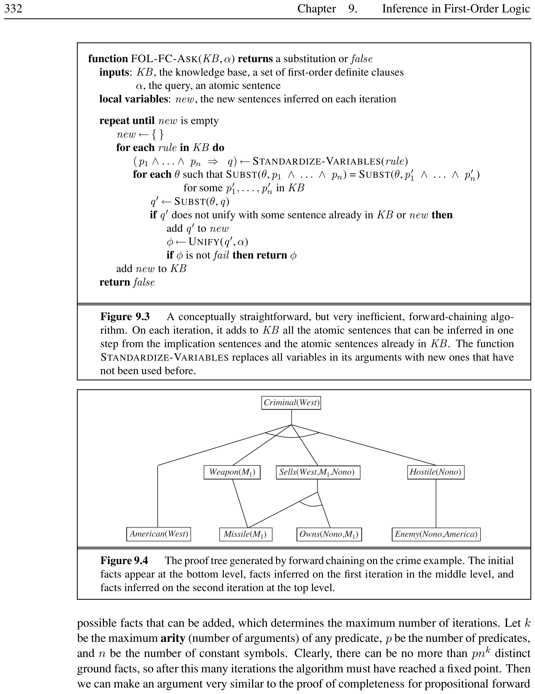
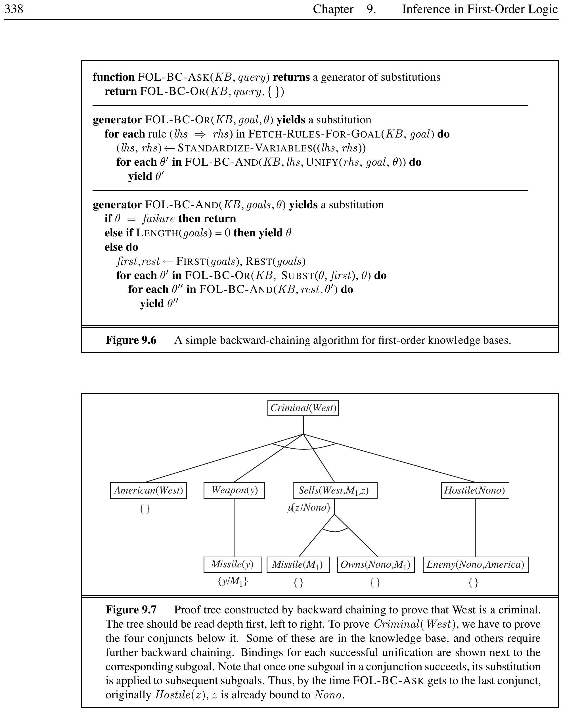

# Inference in First-Order Logic


In which we define effective procedures for answering questions posed in first-order logic.

## Propositional vs.\ First-Order Inference


<div style="border-left: 4px solid #1a5c9e; background-color: #f0f4f8; padding: 15px; margin: 20px 0; border-radius: 4px;">
<strong>📖 Universal Instantiation (UI)</strong>

**Universal Instantiation** (also called $\forall$-Elimination) is the rule that from a universally quantified sentence we can infer any sentence obtained by substituting a ground term for the variable:
\[
\frac{\forall v \; \alpha}{**Subst**(\{v/g\}, \alpha)}
\]
for any variable $v$ and ground term $g$ (a term with no variables).

</div>


<div style="border-left: 4px solid #2e7d32; background-color: #e8f5e9; padding: 15px; margin: 20px 0; border-radius: 4px;">
<strong>💡 Universal Instantiation</strong>

From the axiom ``All greedy kings are evil'':
\[
\forall x \; \text{King}(x) \land \text{Greedy}(x) \Rightarrow \text{Evil}(x)
\]
We can infer any of:
\begin{itemize}
    \item $\text{King}(\text{John}) \land \text{Greedy}(\text{John}) \Rightarrow \text{Evil}(\text{John})$   $\{x/\text{John}\}$
    \item $\text{King}(\text{Richard}) \land \text{Greedy}(\text{Richard}) \Rightarrow \text{Evil}(\text{Richard})$   $\{x/\text{Richard}\}$
    \item $\text{King}(\text{Father}(\text{John})) \land \text{Greedy}(\text{Father}(\text{John})) \Rightarrow \text{Evil}(\text{Father}(\text{John}))$   $\{x/\text{Father}(\text{John})\}$
\end{itemize}

</div>


<div style="border-left: 4px solid #1a5c9e; background-color: #f0f4f8; padding: 15px; margin: 20px 0; border-radius: 4px;">
<strong>📖 Existential Instantiation (EI)</strong>

**Existential Instantiation** (also called $\exists$-Elimination) replaces an existentially quantified variable with a single new constant symbol that does not appear elsewhere in the knowledge base:
\[
\frac{\exists v \; \alpha}{**Subst**(\{v/k\}, \alpha)}
\]
where $k$ is a fresh constant called a **Skolem constant**.

</div>


<div style="border-left: 4px solid #2e7d32; background-color: #e8f5e9; padding: 15px; margin: 20px 0; border-radius: 4px;">
<strong>💡 Existential Instantiation</strong>

From the sentence ``There exists a crown on John's head'':
\[
\exists x \; \text{Crown}(x) \land \text{OnHead}(x, \text{John})
\]
we infer:
\[
\text{Crown}(C_1) \land \text{OnHead}(C_1, \text{John})
\]
as long as $C_1$ is a new constant not used elsewhere.

</div>


<div style="border-left: 4px solid #1a5c9e; background-color: #f0f4f8; padding: 15px; margin: 20px 0; border-radius: 4px;">
<strong>📖 Inferential Equivalence</strong>

Two knowledge bases are **inferentially equivalent** if they are satisfiable exactly when the original knowledge base is satisfiable. Existential Instantiation preserves inferential equivalence (though not logical equivalence). The existentially quantified sentence can be discarded after instantiation.

</div>


<div style="border-left: 4px solid #2e7d32; background-color: #e8f5e9; padding: 15px; margin: 20px 0; border-radius: 4px;">
<strong>💡 Inferential Equivalence</strong>

Consider the KB:
\[
\exists x \; \text{King}(x), \quad \text{King}(\text{John}) \Rightarrow \text{Person}(\text{John})
\]
After EI on $\exists x \; \text{King}(x)$ with Skolem constant $C_1$:
\[
\text{King}(C_1), \quad \text{King}(\text{John}) \Rightarrow \text{Person}(\text{John})
\]
The new KB is not logically equivalent (the original KB does not mention $C_1$), but it is **inferentially equivalent**: the new KB is satisfiable iff the original was.

</div>


### Reduction to Propositional Inference

First-order inference can be reduced to propositional inference by applying UI to replace universally quantified sentences with all possible ground instantiations. If the knowledge base contains no function symbols, the set of ground terms is finite. With function symbols, the set is infinite, but **Herbrand's theorem** (1930) guarantees that if a sentence is entailed, there is a proof involving only a finite subset of ground instantiations.


<div style="border-left: 4px solid #ef6c00; background-color: #fff3e0; padding: 15px; margin: 20px 0; border-radius: 4px;">
<strong>⚠️ Semidecidability</strong>

Entailment in first-order logic is **semidecidable**: Algorithms exist that say ``yes'' to every entailed sentence, but no algorithm can say ``no'' to every non-entailed sentence (Turing, 1936; Church, 1936).

</div>


Table~\ref{tab:pl-vs-fol-inference} summarises the differences between propositional and first-order inference.

[htbp]

\begin{tabular}{lll}
\toprule
Property & Propositional Logic & First-Order Logic \\
\midrule
Entailment & Decidable & Semidecidable \\
Inference rules & Modus Ponens, Resolution & GMP, Lifted Resolution \\
Unification & Not needed & Required \\
Quantifiers & None & $\forall$, $\exists$ \\
Ground terms & Atomic propositions & Constants, functions \\
\bottomrule
\end{tabular}


*Caption: Comparison of Propositional vs.\ First-Order Inference*


\end{table}

## Unification and Lifting


Propositionalization is inefficient because it generates many irrelevant sentences (as shown in Table~\ref{tab:pl-vs-fol-inference}, unification becomes a central requirement). **Lifting** raises Modus Ponens from ground propositional logic to first-order logic, making only the substitutions required for the inference.


<div style="border-left: 4px solid #1a5c9e; background-color: #f0f4f8; padding: 15px; margin: 20px 0; border-radius: 4px;">
<strong>📖 Generalized Modus Ponens (GMP)</strong>

**Generalized Modus Ponens** is a lifted inference rule. For atomic sentences $p_i'$, $p_i$, and $q$, where there exists a substitution $\theta$ such that $**Subst**(\theta, p_i') = **Subst**(\theta, p_i)$ for all $i$:
\[
\frac{p_1', p_2', \ldots, p_n', \quad (p_1 \land p_2 \land \cdots \land p_n \Rightarrow q)}{**Subst**(\theta, q)}
\]

GMP combines And-Introduction, Universal Elimination, and Modus Ponens into a single rule.

</div>


\[
\text{GMP:} \quad \frac{\text{King}(\text{John}), \quad \text{Greedy}(\text{John}), \quad \forall x \; \text{King}(x) \land \text{Greedy}(x) \Rightarrow \text{Evil}(x)}{\text{Evil}(\text{John})}
\]

[htbp]


*Caption: Lifted inference via Generalized Modus Ponens. The rule, quantified over all $x$, is instantiated for John without generating all possible groundings.*


\end{figure}


<div style="border-left: 4px solid #2e7d32; background-color: #e8f5e9; padding: 15px; margin: 20px 0; border-radius: 4px;">
<strong>💡 Generalized Modus Ponens</strong>

Suppose we know everyone is greedy:
\[
\forall y \; \text{Greedy}(y)
\]
Then to conclude $\text{Evil}(\text{John})$, we need a substitution for both the implication and the knowledge-base sentences:
\[
\theta = \{x/\text{John}, y/\text{John}\}
\]
making $\text{King}(x)$ match $\text{King}(\text{John})$ and $\text{Greedy}(x)$ match $\text{Greedy}(y)$.

</div>


<div style="border-left: 4px solid #1a5c9e; background-color: #f0f4f8; padding: 15px; margin: 20px 0; border-radius: 4px;">
<strong>📖 Unification</strong>

**Unification** is the process of finding a substitution $\theta$ (called a **unifier**) that makes two logical expressions identical:
\[
**Unify**(p, q) = \theta \text{ where } **Subst**(\theta, p) = **Subst**(\theta, q)
\]

The **Most General Unifier (MGU)** is the unique unifier (up to renaming) that places the fewest restrictions on variables.

</div>


[htbp]


*Caption: The unification algorithm. Expressions are compared side-by-side, building up a substitution.*


\end{figure}


<div style="border-left: 4px solid #2e7d32; background-color: #e8f5e9; padding: 15px; margin: 20px 0; border-radius: 4px;">
<strong>💡 Unification Examples</strong>

\begin{itemize}
    \item $**Unify**(\text{Knows}(\text{John}, x),\; \text{Knows}(\text{John}, \text{Jane})) = \{x/\text{Jane}\}$
    \item $**Unify**(\text{Knows}(\text{John}, x),\; \text{Knows}(y, \text{Bill})) = \{x/\text{Bill}, y/\text{John}\}$
    \item $**Unify**(\text{Knows}(\text{John}, x),\; \text{Knows}(y, \text{Mother}(y))) = \{y/\text{John}, x/\text{Mother}(\text{John})\}$
    \item $**Unify**(\text{Knows}(\text{John}, x),\; \text{Knows}(x, \text{Elizabeth})) = \text{fail}$
\end{itemize}

The last unification fails because $x$ cannot simultaneously equal John and Elizabeth. **Standardizing apart** (renaming variables to avoid clashes) resolves such conflicts.

</div>


[htbp]

\begin{tabular}{lll}
\toprule
Expression 1 & Expression 2 & MGU \\
\midrule
$\text{Knows}(\text{John}, x)$ & $\text{Knows}(\text{John}, \text{Jane})$ & $\{x/\text{Jane}\}$ \\
$\text{Knows}(\text{John}, x)$ & $\text{Knows}(y, \text{Bill})$ & $\{x/\text{Bill}, y/\text{John}\}$ \\
$\text{Knows}(\text{John}, x)$ & $\text{Knows}(y, \text{Mother}(y))$ & $\{y/\text{John}, x/\text{Mother}(\text{John})\}$ \\
$\text{Knows}(\text{John}, x)$ & $\text{Knows}(x, \text{Elizabeth})$ & fail \\
\bottomrule
\end{tabular}


*Caption: Unification examples*


\end{table}


<div style="border-left: 4px solid #1a5c9e; background-color: #f0f4f8; padding: 15px; margin: 20px 0; border-radius: 4px;">
<strong>📖 Standardizing Apart</strong>

**Standardizing apart** renames variables in one of two sentences being unified to avoid name clashes. Each use of a variable is treated as a separate variable to prevent unintended name collisions during unification.

</div>


<div style="border-left: 4px solid #2e7d32; background-color: #e8f5e9; padding: 15px; margin: 20px 0; border-radius: 4px;">
<strong>💡 Standardizing Apart</strong>

Without standardizing apart:
\[
**Unify**(\text{Knows}(\text{John}, x), \text{Knows}(x, \text{Elizabeth})) = \text{fail}
\]
Renaming $x$ in $\text{Knows}(x, \text{Elizabeth})$ to $x_{17}$ gives:
\[
**Unify**(\text{Knows}(\text{John}, x), \text{Knows}(x_{17}, \text{Elizabeth})) = \{x/\text{Elizabeth}, x_{17}/\text{John}\}
\]

</div>


<div style="border-left: 4px solid #1a5c9e; background-color: #f0f4f8; padding: 15px; margin: 20px 0; border-radius: 4px;">
<strong>📖 Occur Check</strong>

The **occur check** verifies that a variable does not occur inside the term being substituted for it. Without it, unsound inferences can occur. Some systems (including Prolog) omit the occur check for efficiency.

</div>


<div style="border-left: 4px solid #2e7d32; background-color: #e8f5e9; padding: 15px; margin: 20px 0; border-radius: 4px;">
<strong>💡 Occur Check</strong>

$S(x)$ cannot unify with $S(S(x))$ because $x$ occurs inside $S(x)$. The substitution $\{x/S(x)\}$ would produce $S(S(x))$ from $S(x)$, which requires another $S(x)$ inside---an infinite regress. With the occur check, UNIFY returns failure.

</div>


<div style="border-left: 4px solid #1a5c9e; background-color: #f0f4f8; padding: 15px; margin: 20px 0; border-radius: 4px;">
<strong>📖 Predicate Indexing and Subsumption Lattice</strong>

**Predicate indexing** groups facts by predicate symbol in a hash table for efficient retrieval. A **subsumption lattice** organizes all possible queries that unify with a stored fact. Each child node is obtained from its parent by a single substitution.

</div>


<div style="border-left: 4px solid #2e7d32; background-color: #e8f5e9; padding: 15px; margin: 20px 0; border-radius: 4px;">
<strong>💡 Subsumption Lattice</strong>

The ground fact $\text{Employs}(\text{IBM}, \text{Richard})$ subsumes all of these queries:
\[
\text{Employs}(x, \text{Richard}), \quad \text{Employs}(\text{IBM}, y), \quad \text{Employs}(x, y)
\]
Any answer to a subsumed query also answers the original. The lattice organizes facts so that a query can skip clauses it cannot match.

</div>


## Forward Chaining


Forward chaining applies Modus Ponens in the forward direction, starting from known atomic sentences and adding new conclusions until no further inferences can be made.


<div style="border-left: 4px solid #1a5c9e; background-color: #f0f4f8; padding: 15px; margin: 20px 0; border-radius: 4px;">
<strong>📖 First-Order Definite Clauses</strong>

A **first-order definite clause** is a disjunction of literals with exactly one positive literal. It is either atomic or an implication whose antecedent is a conjunction of positive literals and whose consequent is a single positive literal. Variables are assumed to be universally quantified.

Examples:

```text
King(x) & Greedy(x) -> Evil(x)
King(John)
Greedy(y)
```


</div>


<div style="border-left: 4px solid #2e7d32; background-color: #e8f5e9; padding: 15px; margin: 20px 0; border-radius: 4px;">
<strong>💡 Definite Clause Examples</strong>

Definite clauses come in two forms:
\begin{itemize}
    \item **Atomic (fact)**: $\text{King}(\text{John})$, $\text{Woman}(\text{Mary})$ --- ground unit clauses.
    \item **Implication (rule)**: $\forall x \; \text{King}(x) \land \text{Greedy}(x) \Rightarrow \text{Evil}(x)$ --- exactly one positive literal in the conclusion.
\end{itemize}
Datalog restricts these further by disallowing function symbols, keeping only constants and variables as terms.

</div>


<div style="border-left: 4px solid #1a5c9e; background-color: #f0f4f8; padding: 15px; margin: 20px 0; border-radius: 4px;">
<strong>📖 Datalog</strong>

**Datalog** is a restricted language of first-order definite clauses with no function symbols. The absence of function symbols makes inference decidable and allows efficient relational-database-style operations.

</div>


<div style="border-left: 4px solid #2e7d32; background-color: #e8f5e9; padding: 15px; margin: 20px 0; border-radius: 4px;">
<strong>💡 Datalog vs.\ Full FOL</strong>

\begin{itemize}
    \item **Datalog**: $\text{Parent}(x,y) \land \text{Parent}(y,z) \Rightarrow \text{Grandparent}(x,z)$
    \item **Full FOL**: $\forall x \; [\text{Person}(x) \Rightarrow \exists y \; \text{Mother}(y,x)]$\\
    \hspace*{2em} (not expressible in Datalog due to $\text{Mother}$ being a function symbol)
\end{itemize}
Datalog is decidable; full FOL is semidecidable.

</div>


<div style="border-left: 4px solid #1a5c9e; background-color: #f0f4f8; padding: 15px; margin: 20px 0; border-radius: 4px;">
<strong>📖 Forward Chaining Algorithm</strong>

FOL-FC-ASK starts from known facts and triggers all rules whose premises are satisfied, adding conclusions. The process repeats until the query is answered or no new facts are added. A fact is ``new'' only if it is not a renaming of an existing fact. The algorithm reaches a **fixed point** when no new inferences are possible.


\begin{tikzpicture}[node distance=1cm, auto]
\node[draw, ellipse, fill=blue!10] (start) {Start};
\node[draw, rectangle, below=0.6cm of start, text width=3cm, align=center] (kb) {Known facts\\ in KB};
\node[draw, diamond, below=0.6cm of kb, text width=2.5cm, align=center] (match) {Match rules\\ against facts};
\node[draw, rectangle, below=0.6cm of match, text width=3cm, align=center] (fire) {Fire matching\\ rules};
\node[draw, diamond, below=0.6cm of fire, text width=2.5cm, align=center] (new) {New facts\\ added?};
\node[draw, rectangle, below=0.6cm of new, text width=3cm, align=center] (done) {Fixed point\\ reached};
\node[draw, ellipse, fill=green!10, below=0.6cm of done] (end) {Done};
\draw[->] (start) -- (kb);
\draw[->] (kb) -- (match);
\draw[->] (match) -- (fire);
\draw[->] (fire) -- (new);
\draw[->] (new) -- node[right] {yes} (match.west);
\draw[->] (new) -- node[right] {no} (done);
\draw[->] (done) -- (end);
\draw (match.west) -- ++(-1.2cm,0) |- (new.west);
\node at ($(match.west)+(-0.6cm,0)$) [left] {\small loop};
\end{tikzpicture}
\captionof{figure}{Forward chaining algorithm flow. Rules are matched and fired iteratively until a fixed point is reached.}


Figure~\ref{fig:forward-chaining-flow} shows the overall forward chaining process, while Figure~\ref{fig:forward-chaining-crime} gives the concrete proof tree for the crime example.

</div>


[htbp]





*Caption: Proof tree for the crime example. Initial facts are at the bottom, inferred facts in the middle, and the conclusion at the top.*


\end{figure}


<div style="border-left: 4px solid #2e7d32; background-color: #e8f5e9; padding: 15px; margin: 20px 0; border-radius: 4px;">
<strong>💡 Forward Chaining: Crime Example</strong>

The law says: ``It is a crime for an American to sell weapons to hostile nations.''
Knowledge base:

```text
American(x) & Weapon(y) & Sells(x,y,z) & Hostile(z) -> Criminal(x)
Missile(x) & Owns(Nono,x) -> Sells(West,x,Nono)
Missile(x) -> Weapon(x)
Enemy(x,America) -> Hostile(x)
American(West)
Missile(M1)
Owns(Nono,M1)
Enemy(Nono,America)
```


Iteration 1: Rule (3) adds $\text{Weapon}(M_1)$; Rule (2) adds $\text{Sells}(\text{West}, M_1, \text{Nono})$; Rule (4) adds $\text{Hostile}(\text{Nono})$.

Iteration 2: Rule (1) adds $\text{Criminal}(\text{West})$.

</div>


<div style="border-left: 4px solid #1a5c9e; background-color: #f0f4f8; padding: 15px; margin: 20px 0; border-radius: 4px;">
<strong>📖 RETE Algorithm</strong>

The **RETE algorithm** preprocesses rules into a dataflow network. Variable bindings flow through the network, and partial matches are retained across iterations. This avoids redundant rule matching when new facts arrive. RETE is a key component of **production systems** and **cognitive architectures** (ACT, SOAR).

</div>


<div style="border-left: 4px solid #2e7d32; background-color: #e8f5e9; padding: 15px; margin: 20px 0; border-radius: 4px;">
<strong>💡 RETE Network Example</strong>

Consider two rules sharing a common condition:

```text
R1: A(x) & B(x) -> C(x)
R2: A(x) & D(x) -> E(x)
```


RETE builds a root node for $\text{A}(x)$ shared by both rules. When a new $\text{A}(a)$ fact arrives, it is propagated once to both rule memories. Partial matches for R1 and R2 are stored separately. This sharing avoids re-matching $\text{A}(x)$ against the fact base for each rule.

</div>


<div style="border-left: 4px solid #2e7d32; background-color: #e8f5e9; padding: 15px; margin: 20px 0; border-radius: 4px;">
<strong>💡 Fire Alarm Example (Forward Chaining)</strong>

Facts: $\text{SmokeDetected}$, $\text{HighTemperature}$
\\
Rules:

```text
SmokeDetected & HighTemperature -> FireAlarmON
```

Forward chaining triggers the rule because both premises are satisfied, concluding $\text{FireAlarmON}$.

</div>


<div style="border-left: 4px solid #1a5c9e; background-color: #f0f4f8; padding: 15px; margin: 20px 0; border-radius: 4px;">
<strong>📖 Deductive Databases and Magic Set</strong>

**Deductive databases** use forward chaining as a standard inference tool. The **magic set** technique rewrites rules using information from the goal so that only relevant variable bindings are considered during forward inference. This hybrid approach combines forward inference with backward preprocessing for efficiency.

</div>


<div style="border-left: 4px solid #2e7d32; background-color: #e8f5e9; padding: 15px; margin: 20px 0; border-radius: 4px;">
<strong>💡 Magic Set Rewriting</strong>

Goal: $\text{Criminal}(\text{West})$.

Original rule:
\[
\text{American}(x) \land \text{Weapon}(y) \land \text{Sells}(x,y,z) \land \text{Hostile}(z) \Rightarrow \text{Criminal}(x)
\]

Magic set rewrite adds a magic predicate that restricts $x$ to values matching the goal:
\[
\text{MagicCriminal}(\text{West}) \quad \text{(from goal)}
\]
\[
\text{MagicCriminal}(x) \Rightarrow \text{MagicSells}(x,y,z), \text{MagicWeapon}(y), \dots
\]

Only facts relevant to $\text{West}$ are derived during forward chaining.

</div>


## Backward Chaining


Backward chaining works backward from the goal, chaining through rules to find known facts that support the proof.


<div style="border-left: 4px solid #1a5c9e; background-color: #f0f4f8; padding: 15px; margin: 20px 0; border-radius: 4px;">
<strong>📖 Backward Chaining Algorithm</strong>

FOL-BC-ASK proves a goal by finding a clause whose right-hand side unifies with the goal, then recursively proves each conjunct in the left-hand side. It is a depth-first AND/OR search:
\begin{itemize}
    \item **OR** part: the goal can be proved by any rule in the knowledge base.
    \item **AND** part: all conjuncts in the premise of a clause must be proved.
\end{itemize}
Backward chaining acts as a **generator**, returning multiple possible results.


\begin{tikzpicture}[node distance=0.8cm, auto]
\node[draw, ellipse, fill=blue!10] (start) {Goal $q$};
\node[draw, rectangle, below=0.6cm of start, text width=3cm, align=center] (find) {Find clause\\ $p \Rightarrow q'$ where\\ $**Unify**(q,q')$};
\node[draw, diamond, below=0.6cm of find, text width=2.5cm, align=center] (matched) {Match\\ found?};
\node[draw, rectangle, below=0.6cm of matched, text width=3cm, align=center] (prove) {Recursively prove\\ each $p_i$ (AND)};
\node[draw, diamond, below=0.6cm of prove, text width=2.5cm, align=center] (all) {All proved?};
\node[draw, rectangle, fill=green!10, below=0.6cm of all] (success) {Goal proved};
\node[draw, rectangle, fill=red!10, right=1.2cm of matched] (fail) {Fail};
\draw[->] (start) -- (find);
\draw[->] (find) -- (matched);
\draw[->] (matched) -- node[right] {yes} (prove);
\draw[->] (matched) -- node[above] {no} (fail);
\draw[->] (prove) -- (all);
\draw[->] (all) -- node[right] {yes} (success);
\draw[->] (all.east) -- ++(0.8cm,0) |- node[above right] {backtrack} (find.east);
\node[right=2cm of prove, font=\small] {OR: try next clause};
\end{tikzpicture}
\captionof{figure}{Backward chaining algorithm flow. Subgoals are proved recursively with backtracking on failure.}


Figure~\ref{fig:backward-chaining-flow} shows the backward chaining process, and Figure~\ref{fig:backward-chaining-crime} shows the proof tree for the crime example.

</div>


[htbp]





*Caption: Proof tree constructed by backward chaining for the crime example. The tree is read depth-first, left to right. Bindings are shown next to each subgoal.*


\end{figure}


<div style="border-left: 4px solid #1a5c9e; background-color: #f0f4f8; padding: 15px; margin: 20px 0; border-radius: 4px;">
<strong>📖 Logic Programming and Prolog</strong>

**Logic programming** embodies the declarative ideal: systems express knowledge in a formal language and solve problems by running inference. Prolog is the most widely used logic programming language.

Key equation (Kowalski): $\text{Algorithm} = \text{Logic} + \text{Control}$.

Prolog executes programs through depth-first backward chaining with clauses tried in order.

</div>


<div style="border-left: 4px solid #2e7d32; background-color: #e8f5e9; padding: 15px; margin: 20px 0; border-radius: 4px;">
<strong>💡 Prolog Program and Query</strong>

Prolog syntax uses uppercase for variables and lowercase for constants:

```prolog
criminal(X) :- american(X), weapon(Y), sells(X,Y,Z), hostile(Z).
append([],Y,Y).
append([A|X],Y,[A|Z]) :- append(X,Y,Z).
```


Query \texttt{?- criminal(west).} Prolog searches depth-first through the clauses, backtracking on failure.

</div>


<div style="border-left: 4px solid #1a5c9e; background-color: #f0f4f8; padding: 15px; margin: 20px 0; border-radius: 4px;">
<strong>📖 Choice Point, Trail, Continuation</strong>

Backward chaining uses several implementation mechanisms:
\begin{itemize}
    \item **Choice point**: A stack frame keeping track of multiple possibilities when a goal matches multiple clauses.
    \item **Trail**: A stack recording variable bindings so they can be undone on backtracking.
    \item **Continuation**: A packaging of a procedure and arguments defining what should be done next when the current goal succeeds.
\end{itemize}

</div>


<div style="border-left: 4px solid #2e7d32; background-color: #e8f5e9; padding: 15px; margin: 20px 0; border-radius: 4px;">
<strong>💡 Backtracking in Prolog</strong>

Given clauses:

```prolog
parent(john, mary).
parent(john, bob).
parent(mary, alice).
grandparent(X,Z) :- parent(X,Y), parent(Y,Z).
```


Query \texttt{?- grandparent(john, alice).}
\begin{enumerate}
    \item **Choice point**: The goal matches one clause.
    \item **Subgoal 1**: \texttt{parent(john, Y)} --- choice point with options $Y = \text{mary}$ or $Y = \text{bob}$.
    \item **Trail**: $Y = \text{mary}$ is recorded for backtracking.
    \item **Subgoal 2**: \texttt{parent(mary, alice)} succeeds.
    \item On failure of another branch, the **trail** undoes bindings and the **choice point** resumes with the next option.
\end{enumerate}

</div>


<div style="border-left: 4px solid #1a5c9e; background-color: #f0f4f8; padding: 15px; margin: 20px 0; border-radius: 4px;">
<strong>📖 Tabled Logic Programming</strong>

**Tabled logic programming** uses memoization to cache solutions to subgoals, avoiding redundant computation. It combines the goal-directedness of backward chaining with the dynamic-programming efficiency of forward chaining. It is complete for Datalog knowledge bases.

</div>


<div style="border-left: 4px solid #2e7d32; background-color: #e8f5e9; padding: 15px; margin: 20px 0; border-radius: 4px;">
<strong>💡 Tabled vs.\ Non-Tabled Evaluation</strong>

Transitive closure:

```prolog
edge(a,b).  edge(b,c).  edge(c,d).
reach(X,Y) :- edge(X,Y).
reach(X,Y) :- edge(X,Z), reach(Z,Y).
```


Query \texttt{?- reach(a,X)}:
\begin{itemize}
    \item **Without tabling**: $\text{reach}(b,X)$ is recomputed for each path through $a$.
    \item **With tabling**: $\text{reach}(b,X)$ is computed once, cached, and reused. Infinite loops (cyclic graphs) terminate.
\end{itemize}
Tabling makes evaluation complete for Datalog programs.

</div>


<div style="border-left: 4px solid #1a5c9e; background-color: #f0f4f8; padding: 15px; margin: 20px 0; border-radius: 4px;">
<strong>📖 Constraint Logic Programming (CLP)</strong>

**Constraint Logic Programming** allows variables to be constrained rather than fully bound. A CLP solution is the most specific set of constraints on query variables derivable from the knowledge base. CLP systems incorporate constraint-solving algorithms (linear programming, bounds propagation) and flexible search strategies beyond depth-first backtracking.

</div>


<div style="border-left: 4px solid #2e7d32; background-color: #e8f5e9; padding: 15px; margin: 20px 0; border-radius: 4px;">
<strong>💡 CLP: Triangle Constraints</strong>

A triangle rule in CLP:
\[
\text{triangle}(X,Y,Z) : X>0,\;Y>0,\;Z>0,\;X+Y>=Z,\;Y+Z>=X,\;X+Z>=Y.
\]

Query $\text{triangle}(3,4,Z)$ yields the constraint $7 \ge Z \ge 1$, not a single binding. The answer is a constraint rather than a ground term.

</div>


<div style="border-left: 4px solid #2e7d32; background-color: #e8f5e9; padding: 15px; margin: 20px 0; border-radius: 4px;">
<strong>💡 Student Exam Example (Backward Chaining)</strong>

Goal: Does student $S$ pass the exam?

Knowledge base:

```text
Marks(x) >= 40 -> Pass(x)
Marks(Biplob) = 75
```


Backward chaining: $\text{Pass}(\text{Biplob})$ unifies with rule conclusion. Prove $\text{Marks}(\text{Biplob}) \ge 40$. Given $\text{Marks}(\text{Biplob}) = 75$, the condition holds, so $\text{Pass}(\text{Biplob})$ is proved.

</div>


### Prolog vs.\ First-Order Logic

Prolog uses **database semantics** (unique names assumption, closed-world assumption) rather than full first-order semantics. It also omits the occur check and includes built-in predicates with side effects (I/O, assert/retract).

## Resolution


Resolution is a complete inference procedure for first-order logic that works by refutation: proving $KB \models \alpha$ by showing $KB \land \neg\alpha$ is unsatisfiable.


<div style="border-left: 4px solid #1a5c9e; background-color: #f0f4f8; padding: 15px; margin: 20px 0; border-radius: 4px;">
<strong>📖 CNF for First-Order Logic</strong>

First-order resolution requires sentences in **Conjunctive Normal Form** (CNF) --- a conjunction of clauses, each a disjunction of literals. Variables are assumed universally quantified.

Conversion procedure:
\begin{enumerate}
    \item Eliminate implications ($\alpha \Rightarrow \beta \equiv \neg\alpha \lor \beta$)
    \item Move $\neg$ inwards ($\neg\forall x\;p \equiv \exists x\;\neg p$, $\neg\exists x\;p \equiv \forall x\;\neg p$)
    \item Standardize variables (rename to avoid clashes)
    \item **Skolemize**: replace existential quantifiers with **Skolem functions** whose arguments are all universally quantified variables in whose scope the existential appears
    \item Drop universal quantifiers
    \item Distribute $\lor$ over $\land$
\end{enumerate}

</div>


\[
\forall x [\forall y \; \text{Animal}(y) \Rightarrow \text{Loves}(x,y)] \Rightarrow [\exists y \; \text{Loves}(y,x)]
\]
converts to CNF:
\[
[\text{Animal}(F(x)) \lor \text{Loves}(G(z),x)] \land [\neg\text{Loves}(x,F(x)) \lor \text{Loves}(G(z),x)]
\]


<div style="border-left: 4px solid #2e7d32; background-color: #e8f5e9; padding: 15px; margin: 20px 0; border-radius: 4px;">
<strong>💡 CNF Conversion Example</strong>

Convert $\forall x \; [\text{Person}(x) \Rightarrow \exists y \; \text{Heart}(y) \land \text{Has}(x,y)]$ to CNF:
\begin{enumerate}
    \item Eliminate $\Rightarrow$: $\forall x \; [\neg\text{Person}(x) \lor \exists y \; \text{Heart}(y) \land \text{Has}(x,y)]$
    \item $\neg$ is already inwards.
    \item Standardize variables: no clashes.
    \item **Skolemize**: $\exists y$ becomes $\text{Heart}(H(x)) \land \text{Has}(x,H(x))$ where $H$ is a Skolem function of $x$.
    \item Drop $\forall$: $\neg\text{Person}(x) \lor [\text{Heart}(H(x)) \land \text{Has}(x,H(x))]$
    \item Distribute $\lor$ over $\land$: $[\neg\text{Person}(x) \lor \text{Heart}(H(x))] \land [\neg\text{Person}(x) \lor \text{Has}(x,H(x))]$
\end{enumerate}
The result is two CNF clauses ready for resolution.

</div>


<div style="border-left: 4px solid #1a5c9e; background-color: #f0f4f8; padding: 15px; margin: 20px 0; border-radius: 4px;">
<strong>📖 Binary Resolution Rule</strong>

The **binary resolution rule** for first-order clauses is a lifted version of propositional resolution. Two clauses with no shared variables can be resolved if they contain complementary literals that unify:
\[
\frac{\ell_1 \lor \cdots \lor \ell_k,\qquad m_1 \lor \cdots \lor m_n}{**Subst**(\theta, \ell_1 \lor \cdots \lor \ell_{i-1} \lor \ell_{i+1} \lor \cdots \lor \ell_k \lor m_1 \lor \cdots \lor m_{j-1} \lor m_{j+1} \lor \cdots \lor m_n)}
\]
where $**Unify**(\ell_i, \neg m_j) = \theta$.

</div>


<div style="border-left: 4px solid #2e7d32; background-color: #e8f5e9; padding: 15px; margin: 20px 0; border-radius: 4px;">
<strong>💡 Resolution Proof: Crime Example</strong>

CNF clauses:

```text
~American(x) | ~Weapon(y) | ~Sells(x,y,z) | ~Hostile(z) | Criminal(x)
~Missile(x) | ~Owns(Nono,x) | Sells(West,x,Nono)
~Enemy(x,America) | Hostile(x)
~Missile(x) | Weapon(x)
Owns(Nono,M1)
Missile(M1)
American(West)
Enemy(Nono,America)
~Criminal(West)   % negated goal
```

Resolution proceeds along a single spine: resolving the negated goal with clause (1), then with clauses (4), (6), (2), (5), (7), (3), (8) to derive the empty clause.

</div>


<div style="border-left: 4px solid #1a5c9e; background-color: #f0f4f8; padding: 15px; margin: 20px 0; border-radius: 4px;">
<strong>📖 Answer Literal</strong>

To answer existential queries (e.g., ``Who killed the cat?''), an **answer literal** is added to the negated goal:
\[
\neg\text{Kills}(w, \text{Tuna}) \lor \text{Answer}(w)
\]
Resolution generates $\text{Answer}(\text{Curiosity})$ when a clause containing only the answer literal is derived.

</div>


<div style="border-left: 4px solid #2e7d32; background-color: #e8f5e9; padding: 15px; margin: 20px 0; border-radius: 4px;">
<strong>💡 Answer Literal: Who Killed the Cat?</strong>

KB: $\text{Cat}(\text{Tuna}), \quad \text{Kills}(\text{Curiosity}, \text{Tuna})$

Query: $\exists w \; \text{Kills}(w, \text{Tuna})$ (``Who killed the cat?'')

Negated goal with answer literal:
\[
\neg\text{Kills}(w, \text{Tuna}) \lor \text{Answer}(w)
\]

Resolving with $\text{Kills}(\text{Curiosity}, \text{Tuna})$ under $\{w/\text{Curiosity}\}$:
\[
\text{Answer}(\text{Curiosity})
\]

The answer literal survives as the result.

</div>


<div style="border-left: 4px solid #1a5c9e; background-color: #f0f4f8; padding: 15px; margin: 20px 0; border-radius: 4px;">
<strong>📖 Refutation Completeness</strong>

Resolution is **refutation-complete**: if a set of clauses is unsatisfiable, resolution will always derive a contradiction. The proof relies on:
\begin{enumerate}
    \item **Herbrand's theorem**: If $S$ is unsatisfiable, a finite set of ground instances of $S$ is also unsatisfiable.
    \item **Ground resolution theorem**: Propositional resolution is complete for ground sentences.
    \item **Lifting lemma**: For any resolution proof using ground clauses, there is a corresponding proof using the original first-order clauses.
\end{enumerate}

</div>


<div style="border-left: 4px solid #2e7d32; background-color: #e8f5e9; padding: 15px; margin: 20px 0; border-radius: 4px;">
<strong>💡 Refutation Proof: Simple Example</strong>

Prove $P(A)$ from $\{P(x) \lor Q(x),\; \neg Q(A),\; \neg P(A)\}$.

\begin{enumerate}
    \item $P(x) \lor Q(x)$   (given)
    \item $\neg Q(A)$   (given)
    \item $\neg P(A)$   (negated goal)
    \item $P(A)$   (resolve 1, 2: $\{x/A\}$)
    \item $\bot$   (resolve 3, 4: empty clause)
\end{enumerate}

Resolution derived a contradiction, therefore $KB \models P(A)$.

</div>


<div style="border-left: 4px solid #1a5c9e; background-color: #f0f4f8; padding: 15px; margin: 20px 0; border-radius: 4px;">
<strong>📖 Herbrand Universe and Saturation</strong>

The **Herbrand universe** of a clause set $S$ is the set of all ground terms constructible from the function and constant symbols in $S$ (if no constants, add $A$). The **saturation** $P(S)$ is the set of all ground clauses obtained by applying all substitutions of ground terms from set $P$ with variables in $S$. The **Herbrand base** is the saturation with respect to the Herbrand universe.

</div>


<div style="border-left: 4px solid #2e7d32; background-color: #e8f5e9; padding: 15px; margin: 20px 0; border-radius: 4px;">
<strong>💡 Herbrand Universe Construction</strong>

Clause set $S = \{P(x) \lor Q(f(x)),\; R(A)\}$.

Function symbols: $f/1$. Constant symbols: $A$.

Herbrand universe: $H_0 = \{A\}$, $H_1 = \{A, f(A)\}$, $H_2 = \{A, f(A), f(f(A))\}$, \dots

Herbrand base: all ground atoms $P(A), P(f(A)), Q(f(A)), Q(f(f(A))), R(A), \dots$

If $S$ is unsatisfiable, some finite subset of the Herbrand base is propositionally unsatisfiable.

</div>


<div style="border-left: 4px solid #1a5c9e; background-color: #f0f4f8; padding: 15px; margin: 20px 0; border-radius: 4px;">
<strong>📖 Demodulation and Paramodulation</strong>

**Demodulation** uses a unit equality clause $x = y$ to rewrite terms in another clause, substituting $y$ for $x$ after unification. It is directional and used for simplification.

**Paramodulation** generalizes demodulation to non-unit clauses where an equality literal appears. It provides a complete inference procedure for first-order logic with equality:
\[
\frac{\ell_1 \lor \cdots \lor \ell_k \lor x = y,\qquad m_1 \lor \cdots \lor m_n}{**Sub**(**Subst**(\theta, x), **Subst**(\theta, y), **Subst**(\theta, \ell_1 \lor \cdots \lor \ell_k \lor m_1 \lor \cdots \lor m_n))}
\]

**Equational unification** handles equality within an extended unification algorithm, using known axioms (commutativity, associativity).

</div>


<div style="border-left: 4px solid #2e7d32; background-color: #e8f5e9; padding: 15px; margin: 20px 0; border-radius: 4px;">
<strong>💡 Demodulation Rewriting</strong>

Given unit equality clause:
\[
\text{Father}(\text{John}) = \text{George}
\]

Clause to rewrite:
\[
\text{Likes}(\text{Mary}, \text{Father}(\text{John}))
\]

Demodulation substitutes $\text{George}$ for $\text{Father}(\text{John})$:
\[
\text{Likes}(\text{Mary}, \text{George})
\]

Paramodulation generalizes this: the equality may appear as a non-unit literal rather than a separate unit clause.

</div>


<div style="border-left: 4px solid #1a5c9e; background-color: #f0f4f8; padding: 15px; margin: 20px 0; border-radius: 4px;">
<strong>📖 Resolution Strategies</strong>

Several strategies improve resolution efficiency:
\begin{itemize}
    \item **Unit preference**: Prefer resolutions involving a unit clause (single literal). Produces shorter clauses.
    \item **Set of support**: Every resolution must involve at least one clause from a special set (typically the negated goal). Complete when the remaining clauses are jointly satisfiable.
    \item **Input resolution**: Every step resolves an input clause with some other clause. Complete for Horn clauses.
    \item **Subsumption**: Remove clauses that are more specific than existing ones (e.g., $P(A)$ is subsumed by $P(x)$).
\end{itemize}

</div>


<div style="border-left: 4px solid #2e7d32; background-color: #e8f5e9; padding: 15px; margin: 20px 0; border-radius: 4px;">
<strong>💡 Resolution Strategy Comparison</strong>

Clauses: $\{P \lor Q,\; \neg P \lor R,\; \neg Q \lor R,\; \neg R\}$.

\begin{itemize}
    \item **Unit preference**: First resolves unit $\neg R$ with $(\neg Q \lor R)$, then with $(\neg P \lor R)$, producing shorter clauses quickly.
    \item **Set of support**: Start with $\{\neg R\}$. Every resolution must involve $\neg R$ or a derived clause. This focuses the search.
    \item **Input resolution**: Always resolves $\neg R$ against an input clause. Complete here because the set is Horn.
\end{itemize}
All strategies eventually derive $\bot$, but the search spaces differ drastically.

</div>


## Rule-Based Systems


<div style="border-left: 4px solid #1a5c9e; background-color: #f0f4f8; padding: 15px; margin: 20px 0; border-radius: 4px;">
<strong>📖 Rule-Based System</strong>

A **rule-based system** is an AI system that makes decisions using a predefined set of IF--THEN rules. It consists of three components:
\begin{itemize}
    \item **Knowledge Base**: Stores rules and facts containing domain knowledge.
    \item **Inference Engine**: Applies rules to facts, matches data with rules, and derives conclusions.
    \item **Working Memory**: Stores current data and facts, updated when new facts are generated.
\end{itemize}

</div>


[htbp]


*Caption: Architecture of a rule-based system. The inference engine matches rules against working memory and derives new facts.*


\end{figure}


<div style="border-left: 4px solid #2e7d32; background-color: #e8f5e9; padding: 15px; margin: 20px 0; border-radius: 4px;">
<strong>💡 Rule-Based System Examples</strong>

\begin{itemize}
    \item **Medical Diagnosis**: $\text{Fever}(x) \land \text{Cough}(x) \Rightarrow \text{Flu}(x)$
    \item **Student Exam**: $\text{RegularAttendance}(x) \Rightarrow \text{EligibleForExam}(x)$
    \item **Library System**: $\text{Student}(x) \land \text{LibraryCard}(x) \Rightarrow \text{CanBorrow}(x)$
    \item **Smart Home**: $\text{MotionDetected}(x) \Rightarrow \text{LightON}(x)$
\end{itemize}

</div>


\input{sections/nlp}
