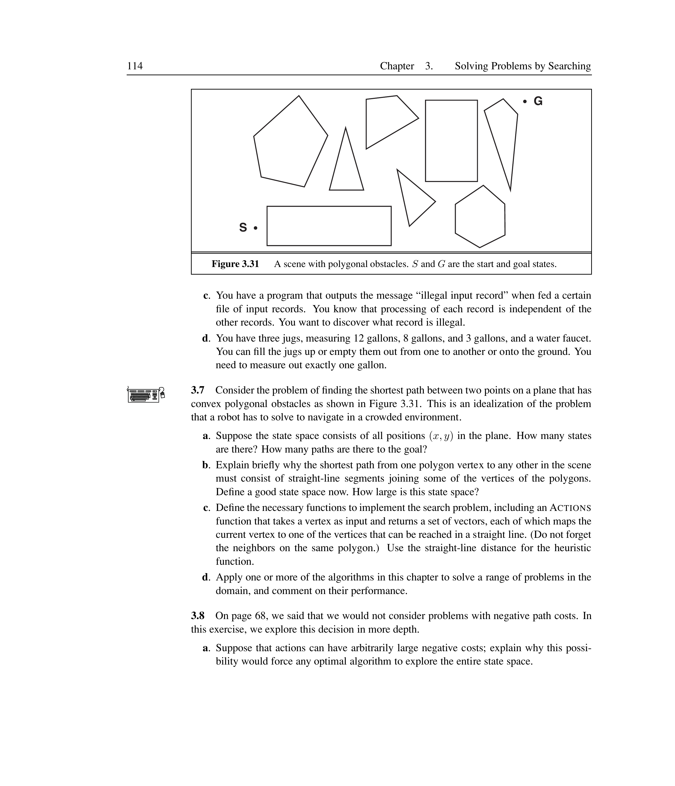
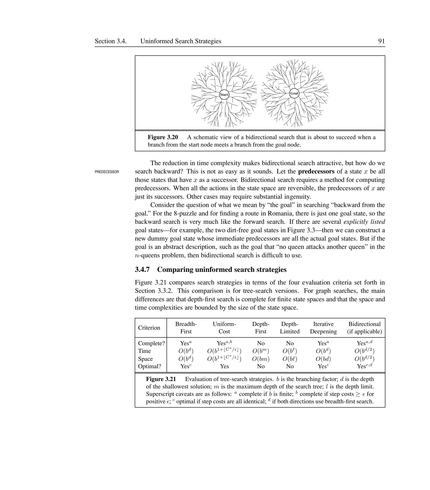
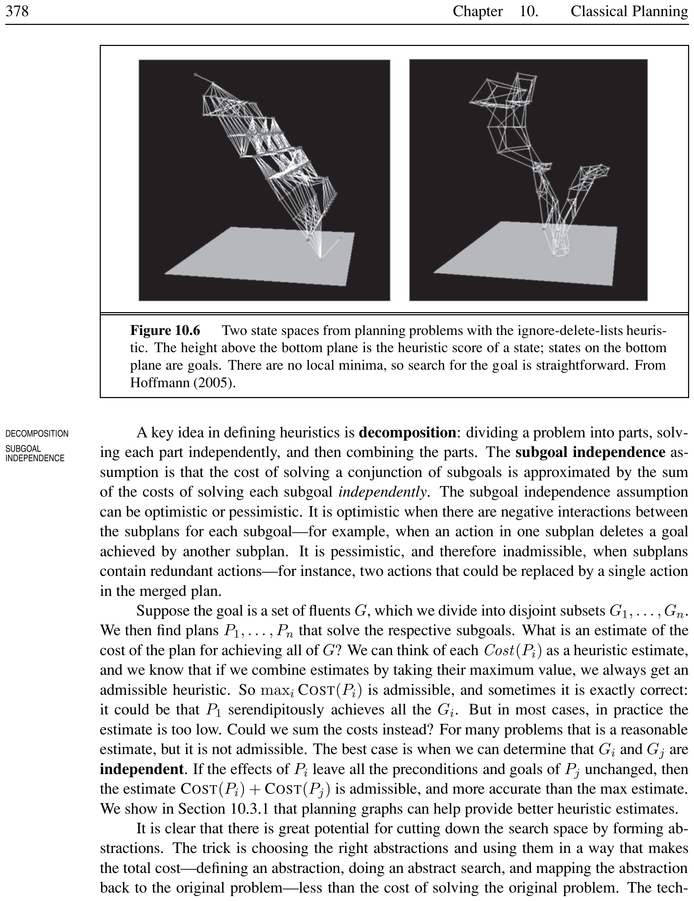
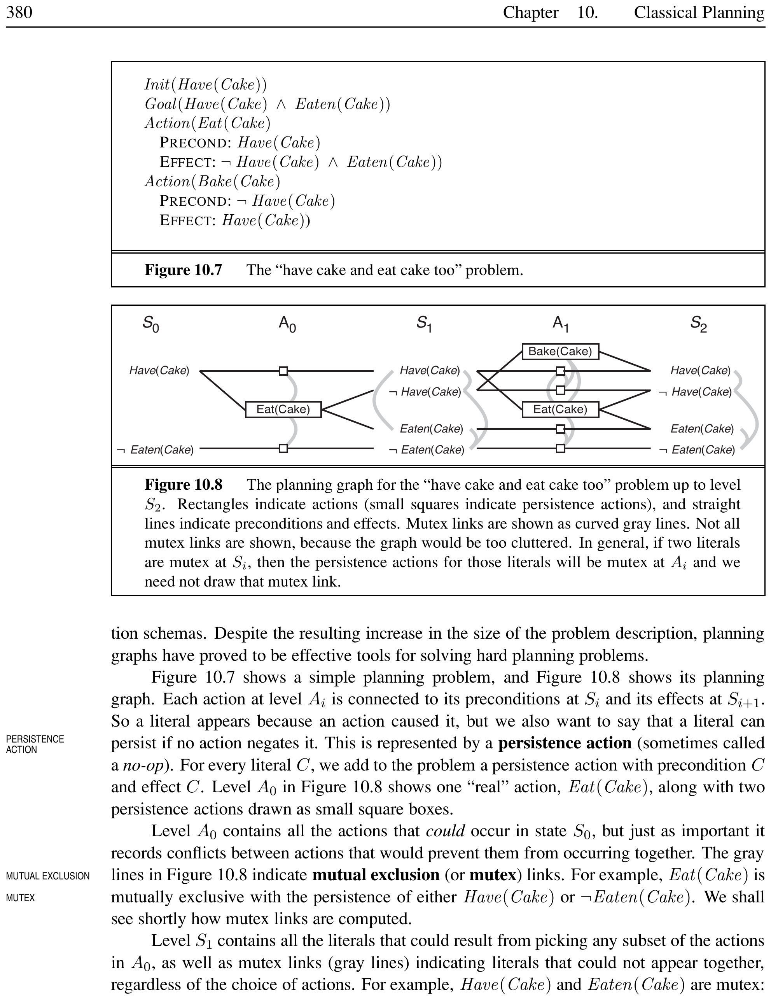
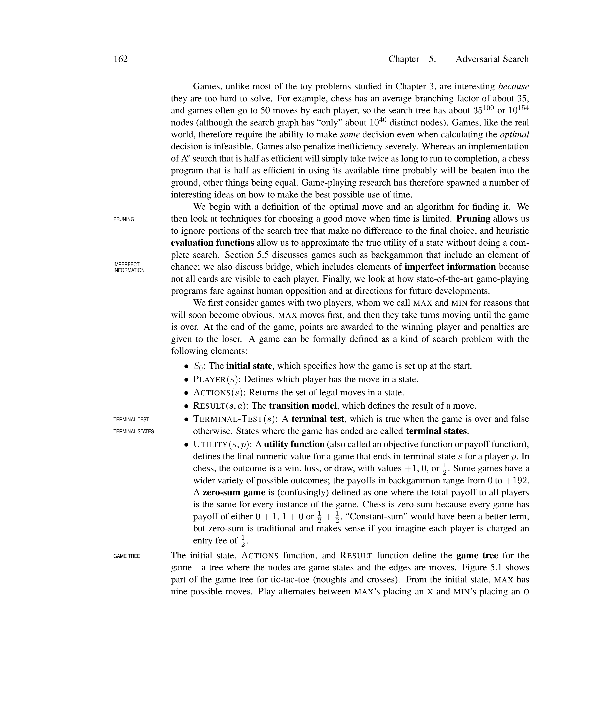
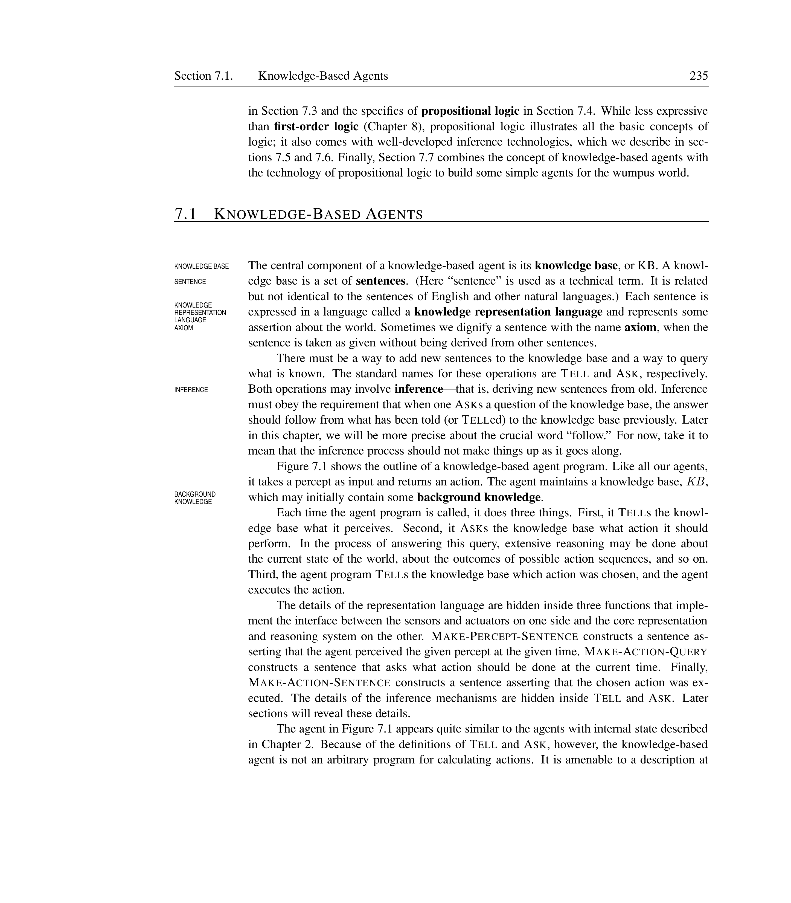
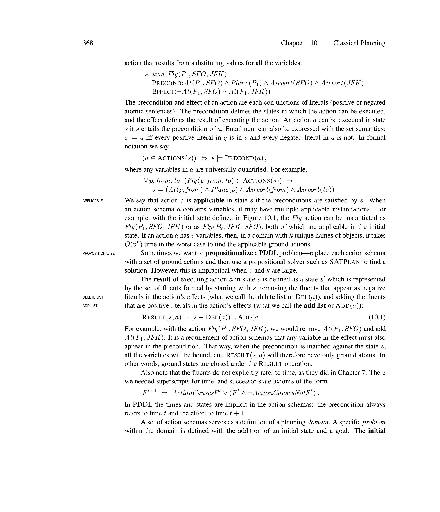


# Classical Planning

Planning is the process of devising a sequence of actions to achieve a goal. Unlike search-based problem-solving (Chapter [ch:solving-problems-searching]), which uses atomic state representations, planning uses a **factored representation** where each state is described by a set of variables. This makes it possible to derive domain-independent heuristics automatically.

## Definition of Classical Planning

<div markdown="1" style="border-left:4px solid #1a5c9e;background:#f0f4f8;padding:14px 18px;margin:18px 0;border-radius:6px;">

Classical Planning

A **classical planning** problem is defined by an initial state, a set of actions, a transition model, and a goal. The planner must find a sequence of actions (a **plan**) that transforms the initial state into a state satisfying the goal. The environment is fully observable, deterministic, static, and single-agent.

</div>

<div markdown="1" style="border-left:4px solid #2e7d32;background:#e8f5e9;padding:14px 18px;margin:18px 0;border-radius:6px;">

Planning vs. Problem-Solving

Classical planning differs from search-based problem-solving (Chapter [ch:solving-problems-searching]) by using factored state representations (variables) instead of atomic states. This enables automatic derivation of heuristics. For example, in the air cargo domain, a single action schema $Fly(p, from, to)$ replaces $4Tn^2$ ground actions that a propositional agent would need.

</div>

### PDDL

<div markdown="1" style="border-left:4px solid #1a5c9e;background:#f0f4f8;padding:14px 18px;margin:18px 0;border-radius:6px;">

PDDL (Planning Domain Definition Language)

**PDDL** is a factored representation language for planning problems. Each state is a conjunction of ground, functionless atoms. The **closed-world assumption** holds (fluents not mentioned are false), and **unique names assumption** holds (different names refer to different objects).

</div>

<div markdown="1" style="border-left:4px solid #2e7d32;background:#e8f5e9;padding:14px 18px;margin:18px 0;border-radius:6px;">

PDDL State vs. First-Order Logic

In PDDL, $Poor \land Unknown$ represents a state using database semantics: $Poor$ is true, $Unknown$ is true, and everything else is false. Unlike FOL, PDDL states cannot contain variables, negated fluents, or function symbols — ensuring efficient set-based operations.

</div>

<div markdown="1" style="border-left:4px solid #1a5c9e;background:#f0f4f8;padding:14px 18px;margin:18px 0;border-radius:6px;">

Action Schema

An **action schema** is a lifted (first-order) representation of an action. It consists of:

- **Action name** and parameters (variables).

- **Precondition:** a conjunction of literals that must hold for the action to be applicable.

- **Effect:** a conjunction of literals that become true (add list) or false (delete list) after execution.

</div>

The result of executing action $a$ in state $s$ is:

$$\text{Result}(s, a) = (s - \text{Del}(a)) \cup \text{Add}(a)$$

An action $a$ is **applicable** in state $s$ if $s \models \text{Precond}(a)$.

<figure>

<figcaption>Planning as a search process: actions transform states until the goal is reached.</figcaption>
</figure>

<div markdown="1" style="border-left:4px solid #2e7d32;background:#e8f5e9;padding:14px 18px;margin:18px 0;border-radius:6px;">

Air Cargo Transport

Three action schemas: `Load(c, p, a)`, `Unload(c, p, a)`, `Fly(p, from, to)`. Initial cargo $C_1$ at SFO, $C_2$ at JFK. Goal: $C_1$ at JFK, $C_2$ at SFO.

```text
Action(Fly(p, from, to),
  PRECOND: At(p, from) $\land$ Plane(p) $\land$ Airport(from) $\land$ Airport(to)
  EFFECT:  $\lnot$At(p, from) $\land$ At(p, to))
```

Solution: `[Load(C`$_1$`, P`$_1$`, SFO), Fly(P`$_1$`, SFO, JFK), Unload(C`$_1$`, P`$_1$`, JFK),`  
`Load(C`$_2$`, P`$_2$`, JFK), Fly(P`$_2$`, JFK, SFO), Unload(C`$_2$`, P`$_2$`, SFO)]`

</div>

### The Blocks World

<div markdown="1" style="border-left:4px solid #1a5c9e;background:#f0f4f8;padding:14px 18px;margin:18px 0;border-radius:6px;">

Blocks World

The **blocks world** is a classic planning domain with cube-shaped blocks on a table. A robot arm can pick up one block at a time and move it either to the table or onto another clear block. The goal is to build specified stacks.

</div>

Two action schemas:

```text
Action(Move(b, x, y),
  PRECOND: On(b, x) $\land$ Clear(b) $\land$ Clear(y) $\land$ Block(b) $\land$ Block(y) $\land$ (b$\neq$x) $\land$ (b$\neq$y) $\land$ (x$\neq$y)
  EFFECT:  On(b, y) $\land$ Clear(x) $\land$ $\lnot$On(b, x) $\land$ $\lnot$Clear(y))

Action(MoveToTable(b, x),
  PRECOND: On(b, x) $\land$ Clear(b) $\land$ Block(b) $\land$ (b$\neq$x)
  EFFECT:  On(b, Table) $\land$ Clear(x) $\land$ $\lnot$On(b, x))
```

<div markdown="1" style="border-left:4px solid #2e7d32;background:#e8f5e9;padding:14px 18px;margin:18px 0;border-radius:6px;">

Building a Three-Block Tower

Initial: $On(A, Table)$, $On(B, Table)$, $On(C, A)$, $Clear(B)$, $Clear(C)$. Goal: $On(A, B) \land On(B, C)$. Solution: `[MoveToTable(C, A), Move(B, Table, C), Move(A, Table, B)]`.

</div>

### Complexity of Classical Planning

<div markdown="1" style="border-left:4px solid #1a5c9e;background:#f0f4f8;padding:14px 18px;margin:18px 0;border-radius:6px;">

PlanSAT and Bounded PlanSAT

**PlanSAT** asks whether any plan exists for a planning problem. **Bounded PlanSAT** asks whether a plan of length $\leq k$ exists. PlanSAT is PSPACE-complete; Bounded PlanSAT is NP-complete for many domains. Optimal planning is usually hard, but suboptimal planning can be easy.

</div>

<div markdown="1" style="border-left:4px solid #2e7d32;background:#e8f5e9;padding:14px 18px;margin:18px 0;border-radius:6px;">

PlanSAT in Blocks World

For the blocks world, PlanSAT is in P (a plan always exists for any solvable goal), but Bounded PlanSAT is NP-complete (finding the shortest tower is hard). This means suboptimal planning is tractable, but optimal planning requires exponential search in the worst case.

</div>

## Algorithms for Planning as State-Space Search

### Forward (Progression) Search

<div markdown="1" style="border-left:4px solid #1a5c9e;background:#f0f4f8;padding:14px 18px;margin:18px 0;border-radius:6px;">

Forward Search (Progression)

**Forward search** starts at the initial state and applies applicable actions to generate successor states, searching forward toward the goal. It uses the standard search algorithms from Chapter [ch:solving-problems-searching] with a heuristic function.

</div>

Forward search suffers from two problems: (1) it explores many irrelevant actions (e.g., 10 billion ground `Buy` actions for ISBNs), and (2) the branching factor is huge (up to 10,450 actions per state in air cargo with 10 airports).

<figure>

<figcaption>Forward (progression) search expands from the initial state $S_0$ by applying all applicable actions, generating successor states until a goal is found. The branching factor equals the number of applicable actions in each state.</figcaption>
</figure>

<div markdown="1" style="border-left:4px solid #2e7d32;background:#e8f5e9;padding:14px 18px;margin:18px 0;border-radius:6px;">

Forward Search in Air Cargo

With 10 airports, 50 planes, and 200 packages, the average branching factor is about 2,000 actions per state. A solution of depth 4 requires searching roughly $2000^4 = 1.6 \times 10^{13}$ nodes without heuristics — hopeless without domain-independent guidance.

</div>

### Backward (Regression) Search

<div markdown="1" style="border-left:4px solid #1a5c9e;background:#f0f4f8;padding:14px 18px;margin:18px 0;border-radius:6px;">

Backward Search (Regression)

**Backward search** (or **relevant-states search**) starts at the goal and applies actions backward to find predecessor states. Given a goal $g$ and a ground action $a$, the regressed state description is:

</div>

$$g' = (g - \text{Add}(a)) \cup \text{Precond}(a)$$

Backward search has a lower branching factor because only actions **relevant** to the goal are considered. An action is relevant if at least one of its effects unifies with a goal literal, and no effect negates a goal literal.

<div markdown="1" style="border-left:4px solid #2e7d32;background:#e8f5e9;padding:14px 18px;margin:18px 0;border-radius:6px;">

Backward Search for ISBN Purchase

Goal: `Own(0136042597)` with action `Buy(i)` effect `Own(i)`. Regress over `Buy(0136042597)` to get precondition `ISBN(0136042597)`. This matches the initial state, so the plan is found immediately — no enumeration of 10 billion ISBNs needed.

</div>

### Heuristics for Planning

<div markdown="1" style="border-left:4px solid #1a5c9e;background:#f0f4f8;padding:14px 18px;margin:18px 0;border-radius:6px;">

Ignore Preconditions Heuristic

The **ignore preconditions** heuristic drops all preconditions from actions, making every action applicable in every state. The number of steps needed becomes the number of unsatisfied goals, but this ignores that one action may achieve multiple goals.

</div>

<div markdown="1" style="border-left:4px solid #2e7d32;background:#e8f5e9;padding:14px 18px;margin:18px 0;border-radius:6px;">

Ignore Preconditions for 8-Puzzle

In the sliding-tile puzzle, removing the preconditions $Blank(s_2) \land Adjacent(s_1, s_2)$ from the Slide action lets any tile move to any space in one step. The relaxed solution length is the number of misplaced tiles — the trivial $h_1$ heuristic from Chapter [ch:solving-problems-searching].

</div>

<div markdown="1" style="border-left:4px solid #1a5c9e;background:#f0f4f8;padding:14px 18px;margin:18px 0;border-radius:6px;">

Ignore Delete Lists Heuristic

The **ignore delete lists** heuristic removes all negative literals from action effects. Actions can only add fluents, never remove them, enabling monotonic progress toward the goal. Though finding the optimal relaxed solution is NP-hard, hill-climbing on this heuristic works well in practice. This is the heuristic used by the **FF (Fast Forward)** planner.

</div>

<div markdown="1" style="border-left:4px solid #2e7d32;background:#e8f5e9;padding:14px 18px;margin:18px 0;border-radius:6px;">

Ignore Delete Lists on Blocks World

In blocks world, moving block A onto B has the effect $On(A,B) \land Clear(Table)$. The ignore-delete-lists version keeps $Clear(B)$ true even after A is placed on B, so B remains available. This makes the relaxed problem easier to solve but may underestimate the true cost (making the heuristic inadmissible).

</div>

<figure>

<figcaption>The ignore-delete-lists heuristic produces a landscape with no local minima, making hill-climbing effective. From Hoffmann (2005).</figcaption>
</figure>

<div markdown="1" style="border-left:4px solid #1a5c9e;background:#f0f4f8;padding:14px 18px;margin:18px 0;border-radius:6px;">

State Abstraction

**State abstraction** derives heuristics by ignoring certain aspects of the state to create a relaxed (easier) problem. Both ignore-preconditions and ignore-delete-lists are forms of state abstraction: they drop details from the action definitions, making the relaxed problem solvable without search. The cost of the optimal solution in the abstracted state space provides a heuristic for the original problem.

</div>

<div markdown="1" style="border-left:4px solid #1a5c9e;background:#f0f4f8;padding:14px 18px;margin:18px 0;border-radius:6px;">

Subgoal Independence Assumption

The **subgoal independence assumption** estimates the cost of a conjunction of subgoals as the sum (or maximum) of the costs of solving each subgoal independently. The **max** variant is admissible but often too low; the **sum** variant is more accurate but not admissible.

</div>

<div markdown="1" style="border-left:4px solid #2e7d32;background:#e8f5e9;padding:14px 18px;margin:18px 0;border-radius:6px;">

Subgoal Independence in Blocks World

Goal: $On(A,B) \land On(B,C)$. Solving $On(A,B)$ independently might give plan $P_1$ (move A onto B). Solving $On(B,C)$ independently gives $P_2$ (move B onto C). The merged plan may be shorter than $|P_1| + |P_2|$ because actions can serve both subgoals, or longer because one subplan may undo the other’s progress.

</div>

## Planning Graphs

<div markdown="1" style="border-left:4px solid #1a5c9e;background:#f0f4f8;padding:14px 18px;margin:18px 0;border-radius:6px;">

Planning Graph

A **planning graph** is a directed, leveled graph that approximates the reachable states of a planning problem. It alternates between **state levels** $S_i$ (containing literals that could hold at time $i$) and **action levels** $A_i$ (containing actions that could be applicable at time $i$). The graph is polynomial in size: $O(n(a + l)^2)$ for $n$ levels.

</div>

<div markdown="1" style="border-left:4px solid #2e7d32;background:#e8f5e9;padding:14px 18px;margin:18px 0;border-radius:6px;">

Planning Graph for Have Cake

In the Have Cake/Eat Cake problem ($S_0$: $Have(Cake), \neg Eaten(Cake)$), the planning graph at $S_1$ contains both $Have(Cake)$ and $Eaten(Cake)$, but they are mutex. At $S_2$, the graph levels off with both literals non-mutex. This tells us the goal requires at least 2 steps.

</div>

<div markdown="1" style="border-left:4px solid #1a5c9e;background:#f0f4f8;padding:14px 18px;margin:18px 0;border-radius:6px;">

Persistence Action

A **persistence action** (or no-op) for a literal $C$ has precondition $C$ and effect $C$. It represents that a literal can persist across time steps if no action negates it.

</div>

<div markdown="1" style="border-left:4px solid #2e7d32;background:#e8f5e9;padding:14px 18px;margin:18px 0;border-radius:6px;">

Persistence in Planning Graphs

In the Have Cake graph, $Have(Cake)$ persists from $S_0$ to $S_1$ via a persistence action. This ensures $Have(Cake)$ appears at every level once achieved. Without persistence, literals would disappear unless explicitly re-achieved each step.

</div>

<div markdown="1" style="border-left:4px solid #1a5c9e;background:#f0f4f8;padding:14px 18px;margin:18px 0;border-radius:6px;">

Mutual Exclusion (Mutex)

**Mutex** links record conflicts between actions or literals at the same level. Two actions are mutex if any of these hold:

- **Inconsistent effects:** one negates an effect of the other.

- **Interference:** an effect of one negates a precondition of the other.

- **Competing needs:** a precondition of one is mutex with a precondition of the other.

Two literals are mutex if one is the negation of the other, or if every pair of actions achieving them is mutex (**inconsistent support**).

</div>

<div markdown="1" style="border-left:4px solid #2e7d32;background:#e8f5e9;padding:14px 18px;margin:18px 0;border-radius:6px;">

Mutex in Spare Tire Problem

In the spare tire planning graph, $PutOn(Spare, Axle)$ and $Remove(Flat, Axle)$ are mutex due to competing needs: $PutOn$ requires $\neg At(Flat, Axle)$ while $Remove$ has the precondition $At(Flat, Axle)$. Similarly, $At(Spare, Ground)$ and $At(Flat, Ground)$ are mutex in $S_1$ because no action level can produce both without conflict.

</div>

<figure>

<figcaption>The planning graph for the “Have Cake and Eat Cake Too” problem up to level S$_2$. Rectangles are actions, small squares are persistence actions. Gray curved lines indicate mutex links.</figcaption>
</figure>

### Heuristics from Planning Graphs

<div markdown="1" style="border-left:4px solid #1a5c9e;background:#f0f4f8;padding:14px 18px;margin:18px 0;border-radius:6px;">

Level Cost

The **level cost** of a literal $g_i$ is the first level $S_i$ at which $g_i$ appears in the planning graph constructed from the initial state. This is an admissible heuristic for achieving $g_i$ individually.

</div>

For conjunctions of goals, three heuristics can be derived:

- **Max-level:** maximum level cost of any goal literal (admissible).

- **Level sum:** sum of level costs (inadmissible but accurate for decomposable problems).

- **Set-level:** first level where all goal literals appear with no mutexes between any pair (admissible, dominates max-level).

<div markdown="1" style="border-left:4px solid #2e7d32;background:#e8f5e9;padding:14px 18px;margin:18px 0;border-radius:6px;">

Heuristics for “Have Cake and Eat Cake Too”

Goal: $Have(Cake) \land Eaten(Cake)$. Level costs: $Have(Cake)=0$, $Eaten(Cake)=1$.

- Max-level: $\max(0,1) = 1$.

- Level-sum: $0 + 1 = 1$ (true optimal is 2: \[Eat, Bake\]).

- Set-level: 2 (at $S_2$ both literals appear without mutex).

The set-level heuristic gives the correct value of 2.

</div>

### The GRAPHPLAN Algorithm

<div markdown="1" style="border-left:4px solid #1a5c9e;background:#f0f4f8;padding:14px 18px;margin:18px 0;border-radius:6px;">

GRAPHPLAN

**GRAPHPLAN** extracts a plan directly from the planning graph. It alternates between expanding the graph and attempting to extract a plan via backward search. If extraction fails and the graph has leveled off, the problem is unsolvable.

</div>

The extraction phase is a backward search from the goal at the final level $S_n$ to the initial state $S_0$. At each level $S_i$, the algorithm selects a conflict-free subset of actions from $A_{i-1}$ whose effects cover the current goals, then recurses on the preconditions.

<figure>

<figcaption>GRAPHPLAN alternates between graph expansion and plan extraction. If extraction fails and the graph has leveled off, the problem is unsolvable within the current horizon.</figcaption>
</figure>

<div markdown="1" style="border-left:4px solid #2e7d32;background:#e8f5e9;padding:14px 18px;margin:18px 0;border-radius:6px;">

GRAPHPLAN on the Spare Tire Problem

Initial: $At(Spare, Trunk) \land At(Flat, Axle)$. Goal: $At(Spare, Axle)$. Actions: Remove, PutOn, LeaveOvernight. The planning graph expands to $S_2$ where the goal literal appears. Backward extraction selects $PutOn(Spare, Axle)$ at $A_1$, which requires $At(Spare, Ground) \land \neg At(Flat, Axle)$ at $S_1$. These are achieved by $Remove(Spare, Trunk)$ and $Remove(Flat, Axle)$ at $A_0$, whose preconditions match the initial state. Solution: $[Remove(Spare, Trunk), Remove(Flat, Axle), PutOn(Spare, Axle)]$.

</div>

Planning graphs have monotonic properties: literals and actions increase monotonically (once present, they persist), while mutexes decrease monotonically (once resolved, they stay resolved). These ensure termination.

<div markdown="1" style="border-left:4px solid #1a5c9e;background:#f0f4f8;padding:14px 18px;margin:18px 0;border-radius:6px;">

Serial Planning Graph

A **serial planning graph** is a planning graph with the restriction that each action level contains at most one non-persistence action. This enforces a total order among actions: only one “real” action executes per time step. The level cost in a serial planning graph gives a more accurate (but still admissible) heuristic than the standard planning graph, because the serial constraint prevents parallelism from artificially inflating the heuristic estimate.

</div>

## Other Classical Planning Approaches

### Planning as Boolean Satisfiability (SATPlan)

<div markdown="1" style="border-left:4px solid #1a5c9e;background:#f0f4f8;padding:14px 18px;margin:18px 0;border-radius:6px;">

SATPlan

**SATPlan** translates a bounded planning problem into a Boolean satisfiability problem. The translation includes:

- **Successor-state axioms:** $F^{t+1} \Leftrightarrow \text{ActionCauses}F^t \lor (F^t \land \neg\text{ActionCausesNot}F^t)$

- **Precondition axioms:** $A^t \Rightarrow \text{Pre}(A)^t$

- **Action exclusion axioms:** each action is distinct from every other

A SAT solver then finds a satisfying assignment, which corresponds to a plan.

</div>

<div markdown="1" style="border-left:4px solid #2e7d32;background:#e8f5e9;padding:14px 18px;margin:18px 0;border-radius:6px;">

SATPlan Translation Step

For the action $Fly(P_1, SFO, JFK)$ at time $t$:

```text
Successor-state for At(P$_1$, SFO):
  At(P$_1$, SFO)$^{t+1}$ $\Leftrightarrow$ Fly(P$_1$, SFO, JFK)$^t$ $\lor$ (At(P$_1$, SFO)$^t$ $\land$ $\lnot$Fly(P$_1$, SFO, JFK)$^t$)
Precondition: Fly(P$_1$, SFO, JFK)$^t$ $\Rightarrow$ At(P$_1$, SFO)$^t$ $\land$ Plane(P$_1$) $\land$ Airport(SFO) $\land$ Airport(JFK)
```

</div>

<figure>

<figcaption>SATPlan workflow: a planning problem is translated to SAT for a bounded horizon $k$. If the SAT solver returns unsatisfiable, $k$ is increased and the process repeats.</figcaption>
</figure>

### Planning as First-Order Deduction: Situation Calculus

<div markdown="1" style="border-left:4px solid #1a5c9e;background:#f0f4f8;padding:14px 18px;margin:18px 0;border-radius:6px;">

Situation Calculus

**Situation calculus** is a first-order logic formalism for reasoning about actions and change. A **situation** corresponds to a history of actions. The initial state is a constant $S_0$; applying action $a$ in situation $s$ gives $Result(s, a)$.

</div>

<div markdown="1" style="border-left:4px solid #2e7d32;background:#e8f5e9;padding:14px 18px;margin:18px 0;border-radius:6px;">

Situations in the Wumpus World

Starting from $S_0$ (initial wumpus world), $Result(S_0, Forward)$ is the situation after moving forward. $Result(Result(S_0, Forward), Turn(Right))$ is the situation after moving forward then turning right. Each unique action sequence produces a unique situation, encoding branching time rather than linear time.

</div>

<div markdown="1" style="border-left:4px solid #1a5c9e;background:#f0f4f8;padding:14px 18px;margin:18px 0;border-radius:6px;">

Possibility Axiom

A **possibility axiom** specifies when an action can be executed: $\Phi(s) \Rightarrow Poss(a, s)$ where $\Phi(s)$ describes the preconditions in situation $s$.

</div>

Each fluent is described by a **successor-state axiom**: $$Poss(a, s) \Rightarrow (F(Result(a, s)) \Leftrightarrow a = \text{ActionCausesF} \lor (F(s) \land a \neq \text{ActionCausesNotF}))$$

<div markdown="1" style="border-left:4px solid #2e7d32;background:#e8f5e9;padding:14px 18px;margin:18px 0;border-radius:6px;">

Situation Calculus for Wumpus World

Possibility axiom for Shoot: $Alive(Agent, s) \land Have(Agent, Arrow, s) \Rightarrow Poss(Shoot, s)$. Successor-state for Holding: $Poss(a, s) \Rightarrow (Holding(Agent, g, Result(a, s)) \Leftrightarrow a = Grab(g) \lor (Holding(Agent, g, s) \land a \neq Release(g)))$.

</div>

### Planning as Constraint Satisfaction

A bounded planning problem can be encoded as a CSP: at each time step, a single variable $Action_t$ has domain equal to the set of all possible actions. No action exclusion axioms are needed. This encoding is simpler than the SAT encoding.

### Partial-Order Planning

<div markdown="1" style="border-left:4px solid #1a5c9e;background:#f0f4f8;padding:14px 18px;margin:18px 0;border-radius:6px;">

Partial-Order Planning (POP)

**Partial-order planning** represents plans as sets of actions with ordering constraints ($Before(a_i, a_j)$), rather than linear sequences. It searches through the space of plans, refining them by adding actions or constraints to fix **flaws** (e.g., unsatisfied preconditions).

</div>

<div markdown="1" style="border-left:4px solid #2e7d32;background:#e8f5e9;padding:14px 18px;margin:18px 0;border-radius:6px;">

POP vs. Total-Order Planning

In the spare tire problem, a total-order planner must choose either $Remove(Spare, Trunk)$ followed by $Remove(Flat, Axle)$ or vice versa — both are valid but the planner must search both orderings. POP represents both at once with just the constraint $Remove \prec PutOn$, eliminating the irrelevant ordering choice.

</div>

<div markdown="1" style="border-left:4px solid #1a5c9e;background:#f0f4f8;padding:14px 18px;margin:18px 0;border-radius:6px;">

Least Commitment

The **least commitment** principle: when fixing a flaw, make only the minimum commitment necessary. Leave actions unordered and variables unbound unless forced to do otherwise by the constraints.

</div>

<figure>

<figcaption>A partially ordered plan for the spare tire problem. The two Remove actions can be executed in either order, as long as both complete before PutOn.</figcaption>
</figure>

<div markdown="1" style="border-left:4px solid #2e7d32;background:#e8f5e9;padding:14px 18px;margin:18px 0;border-radius:6px;">

Spare Tire as Partial-Order Plan

The POP starts with an empty plan (Start $\to$ Finish). The goal $At(Spare, Axle)$ is a flaw. Adding $PutOn(Spare, Axle)$ introduces new flaws: the preconditions $At(Spare, Ground)$ and $\neg At(Flat, Axle)$. Adding $Remove(Spare, Trunk)$ and $Remove(Flat, Axle)$ with ordering constraints $Remove \prec PutOn$ resolves them. No ordering between the two Remove actions is needed.

</div>

### Serializable Subgoals and the Sussman Anomaly

<div markdown="1" style="border-left:4px solid #1a5c9e;background:#f0f4f8;padding:14px 18px;margin:18px 0;border-radius:6px;">

Serializable Subgoals

A problem has **serializable subgoals** if there exists an order of subgoals such that the planner can achieve them in that order without undoing previously achieved subgoals. When subgoals are serializable, linear (non-interleaved) planning works.

</div>

<div markdown="1" style="border-left:4px solid #2e7d32;background:#e8f5e9;padding:14px 18px;margin:18px 0;border-radius:6px;">

Serializable Subgoals in the Spare Tire Problem

The spare tire problem has serializable subgoals: achieve $At(Spare, Trunk)$ first, then fetch the spare, then $PutOn(Spare, Axle)$. No earlier subgoal is undone by later steps. Linear search with the ignore-delete-lists heuristic solves this without interleaving.

</div>

<div markdown="1" style="border-left:4px solid #1a5c9e;background:#f0f4f8;padding:14px 18px;margin:18px 0;border-radius:6px;">

Sussman Anomaly

The **Sussman anomaly** is a blocks-world problem where subgoals $On(A, B)$ and $On(B, C)$ are not serializable in either order. Achieving $On(B, C)$ first (place B on C) blocks achieving $On(A, B)$ because B is no longer clear. Achieving $On(A, B)$ first (place A on B) must be undone to place B on C. A complete planner must **interleave** actions from different subplans.

</div>

<figure>

<figcaption>The Sussman anomaly: neither ordering works. Only interleaved planning (moving C to table, then B onto C, then A onto B) achieves both subgoals.</figcaption>
</figure>

<div markdown="1" style="border-left:4px solid #2e7d32;background:#e8f5e9;padding:14px 18px;margin:18px 0;border-radius:6px;">

Non-Serializable Subgoals

A simpler example: goal $On(A,B) \land On(B,C)$ with $A$ stacked on $C$ initially.

- Order 1: achieve $On(A,B)$ first. Now A is on B, but B cannot move (blocked by A). To get $On(B,C)$, we must undo $On(A,B)$.

- Order 2: achieve $On(B,C)$ first. Now B is on C, but A cannot move onto B (B is not clear). To get $On(A,B)$, we must undo $On(B,C)$.

Neither ordering works — the subgoals are non-serializable, proving the need for interleaving.

</div>

<div markdown="1" style="border-left:4px solid #2e7d32;background:#e8f5e9;padding:14px 18px;margin:18px 0;border-radius:6px;">

Solving the Sussman Anomaly

Initial: $On(C, A) \land On(Table, B)$. Goal: $On(A, B) \land On(B, C)$. An interleaved plan: `[MoveToTable(C, A), Move(B, Table, C), Move(A, Table, B)]`. The first action clears A. The second stacks B on C. The third stacks A on B. Each action serves progress toward both subgoals in an interleaved fashion.

</div>

## Analysis of Planning Approaches

<div markdown="1" style="border-left:4px solid #1a5c9e;background:#f0f4f8;padding:14px 18px;margin:18px 0;border-radius:6px;">

Planning Approaches Comparison

Several major approaches to automated planning exist:

- **Forward state-space search** (FF, Fast Downward): uses heuristics like ignore-delete-lists. Best for domains where feasible solutions can be found without backtracking.

- **Planning graphs** (GRAPHPLAN, IPP, LPG): polynomial reachability analysis with mutex constraints. Best when interactions between subgoals are complex.

- **SAT-based** (SATPlan, MAXPlan, SATMC): translates to Boolean satisfiability. Best for NP-hard planning domains.

- **CSP-based** (GP-CSP): encodes planning as constraint satisfaction.

- **Partial-order planning** (UCPOP, SNLP): explicit representation of plan structure. Useful when human understanding of plans is required.

</div>

| Year | Track       | Winning System (Approach)                        |
|:-----|:------------|:-------------------------------------------------|
| 1998 | Automated   | IPP (planning graphs); HSP (forward search)      |
| 2000 | Automated   | FF (forward search with ignore-delete-lists)     |
| 2002 | Hand-coded  | TLPlan (temporal action logic)                   |
| 2002 | Automated   | LPG (local search on planning graphs)            |
| 2004 | Optimal     | SATPlan (Boolean satisfiability)                 |
| 2004 | Satisficing | Fast Downward (forward search with causal graph) |
| 2006 | Optimal     | SATPlan, MAXPlan (Boolean satisfiability)        |
| 2008 | Optimal     | Gamer (model checking, bidirectional search)     |
| 2008 | Satisficing | LAMA (Fast Downward with improved heuristics)    |

Top-Performing Planning Systems in the International Planning Competition

<div markdown="1" style="border-left:4px solid #2e7d32;background:#e8f5e9;padding:14px 18px;margin:18px 0;border-radius:6px;">

FF Planner in Practice

The FF (Fast Forward) planner uses forward state-space search with the ignore-delete-lists heuristic. It estimates the heuristic by building a planning graph at each state. FF then uses hill-climbing search, switching to iterative deepening when it hits a plateau. This approach solved problems that were intractable for prior systems, winning the AIPS 2000 planning competition.

</div>

## Summary

- Classical planning uses the factored representation of PDDL with action schemas (preconditions and effects) to define domains.

- Forward (progression) and backward (regression) state-space search with domain-independent heuristics are the most common approaches.

- Planning graphs provide a polynomial-sized approximation of reachable states and yield accurate, admissible heuristics.

- GRAPHPLAN extracts plans directly from the planning graph via backward search with mutex constraints.

- Alternative approaches include SAT-based planning (SATPlan), situation calculus, CSP encoding, and partial-order planning.

- The Sussman anomaly demonstrates that non-interleaved planning is incomplete; interleaving actions from different subplans is essential.

- Serializable subgoals define the class of problems for which linear (non-interleaved) planning suffices.


