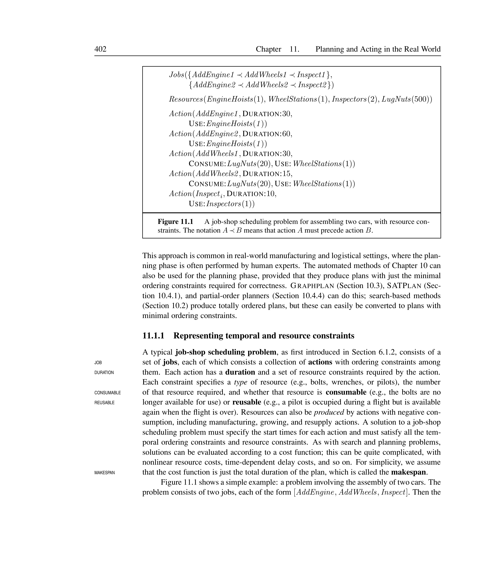
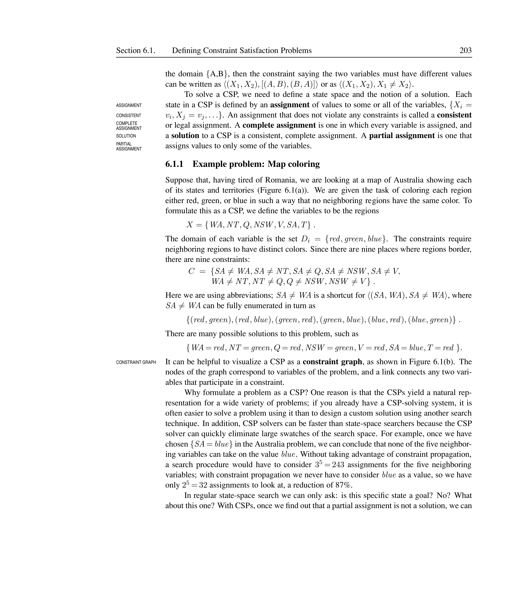
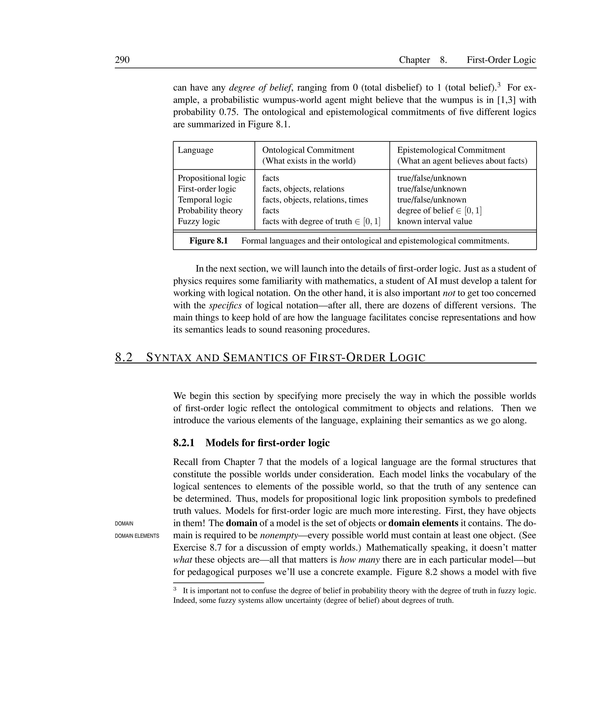
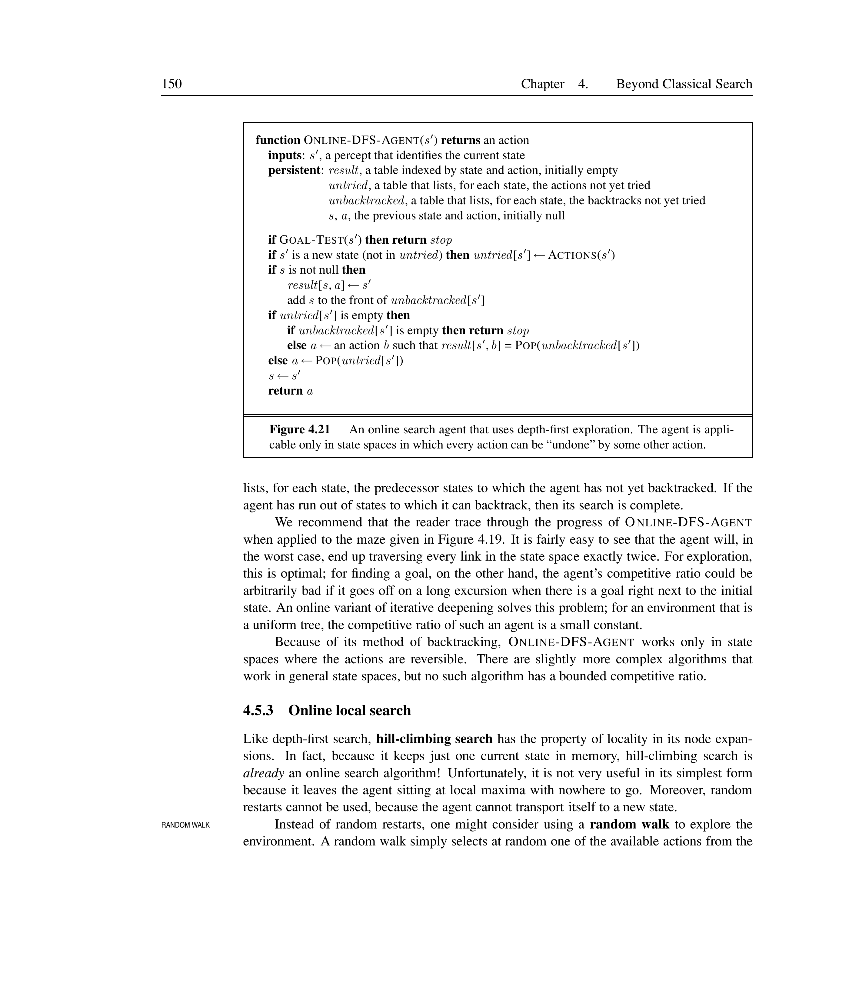
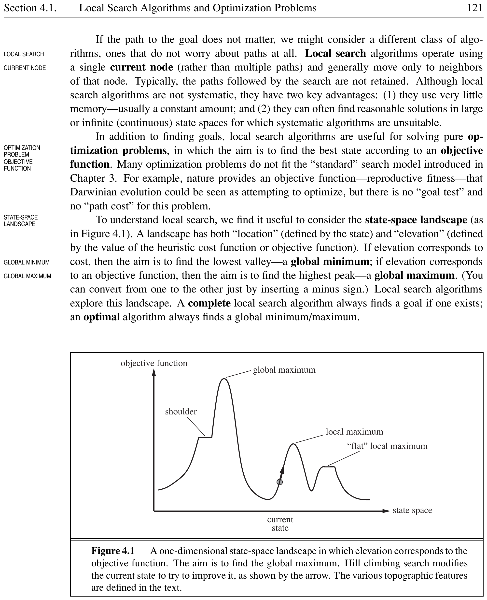
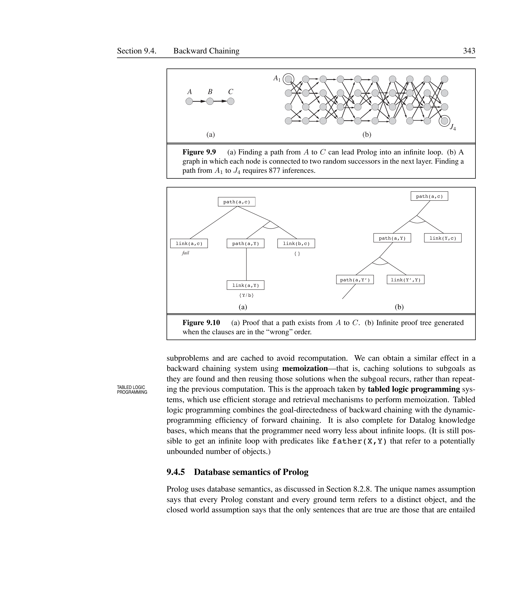
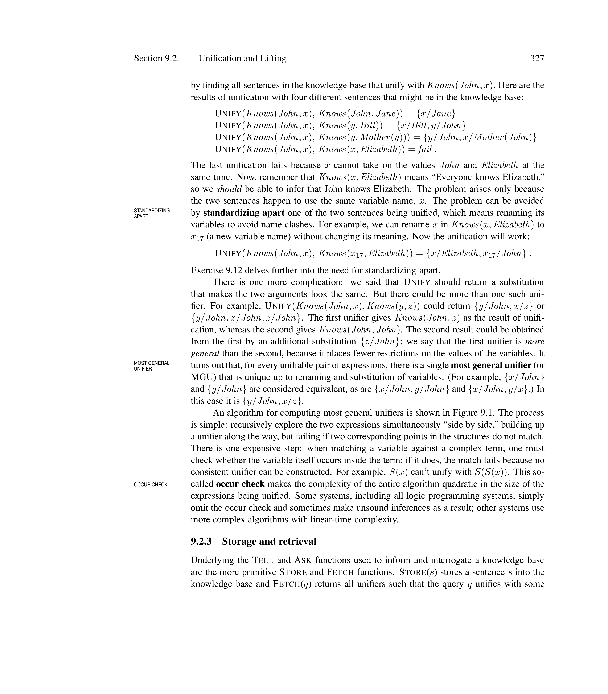

# Planning and Acting in the Real World


Classical planning (Chapter~\ref{ch:classical-planning}) assumes a fully observable, deterministic, static, single-agent environment. The real world is far more complex: actions take time, consume resources, can be decomposed hierarchically, may fail or have uncertain outcomes, and are executed alongside other agents. This chapter extends planning to handle these realities.

% ============================================================
## Time, Schedules, and Resources


Classical planning representations cannot express how long an action takes or when it occurs. In the real world, we need to assign departure and arrival times to flights, allocate staff, and ensure deadlines are met. The standard approach is ``plan first, schedule later'': first select actions with minimal ordering constraints, then add temporal information to satisfy resource and deadline constraints.

% ------------------------------------------
### Representing Temporal and Resource Constraints


<div style="border-left: 4px solid #1a5c9e; background-color: #f0f4f8; padding: 15px; margin: 20px 0; border-radius: 4px;">
<strong>📖 Job-Shop Scheduling Problem</strong>

A **job** is a collection of actions with ordering constraints. Each action has a **duration** and requires resources. A **resource** has a type, a quantity, and a nature:
\begin{itemize}
  \item **Consumable:** used up (e.g., bolts, fuel, lug nuts).
  \item **Reusable:** occupied during execution but available again afterward (e.g., a pilot, an inspector, an engine hoist).
\end{itemize}
The **makespan** is the total duration of the plan.

</div>


<div style="border-left: 4px solid #1a5c9e; background-color: #f0f4f8; padding: 15px; margin: 20px 0; border-radius: 4px;">
<strong>📖 Aggregation</strong>

**Aggregation** groups indistinguishable individual objects into numerical quantities. Instead of naming each inspector individually ($I_1, I_2$), we state there are 2 inspectors. This reduces complexity from $10!$ assignments to a single numerical check.

</div>


<div style="border-left: 4px solid #2e7d32; background-color: #e8f5e9; padding: 15px; margin: 20px 0; border-radius: 4px;">
<strong>💡 Aggregation in the Car Assembly Problem</strong>

Without aggregation, representing 2 inspectors would require named entities Inspector(I1) and Inspector(I2). With 10 concurrent Inspect actions and 9 inspectors, the algorithm would try all $10!$ ways of assigning inspectors before detecting failure. With aggregation, a single numerical check Inspectors(9) < 10 fails immediately.

</div>


 Figure~\ref{fig:job-shop} shows a typical job-shop scheduling problem: assembling two cars.

[htbp]





*Caption: A job-shop scheduling problem for assembling two cars. Each action has a duration; some consume resources (lug nuts), others occupy reusable resources (hoists, wheel stations, inspectors).*


\end{figure}


<div style="border-left: 4px solid #2e7d32; background-color: #e8f5e9; padding: 15px; margin: 20px 0; border-radius: 4px;">
<strong>💡 Resource Declaration in PDDL</strong>


```text
Jobs({AddEngine1 $\prec$ AddWheels1 $\prec$ Inspect1},
     {AddEngine2 $\prec$ AddWheels2 $\prec$ Inspect2})
Resources(EngineHoists(1), WheelStations(1), Inspectors(2), LugNuts(500))
Action(AddEngine1, DURATION:30, USE:EngineHoists(1))
Action(AddEngine2, DURATION:60, USE:EngineHoists(1))
Action(AddWheels1, DURATION:30, CONSUME:LugNuts(20), USE:WheelStations(1))
Action(AddWheels2, DURATION:15, CONSUME:LugNuts(20), USE:WheelStations(1))
Action(Inspect$_i$, DURATION:10, USE:Inspectors(1))
```

The notation $A \prec B$ means action $A$ must precede action $B$.

</div>


% ------------------------------------------
### Solving Scheduling Problems


<div style="border-left: 4px solid #1a5c9e; background-color: #f0f4f8; padding: 15px; margin: 20px 0; border-radius: 4px;">
<strong>📖 Critical Path Method (CPM)</strong>

The **critical path method** determines the earliest and latest possible start times for each action given only ordering constraints (ignoring resources). The **critical path** is the longest-duration path through the action graph; it determines the makespan. Actions not on the critical path have **slack**: the amount of delay they can tolerate without affecting the overall plan.

</div>


 Let $ES(A)$ be the earliest possible start time of action $A$, $LS(A)$ the latest possible start time, and $Duration(A)$ its duration. These satisfy:

\[
ES(\text{Start}) = 0 \qquad
ES(B) = \max_{A \prec B} \big( ES(A) + Duration(A) \big)
\]

\[
LS(\text{Finish}) = ES(\text{Finish}) \qquad
LS(A) = \min_{B \succ A} \big( LS(B) - Duration(A) \big)
\]

 The **slack** of action $A$ is $LS(A) - ES(A)$. Actions with zero slack lie on the critical path.

[htbp]





*Caption: Critical path analysis for the car assembly problem. Each action is labeled $[ES, LS]$. The critical path (bold arrows) is {AE2 $\to$ AW2 $\to$ I2*
 with makespan 85 minutes.}

\end{figure}

 The CPM algorithm runs in $O(Nb)$ where $N$ is the number of actions and $b$ is the maximum branching factor.


<div style="border-left: 4px solid #2e7d32; background-color: #e8f5e9; padding: 15px; margin: 20px 0; border-radius: 4px;">
<strong>💡 Slack Calculation for AddWheels$_1$</strong>

For the car assembly problem, action AddWheels$_1$ follows AddEngine$_1$ (duration 30). Given $ES(\text{AddEngine}_1) = 0$:
\[
ES(\text{AddWheels}_1) = ES(\text{AddEngine}_1) + 30 = 30
\]
Working backward from Finish (makespan 85), AddWheels$_1$ feeds Inspect$_1$ (duration 10):
\[
LS(\text{AddWheels}_1) = LS(\text{Inspect}_1) - 30 = 75 - 30 = 45
\]
Slack $= LS - ES = 45 - 30 = 15$ minutes. AddWheels$_1$ can be delayed up to 15 minutes without affecting the total makespan.

</div>


<div style="border-left: 4px solid #ef6c00; background-color: #fff3e0; padding: 15px; margin: 20px 0; border-radius: 4px;">
<strong>⚠️ Resource Constraints Make Scheduling NP-Hard</strong>

Without resource constraints, finding a minimum-duration schedule is easy (linear inequalities on start times). Adding resource constraints introduces disjunctions (e.g., ``cannot overlap'' means one action must come before the other, or vice versa), making the problem NP-hard.

</div>


<div style="border-left: 4px solid #1a5c9e; background-color: #f0f4f8; padding: 15px; margin: 20px 0; border-radius: 4px;">
<strong>📖 Minimum Slack Algorithm</strong>

The **minimum slack algorithm** is a heuristic for scheduling with resource constraints. On each iteration, among all unscheduled actions whose predecessors are scheduled, pick the one with the least slack, assign it the earliest possible start time, then recompute ES and LS. This is analogous to the MRV heuristic in CSPs.

</div>


<div style="border-left: 4px solid #2e7d32; background-color: #e8f5e9; padding: 15px; margin: 20px 0; border-radius: 4px;">
<strong>💡 Minimum Slack Applied to Car Assembly</strong>

Initial ES/LS from CPM gives slack values:
\begin{itemize}
  \item AddEngine$_1$: slack 15, AddEngine$_2$: slack 0 (critical)
  \item AddWheels$_1$: slack 15, AddWheels$_2$: slack 0 (critical)
  \item Inspect$_1$: slack 15, Inspect$_2$: slack 0 (critical)
\end{itemize}
The algorithm picks AddEngine$_2$ (slack 0) first at $t=0$. It occupies the single engine hoist for 60 minutes. Next, AddEngine$_1$ (slack 15) must wait until $t=60$ because the hoist is busy. After recomputation, AddWheels$_2$ follows at $t=60$, AddWheels$_1$ at $t=90$, and the makespan becomes 115 minutes --- 30 minutes longer than the CPM lower bound.

</div>


[htbp]





*Caption: A solution with resource constraints for the car assembly problem. The engine hoist is a bottleneck: AddEngine$_1$ and AddEngine$_2$ cannot overlap, making the makespan 115 minutes.*


\end{figure}

% ============================================================
## Hierarchical Planning


Human planning operates at multiple levels of abstraction. A two-week Hawaii vacation is described as ``fly to Honolulu, do vacation stuff, fly back'' --- not as a sequence of $10^{10}$ muscle activations. Hierarchical planning mirrors this ability to work at higher levels of abstraction.

% ------------------------------------------
### High-Level Actions


<div style="border-left: 4px solid #1a5c9e; background-color: #f0f4f8; padding: 15px; margin: 20px 0; border-radius: 4px;">
<strong>📖 Hierarchical Task Network (HTN) Planning</strong>

**HTN planning** extends classical planning with a hierarchy of actions:
\begin{itemize}
  \item **Primitive actions:** standard precondition--effect schemas that can be executed directly.
  \item **High-level actions (HLAs):** abstract actions that have one or more **refinements** --- sequences of subactions (which may themselves be HLAs or primitive actions).
  \item An **implementation** of an HLA is a refinement that consists entirely of primitive actions.
\end{itemize}

</div>


 A high-level plan achieves the goal if **at least one** of its implementations achieves the goal. The agent chooses which implementation to execute.

[htbp]





*Caption: Two refinements for the HLA Go(Home, SFO). The first uses driving and a shuttle; the second uses a taxi.*


\end{figure}


<div style="border-left: 4px solid #2e7d32; background-color: #e8f5e9; padding: 15px; margin: 20px 0; border-radius: 4px;">
<strong>💡 HLA Refinements for Go(Home, SFO)</strong>


```text
Refinement(Go(Home, SFO),
  STEPS: [Drive(Home, SFOLongTermParking),
          Shuttle(SFOLongTermParking, SFO)])
Refinement(Go(Home, SFO),
  STEPS: [Taxi(Home, SFO)])
```

The HLAs embody knowledge about how to do things: buying milk, sitting down, or moving a knight to e4 are not considered.

</div>


<div style="border-left: 4px solid #2e7d32; background-color: #e8f5e9; padding: 15px; margin: 20px 0; border-radius: 4px;">
<strong>💡 Recursive Refinement for Vacuum Navigation</strong>


```text
Refinement(Navigate([a,b], [x,y]),
  PRECOND: a = x $\land$ b = y
  STEPS: [])
Refinement(Navigate([a,b], [x,y]),
  PRECOND: Connected([a,b], [a-1,b])
  STEPS: [Left, Navigate([a-1,b], [x,y])])
Refinement(Navigate([a,b], [x,y]),
  PRECOND: Connected([a,b], [a+1,b])
  STEPS: [Right, Navigate([a+1,b], [x,y])])
```


</div>


% ------------------------------------------
### Searching for Primitive Solutions


<div style="border-left: 4px solid #1a5c9e; background-color: #f0f4f8; padding: 15px; margin: 20px 0; border-radius: 4px;">
<strong>📖 Hierarchical Search</strong>

**Hierarchical search** begins with the top-level HLA $Act$ and repeatedly refines HLAs until a complete primitive plan is found. The algorithm searches in the space of refinement trees rather than primitive action sequences.

</div>


 The HIERARCHICAL-SEARCH algorithm uses breadth-first search over refinement depth (see Figure~\ref{fig:htn-search-space} for the search space structure). The computational benefit is dramatic:

\[
\text{Nonhierarchical: } O(b^d) \qquad
\text{Hierarchical: } O(r^{(d-1)/(k-1)})
\]

 where $d$ is the solution depth in primitive actions, $b$ is the branching factor of primitive actions, $r$ is the number of refinements per HLA, and $k$ is the number of subactions per refinement. When $r$ is small and $k$ is large, hierarchical search takes the $k$th root of the nonhierarchical cost.

[htbp]





*Caption: Hierarchical search space. The planner searches over refinement trees, not primitive action sequences. This reduces exponential blowup.*


\end{figure}


<div style="border-left: 4px solid #2e7d32; background-color: #e8f5e9; padding: 15px; margin: 20px 0; border-radius: 4px;">
<strong>💡 O-PLAN at Hitachi</strong>

The O-PLAN HTN planner was used at Hitachi to generate production plans involving 350 products, 35 assembly machines, and over 2000 operations. It produces a 30-day schedule with three 8-hour shifts per day, containing tens of millions of steps. The hierarchical structure of the plan makes it easy for humans to understand.

</div>


% ------------------------------------------
### Searching for Abstract Solutions


Refining HLAs all the way to primitives before checking plan validity is wasteful. We would like to reason about HLAs directly.

### Hierarchical Lookahead


<div style="border-left: 4px solid #1a5c9e; background-color: #f0f4f8; padding: 15px; margin: 20px 0; border-radius: 4px;">
<strong>📖 Hierarchical Lookahead</strong>

**Hierarchical lookahead** is an online search technique that uses angelic semantics to evaluate abstract plans at multiple levels of abstraction. Before committing to a detailed action sequence, the agent performs a lookahead at the HLA level to prune unpromising abstract plans, then refines only the promising ones.

</div>


 By extending angelic semantics to track costs (not just reachability), the agent can compute optimistic and pessimistic cost bounds for abstract plans. A plan whose optimistic cost exceeds the current best known cost can be pruned without refinement. This mirrors human deliberation: we plan vacations at an abstract level (``fly to Hawaii, spend two days on each island, fly back'') and only refine the promising options.


<div style="border-left: 4px solid #2e7d32; background-color: #e8f5e9; padding: 15px; margin: 20px 0; border-radius: 4px;">
<strong>💡 Hierarchical Lookahead for Cleaning a House</strong>

Consider a robot cleaning a multi-room house. At the abstract level, it considers plans like $[\text{CleanRoom}(\text{Kitchen}), \text{CleanRoom}(\text{LivingRoom}), \text{CleanRoom}(\text{Bedroom})]$. Using hierarchical lookahead, it computes optimistic cost bounds for each ordering without generating primitive vacuum movements. If $[\text{LivingRoom}, \text{Kitchen}, \text{Bedroom}]$ has a much lower optimistic cost (because it minimises hallway traversal), the robot commits to that abstract plan and refines it to primitive Suck/Move actions.

</div>


<div style="border-left: 4px solid #1a5c9e; background-color: #f0f4f8; padding: 15px; margin: 20px 0; border-radius: 4px;">
<strong>📖 Downward Refinement Property</strong>

A set of HLA descriptions satisfies the **downward refinement property** if every high-level plan that claims to achieve the goal (based on the HLA descriptions) actually has at least one implementation that does so.

</div>


<div style="border-left: 4px solid #2e7d32; background-color: #e8f5e9; padding: 15px; margin: 20px 0; border-radius: 4px;">
<strong>💡 Downward Refinement in the Vacuum World</strong>

Consider an HLA $\text{CleanRoom}(r)$ that claims to make a room clean without specifying how. If the vacuum world has a downward refinement property, then whenever a high-level plan $[\text{CleanRoom}(\text{Left}), \text{CleanRoom}(\text{Right})]$ appears to work (based on the HLA's abstract effects), there is guaranteed to be some primitive refinement --- e.g., sweeping left-to-right or right-to-left --- that actually achieves the goal. Without this property, the planner might commit to a high-level plan that cannot be refined into any real action sequence.

</div>


<div style="border-left: 4px solid #1a5c9e; background-color: #f0f4f8; padding: 15px; margin: 20px 0; border-radius: 4px;">
<strong>📖 Demonic vs.\ Angelic Nondeterminism</strong>

**Demonic nondeterminism** assumes an adversary chooses the implementation; an effect must hold for \emph{every} implementation. **Angelic nondeterminism** assumes the agent itself chooses; an effect holds if \emph{some} implementation achieves it.

</div>


 Under **angelic semantics**, the **reachable set** of an HLA $h$ from state $s$ is:

\[
\text{Reach}(s, h) = \{ s' \mid s' \text{ reachable by some implementation of } h \text{ from } s \}
\]

 A high-level plan $[h_1, h_2, \dots, h_m]$ achieves the goal if:

\[
\text{Reach}(s_0, [h_1, \dots, h_m]) \cap \text{Goal} \neq \emptyset
\]

 This is a much weaker condition than the demonic requirement (where \emph{every} member of the reachable set must be a goal state).

[htbp]


*Caption: Reachable sets under angelic semantics. The reachable set of $[h_1, h_2]$ intersects the goal set, so the plan achieves the goal. Under demonic semantics, the plan would fail because not \emph{all*
 implementations reach the goal.}

\end{figure}


<div style="border-left: 4px solid #1a5c9e; background-color: #f0f4f8; padding: 15px; margin: 20px 0; border-radius: 4px;">
<strong>📖 Optimistic and Pessimistic Descriptions</strong>

When the exact reachable set is too complex to compute, we use approximations:
\[
\text{Reach}^-(s, h) \subseteq \text{Reach}(s, h) \subseteq \text{Reach}^+(s, h)
\]
\begin{itemize}
  \item **Pessimistic** $(\text{Reach}^-)$: understates the reachable set. If it intersects the goal, the plan **definitely works**.
  \item **Optimistic** $(\text{Reach}^+)$: overstates the reachable set. If it does not intersect the goal, the plan **definitely fails**.
  \item If the optimistic set intersects the goal but the pessimistic set does not, the plan is **uncertain** and must be refined further.
\end{itemize}

</div>


 The ANGELIC-SEARCH algorithm (Figure~11.8 in AIMA) uses these approximations to commit to or reject high-level plans without refining them to primitives. For the vacuum world cleaning problem, ANGELIC-SEARCH scales approximately linearly in the number of squares, while HIERARCHICAL-SEARCH remains exponential and plain BFS cannot handle even two $2 \times 2$ rooms.


<div style="border-left: 4px solid #2e7d32; background-color: #e8f5e9; padding: 15px; margin: 20px 0; border-radius: 4px;">
<strong>💡 Angelic Description of Go(Home, SFO)</strong>


```text
Action(Go(Home, SFO),
  PRECOND: true,
  EFFECT: $\lozenge$At(Agent, SFO) $\land$ $\lozenge\neg$Cash)
```

The $\lozenge$ symbol means ``possibly, if the agent so chooses.'' The HLA may delete Cash (if the agent takes a taxi) or leave it untouched (if the agent drives). The agent can choose which outcome occurs.

</div>


% ============================================================
## Planning and Acting in Nondeterministic Domains


The real world is partially observable, nondeterministic, and unknown. We extend planning using three approaches: sensorless (conformant) planning, contingent planning with sensing, and online replanning.


<div style="border-left: 4px solid #1a5c9e; background-color: #f0f4f8; padding: 15px; margin: 20px 0; border-radius: 4px;">
<strong>📖 Percept Schema</strong>

A **percept schema** models the agent's sensors in PDDL. It specifies what the agent will perceive and under what conditions:

```text
Percept(Color(x, c),
  PRECOND: Object(x) $\land$ InView(x))
Percept(Color(can, c),
  PRECOND: Can(can) $\land$ InView(can) $\land$ Open(can))
```


</div>


[htbp]


*Caption: Percept schema filters raw observations into structured percepts. The schema defines preconditions that determine when a percept is available.*


\end{figure}

 Consider the **paint-and-furniture problem**: we have a chair and a table that must match in color, two cans of paint of unknown color, and only the table is initially in view.


<div style="border-left: 4px solid #2e7d32; background-color: #e8f5e9; padding: 15px; margin: 20px 0; border-radius: 4px;">
<strong>💡 Paint Problem Domain</strong>


```text
Init: Object(Table) $\land$ Object(Chair) $\land$ Can(C1) $\land$ Can(C2) $\land$ InView(Table)
Goal: Color(Chair, c) $\land$ Color(Table, c)

Action(RemoveLid(can),
  PRECOND: Can(can)
  EFFECT: Open(can))

Action(Paint(x, can),
  PRECOND: Object(x) $\land$ Can(can) $\land$ Color(can, c) $\land$ Open(can)
  EFFECT: Color(x, c))

Action(LookAt(x),
  PRECOND: InView(y) $\land$ (x $\neq$ y)
  EFFECT: InView(x) $\land$ $\neg$InView(y))
```


</div>


% ------------------------------------------
### Sensorless (Conformant) Planning


<div style="border-left: 4px solid #1a5c9e; background-color: #f0f4f8; padding: 15px; margin: 20px 0; border-radius: 4px;">
<strong>📖 Sensorless Planning</strong>

In **sensorless planning** (also called **conformant planning**), the agent has no sensors. It must find a plan that works for \emph{all} possible initial states consistent with its knowledge. The agent's knowledge is represented as a **belief state** --- a logical formula describing the set of possible physical states.

</div>


 For a deterministic world, the belief state update after applying action $a$ is:

\[
b' = \text{Result}(b, a) = (b - \text{Del}(a)) \cup \text{Add}(a)
\]

 If the belief state starts as a conjunction of literals (1-CNF), it remains in 1-CNF \emph{provided} the action has unconditional effects. The paint problem has a sensorless solution:

\[
[\text{RemoveLid}(C_1), \text{Paint}(\text{Chair}, C_1), \text{Paint}(\text{Table}, C_1)]
\]

 This **coerces** the chair and table to the same color, even though the agent never learns what that color is.


<div style="border-left: 4px solid #ef6c00; background-color: #fff3e0; padding: 15px; margin: 20px 0; border-radius: 4px;">
<strong>⚠️ Conditional Effects Break 1-CNF</strong>

When actions have conditional effects (e.g., Suck in the vacuum world cleans the square where the robot is currently located), the belief state can become a disjunction, losing the 1-CNF property:
\[
\text{Action(Suck, EFFECT: when AtL: CleanL} \land \text{when AtR: CleanR)}
\]
After Suck from belief state True, we get $(AtL \land CleanL) \lor (AtR \land CleanR)$.

</div>


 Solutions to the wiggliness problem include:
\begin{itemize}
  \item Using 1-CNF approximations (sound but incomplete).
  \item Looking for action sequences that keep the belief state simple.
  \item Using a lazy representation: ``initial belief state $b_0$ then actions $[a_1,\dots,a_m]$'' and checking goals via SAT.
\end{itemize}


<div style="border-left: 4px solid #2e7d32; background-color: #e8f5e9; padding: 15px; margin: 20px 0; border-radius: 4px;">
<strong>💡 Belief State Progression</strong>

Initial belief state $b_0$: $\text{Color}(x, C(x))$ \\
After $\text{RemoveLid}(C_1)$: $\text{Color}(x, C(x)) \land \text{Open}(C_1)$ \\
After $\text{Paint}(\text{Chair}, C_1)$: $\text{Color}(x, C(x)) \land \text{Open}(C_1) \land \text{Color}(\text{Chair}, C(C_1))$ \\
After $\text{Paint}(\text{Table}, C_1)$: $\text{Color}(x, C(x)) \land \text{Open}(C_1) \land \text{Color}(\text{Chair}, C(C_1)) \land \text{Color}(\text{Table}, C(C_1))$ \\
Goal satisfied with $c = C(C_1)$.

</div>


% ------------------------------------------
### Contingent Planning


<div style="border-left: 4px solid #1a5c9e; background-color: #f0f4f8; padding: 15px; margin: 20px 0; border-radius: 4px;">
<strong>📖 Contingent Plan</strong>

A **contingent plan** includes conditional branches based on percepts. The agent senses the world during execution and follows different branches depending on what it observes.

</div>


<div style="border-left: 4px solid #2e7d32; background-color: #e8f5e9; padding: 15px; margin: 20px 0; border-radius: 4px;">
<strong>💡 Contingent Plan for Paint Problem</strong>

For the paint problem with sensors, a contingent plan with conditional branches:

```text
[LookAt(Table), LookAt(Chair),
  if Color(Table,c) $\land$ Color(Chair,c) then NoOp
  else [RemoveLid(C1), LookAt(C1), RemoveLid(C2), LookAt(C2),
        if Color(Table,c) $\land$ Color(can,c) then Paint(Chair, can)
        else if Color(Chair,c) $\land$ Color(can,c) then Paint(Table, can)
        else [Paint(Chair, C1), Paint(Table, C1)]]]
```

The agent maintains its belief state as a logical formula during execution and evaluates branch conditions by checking entailment.

</div>


 AND--OR search over belief states (as in Section~\ref{sec:and-or-trees}) generates contingent plans.

% ------------------------------------------
### Online Replanning


<div style="border-left: 4px solid #1a5c9e; background-color: #f0f4f8; padding: 15px; margin: 20px 0; border-radius: 4px;">
<strong>📖 Execution Monitoring</strong>

**Execution monitoring** is the process of observing the world during plan execution and deciding whether replanning is needed. Three levels of monitoring:
\begin{itemize}
  \item **Action monitoring:** before each action, verify its preconditions still hold.
  \item **Plan monitoring:** before each action, verify the remaining plan will still succeed.
  \item **Goal monitoring:** before each action, check if goals have changed or been achieved.
\end{itemize}

</div>


[htbp]





*Caption: Replanning: the agent expects to be at state $E$ but observes state $O$. It repairs by finding a path from $O$ to some point $P$ on the original plan, then continues to $G$.*


\end{figure}


<div style="border-left: 4px solid #1a5c9e; background-color: #f0f4f8; padding: 15px; margin: 20px 0; border-radius: 4px;">
<strong>📖 Sources of Planning Failure</strong>

\begin{itemize}
  \item **Missing precondition:** the action model omits a precondition (e.g., a screwdriver is needed to open a paint can).
  \item **Missing effect:** the action model omits some effect (e.g., painting also gets paint on the floor).
  \item **Missing state variable:** the model lacks a variable (e.g., amount of paint remaining in a can).
  \item **Exogenous event:** an external event changes the world (e.g., someone knocks over the paint can).
  \item **Goal change:** the goal itself changes during execution.
\end{itemize}

</div>


<div style="border-left: 4px solid #2e7d32; background-color: #e8f5e9; padding: 15px; margin: 20px 0; border-radius: 4px;">
<strong>💡 Replanning in the Paint World</strong>

An agent generates the plan:

```text
[LookAt(Table), LookAt(Chair),
  if Color(Table,c) $\land$ Color(Chair,c) then NoOp
  else [RemoveLid(C1), LookAt(C1),
        if Color(Table,c) $\land$ Color(C1,c) then Paint(Chair, C1)
        else REPLAN]]
```

After painting the chair, if the agent perceives the chair is still not the right color (e.g., black paint shows through white), it replans by retrying the Paint action. This creates a loop through plan--execute--replan rather than an explicit loop in the plan.

</div>


% ============================================================
## Multiagent Planning


<div style="border-left: 4px solid #1a5c9e; background-color: #f0f4f8; padding: 15px; margin: 20px 0; border-radius: 4px;">
<strong>📖 Multiagent Planning Problem</strong>

A **multiagent planning problem** involves multiple actors in the same environment. A spectrum of settings:
\begin{itemize}
  \item **Multieffector planning:** one agent, multiple effectors that can operate concurrently (e.g., typing and speaking simultaneously).
  \item **Multibody planning:** multiple physically separate units controlled by a single planner (e.g., a fleet of delivery robots with shared sensor information).
  \item **Decentralized planning:** multiple agents, each doing its own planning, possibly with different goals.
\end{itemize}

</div>


% ------------------------------------------
### Planning with Multiple Simultaneous Actions


<div style="border-left: 4px solid #1a5c9e; background-color: #f0f4f8; padding: 15px; margin: 20px 0; border-radius: 4px;">
<strong>📖 Joint Action</strong>

In the multiactor setting, a **joint action** $\langle a_1, a_2, \dots, a_n \rangle$ specifies the action taken by each of $n$ actors at a given time step. The branching factor becomes $b^n$, making decoupling essential for tractability.

</div>


 The key challenge is representing **interactions**. Two enhancements to PDDL handle this:

\begin{enumerate}
  \item Each action includes the **actor** as an explicit parameter.
  \item A **concurrent action list** specifies which combinations are allowed.
\end{enumerate}


<div style="border-left: 4px solid #2e7d32; background-color: #e8f5e9; padding: 15px; margin: 20px 0; border-radius: 4px;">
<strong>💡 Doubles Tennis Problem</strong>

The doubles tennis problem involves two agents who must coordinate to return the ball and cover the net:

```text
Actors(A, B)
Init: At(A, LeftBaseline) $\land$ At(B, RightNet) $\land$
      Approaching(Ball, RightBaseline) $\land$ Partner(A,B) $\land$ Partner(B,A)
Goal: Returned(Ball) $\land$ (At(a, RightNet) $\lor$ At(a, LeftNet))

Action(Hit(a, Ball),
  CONCURRENT: b $\neq$ a $\Rightarrow$ $\neg$Hit(b, Ball)
  PRECOND: Approaching(Ball, loc) $\land$ At(a, loc)
  EFFECT: Returned(Ball))

Action(Go(a, to),
  PRECOND: At(a, loc) $\land$ to $\neq$ loc
  EFFECT: At(a, to) $\land$ $\neg$At(a, loc))
```

Without a concurrent action list, both agents might hit the ball simultaneously and collide.

</div>


<div style="border-left: 4px solid #2e7d32; background-color: #e8f5e9; padding: 15px; margin: 20px 0; border-radius: 4px;">
<strong>💡 Carry Action (Requires Two Agents)</strong>


```text
Action(Carry(a, cooler, here, there),
  CONCURRENT: b $\neq$ a $\land$ Carry(b, cooler, here, there)
  PRECOND: At(a, here) $\land$ At(cooler, here) $\land$ Cooler(cooler)
  EFFECT: At(a, there) $\land$ At(cooler, there) $\land$
           $\neg$At(a, here) $\land$ $\neg$At(cooler, here))
```

The Carry action requires two agents to act simultaneously.

</div>


% ------------------------------------------
### Planning with Multiple Agents: Cooperation and Coordination


When each agent plans independently, the challenge is **coordination**: ensuring that agents choose compatible joint plans.


<div style="border-left: 4px solid #1a5c9e; background-color: #f0f4f8; padding: 15px; margin: 20px 0; border-radius: 4px;">
<strong>📖 Coordination Mechanisms</strong>

\begin{itemize}
  \item **Convention:** a constraint on the selection of joint plans. Example: ``stick to your side of the court'' in tennis. When conventions are widespread, they are called **social laws** (e.g., ``drive on the right'').
  \item **Communication:** agents share their intended plans (e.g., shouting ``Mine!'' in tennis).
  \item **Plan recognition:** one agent infers another agent's plan from its actions (e.g., if A heads for the net, B knows to cover the baseline).
\end{itemize}

</div>


[htbp]





*Caption: Coordination problem in doubles tennis. Both agents must agree on compatible roles to achieve the goal.*


\end{figure}


<div style="border-left: 4px solid #1a5c9e; background-color: #f0f4f8; padding: 15px; margin: 20px 0; border-radius: 4px;">
<strong>📖 BOID Architecture and Emergent Behavior</strong>

The **boid** model simulates flocking behavior using three weighted rules per agent:
\begin{enumerate}
  \item **Cohesion:** move toward the average position of neighbors.
  \item **Separation:** avoid getting too close to any single neighbor.
  \item **Alignment:** match the average heading of neighbors.
\end{enumerate}
From these simple local rules, **emergent behavior** arises: the flock flies as a pseudorigid body with constant density, making sudden swooping motions --- without any centralized control or joint plan.

</div>


<div style="border-left: 4px solid #2e7d32; background-color: #e8f5e9; padding: 15px; margin: 20px 0; border-radius: 4px;">
<strong>💡 Ant Colony Coordination</strong>

Harvester ant colonies execute elaborate joint plans without centralized control:
\begin{itemize}
  \item **Foragers** search for seeds and bring them back immediately.
  \item The rate of returning foragers signals food availability.
  \item When the rate is high, other ants switch roles to become foragers.
  \item There is a **convention** on role importance: foraging is most important.
\end{itemize}
The colony learns over its decades-long lifespan, even though individual ants live only about one year.

</div>


[htbp]


*Caption: Emergent behavior: individual agents following simple local rules (cohesion, separation, alignment) produce a coherent flock without central coordination.*


\end{figure}

% ============================================================
## Summary


\begin{itemize}
  \item **Time and resources:** Scheduling extends planning with durations and resource constraints. CPM finds minimum-duration schedules in $O(Nb)$; resource constraints make scheduling NP-hard. The minimum slack heuristic is analogous to MRV in CSPs.
  \item **Hierarchical planning:** HTN planning uses HLAs with refinements to manage complexity. Angelic semantics allows provably correct abstract plans. ANGELIC-SEARCH scales linearly in problem size for structured domains.
  \item **Nondeterministic domains:** Sensorless (conformant) planning uses belief-state search. Conditional effects break 1-CNF belief states. Contingent planning adds sensing branches. Online replanning uses execution monitoring (action, plan, goal) to repair failures.
  \item **Multiagent planning:** Joint actions and concurrent action lists handle multiple simultaneous actors. Coordination is achieved through conventions, social laws, communication, or plan recognition. Emergent behavior (e.g., flocking) arises from simple local rules.
\end{itemize}
