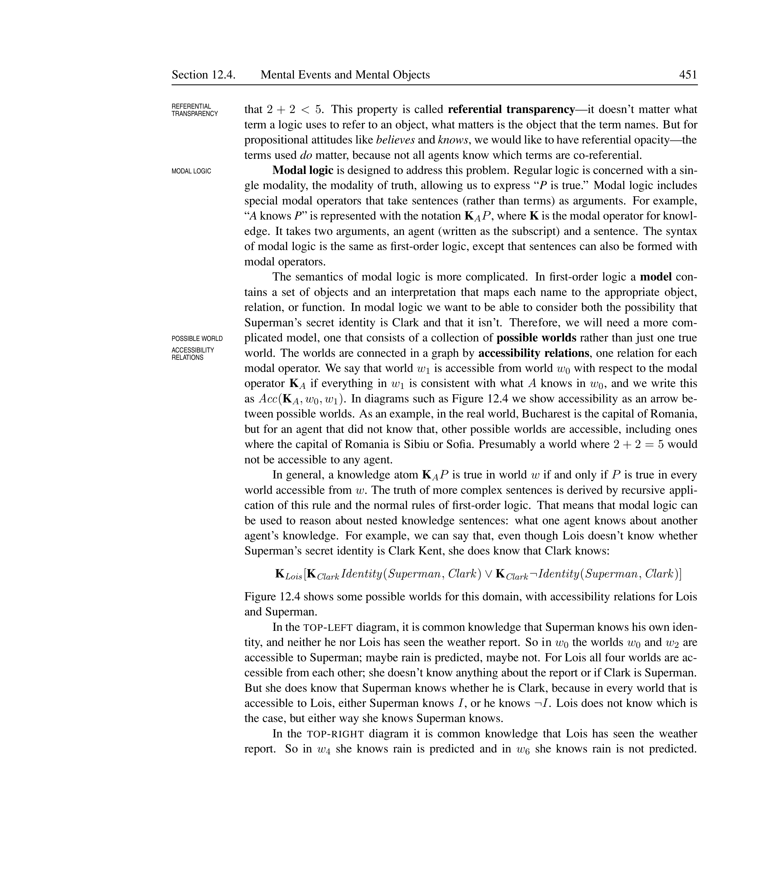
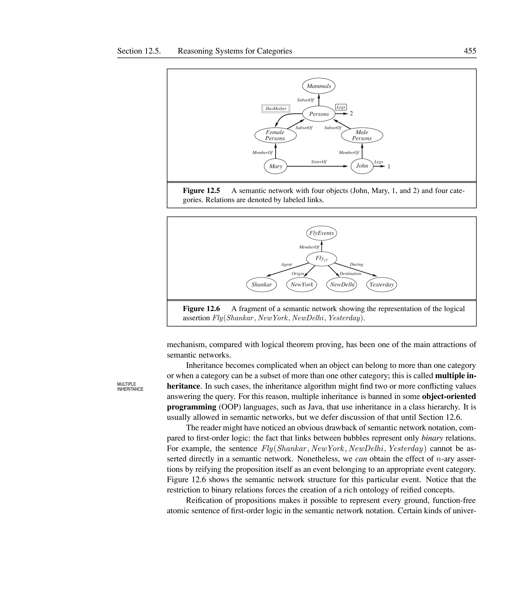
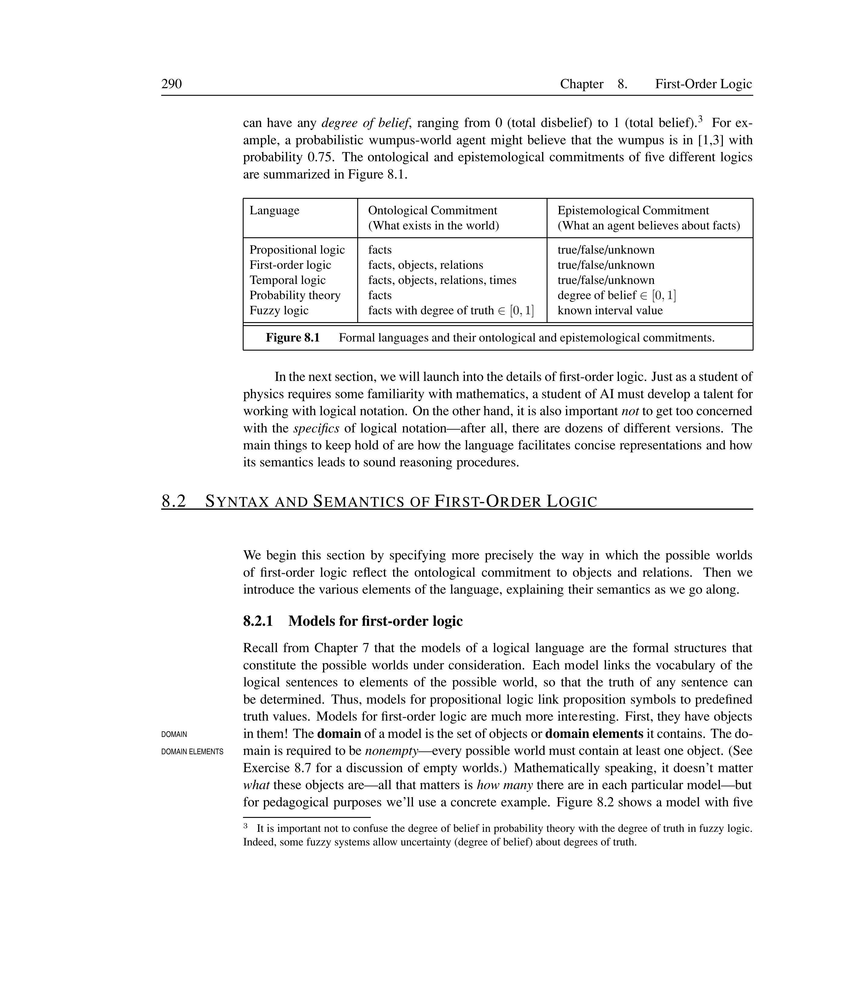
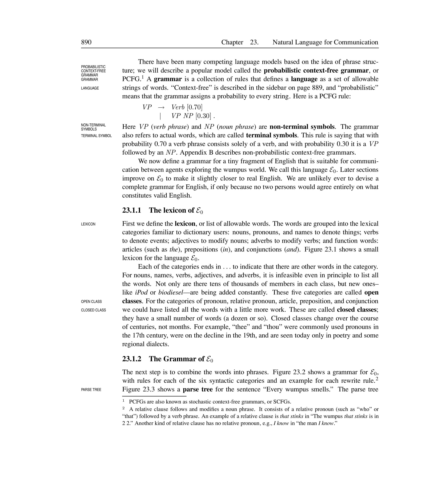
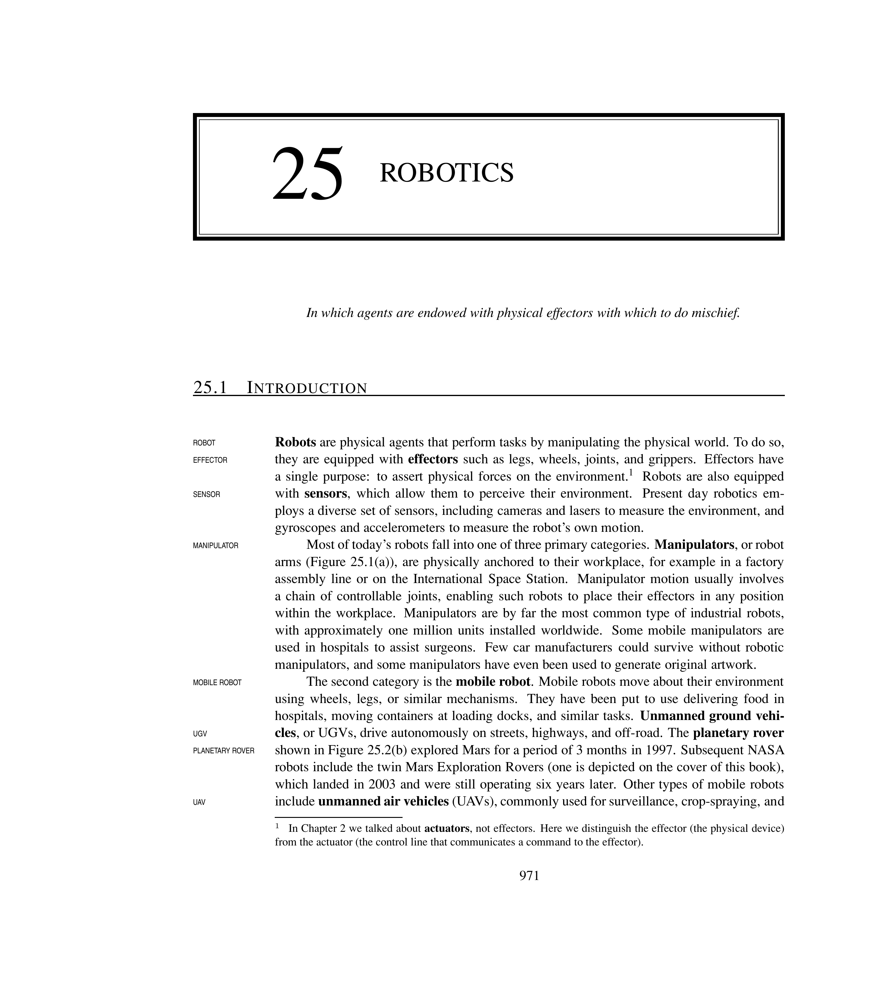

# Knowledge Representation


The previous chapters described the technology for knowledge-based agents: syntax, semantics, and proof theory of logic. This chapter addresses what content to put into an agent's knowledge base -- how to represent facts about the world.

% ==================== Section 12.1 ====================

## Ontological Engineering


In toy domains, the choice of representation is not critical. Complex domains such as Internet shopping or driving a car require more general and flexible representations. Creating these representations, concentrating on general concepts such as Events, Time, Physical Objects, and Beliefs, is called **ONTOLOGICAL ENGINEERING**.


<div style="border-left: 4px solid #1a5c9e; background-color: #f0f4f8; padding: 15px; margin: 20px 0; border-radius: 4px;">
<strong>📖 Upper Ontology</strong>


An **UPPER ONTOLOGY** is a general-purpose framework of concepts that organises everything in the world into a hierarchy of categories. It serves as a top-level structure from which domain-specific ontologies can be derived. Major examples include:
\begin{itemize}
  \item **CYC**: Built by a team of trained ontologist/logicians; contains over 150,000 concepts.
  \item **SUMO**: Suggested Upper Merged Ontology (~1000 terms in the upper level, linked to 20,000+ domain-specific terms).
  \item **OWL**: Web Ontology Language -- a description logic for the Semantic Web.
\end{itemize}

</div>


The general framework of concepts is drawn with general concepts at the top and specific concepts below.

[htbp]


*Caption: The upper ontology of the world. Each link indicates that the lower concept is a specialisation of the upper one.*


\end{figure}


<div style="border-left: 4px solid #1a5c9e; background-color: #f0f4f8; padding: 15px; margin: 20px 0; border-radius: 4px;">
<strong>📖 Categories and Objects in Ontological Engineering</strong>


In ontological engineering, **CATEGORIES** organise objects into classes. Categories support inheritance, prediction, and reasoning. Objects are members of categories; categories can be subcategories of other categories.

</div>


A general-purpose ontology has two distinguishing characteristics:
\begin{itemize}
  \item It should be applicable in any special-purpose domain (with the addition of domain-specific axioms).
  \item In demanding domains, different areas of knowledge must be unified because reasoning may involve several areas simultaneously.
\end{itemize}


<div style="border-left: 4px solid #2e7d32; background-color: #e8f5e9; padding: 15px; margin: 20px 0; border-radius: 4px;">
<strong>💡 Upper Ontology Examples</strong>


\begin{itemize}
  \item **CYC** contains concepts like ``OLED Display'' and ``iPhone'' as types of ``cellular phone'', which is a type of ``consumer electronics''.
  \item **DBPEDIA** extracts structured data from Wikipedia infoboxes -- 2.6 million concepts with ~100 facts per concept.
  \item **OWL** supports inferences over RDF triples on the Semantic Web.
\end{itemize}

</div>


% ==================== Section 12.2 ====================

## Categories and Objects


The organisation of objects into categories is a vital part of knowledge representation. Interaction with the world occurs at the level of individual objects, but much reasoning takes place at the level of categories.


<div style="border-left: 4px solid #1a5c9e; background-color: #f0f4f8; padding: 15px; margin: 20px 0; border-radius: 4px;">
<strong>📖 Category and Reification</strong>


A **CATEGORY** is a class or collection of objects that share common properties. Categories can be represented in first-order logic either as predicates (e.g., $Basketball(b)$) or as reified objects (e.g., $b \in Basketballs$). **REIFICATION** is the process of turning a proposition into an object -- from the Latin *res*, meaning ``thing''.

</div>


<div style="border-left: 4px solid #1a5c9e; background-color: #f0f4f8; padding: 15px; margin: 20px 0; border-radius: 4px;">
<strong>📖 Subcategory and Inheritance</strong>


A **SUBCATEGORY** is a category that is a subset of another category. We write $Basketballs \subset Balls$ to say that Basketballs is a subcategory of Balls. **INHERITANCE** allows properties of a supercategory to be automatically inferred for all its members and subcategories.

</div>


<div style="border-left: 4px solid #1a5c9e; background-color: #f0f4f8; padding: 15px; margin: 20px 0; border-radius: 4px;">
<strong>📖 Taxonomy</strong>


A **TAXONOMY** (or taxonomic hierarchy) is a hierarchical organisation of categories through subclass relations. Taxonomies have been used for centuries in biology, library science (Dewey Decimal system), and commerce.

</div>


[htbp]

\resizebox{\textwidth}{!}{%
\begin{tikzpicture}[
  node distance=1.2cm,
  cat/.style={draw, rectangle, rounded corners, minimum width=2.2cm, minimum height=0.6cm, align=center, font=\small, fill=blue!5}
]
\node[cat, fill=green!10] (thing) {**Thing**};
\node[cat, below left=of thing, xshift=-2cm] (animal) {Animals};
\node[cat, below right=of thing, xshift=2cm] (plant) {Plants};
\node[cat, below left=of animal, xshift=-2cm] (mammal) {Mammals};
\node[cat, below right=of animal, xshift=2cm] (bird) {Birds};
\node[cat, below=of mammal] (dog) {Dogs};
\node[cat, below=of dog] (poodle) {Poodle};

\draw[->] (thing) -- (animal);
\draw[->] (thing) -- (plant);
\draw[->] (animal) -- (mammal);
\draw[->] (animal) -- (bird);
\draw[->] (mammal) -- (dog);
\draw[->] (dog) -- (poodle);

% Labels
\node[font=\scriptsize, right=of thing, xshift=0.2cm] {Top category};
\node[font=\scriptsize, right=of animal, xshift=0.2cm] {Subcategory};
\node[font=\scriptsize, right=of mammal, xshift=0.2cm] {Subcategory};
\node[font=\scriptsize, right=of dog, xshift=0.2cm] {Subcategory};
\node[font=\scriptsize, right=of poodle, xshift=0.2cm] {Leaf category};
\end{tikzpicture}%
}

*Caption: A taxonomic hierarchy showing subcategory relationships.*


\end{figure}


<div style="border-left: 4px solid #1a5c9e; background-color: #f0f4f8; padding: 15px; margin: 20px 0; border-radius: 4px;">
<strong>📖 Disjoint, Exhaustive Decomposition, and Partition</strong>


\begin{description}\sloppy
  \item[**EXHAUSTIVE DECOMPOSITION**] \hspace{0pt}means every member of a supercategory belongs to at least one subcategory: $ExhaustiveDecomposition(\{Americans, Canadians, Mexicans\}, NorthAmericans)$.
  \item[**PARTITION**] \hspace{0pt}is a disjoint exhaustive decomposition: $Partition(\{Males, Females\}, Animals)$.
\end{description}

</div>


\[
Disjoint(s) \iff (\forall c_1, c_2 \; c_1 \in s \land c_2 \in s \land c_1 \neq c_2 \Rightarrow Intersection(c_1, c_2) = \{\})
\]
\[
ExhaustiveDecomposition(s, c) \iff (\forall i \; i \in c \iff \exists c_2 \; c_2 \in s \land i \in c_2)
\]
\[
Partition(s, c) \iff Disjoint(s) \land ExhaustiveDecomposition(s, c)
\]


<div style="border-left: 4px solid #1a5c9e; background-color: #f0f4f8; padding: 15px; margin: 20px 0; border-radius: 4px;">
<strong>📖 Composite Object and Bunch</strong>


A **COMPOSITE OBJECT** is an object composed of parts held together by structural relations. The $PartOf$ relation is transitive and reflexive. A **BUNCH** denotes the composite object consisting of all elements of a set as parts (not elements). $BunchOf(\{Apple_1, Apple_2, Apple_3\})$ is the composite object with the three apples as parts.

</div>


<div style="border-left: 4px solid #1a5c9e; background-color: #f0f4f8; padding: 15px; margin: 20px 0; border-radius: 4px;">
<strong>📖 Natural Kinds and Measure</strong>


**NATURAL KINDS** are categories that lack strict logical definitions (e.g., tomatoes, games). They are characterised by typical features rather than necessary and sufficient conditions. A **MEASURE** is a value assigned to a property such as height, mass, or cost. Measures use units functions: $Length(L_1) = Inches(1.5) = Centimeters(3.81)$.

</div>


<div style="border-left: 4px solid #1a5c9e; background-color: #f0f4f8; padding: 15px; margin: 20px 0; border-radius: 4px;">
<strong>📖 Count Nouns vs. Mass Nouns</strong>


**COUNT NOUNS** refer to individual objects that can be counted (e.g., ``an aardvark'', ``a theorem''). **MASS NOUNS** (or substances) refer to stuff that cannot be individuated (e.g., ``butter'', ``water''). Any part of a mass noun instance is also an instance of the same category. Properties that are retained under subdivision are **INTRINSIC** (density, colour); those that change are **EXTRINSIC** (weight, shape).

</div>


<div style="border-left: 4px solid #2e7d32; background-color: #e8f5e9; padding: 15px; margin: 20px 0; border-radius: 4px;">
<strong>💡 Categories and Objects Examples</strong>


\begin{itemize}
  \item **Category:** $BB_9 \in Basketballs$ -- a specific basketball belongs to the category.
  \item **Subcategory:** $Basketballs \subset Balls$ -- all basketballs are balls.
  \item **Inheritance:** $(x \in Basketballs) \Rightarrow Spherical(x)$ -- all basketballs are spherical.
  \item **Partition:** $Partition(\{Males, Females\}, Animals)$ -- every animal is exactly one sex.
  \item **Bunch:** The apples in this bag weigh two pounds; the bunch has weight, the set does not.
  \item **Natural Kind:** $x \in Typical(Tomatoes) \Rightarrow Red(x) \land Round(x)$ -- typical tomatoes are red and round, but some are not.
\end{itemize}

</div>


% ==================== Section 12.3 ====================

## Events


Actions and events change the world over time. While situation calculus handles discrete, instantaneous actions, event calculus provides a more general formalism.


<div style="border-left: 4px solid #1a5c9e; background-color: #f0f4f8; padding: 15px; margin: 20px 0; border-radius: 4px;">
<strong>📖 Event Calculus</strong>


**EVENT CALCULUS** is a formalism for reasoning about actions and their effects over time. It reifies both fluents and events. The key predicates are:
\begin{itemize}
  \item $T(f, t)$: Fluent $f$ is true at time $t$.
  \item $Happens(e, i)$: Event $e$ happens over time interval $i$.
  \item $Initiates(e, f, t)$: Event $e$ causes fluent $f$ to start holding at time $t$.
  \item $Terminates(e, f, t)$: Event $e$ causes fluent $f$ to cease holding at time $t$.
\end{itemize}

</div>


\[
Happens(e, (t_1, t_2)) \land Initiates(e, f, t_1) \land \neg Clipped(f, (t_1, t)) \land t_1 < t \Rightarrow T(f, t)
\]
\[
Happens(e, (t_1, t_2)) \land Terminates(e, f, t_1) \land \neg Restored(f, (t_1, t)) \land t_1 < t \Rightarrow \neg T(f, t)
\]

[htbp]


*Caption: Event calculus predicates and their relationships.*


\end{figure}


<div style="border-left: 4px solid #1a5c9e; background-color: #f0f4f8; padding: 15px; margin: 20px 0; border-radius: 4px;">
<strong>📖 Discrete Events, Process, and Liquid Event</strong>


\begin{description}
  \item[**DISCRETE EVENTS**] have a definite structure with a beginning, middle, and end (e.g., a trip from San Francisco to Washington).
  \item[**PROCESS**] categories (or **LIQUID EVENT** categories) are events that happen over any subinterval of their occurrence. If a process happens over an interval, it also happens over any subinterval.
  \item[**TEMPORAL SUBSTANCE**] is another name for liquid events. **SPATIAL SUBSTANCE** refers to physical stuff like butter.
\end{description}

</div>


### Conceptual Dependency (CD)


**CONCEPTUAL DEPENDENCY (CD)**, developed by Roger Schank, is a representation scheme for natural language meaning. It decomposes actions into a small set of primitive actions.


<div style="border-left: 4px solid #1a5c9e; background-color: #f0f4f8; padding: 15px; margin: 20px 0; border-radius: 4px;">
<strong>📖 Conceptual Dependency</strong>


**CONCEPTUAL DEPENDENCY (CD)** is a representation scheme that represents the meaning of natural language sentences at a primitive, language-independent level. CD actions have specific case frames (slots) such as object, source, destination, and instrument.

</div>


<div style="border-left: 4px solid #1a5c9e; background-color: #f0f4f8; padding: 15px; margin: 20px 0; border-radius: 4px;">
<strong>📖 CD Primitive Actions</strong>


CD defines a small set of **PRIMITIVE ACTIONS** from which all other actions are composed:

\begin{itemize}
  \item **ATRANS**: Transfer of an abstract relationship (e.g., ``give'', ``take'', ``own'').
  \item **PTRANS**: Physical transfer of an object (e.g., ``go'', ``move'', ``put'').
  \item **MTRANS**: Transfer of mental information (e.g., ``tell'', ``remember'', ``forget'').
  \item **MBUILD**: Building new information from existing information (e.g., ``decide'', ``conclude'').
  \item **INGEST**: Ingesting something (e.g., ``eat'', ``drink'').
  \item **EXPEL**: Expelling something (e.g., ``spit'', ``sweat'').
  \item **PROPEL**: Applying force (e.g., ``push'', ``pull'').
  \item **MOVE**: Movement of a body part (e.g., ``raise arm'').
  \item **GRASP**: Grasping an object (e.g., ``hold'', ``grab'').
  \item **ATTEND**: Attending to a stimulus (e.g., ``see'', ``hear'').
\end{itemize}

</div>


<div style="border-left: 4px solid #1a5c9e; background-color: #f0f4f8; padding: 15px; margin: 20px 0; border-radius: 4px;">
<strong>📖 Ontological Building Blocks of CD</strong>


CD uses four basic **ONTOLOGICAL BUILDING BLOCKS**:
\begin{itemize}
  \item **ACTs**: The primitive actions (ATRANS, PTRANS, etc.).
  \item **PPs**: Picture Producers -- physical objects (nouns).
  \item **AAs**: Action Aiders -- modifiers of actions (adverbs).
  \item **PAs**: Picture Aiders -- modifiers of objects (adjectives).
\end{itemize}

</div>


[htbp]


*Caption: The four ontological building blocks of Conceptual Dependency and their subcomponents.*


\end{figure}


<div style="border-left: 4px solid #2e7d32; background-color: #e8f5e9; padding: 15px; margin: 20px 0; border-radius: 4px;">
<strong>💡 CD Representation Examples</strong>


\begin{itemize}
  \item **ATRANS** (transfer of possession):\\
    ``John gave a book to Mary.''\\
    John $\Leftrightarrow$ ATRANS $\leftarrow$ Object: Book\\
    \hspace{3.2cm} $\leftarrow$ From: John $\rightarrow$ To: Mary

  \item **PTRANS** (physical transfer):\\
    ``John went to the store.''\\
    John $\Leftrightarrow$ PTRANS $\leftarrow$ Object: John\\
    \hspace{3.2cm} $\leftarrow$ From: Location$_1$ $\rightarrow$ To: Store

  \item **MTRANS** (mental transfer):\\
    ``John told Mary the news.''\\
    John $\Leftrightarrow$ MTRANS $\leftarrow$ Object: News\\
    \hspace{3.2cm} $\leftarrow$ From: John's Mind $\rightarrow$ To: Mary's Mind
\end{itemize}

</div>


% ==================== Section 12.4 ====================

## Mental Events and Mental Objects


Agents need knowledge about beliefs -- both their own and those of others. This enables reasoning about what others know, planning communication, and controlling inference.


<div style="border-left: 4px solid #1a5c9e; background-color: #f0f4f8; padding: 15px; margin: 20px 0; border-radius: 4px;">
<strong>📖 Propositional Attitude</strong>


A **PROPOSITIONAL ATTITUDE** is a mental state that an agent has toward a proposition. Examples include *Believes*, *Knows*, *Wants*, *Intends*, and *Informs*. These attitudes do not behave like normal predicates because they are referentially opaque.

</div>


<div style="border-left: 4px solid #1a5c9e; background-color: #f0f4f8; padding: 15px; margin: 20px 0; border-radius: 4px;">
<strong>📖 Referential Transparency</strong>


**REFERENTIAL TRANSPARENCY** is the property that the truth of a statement depends only on the objects referred to, not on how they are described. Propositional attitudes like *knows* and *believes* violate this -- we want **REFERENTIAL OPACITY**: the terms used matter because agents may not know which terms are co-referential.

</div>


<div style="border-left: 4px solid #1a5c9e; background-color: #f0f4f8; padding: 15px; margin: 20px 0; border-radius: 4px;">
<strong>📖 Modal Logic and Possible Worlds</strong>


**MODAL LOGIC** extends first-order logic with modal operators to handle propositional attitudes. $K_A P$ means ``Agent $A$ knows $P$''. The semantics uses **POSSIBLE WORLDS**: a model consists of a collection of worlds connected by **ACCESSIBILITY RELATIONS**. A knowledge atom $K_A P$ is true in world $w$ if and only if $P$ is true in every world accessible from $w$.

</div>


[htbp]





*Caption: Possible worlds with accessibility relations $K_A$ (agent A) and $K_B$ (agent B). Each world is accessible from itself (shown by loops).*


\end{figure}


<div style="border-left: 4px solid #1a5c9e; background-color: #f0f4f8; padding: 15px; margin: 20px 0; border-radius: 4px;">
<strong>📖 Logical Omniscience</strong>


**LOGICAL OMNISCIENCE** is the property that if an agent knows a set of axioms, it knows all consequences of those axioms. This is an assumption of modal logic that is problematic for belief, because real agents have finite reasoning capacity. Limited rationality attempts to address this by restricting the number of reasoning steps or computation time.

</div>


### Scripts


<div style="border-left: 4px solid #1a5c9e; background-color: #f0f4f8; padding: 15px; margin: 20px 0; border-radius: 4px;">
<strong>📖 Scripts</strong>


A **SCRIPT** is a structured representation of a stereotypical sequence of events in a particular context. Developed by Roger Schank, scripts organise knowledge about familiar situations (e.g., going to a restaurant, visiting a doctor). Components include:
\begin{itemize}
  \item **Entry Conditions**: Conditions that must hold for the script to be activated.
  \item **Roles**: Participants in the script.
  \item **Props**: Objects used in the script.
  \item **Scenes**: Ordered sequence of events.
  \item **Results**: Outcomes of the script.
\end{itemize}

</div>


[htbp]


*Caption: Components of a script structure.*


\end{figure}


<div style="border-left: 4px solid #2e7d32; background-color: #e8f5e9; padding: 15px; margin: 20px 0; border-radius: 4px;">
<strong>💡 ICPC Organising Script</strong>


Script for organising an ICPC (International Collegiate Programming Contest) at a university:

\begin{itemize}
  \item **Entry Conditions**: University has computing facilities, faculty approval obtained, budget allocated.
  \item **Roles**: Contest Director, Problem Setter, Judge, Technical Support, Volunteers, Participants.
  \item **Props**: Computers, contest platform, problem statements, scoreboard, certificates.
  \item **Scenes**:
    \begin{enumerate}
      \item Registration: Teams register and receive credentials.
      \item Briefing: Rules and environment explained.
      \item Contest: Teams solve problems (typically 5 hours).
      \item Judging: Solutions are tested and scored.
      \item Closing: Winners announced, certificates distributed.
    \end{enumerate}
  \item **Results**: Teams ranked by problems solved, tie-breaking by time.
\end{itemize}

</div>


% ==================== Section 12.5 ====================

## Reasoning Systems for Categories


Categories are the primary building blocks of large-scale knowledge representation. Two closely related families of systems support category reasoning: semantic networks and description logics.


<div style="border-left: 4px solid #1a5c9e; background-color: #f0f4f8; padding: 15px; margin: 20px 0; border-radius: 4px;">
<strong>📖 Multiple Inheritance and Default Value</strong>


**MULTIPLE INHERITANCE** occurs when an object belongs to more than one category, or a category is a subset of more than one other category. The inheritance algorithm may find conflicting values. A **DEFAULT VALUE** is a property assumed to hold for all members of a category unless contradicted by more specific information.

</div>


<div style="border-left: 4px solid #1a5c9e; background-color: #f0f4f8; padding: 15px; margin: 20px 0; border-radius: 4px;">
<strong>📖 Overriding</strong>


**OVERRIDING** is the process by which a more specific value replaces a default value inherited from a supercategory. In semantic networks, the inheritance algorithm follows links upward from the object and stops as soon as it finds a value -- specific information takes precedence over general defaults.

</div>


<div style="border-left: 4px solid #1a5c9e; background-color: #f0f4f8; padding: 15px; margin: 20px 0; border-radius: 4px;">
<strong>📖 Description Logic</strong>


**DESCRIPTION LOGIC** is a formalism designed to describe definitions and properties of categories. Key inference tasks are **SUBSUMPTION** (checking if one category is a subset of another by comparing definitions) and **CLASSIFICATION** (checking whether an object belongs to a category).

</div>


[htbp]





*Caption: Components of a semantic network reasoning system.*


\end{figure}

### Frame Structures


<div style="border-left: 4px solid #1a5c9e; background-color: #f0f4f8; padding: 15px; margin: 20px 0; border-radius: 4px;">
<strong>📖 Frame Structures</strong>


A **FRAME** is a data structure for representing a stereotyped concept or object. Developed by Marvin Minsky, frames organise knowledge into slots with fillers. Each frame represents a concept, and slots represent properties or relationships. Frames support inheritance through a class hierarchy.

Key elements:
\begin{itemize}
  \item **Frame Name**: Identifies the concept.
  \item **Slots**: Attributes or relations of the concept.
  \item **Fillers**: Values of slots (can be other frames, numbers, strings, or procedures).
  \item **Procedural Attachment**: Procedures attached to slots for computing values.
\end{itemize}

</div>


[htbp]





*Caption: Example of a frame structure for a Student concept with slots for attributes.*


\end{figure}


<div style="border-left: 4px solid #2e7d32; background-color: #e8f5e9; padding: 15px; margin: 20px 0; border-radius: 4px;">
<strong>💡 Frame Structure Example</strong>


Frame for a ``Student'' in a university knowledge base:

\begin{center}
\begin{tabular}{@{}ll@{}}
\toprule
**Slot** & **Filler** \\
\midrule
isa & Person \\
Name & John Smith \\
Age & 21 \\
Department & CSE \\
StudentID & 22102001 \\
Courses & [CSE405, CSE406] \\
GPA & 3.75 \\
\bottomrule
\end{tabular}
\end{center}

In LISP, property lists implement frame-like structures:

```lisp
(setf (get 'john 'name) "John Smith")
(setf (get 'john 'age) 21)
(setf (get 'john 'department) 'cse)
(setf (get 'john 'gpa) 3.75)
```


</div>


### Associative Networks


<div style="border-left: 4px solid #1a5c9e; background-color: #f0f4f8; padding: 15px; margin: 20px 0; border-radius: 4px;">
<strong>📖 Associative Networks</strong>


An **ASSOCIATIVE NETWORK** is a graph representation of knowledge where nodes represent concepts and edges represent associations between them. Nodes may represent objects, categories, or events. Edges are labelled with relation types such as **isa**, **has-part**, **belongs-to**, or domain-specific relations. Associative networks support spreading activation for retrieval and inheritance for inference.

</div>


### Truth Maintenance Systems (TMS)


<div style="border-left: 4px solid #1a5c9e; background-color: #f0f4f8; padding: 15px; margin: 20px 0; border-radius: 4px;">
<strong>📖 Truth Maintenance System</strong>


A **TRUTH MAINTENANCE SYSTEM (TMS)** manages knowledge updates and belief revision. It keeps track of dependencies between sentences and automatically retracts conclusions when their justifications become invalid. TMS ensures the knowledge base remains consistent when beliefs change.

</div>


[htbp]


*Caption: Architecture of a Truth Maintenance System interacting with a Problem Solver.*


\end{figure}


<div style="border-left: 4px solid #1a5c9e; background-color: #f0f4f8; padding: 15px; margin: 20px 0; border-radius: 4px;">
<strong>📖 Problem Solver with TMS</strong>


The **PROBLEM SOLVER** generates new inferences and communicates them to the TMS. The TMS records justifications for each inference. When the Problem Solver retracts a belief, the TMS determines which derived sentences must also be retracted based on their justifications.

</div>


<div style="border-left: 4px solid #1a5c9e; background-color: #f0f4f8; padding: 15px; margin: 20px 0; border-radius: 4px;">
<strong>📖 SL, JTMS, and ATMS</strong>


\begin{description}
  \item[**SUPPORT LISTS (SL)**] are lists of justifications attached to each sentence, consisting of the set of sentences from which it was inferred.
  \item[**JTMS** (Justification-Based TMS)] maintains a single current state. Each sentence is labelled *in* or *out*. Retraction removes sentences whose justifications are no longer valid.
  \item[**ATMS** (Assumption-Based TMS)] represents all hypothetical states simultaneously. Each sentence has a label consisting of sets of assumptions that would make it true.
\end{description}

</div>


<div style="border-left: 4px solid #2e7d32; background-color: #e8f5e9; padding: 15px; margin: 20px 0; border-radius: 4px;">
<strong>💡 TMS Example</strong>


Given KB: $\{P, P \Rightarrow Q\}$:
\begin{enumerate}
  \item $P$ is asserted with justification $\{assumed\}$.
  \item $Q$ is derived with justification $\{P, P \Rightarrow Q\}$.
  \item If $P$ is retracted, $Q$ has no remaining justification and is marked *out*.
  \item If $Q$ also had justification $\{R, R \Rightarrow Q\}$ and $R$ is still true, $Q$ remains *in*.
\end{enumerate}

</div>


% ==================== Section 12.6 ====================

## Reasoning with Default Information


Most real-world knowledge has exceptions. Default reasoning allows agents to jump to conclusions in the absence of contrary evidence.


<div style="border-left: 4px solid #1a5c9e; background-color: #f0f4f8; padding: 15px; margin: 20px 0; border-radius: 4px;">
<strong>📖 Nonmonotonicity</strong>


**NONMONOTONICITY** is the property that a set of beliefs does not grow monotonically over time as new evidence arrives. Unlike standard logic (where $KB \models \alpha$ implies $KB \land \beta \models \alpha$), nonmonotonic logics allow conclusions to be retracted when new information is added.

</div>


<div style="border-left: 4px solid #1a5c9e; background-color: #f0f4f8; padding: 15px; margin: 20px 0; border-radius: 4px;">
<strong>📖 Circumscription</strong>


**CIRCUMSCRIPTION** (McCarthy, 1980) assumes that certain predicates are ``as false as possible'' -- false for every object except those known to be true. It uses an $Abnormal$ predicate:
\[
Bird(x) \land \neg Abnormal_1(x) \Rightarrow Flies(x)
\]
Circumscribing $Abnormal_1$ allows concluding $Flies(Tweety)$ from $Bird(Tweety)$ unless $Abnormal_1(Tweety)$ is asserted. \hspace{0pt}

</div>


<div style="border-left: 4px solid #1a5c9e; background-color: #f0f4f8; padding: 15px; margin: 20px 0; border-radius: 4px;">
<strong>📖 Model Preference and Prioritized Circumscription</strong>


**MODEL PREFERENCE** logics entail a sentence if it is true in all preferred models. For circumscription, one model is preferred over another if it has fewer abnormal objects. **PRIORITIZED CIRCUMSCRIPTION** gives precedence to minimising certain predicates over others -- e.g., religious beliefs taking precedence over political beliefs in the Nixon diamond.

</div>


<div style="border-left: 4px solid #1a5c9e; background-color: #f0f4f8; padding: 15px; margin: 20px 0; border-radius: 4px;">
<strong>📖 Default Logic</strong>


**DEFAULT LOGIC** (Reiter, 1980) uses **DEFAULT RULES** of the form:
\[
P : J_1, \ldots, J_n / C
\]
where $P$ is the prerequisite, $C$ is the conclusion, and $J_i$ are justifications (if any can be proven false, the conclusion cannot be drawn). An **EXTENSION** is a maximal set of consequences of a default theory.

</div>


[htbp]


*Caption: Default reasoning with multiple extensions in the Nixon diamond.*


\end{figure}


<div style="border-left: 4px solid #1a5c9e; background-color: #f0f4f8; padding: 15px; margin: 20px 0; border-radius: 4px;">
<strong>📖 Belief Revision</strong>


**BELIEF REVISION** is the process of retracting previously held beliefs when new information contradicts them. It contrasts with **BELIEF UPDATE**, which occurs when the world changes. Belief revision must handle dependencies: retracting $P$ requires retracting everything inferred from $P$ unless those inferences have other justifications.

</div>


<div style="border-left: 4px solid #2e7d32; background-color: #e8f5e9; padding: 15px; margin: 20px 0; border-radius: 4px;">
<strong>💡 Default Reasoning Examples</strong>


\begin{itemize}
  \item **Birds fly:** $Bird(x) : Flies(x) / Flies(x)$. Tweety is a bird; conclude Tweety flies. If Tweety is a penguin, the default is overridden.
  \item **Nixon diamond:** Nixon is both a Quaker (default pacifist) and a Republican (default non-pacifist). Two extensions: one where Nixon is a pacifist, one where he is not.
  \item **Cars have four wheels:** Default conclusion unless evidence of a missing wheel is observed.
\end{itemize}

</div>


% ==================== Section 12.7 ====================

## Expert Systems


<div style="border-left: 4px solid #1a5c9e; background-color: #f0f4f8; padding: 15px; margin: 20px 0; border-radius: 4px;">
<strong>📖 Expert System</strong>


An **EXPERT SYSTEM** is a computer system that emulates the decision-making ability of a human expert in a specific domain. It uses knowledge represented as rules to solve problems that normally require human expertise.

**Characteristics**:
\begin{itemize}
  \item Domain-specific knowledge encoded in IF--THEN rules.
  \item Can explain its reasoning.
  \item Handles uncertainty and incomplete information.
  \item Performs at or near the level of human experts.
  \item Separates knowledge from inference (knowledge base vs.\ inference engine).
\end{itemize}

</div>


[htbp]





*Caption: Rule-based expert system structure showing major components and their interactions.*


\end{figure}


<div style="border-left: 4px solid #2e7d32; background-color: #e8f5e9; padding: 15px; margin: 20px 0; border-radius: 4px;">
<strong>💡 Expert System Applications</strong>


\begin{itemize}
  \item **MYCIN**: Medical diagnosis of bacterial infections (Stanford, 1970s). Outperformed some human specialists.
  \item **DENDRAL**: Interpretation of mass spectrometer data for chemical analysis.
  \item **XCON**: Configuration of DEC computer systems (saved millions annually).
  \item **PROSPECTOR**: Geological exploration for mineral deposits.
\end{itemize}

</div>


% ==================== Section 12.8 ====================

## Knowledge Engineering and Techniques


<div style="border-left: 4px solid #1a5c9e; background-color: #f0f4f8; padding: 15px; margin: 20px 0; border-radius: 4px;">
<strong>📖 Knowledge Acquisition</strong>


**KNOWLEDGE ACQUISITION** is the process of extracting and structuring knowledge from human experts, documents, or data sources for use in a knowledge-based system. It is often the most difficult and time-consuming part of building expert systems.

**General Learning Model** involves:
\begin{enumerate}
  \item Knowledge is elicited from experts (interviews, protocol analysis).
  \item Knowledge is encoded into a formal representation (rules, frames, logic).
  \item The knowledge base is tested and refined.
  \item Performance feedback leads to further acquisition.
\end{enumerate}

</div>


<div style="border-left: 4px solid #1a5c9e; background-color: #f0f4f8; padding: 15px; margin: 20px 0; border-radius: 4px;">
<strong>📖 Learning Types</strong>


\begin{description}
  \item[**ANALOGY**] Learning by mapping knowledge from a known domain to a new domain. Example: understanding electric circuits by analogy with water flow.
  \item[**INDUCTION**] Learning general rules from specific examples. Example: inferring ``all swans are white'' from observing many white swans.
  \item[**MEMORISATION**] Storing facts directly without generalisation. Example: remembering that ``Paris is the capital of France''.
  \item[**DIRECT INSTRUCTION**] Learning from explicit teaching. A teacher provides knowledge in a structured form.
\end{description}

</div>


<div style="border-left: 4px solid #1a5c9e; background-color: #f0f4f8; padding: 15px; margin: 20px 0; border-radius: 4px;">
<strong>📖 Factors Affecting Learning Performance</strong>


Key factors that affect learning performance:
\begin{itemize}
  \item **Quality of Training Data**: Noisy, incomplete, or biased data degrades learning.
  \item **Amount of Training Data**: More data generally improves performance up to a point.
  \item **Representation**: How knowledge is encoded affects what can be learned.
  \item **Feedback**: Timely and accurate feedback improves learning outcomes.
  \item **Prior Knowledge**: Existing knowledge can accelerate or bias new learning.
  \item **Computational Resources**: Time and memory constraints limit learning complexity.
\end{itemize}

</div>


<div style="border-left: 4px solid #2e7d32; background-color: #e8f5e9; padding: 15px; margin: 20px 0; border-radius: 4px;">
<strong>💡 Knowledge Engineering Examples</strong>


\begin{itemize}
  \item **Analogy:** A student learning physics uses analogies to water flow when learning about electrical circuits.
  \item **Induction:** A medical diagnosis system learns rules from patient records: ``Fever AND Cough $\Rightarrow$ Flu''.
  \item **Memorisation:** A geography tutor stores ``Dhaka is the capital of Bangladesh'' as a fact.
  \item **Direct Instruction:** A professor teaches students the rules of predicate logic.
\end{itemize}

</div>


% ==================== Section 12.9 ====================

## Pattern Recognition


<div style="border-left: 4px solid #1a5c9e; background-color: #f0f4f8; padding: 15px; margin: 20px 0; border-radius: 4px;">
<strong>📖 Pattern Recognition</strong>


**PATTERN RECOGNITION** is the process of identifying regularities in data and classifying them into categories. It involves sensing the environment, extracting features, and making decisions about the category of the input pattern.

</div>


[htbp]


*Caption: Pattern recognition pipeline showing stages from sensing to decision.*


\end{figure}


<div style="border-left: 4px solid #1a5c9e; background-color: #f0f4f8; padding: 15px; margin: 20px 0; border-radius: 4px;">
<strong>📖 Decision-Theoretic Classification</strong>


**DECISION-THEORETIC CLASSIFICATION** uses statistical decision theory to classify patterns. It computes the probability of each class given the observed features and selects the class with minimum expected risk:
\[
\text{Choose } C_i \text{ if } P(C_i \mid x) > P(C_j \mid x) \text{ for all } j \neq i
\]
where $x$ is the feature vector and $P(C_i \mid x)$ is the posterior probability of class $C_i$.

</div>


<div style="border-left: 4px solid #1a5c9e; background-color: #f0f4f8; padding: 15px; margin: 20px 0; border-radius: 4px;">
<strong>📖 Clustering</strong>


**CLUSTERING** is an unsupervised learning technique that groups similar patterns together without predefined class labels. Clusters are formed such that intra-cluster similarity is maximised and inter-cluster similarity is minimised. K-means and hierarchical clustering are common methods.

</div>


<div style="border-left: 4px solid #2e7d32; background-color: #e8f5e9; padding: 15px; margin: 20px 0; border-radius: 4px;">
<strong>💡 Pattern Recognition Examples</strong>


\begin{itemize}
  \item **Optical Character Recognition (OCR):** Sensing scanned text, extracting features (strokes, curves), classifying characters.
  \item **Speech Recognition:** Sensing audio signals, preprocessing (noise filtering), extracting features (MFCCs), classifying phonemes.
  \item **Clustering:** Grouping customer purchase data into market segments without predefined categories.
\end{itemize}

</div>


% ==================== Section 12.10 ====================

## Computer Vision vs. Human Vision


<div style="border-left: 4px solid #1a5c9e; background-color: #f0f4f8; padding: 15px; margin: 20px 0; border-radius: 4px;">
<strong>📖 Computer Vision</strong>


**COMPUTER VISION** is the field of AI that enables computers to extract meaningful information from digital images and videos. It includes tasks such as object detection, recognition, tracking, and scene reconstruction.

</div>


[htbp]

\small
\begin{tabular}{@{}p{3.5cm}p{5.5cm}p{5.5cm}@{}}
\toprule
**Aspect** & **Computer Vision** & **Human Vision** \\
\midrule
**Processing** & Sequential, algorithmic, programmed & Parallel, subconscious, learned \\
**Adaptability** & Requires retraining for new tasks & Highly adaptive, learns from few examples \\
**Speed** & Fast for specific tasks (object detection in ms) & Fast but slower for precise measurements \\
**Accuracy** & Highly accurate on trained categories & Prone to illusions, fatigue, bias \\
**Feature Detection** & Can detect beyond visible spectrum (IR, UV) & Limited to visible spectrum \\
**Context** & Struggles with context and ambiguity & Excellent at contextual understanding \\
**Training Data** & Requires thousands of labelled examples & Learns from few examples \\
**Robustness** & Sensitive to lighting, angle, occlusion & Robust to variations in viewing conditions \\
\bottomrule
\end{tabular}


*Caption: Comparison between Computer Vision and Human Vision.*


\end{table}


<div style="border-left: 4px solid #2e7d32; background-color: #e8f5e9; padding: 15px; margin: 20px 0; border-radius: 4px;">
<strong>💡 Vision System Strengths</strong>


\begin{itemize}
  \item **Computer Vision Strengths:** Consistent performance, works in hazardous environments, can process non-visible wavelengths (infrared, X-ray).
  \item **Human Vision Strengths:** General-purpose understanding, handles novel situations, minimal training required, integrated with other senses.
  \item **Computer Vision Weaknesses:** Brittleness to domain shift, requires large datasets, poor at common-sense reasoning.
  \item **Human Vision Weaknesses:** Fatigue, limited to visible light, subjective interpretation, optical illusions.
\end{itemize}

</div>


% ==================== Section 12.11 ====================

## Robotics


<div style="border-left: 4px solid #1a5c9e; background-color: #f0f4f8; padding: 15px; margin: 20px 0; border-radius: 4px;">
<strong>📖 Robotics Engineering</strong>


**ROBOTICS ENGINEERING** is the interdisciplinary field that combines mechanical engineering, electrical engineering, and computer science to design, build, and operate robots. A **ROBOT** is a programmable machine capable of carrying out actions autonomously or semi-autonomously.

**Scope** includes: industrial automation, service robots, medical robots, autonomous vehicles, space exploration, and human-robot interaction.

</div>


<div style="border-left: 4px solid #1a5c9e; background-color: #f0f4f8; padding: 15px; margin: 20px 0; border-radius: 4px;">
<strong>📖 Asimov's Three Laws of Robotics</strong>


Isaac Asimov proposed three fundamental laws governing robot behaviour:

\begin{enumerate}
  \item **First Law:** A robot may not injure a human being or, through inaction, allow a human being to come to harm.
  \item **Second Law:** A robot must obey orders given by human beings except where such orders would conflict with the First Law.
  \item **Third Law:** A robot must protect its own existence as long as such protection does not conflict with the First or Second Law.
\end{enumerate}

</div>


<div style="border-left: 4px solid #1a5c9e; background-color: #f0f4f8; padding: 15px; margin: 20px 0; border-radius: 4px;">
<strong>📖 Key Components of a Robot</strong>


The four essential components of a robot:

\begin{itemize}
  \item **Sensors**: Perceive the environment (cameras, LIDAR, sonar, tactile sensors, encoders).
  \item **Actuators**: Execute actions (motors, servos, hydraulic pistons, grippers).
  \item **Controller**: Processes sensor data and makes decisions (CPU, microcontroller, software).
  \item **Power Supply**: Provides energy (batteries, solar panels, fuel cells, electrical mains).
\end{itemize}

</div>


[htbp]





*Caption: Key components of a robot and their interactions.*


\end{figure}


<div style="border-left: 4px solid #2e7d32; background-color: #e8f5e9; padding: 15px; margin: 20px 0; border-radius: 4px;">
<strong>💡 Robotics Examples</strong>


\begin{itemize}
  \item **Industrial Robots**: Welding arms in car manufacturing (KUKA, FANUC).
  \item **Service Robots**: Roomba vacuum cleaner, delivery drones.
  \item **Medical Robots**: Da Vinci surgical system for minimally invasive surgery.
  \item **Autonomous Vehicles**: Self-driving cars (Waymo, Tesla) using LIDAR, cameras, and AI controllers.
  \item **Exploration Robots**: Mars rovers (Perseverance, Curiosity) operating autonomously on other planets.
\end{itemize}

</div>


% ==================== Section 12.12 ====================

## The Internet Shopping World


<div style="border-left: 4px solid #1a5c9e; background-color: #f0f4f8; padding: 15px; margin: 20px 0; border-radius: 4px;">
<strong>📖 Internet Shopping Agent</strong>


An **INTERNET SHOPPING AGENT** is a knowledge-based system that helps a buyer find product offers on the Internet. It uses an ontology of product categories, follows hyperlinks to find relevant pages, extracts product information, and compares offers.

The agent's tasks:
\begin{enumerate}
  \item Collect product offers relevant to a query by following links from online stores.
  \item Extract product information (price, specifications) using wrappers.
  \item Compare offers and identify undominated choices.
  \item Present the best options to the buyer.
\end{enumerate}

</div>


The ontology includes a hierarchy of product categories:

\begin{center}
\begin{minipage}{0.9\textwidth}

```text
Books |$\subset$| Products
Electronics |$\subset$| Products
Computers |$\subset$| Electronics
LaptopComputers |$\subset$| Computers
DigitalCameras |$\subset$| Electronics

Name("books", Books)
Name("laptops", LaptopComputers)
Name("notebooks", LaptopComputers)
```

\end{minipage}
\end{center}

A product offer is relevant if it can be reached by a chain of relevant category links:
\[
\begin{aligned}
RelevantChain(start, end, query) \iff & (start = end) \; \lor \\
& (\exists u, text \; LinkText(start, u, text) \land {} \\
& \quad RelevantCategoryName(query, text) \land {} \\
& \quad RelevantChain(u, end, query))
\end{aligned}
\]


<div style="border-left: 4px solid #2e7d32; background-color: #e8f5e9; padding: 15px; margin: 20px 0; border-radius: 4px;">
<strong>💡 Shopping Agent Example</strong>


Query: ``laptops'':

\begin{enumerate}
  \item Start at ExampleStore homepage ($example.com$).
  \item Follow link ``Computers'' (names supercategory $Computers$).
  \item Follow link ``Laptops'' (names $LaptopComputers$).
  \item Extract offer page: ``IBM ThinkBook 970, $399, 1.2GHz, 2GB RAM, 250GB disk.''
  \item Compare with other offers. If Offer A is cheaper and faster than Offer C, C is dominated.
  \item Return undominated offers to the buyer.
\end{enumerate}

</div>


In this chapter we showed how to use first-order logic and specialised representation systems to represent the most important aspects of the real world: categories, objects, events, time, beliefs, and shopping. The same general ontology can be applied across many domains, and the reasoning systems we described -- semantic networks, description logics, nonmonotonic logics, and truth maintenance systems -- provide the technology for efficient inference with this knowledge.
