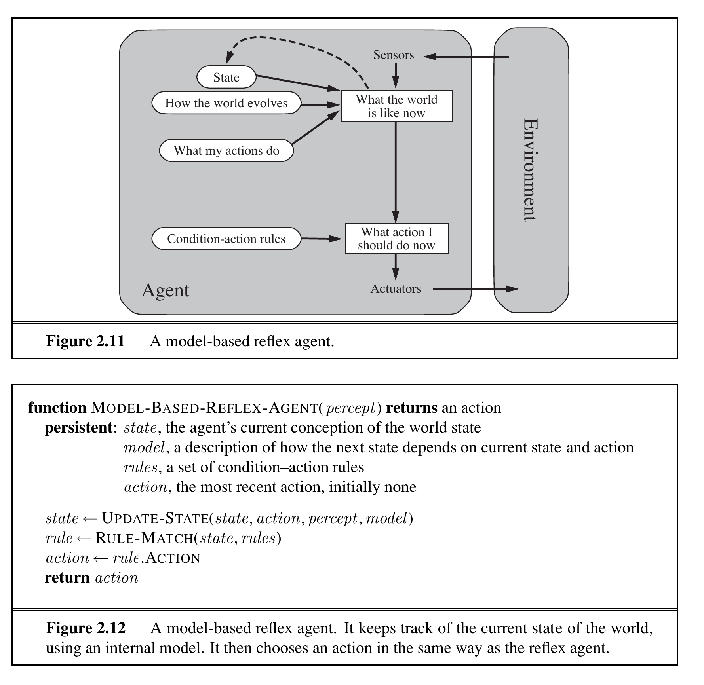
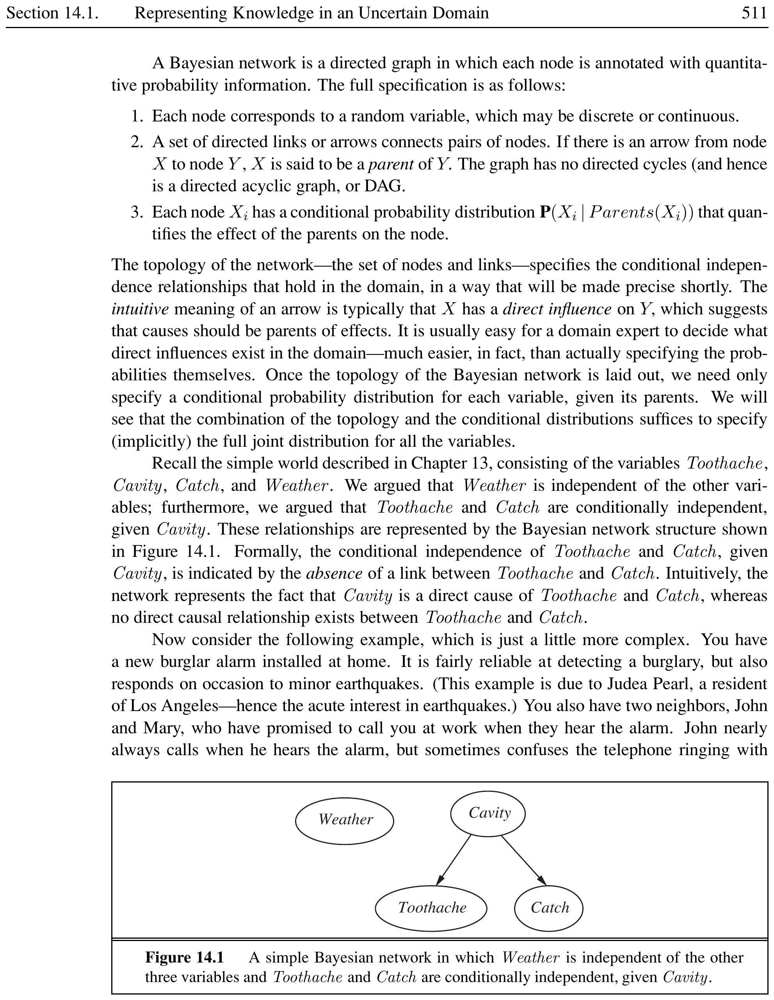
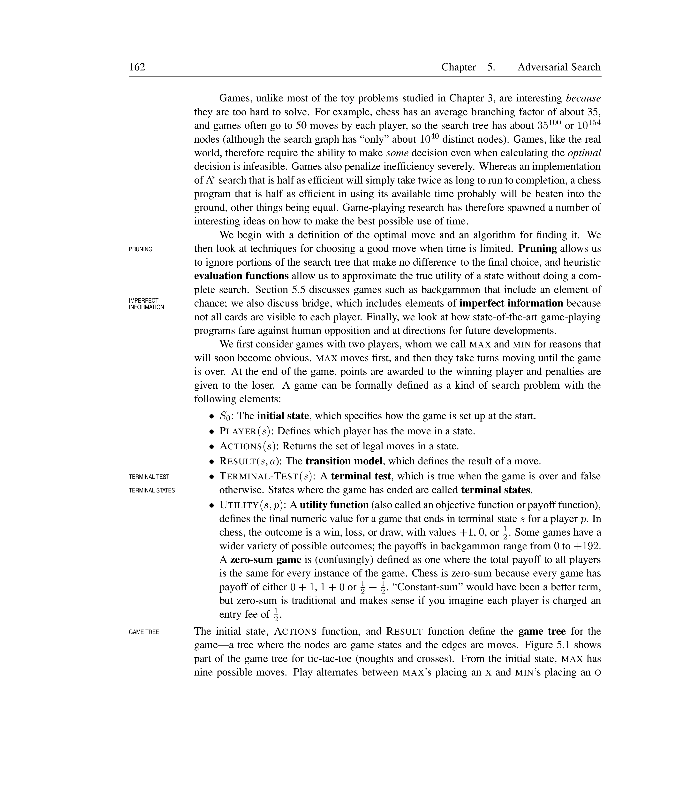


# Quantifying Uncertainty and Bayesian Networks

Logical agents from Chapters 7–9 use a black-and-white view: every sentence is either true, false, or unknown. Real environments are messy. An agent never knows for certain what state it is in or where its actions will lead. This chapter introduces **probability theory** as a calculus for reasoning under uncertainty, and **Bayesian networks** as a graphical framework for efficient probabilistic inference.

## Acting Under Uncertainty

Uncertainty

Uncertainty arises from **laziness** (too much work to list all antecedents/consequents), **theoretical ignorance** (no complete theory), and **practical ignorance** (not all tests have been run). A logical agent forced to act must consider every logically possible explanation, leading to intractable belief-state representations and contingent plans that handle arbitrarily unlikely events.

**Key insight:** The agent does not need certainty—it needs a way to compare the merits of plans that are not guaranteed. The rational choice depends on:

- The **relative importance** of various goals

- The **likelihood** that each goal will be achieved

### Summarizing Uncertainty

Instead of logical certainty, we use **degrees of belief** expressed as probabilities. For a dental patient: $$P(\text{cavity} \mid \text{toothache}) = 0.6$$ This means: out of all situations indistinguishable from current knowledge, the patient has a cavity in 60% of them. The statement does not contradict later updating (e.g., $P(\text{cavity} \mid \text{toothache} \land \neg\text{catch}) = 0.4$).

Decision Theory

Decision theory = probability theory + utility theory. An agent is rational iff it chooses the action that maximizes **expected utility** (the **principle of maximum expected utility**, MEU): $$\text{Rational action} = \argmax_a \sum_{s'} P(s' \mid a, s) \; U(s')$$ where $U(s')$ is the utility of outcome $s'$.

<figure>

<figcaption>A decision-theoretic agent. The belief state holds probabilities of world states. Given the belief state, the agent predicts outcomes and picks the action with highest expected utility.</figcaption>
</figure>

## Basic Probability Notation

Probability Basics

A **sample space** $\Omega$ is the set of all possible worlds. Each world $\omega$ has probability $P(\omega)$ with $0 \le P(\omega) \le 1$ and $\sum_{\omega \in \Omega} P(\omega) = 1$. An **event** is a set of worlds (described by a proposition). The probability of a proposition $\phi$ is: $$P(\phi) = \sum_{\omega \in \phi} P(\omega)$$

### Unconditional and Conditional Probability

- **Unconditional (prior)** probability: degree of belief with no other information, e.g., $P(\text{cavity}) = 0.2$

- **Conditional (posterior)** probability: degree of belief given evidence, e.g., $P(\text{cavity} \mid \text{toothache}) = 0.6$

$$P(a \mid b) = \frac{P(a \land b)}{P(b)} \quad \text{when } P(b) > 0$$

### Random Variables

A **random variable** has a **domain** of possible values. Boolean variables use abbreviations: $a$ for $A = \text{true}$, $\neg a$ for $A = \text{false}$. The **probability distribution** $P(X)$ gives probabilities for all values of $X$. The **joint probability distribution** $P(X_1, \dots, X_n)$ gives probabilities for all combinations.

Kolmogorov’s Axioms

$$\begin{aligned}
&0 \le P(\omega) \le 1 \text{ for every } \omega \quad\text{and}\quad \sum_{\omega \in \Omega} P(\omega) = 1 \tag{13.1}\\
&P(\phi) = \sum_{\omega \in \phi} P(\omega) \tag{13.2}\\
&P(a \lor b) = P(a) + P(b) - P(a \land b) \qquad\text{(inclusion--exclusion)} \tag{13.3}
\end{aligned}$$

Probability of a Disjunction

If $P(\text{cavity}) = 0.2$, $P(\text{toothache}) = 0.1$, and $P(\text{cavity} \land \text{toothache}) = 0.08$, then: $$P(\text{cavity} \lor \text{toothache}) = 0.2 + 0.1 - 0.08 = 0.22$$

## Inference Using Full Joint Distributions

Full Joint Probability Distribution

A table that gives the probability of every combination of values for all random variables in the domain. It contains all information needed to answer any probabilistic query, but grows as $O(2^n)$ for $n$ Boolean variables.

<figure>
<table>
<tbody>
<tr class="odd">
<td style="text-align: left;"></td>
<td colspan="2" style="text-align: center;">toothache</td>
<td colspan="2" style="text-align: center;">¬toothache</td>
</tr>
<tr class="even">
<td style="text-align: left;"></td>
<td style="text-align: center;">catch</td>
<td style="text-align: center;">¬catch</td>
<td style="text-align: center;">catch</td>
<td style="text-align: center;">¬catch</td>
</tr>
<tr class="odd">
<td style="text-align: left;">cavity</td>
<td style="text-align: center;">0.108</td>
<td style="text-align: center;">0.012</td>
<td style="text-align: center;">0.072</td>
<td style="text-align: center;">0.008</td>
</tr>
<tr class="even">
<td style="text-align: left;">¬cavity</td>
<td style="text-align: center;">0.016</td>
<td style="text-align: center;">0.064</td>
<td style="text-align: center;">0.144</td>
<td style="text-align: center;">0.576</td>
</tr>
</tbody>
</table>

<em>P</em>(cavity) = 0.108 + 0.012 + 0.072 + 0.008 = 0.2 
$P(\text{cavity} \mid \text{toothache}) = \dfrac{0.108 + 0.012}{0.108 + 0.012 + 0.016 + 0.064} = 0.6$

<figcaption>Full joint distribution for the Toothache, Cavity, Catch world.</figcaption>
</figure>

### Marginalization and Conditioning

**Marginalization** (summing out): $$P(Y) = \sum_{z \in Z} P(Y, z)$$

**Conditioning**: $$P(Y) = \sum_{z \in Z} P(Y \mid z) P(z)$$

For a query variable $X$, evidence $E=e$, and unobserved variables $Y$: $$P(X \mid e) = \alpha P(X, e) = \alpha \sum_{y \in Y} P(X, e, y)$$ where $\alpha = 1/P(e)$ is a normalization constant.

Inference from Full Joint

From Figure <a href="#fig:full-joint" data-reference-type="ref" data-reference="fig:full-joint">[fig:full-joint]</a>: $$\begin{aligned}
P(\text{cavity} \mid \text{toothache}) &= \alpha P(\text{Cavity}, \text{toothache}) \\
&= \alpha \big[P(\text{cavity},\text{toothache},\text{catch}) + P(\text{cavity},\text{toothache},\neg\text{catch})\big] \\
&= \alpha [\langle 0.108, 0.016 \rangle + \langle 0.012, 0.064 \rangle] \\
&= \alpha \langle 0.12, 0.08 \rangle = \langle 0.6, 0.4 \rangle
\end{aligned}$$

The full joint approach is impractical for $n > 100$ ($2^{100}$ entries). We need more efficient representations.

## Independence

Absolute Independence

Propositions $a$ and $b$ are independent iff: $$P(a \mid b) = P(a) \quad\text{or}\quad P(b \mid a) = P(b) \quad\text{or}\quad P(a \land b) = P(a)P(b)$$ Variables $X$ and $Y$ are independent iff $P(X, Y) = P(X)P(Y)$.

Absolute independence allows factoring the joint distribution into smaller pieces, dramatically reducing the number of parameters. Unfortunately, clean separation of entire variable sets is rare in practice.

<figure>

<figcaption>Absolute independence allows decomposing a large joint distribution. Weather is independent of dental problems, so the 32-element table factors into an 8-element and a 4-element table.</figcaption>
</figure>

### Conditional Independence

Conditional Independence

Two variables $X$ and $Y$ are **conditionally independent** given a third variable $Z$ iff: $$P(X, Y \mid Z) = P(X \mid Z) P(Y \mid Z)$$ Equivalently: $P(X \mid Y, Z) = P(X \mid Z)$.

Conditional independence is more common than absolute independence. For example, and are not absolutely independent, but they *are* conditionally independent given : once we know whether there is a cavity, the probe catch gives no additional information about the toothache.

Conditional Independence in Dentistry

$$\begin{aligned}
P(\text{Toothache}, \text{Catch} \mid \text{Cavity}) &= P(\text{Toothache} \mid \text{Cavity}) P(\text{Catch} \mid \text{Cavity}) \\
P(\text{Toothache}, \text{Catch}, \text{Cavity}) &= P(\text{Toothache} \mid \text{Cavity}) P(\text{Catch} \mid \text{Cavity}) P(\text{Cavity})
\end{aligned}$$ The 8-entry table decomposes into three smaller tables with only $1 + 2 + 2 = 5$ independent numbers (vs. 7 for the full table). For $n$ conditionally independent symptoms given a cause, the representation grows as $O(n)$ instead of $O(2^n)$.

## Bayes’ Rule and Its Use

Bayes’ Rule

From the product rule $P(a \land b) = P(a\mid b)P(b) = P(b\mid a)P(a)$, we derive: $$P(b \mid a) = \frac{P(a \mid b) P(b)}{P(a)}$$ For multivalued variables with normalization: $$P(Y \mid X) = \alpha \, P(X \mid Y) P(Y)$$

Bayes’ rule is most useful in the **causal** $\to$ **diagnostic** direction: $$P(\text{cause} \mid \text{effect}) = \frac{P(\text{effect} \mid \text{cause}) P(\text{cause})}{P(\text{effect})}$$

Causal knowledge $P(\text{effect} \mid \text{cause})$ is more robust: it reflects the underlying mechanism and does not change when the base rate of the cause changes.

Meningitis Diagnosis

A doctor knows: $P(\text{stiff neck} \mid \text{meningitis}) = 0.7$, $P(\text{meningitis}) = 1/50000$, $P(\text{stiff neck}) = 0.01$. $$P(\text{meningitis} \mid \text{stiff neck}) = \frac{0.7 \times 1/50000}{0.01} = 0.0014$$ Even with a strong causal link (70%), the posterior probability is small because meningitis is rare.

### Combining Evidence with Conditional Independence

When we have multiple evidence variables, we use the conditional independence assumption (naive Bayes): $$P(\text{Cause} \mid \text{Effect}_1, \dots, \text{Effect}_n) = \alpha \, P(\text{Cause}) \prod_{i=1}^{n} P(\text{Effect}_i \mid \text{Cause})$$

Naive Bayes Model

A probability model that assumes all effect variables are conditionally independent given the cause variable: $$P(\text{Cause}, \text{Effect}_1, \dots, \text{Effect}_n) = P(\text{Cause}) \prod_{i=1}^{n} P(\text{Effect}_i \mid \text{Cause})$$ Despite its simplifying “naive” assumption, it often works surprisingly well in practice (e.g., spam classification).

## Bayesian Networks

Bayesian Network

A **Bayesian network** (belief network, probabilistic network) is a **directed acyclic graph** (DAG) where:

- Each **node** corresponds to a random variable

- **Directed links** from cause to effect encode direct influences

- Each node $X_i$ has a **conditional probability table** (CPT) $P(X_i \mid \text{Parents}(X_i))$

The network encodes the full joint distribution as: $$P(X_1, \dots, X_n) = \prod_{i=1}^{n} P(X_i \mid \text{Parents}(X_i))$$

### Network Structure and Semantics

The graph topology specifies conditional independence: each node is conditionally independent of its non-descendants given its parents. This is the **local semantics** of Bayesian networks.

<figure>

<figcaption>A simple Bayesian network. Weather is independent of all other variables; Toothache and Catch are conditionally independent given Cavity. The absence of a direct link between Toothache and Catch encodes this conditional independence.</figcaption>
</figure>

### The Burglary Alarm Network

The classic example from Judea Pearl:

<figure>

<figcaption>The burglary alarm Bayesian network. Burglary and Earthquake are parents of Alarm. JohnCalls and MaryCalls depend only on Alarm. Each node has a CPT quantifying the influence of its parents.</figcaption>
</figure>

The full joint distribution is: $$P(B, E, A, J, M) = P(B) \, P(E) \, P(A \mid B, E) \, P(J \mid A) \, P(M \mid A)$$

### Why Bayesian Networks Work

1.  **Conciseness:** Instead of $2^n$ entries for $n$ Boolean variables, we need only the CPT sizes. For the burglary network: $1 + 1 + 4 + 2 + 2 = 10$ numbers instead of $2^5 - 1 = 31$.

2.  **Causal modeling:** Domain experts find it natural to specify $P(\text{effect} \mid \text{cause})$ rather than $P(\text{cause} \mid \text{effect})$.

3.  **Modularity:** Adding a new variable only requires specifying its links to existing parents/children, not rebuilding the entire joint distribution.

4.  **Efficient inference:** Algorithms like Variable Elimination and Belief Propagation exploit the network structure for tractable inference.

Inference in the Burglary Network

Given that John calls ($J = t$) but Mary does not ($M = f$), what is $P(\text{Burglary} \mid j, \neg m)$? $$P(B \mid j, \neg m) = \alpha \sum_{e, a} P(B) P(e) P(a \mid B, e) P(j \mid a) P(\neg m \mid a)$$ We sum over the hidden variables ($E, A$) and normalize. The network structure limits the summation to only the relevant variables rather than all $2^5$ combinations.

## Summary

- Uncertainty is inescapable due to laziness, theoretical ignorance, and practical ignorance. **Probability theory** provides a calculus for degrees of belief.

- **Decision theory** = probability + utility; the rational action maximizes expected utility.

- The **full joint distribution** can answer any query but is too large for practical use.

- **Absolute independence** and **conditional independence** allow factoring the joint distribution into smaller pieces.

- **Bayes’ rule** converts causal probabilities into diagnostic probabilities and is the foundation for probabilistic inference.

- **Bayesian networks** are DAGs where nodes represent variables and edges represent direct causal influences. They encode the full joint distribution concisely via: $$P(X_1, \dots, X_n) = \prod_{i=1}^{n} P(X_i \mid \text{Parents}(X_i))$$

- Conditional independence in Bayesian networks enables tractable inference in many practical domains.


