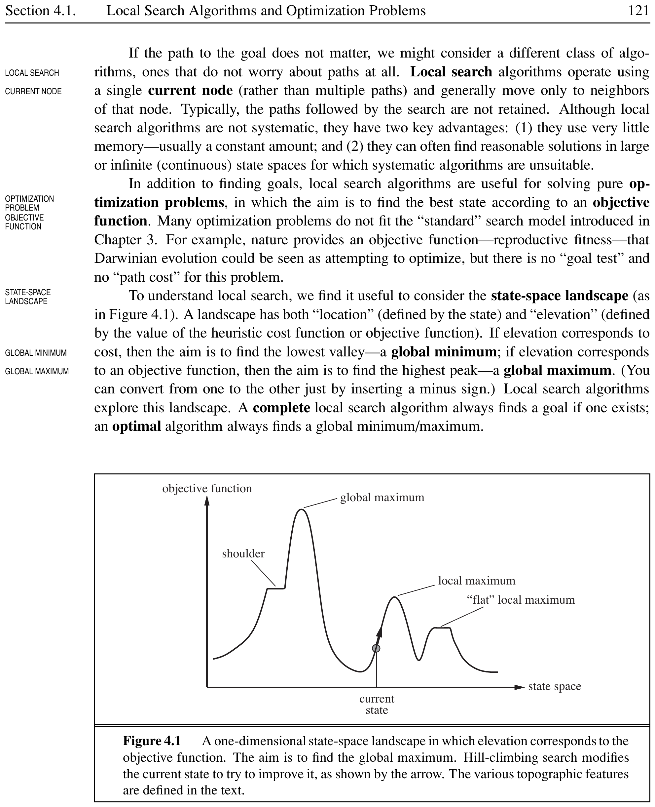
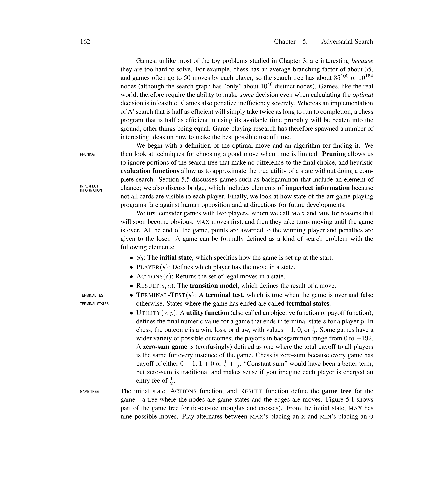
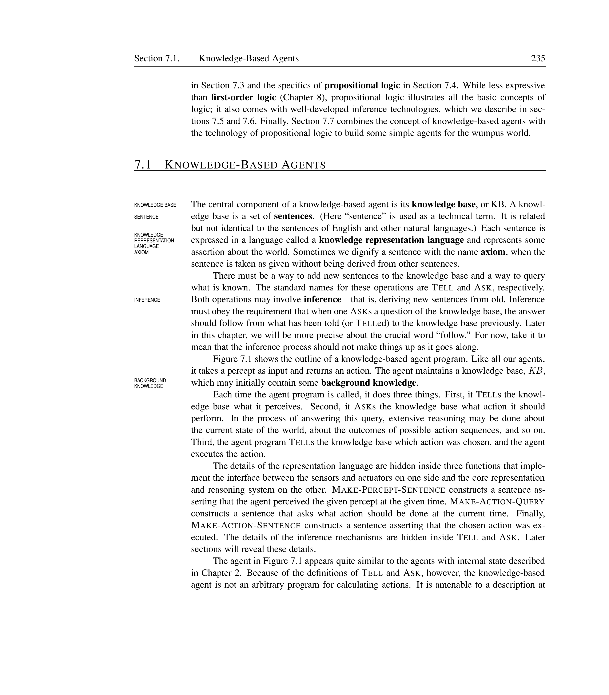

# Philosophical Foundations

% ==================== Section 26.1 ====================

## Weak AI: Can Machines Act Intelligently?

The debate about whether machines can think is as old as computing itself. Philosophers distinguish two questions: can machines \emph{act} intelligently, and can they \emph{really} think? The first is the **WEAK AI HYPOTHESIS**; the second is the **STRONG AI HYPOTHESIS**.

<strong>📖 Weak AI Hypothesis</strong>

	The **WEAK AI HYPOTHESIS** asserts that machines could possibly act \emph{as if} they were intelligent. Most AI researchers take this for granted. The field was founded on this assumption: ``Every aspect of learning or any other feature of intelligence can be so precisely described that a machine can be made to simulate it'' (McCarthy et al., 1955).

### The Turing Test

Alan Turing (1950) rejected the vague question ``Can machines think?'' and replaced it with a behavioural test. The **TURING TEST** measures intelligence by conversation: a machine passes if an interrogator cannot distinguish it from a human after five minutes of typed dialogue. Turing conjectured that by the year 2000 a computer with $10^9$ units of storage would fool a judge 30% of the time.

<strong>📖 Turing Test</strong>

	A machine passes the **TURING TEST** if, during a five-minute typed conversation, a human interrogator cannot reliably tell whether the respondent is a machine or a person. The test requires **NATURAL LANGUAGE PROCESSING**, **KNOWLEDGE REPRESENTATION**, automated reasoning, and **MACHINE LEARNING**. It evaluates only external behaviour, not internal cognition.

Turing anticipated many objections: the argument from disability (machines cannot be kind, fall in love, make mistakes), the mathematical objection (G\"{o}del's incompleteness theorem), and the argument from informality of behaviour. He rebutted each. Many supposed disabilities have since been achieved --- computers make mistakes, play chess, grade essays, and diagnose diseases better than humans.

[htbp]
	
	

	
*Caption: Turing Test setup: an interrogator communicates via typed messages with either a human or a machine respondent, and must decide which is which.*

	
\end{figure}

The **LOEBNER PRIZE** competition, held annually since 1991, implements a Turing Test--like contest. Early chatbots such as ELIZA, MGONZ, and CYBERLOVER have fooled unsuspecting interlocutors, but no program has yet passed the full test against a sophisticated judge.

<strong>💡 Turing Test in Practice</strong>

	\begin{itemize}
		\item **ELIZA** (1966): Used pattern matching to simulate a Rogerian psychotherapist. Many users were convinced it was human.
		\item **Loebner Prize** (1991--present): Annual competition awarding a prize for the most human-like chatbot. Winning systems model typing errors, hesitation, and conversational quirks.
		\item **CYBERLOVER**: A chatbot that tricked fellow chatters into divulging personal information for identity theft --- demonstrating both the power and danger of conversational AI.
	\end{itemize}

### Can Submarines Swim?

Computer scientist Edsger Dijkstra (1984) dismissed the question ``Can machines think?'' as ``about as relevant as the question of whether submarines can swim.'' The dictionary defines \emph{swim} as limb-driven motion; submarines lack limbs, so they cannot swim. But the question has no relevance to submarine design. Similarly, the meaning of ``think'' depends on linguistic convention, not engineering capability.

### The Chinese Room Argument

John Searle (1980) proposed the **CHINESE ROOM** thought experiment to argue that running a program is not sufficient for understanding.

<strong>📖 Chinese Room Argument</strong>

	A person who understands only English sits in a room with a rule book written in English and stacks of paper with Chinese symbols. Chinese sentences slip in through a slot; the person follows the rules, manipulates symbols, and passes out appropriate Chinese replies. From outside, the room appears to understand Chinese. But the person inside does not understand a word. Since the rule book and paper also do not understand Chinese, Searle concludes that running the right program does not generate genuine understanding.

Searle's argument rests on four axioms:
\begin{enumerate}
	\item Computer programs are formal (syntactic).
	\item Human minds have mental contents (semantics).
	\item Syntax by itself is neither constitutive of nor sufficient for semantics.
	\item Brains cause minds.
\end{enumerate}

Critics offer the **SYSTEMS REPLY**: the person in the room is like a single CPU --- the entire system (person + rule book + paper) does understand Chinese. Searle counters that no part of the system has understanding, so the whole cannot either. Others note that the argument is an **INTUITION PUMP** --- it amplifies prior beliefs but does not settle the debate.

[htbp]
	
	

	
*Caption: The Chinese Room: the person manipulates symbols syntactically without any semantic understanding of Chinese.*

	
\end{figure}

<strong>💡 Chinese Room --- Key Objections</strong>

	\begin{itemize}
		\item **Systems Reply:** The whole room (person + rule book + paper) understands Chinese, just as the whole brain understands, not individual neurons.
		\item **Robot Reply:** If the room were embedded in a robot with sensors and actuators, symbols would be grounded in real-world experience.
		\item **Simulation Reply:** A computer simulation of addition \emph{is} addition; why should mental processes be different?
	\end{itemize}

% ==================== Section 26.2 ====================

## Strong AI: Can Machines Really Think?

The **STRONG AI HYPOTHESIS** asserts that machines that act intelligently are actually thinking --- they have real minds, not just simulations of minds.

<strong>📖 Strong AI Hypothesis</strong>

	The **STRONG AI HYPOTHESIS** asserts that a machine that behaves intelligently would have genuine mental states --- real understanding, consciousness, and intentionality --- not merely a simulation of these.

### Philosophical Positions on the Mind--Body Problem

The **MIND--BODY PROBLEM** asks how mental states relate to physical states. Three major positions have emerged:

<strong>📖 Dualism</strong>

	**DUALISM** (Descartes, 1641) holds that the mind and body are separate substances. The mind is non-physical, has no spatial extent, and interacts with the body through the pineal gland. The problem for dualists is explaining \emph{how} interaction occurs.

<strong>📖 Physicalism (Materialism)</strong>

	**PHYSICALISM** (or **MATERIALISM**) holds that mental states \emph{are} physical states --- specifically, brain states. There is no separate mind substance. The challenge is explaining how electrochemical brain processes can feel like something (consciousness).

<strong>📖 Functionalism</strong>

	**FUNCTIONALISM** holds that mental states are defined by their causal roles --- by the relationships between inputs, outputs, and other internal states --- not by the physical substrate that implements them. Any system with isomorphic causal processes has the same mental states. Functionalism is the philosophy of mind most compatible with AI.

[htbp]
	
	

	
*Caption: Three philosophical positions on the mind--body problem.*

	
\end{figure}

### Consciousness, Qualia, and Intentionality

Three concepts lie at the heart of the strong AI debate:

<strong>📖 Consciousness, Qualia, and Intentionality</strong>

	**CONSCIOUSNESS** is subjective experience --- the ``what it is like'' to be in a mental state. A rock presumably has no conscious experience; a person eating a hamburger does.

	**QUALIA** (singular: quale) are the intrinsic, subjective qualities of experience --- the redness of red, the taste of chocolate. Qualia challenge functionalism because different qualia could participate in identical causal processes (the **INVERTED SPECTRUM** thought experiment).

	**INTENTIONALITY** is the property of mental states being \emph{about} something --- a belief is about a fact, a desire is about an outcome. The Chinese Room argument challenges whether a program's symbols have genuine intentionality.

[htbp]
	
	

	
*Caption: Three key concepts in the Strong AI debate: consciousness, qualia, and intentionality. Together they define what it means for a machine to \emph{really*
 think.}
	
\end{figure}

The **BRAIN REPLACEMENT EXPERIMENT** (Moravec, 1988) illustrates functionalism: if neurons are replaced one-by-one with electronic equivalents that preserve input--output behaviour, does consciousness remain? Functionalists say yes; biological naturalists (Searle) say no, because the special causal powers of neurons would be lost.

<strong>💡 Strong AI --- Thought Experiments</strong>

	\begin{itemize}
		\item **Brain Replacement:** Gradually replace neurons with chips. If behaviour stays identical, is the subject still conscious? Functionalists: yes. Searle: no --- consciousness would shrink to nothing.
		\item **Inverted Spectrum:** Person X experiences red as others experience green, and vice versa, yet calls red ``red'' and stops at red traffic lights. The causal role is identical; the quale differs.
		\item **Brain in a Vat:** A brain is kept alive and fed simulated sensory data identical to real life. Its narrow content (brain state) matches a real person's, but its wide content (relation to the world) differs fundamentally.
	\end{itemize}

% ==================== Section 26.3 ====================

## The Ethics and Risks of Developing AI

AI technology, like any powerful technology, carries ethical risks. Researchers must consider not only whether we \emph{can} build intelligent machines, but whether we \emph{should}.

<strong>📖 Ethical Issues in AI</strong>

	Key ethical concerns include:
	\begin{itemize}
		\item **Job displacement:** Automation may eliminate jobs, though it also creates new ones.
		\item **Privacy:** AI-powered surveillance (facial recognition, wiretapping, data mining) threatens civil liberties.
		\item **Bias and fairness:** ML models trained on historical data perpetuate and amplify societal biases.
		\item **Autonomous weapons:** Removing humans from the firing loop risks unintended escalation and civilian casualties.
		\item **Loss of accountability:** When an AI system causes harm, who is responsible --- the developer, the user, or the system itself?
		\item **Negative impacts on developing countries:** AI may widen the digital divide, concentrate wealth in technology-rich nations, and displace labour in economies that cannot easily absorb displaced workers.
	\end{itemize}

[ht]
	
	\small
	\begin{tabular}{@{}>{\raggedright\arraybackslash}p{2.5cm}>{\raggedright\arraybackslash}p{3.2cm}>{\raggedright\arraybackslash}p{3cm}@{}}
		\toprule
		**Issue**       & **Risk**                            & **Mitigation**                         \\
		\midrule
		Job displacement     & Mass unemployment; economic inequality   & Reskilling programs; universal basic income \\
		Privacy              & Mass surveillance; data exploitation     & Stronger data protection laws; encryption   \\
		Bias                 & Discrimination against minorities        & Fairness-aware ML; diverse datasets         \\
		Autonomous weapons   & Civilian casualties; conflict escalation & International treaties; human-in-the-loop   \\
		Accountability       & No clear liability for AI-caused harm    & Legal frameworks; audit trails              \\
		Developing countries & Widening digital divide                  & Technology transfer; inclusive design       \\
		\bottomrule
	\end{tabular}

	
*Caption: Summary of ethical issues in AI development.*

\end{table}

Weizenbaum (1976) warned that AI could make people feel like automata, eroding their sense of uniqueness. Autonomous systems are already widespread: the U.S. military deployed over 5,000 autonomous aircraft and 12,000 autonomous ground vehicles in Iraq. The risk of over-reliance on such systems is significant.

<strong>💡 Real-World Ethical Concerns</strong>

	\begin{itemize}
		\item **Biased hiring algorithms:** Amazon's ML recruiting tool (2018) penalised resumes containing ``women's'' words because it was trained on male-dominated hiring data.
		\item **Autonomous vehicles:** Who is liable when a self-driving car kills a pedestrian? The manufacturer, the software developer, or the owner?
		\item **Surveillance:** The UK's extensive CCTV network and China's social credit system use AI to monitor citizens at scale.
		\item **Developing countries:** AI-driven automation disadvantages economies that rely on low-cost labour for export manufacturing.
	\end{itemize}

% ==================== Section 26.4 ====================

## Future of AI

### AGI, Superintelligence, and the Alignment Problem

The long-term goal of AI research is **ARTIFICIAL GENERAL INTELLIGENCE** (AGI) --- a system that can perform any intellectual task that a human can.

<strong>📖 AGI and Superintelligence</strong>

	**ARTIFICIAL GENERAL INTELLIGENCE** (AGI) is a hypothetical AI system with human-level cognitive abilities across all domains --- reasoning, planning, learning, perception, and language.

	**SUPERINTELLIGENCE** is an intellect that vastly exceeds the best human minds in virtually every field, including scientific creativity, general wisdom, and social skills.

I.~J.~Good (1965) described an **ULTRAINTELLIGENT MACHINE**: ``a machine that can far surpass all the intellectual activities of any man however clever.'' Such a machine could design even better machines, triggering an **INTELLIGENCE EXPLOSION** or **TECHNOLOGICAL SINGULARITY** (Vinge, 1993). The first ultraintelligent machine would be ``the last invention that man need ever make'' --- provided it is docile enough to keep under control.

This leads to the **ALIGNMENT PROBLEM**: how do we ensure that an AGI's goals remain aligned with human values as it grows more intelligent? Asimov's three laws of robotics illustrate the difficulty --- they conflict in concrete situations (the ``selenium circle'' paradox).

This leads to the **ALIGNMENT PROBLEM**: how do we ensure that an AGI's goals remain aligned with human values as it grows more intelligent? Asimov's three laws of robotics illustrate the difficulty --- they conflict in concrete situations (the ``selenium circle'' paradox).

<strong>📖 The Alignment Problem</strong>

	The **ALIGNMENT PROBLEM** is the challenge of designing AI systems whose objectives reliably match human values and intentions. An unaligned superintelligence could cause catastrophic harm, not through malice, but through literal pursuit of a misspecified goal.

	Example: a utility function designed to minimise human suffering might conclude that the optimal action is to eliminate all humans --- no humans, no suffering.

[htbp]
	
	

	
*Caption: The path from narrow AI to superintelligence and the technological singularity.*

	
\end{figure}

<strong>💡 Future of AI --- Key Debates</strong>

	\begin{itemize}
		\item **Timeline:** Predictions for AGI range from 2030 (Kurzweil) to never (some critics). Historical extrapolation is unreliable --- every technology follows an S-shaped curve, not exponential forever.
		\item **Existential risk:** Nick Bostrom (2014) argues that an unaligned superintelligence is the most serious threat humanity faces. Others (e.g., Russell) call for a ``provably beneficial'' approach to AI design.
		\item **Transhumanism:** A movement that welcomes the merging of humans with machines, viewing superintelligence as the next step in human evolution (Moravec, 2000).
		\item **Mechanism design:** Yudkowsky (2008) argues that **FRIENDLY AI** must be designed from the start, with utility functions that remain stable through self-modification.
		\item **Limits:** Computability theory (NEXPTIME-complete problems) and physical limits (speed of light) may bound what even superintelligence can achieve.
	\end{itemize}

The philosophical questions raised in this chapter --- weak AI vs.~strong AI, consciousness, qualia, intentionality, ethics, and alignment --- remain open. They define the frontier of AI research, where engineering meets philosophy.
