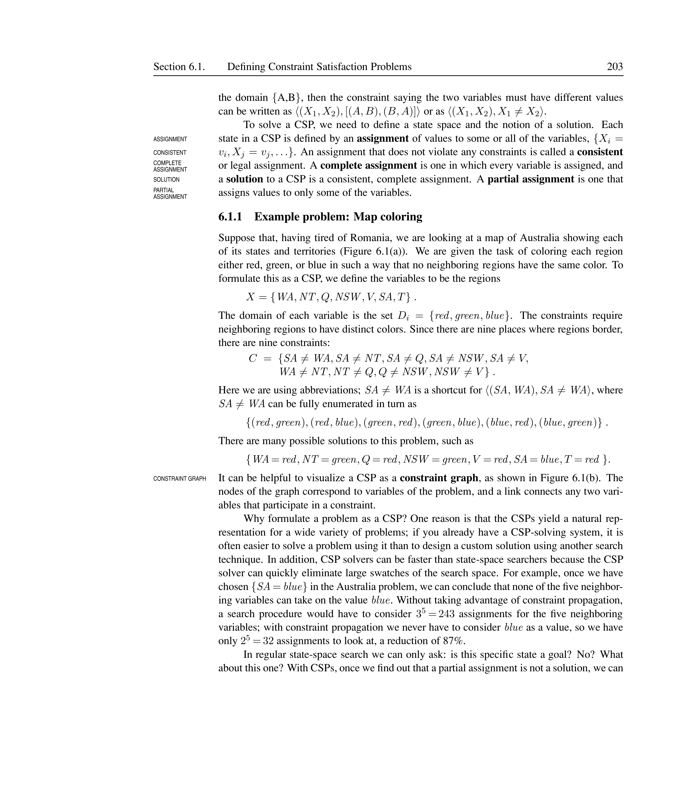
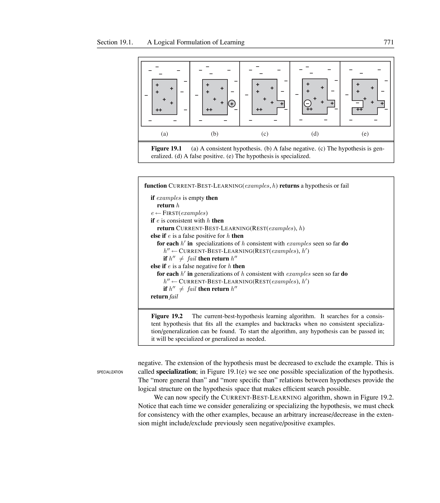
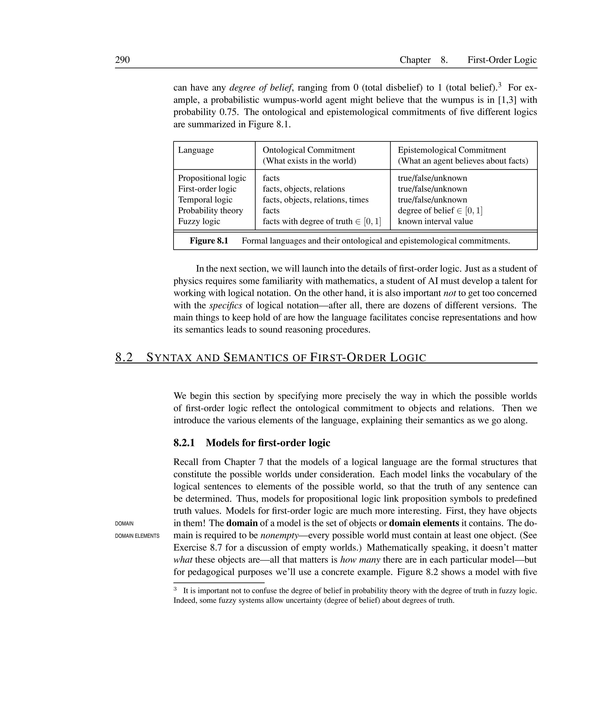
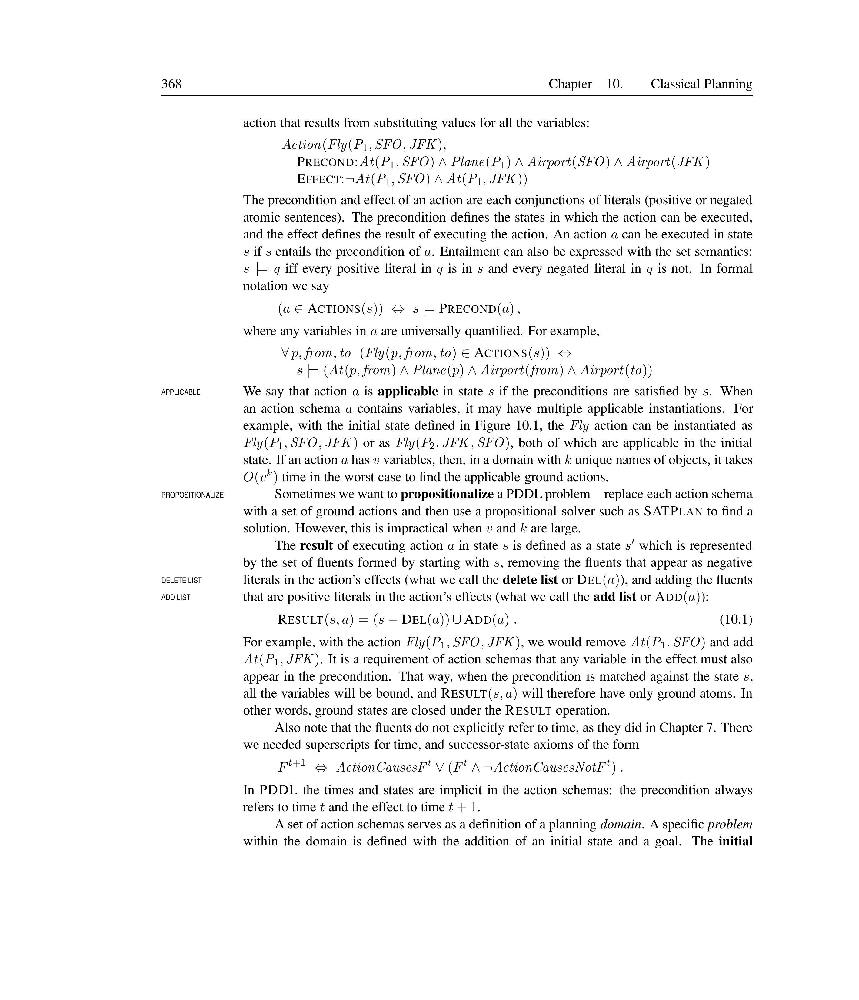
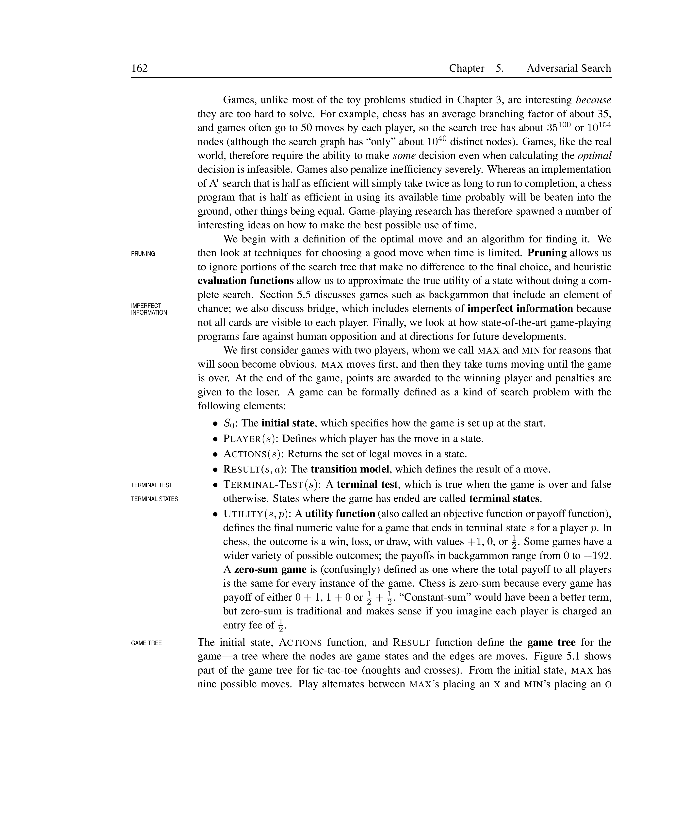


# AI: The Present and Future

In this concluding chapter, we step back from the technical details of individual components and ask where the field of AI stands, where it is heading, and whether the rational-agent approach is the right path. Section <a href="#sec:agent-components" data-reference-type="ref" data-reference="sec:agent-components">[sec:agent-components]</a> surveys the known and missing pieces for each agent component. Section <a href="#sec:agent-architectures" data-reference-type="ref" data-reference="sec:agent-architectures">[sec:agent-architectures]</a> examines overarching agent architectures. Section <a href="#sec:right-direction" data-reference-type="ref" data-reference="sec:right-direction">[sec:right-direction]</a> asks whether designing rational agents is the right goal. Section <a href="#sec:if-succeeds" data-reference-type="ref" data-reference="sec:if-succeeds">[sec:if-succeeds]</a> considers the implications of AI succeeding.

## Agent Components

Chapter <a href="#ch:intelligent-agents" data-reference-type="ref" data-reference="ch:intelligent-agents">[ch:intelligent-agents]</a> presented several agent designs composed of interacting components. To assess progress, we examine the utility-based agent (the most general design) and evaluate the state of the art for each component: sensors, state tracking, projection, utility, and learning.

At the heart of any agent is its **representation** of the world. Three types of representation have been used throughout this book—each comes with a different trade-off between expressiveness and computational efficiency. Figure <a href="#fig:representation-types" data-reference-type="ref" data-reference="fig:representation-types">[fig:representation-types]</a> illustrates the three types.

<figure>

<figcaption>Three types of representation used by AI agents: atomic (indivisible states), factored (attribute–value vectors), and structured (objects with relations).</figcaption>
</figure>

Atomic Representation

An **atomic representation** treats each state as an indivisible whole with no internal structure visible to the reasoning algorithm. Problems are solved by searching over state transitions. This is the representation used in Chapters <a href="#ch:solving-problems-searching" data-reference-type="ref" data-reference="ch:solving-problems-searching">[ch:solving-problems-searching]</a> and <a href="#ch:adversarial-search" data-reference-type="ref" data-reference="ch:adversarial-search">[ch:adversarial-search]</a> (search algorithms and game trees).

Factored Representation

A **factored representation** decomposes each state into a set of variables (attributes) each with a value. This is used in constraint satisfaction (Chapter <a href="#ch:csp" data-reference-type="ref" data-reference="ch:csp">[ch:csp]</a>), propositional logic (Chapter <a href="#ch:logical-agents" data-reference-type="ref" data-reference="ch:logical-agents">[ch:logical-agents]</a>), and classical planning (Chapter <a href="#ch:classical-planning" data-reference-type="ref" data-reference="ch:classical-planning">[ch:classical-planning]</a>).

Structured Representation

A **structured representation** explicitly represents objects and relationships among them. This is the ontological commitment of first-order logic (Chapter <a href="#ch:first-order-logic" data-reference-type="ref" data-reference="ch:first-order-logic">[ch:first-order-logic]</a>). It is the most expressive but computationally most demanding.

Representation Examples

- **Atomic:** In the Romania driving problem (Chapter <a href="#ch:solving-problems-searching" data-reference-type="ref" data-reference="ch:solving-problems-searching">[ch:solving-problems-searching]</a>), each city name like Arad or Bucharest is an atomic state—there is no way to ask “is Arad larger than Bucharest?” from the representation alone.

- **Factored:** A taxi-driving agent’s state might be $\langle loc{=}Airport, speed{=}30, fuel{=}half \rangle$. Each variable is accessible to reasoning but the relationship “the truck towing the car is behind us” is not directly representable.

- **Structured:** The blocks-world domain explicitly represents $On(A, B)$, $Clear(C)$, and $Block(A)$—objects and relations are first-class citizens.

### Keeping Track of the World

The agent must maintain an internal state that reflects the true state of the environment. Chapter <a href="#ch:solving-problems-searching" data-reference-type="ref" data-reference="ch:solving-problems-searching">[ch:solving-problems-searching]</a> showed how to track atomic state; Chapter <a href="#ch:logical-agents" data-reference-type="ref" data-reference="ch:logical-agents">[ch:logical-agents]</a> extended this to factored (propositional) representations; Chapter <a href="#ch:first-order-logic" data-reference-type="ref" data-reference="ch:first-order-logic">[ch:first-order-logic]</a> extended to first-order logic; and Chapter <a href="#ch:inference-fol" data-reference-type="ref" data-reference="ch:inference-fol">[ch:inference-fol]</a> described logical inference.

Current algorithms track low-level predicates reliably (e.g., “the cup is on the table”) but struggle with high-level actions (e.g., “Dr. Russell is having tea with Dr. Norvig while discussing plans”). The combination of probability and first-order logic promises to help, but defining general reusable representation schemes for complex domains remains an open challenge.

### Projecting, Evaluating, and Selecting Courses of Action

The difficulty here is that real-world activities—having a conversation, driving to the airport—consist of thousands or millions of primitive steps. Imposing **hierarchical structure** on behavior is the only known way humans cope. Chapter <a href="#ch:planning-real-world" data-reference-type="ref" data-reference="ch:planning-real-world">[ch:planning-real-world]</a> described hierarchical planning (HTN), and hierarchical reinforcement learning has begun combining these ideas with decision-theoretic techniques. POMDP algorithms, however, still mainly use the atomic representation of Chapter <a href="#ch:solving-problems-searching" data-reference-type="ref" data-reference="ch:solving-problems-searching">[ch:solving-problems-searching]</a>, leaving substantial work ahead.

### Utility and Learning

Little progress has been made on constructing realistic utility functions for complex domains. Preferences over states are compiled from preferences over state histories (reward functions), and even simple reward functions can produce highly complex utility functions.

On the learning side, supervised and reinforcement learning have reached human-level performance on tasks with predefined feature vocabularies, but progress on constructing new representations at higher levels of abstraction (e.g., learning Classroom from pixels without being told to form Desk first) has been limited. Deep belief networks and inductive logic programming are early steps in this direction.

## Agent Architectures

A complete agent cannot rely on any single decision-making method. Reflex responses are needed when time is short; deliberation is needed for long-range planning. The architectures described here address how to combine, schedule, and improve these capabilities.

### Hybrid Architecture

Hybrid Architecture

A **hybrid architecture** combines multiple decision-making components—typically a deliberative (knowledge-based) system and a reflex (reactive) system—within a single agent. The boundaries between components are not fixed; **compilation** converts deliberative decisions into efficient reflex rules over time.

Compilation is the process by which declarative knowledge at the deliberative level is converted into compiled, efficient representations that feed the reflex level. This is the purpose of **explanation-based learning** (Chapter <a href="#ch:inference-fol" data-reference-type="ref" data-reference="ch:inference-fol">[ch:inference-fol]</a>). Architectures such as Soar and Theo save away a generalized version of every deliberatively solved problem for use by the reflex component.

<figure>

<figcaption>A hybrid architecture showing two decision components. The knowledge-based deliberation component feeds compiled decision rules into the reflex system via compilation (explanation-based learning).</figcaption>
</figure>

Hybrid Architecture in Practice

Soar (Laird et al., 1987) uses a hybrid architecture: when solving a novel problem, it engages deliberate search through problem spaces; once a solution is found, it creates a **chunk** (a generalized rule) that records the decision. On future encounters, the chunk fires as a reflex, bypassing deliberation. A less-studied problem is the reverse: when the environment changes, learned reflexes may become inappropriate and the agent must return to deliberation.

### Anytime Algorithm

Anytime Algorithm

An **anytime algorithm** is an algorithm whose output quality improves gradually over time, so that it can return a reasonable answer whenever interrupted. A metalevel decision procedure assesses whether further computation is worthwhile.

<figure>

<figcaption>Quality–time trade-off for an anytime algorithm. The algorithm can be interrupted at any point and return the best result found so far.</figcaption>
</figure>

Anytime Algorithms

- **Iterative deepening in game-tree search:** at any depth cutoff, the algorithm returns the best move found so far; deeper search improves quality.

- **MCMC (Markov chain Monte Carlo)** in Bayesian networks: samples improve the approximate posterior distribution as more samples are drawn.

### Decision-Theoretic Metareasoning

Decision-Theoretic Metareasoning

**Decision-theoretic metareasoning** applies the theory of information value to the selection of individual computations. The value of a computation depends on both its cost (delaying action) and its benefit (improved decision quality).

<figure>

<figcaption>Decision-theoretic metareasoning: the metalevel evaluates the expected value of information for each candidate computation and selects the one that maximises net benefit.</figcaption>
</figure>

Metareasoning techniques can be used to design better search algorithms and to guarantee the anytime property. **Metalevel reinforcement learning** provides another avenue: computations that lead to better decisions are reinforced, while those with no effect are penalized, avoiding the myopia of simple value-of-information calculations.

Decision-Theoretic Metareasoning

- **Game-tree search:** The metalevel decides whether to spend another second evaluating deeper moves (improved move quality) or to act immediately (avoid time pressure). If the value of deeper search exceeds the cost of delaying the move, computation continues.

- **Medical diagnosis:** A diagnostic system must decide whether to request an additional lab test. The value of information (reduced diagnostic uncertainty) is weighed against the cost (time, money, patient discomfort).

- **Metalevel RL:** Computations that consistently lead to better outcomes are reinforced; those that waste time without improving decisions are penalised, learning optimal computation-allocation policies.

### Reflective Architecture

Reflective Architecture

A **reflective architecture** enables deliberation about the computational entities and actions occurring within the architecture itself. It defines a joint state space composed of the environment state and the agent’s own computational state, allowing decision-making and learning algorithms to operate over both.

In a reflective architecture, the agent can reason about which computation to perform next, how much time to spend on a reasoning step, and whether the current algorithm is appropriate. The theoretical foundation combines the environment state and the computational state into a single joint state space.

<figure>

<figcaption>A reflective architecture with metalevel reasoning. The metalevel monitors and controls the object-level reasoning, allocating computational resources based on the joint state of the environment and the agent’s own computation.</figcaption>
</figure>

Metareasoning for a Taxi Driver

A taxi-driving agent sees an accident ahead and must decide whether to brake or swerve. The metalevel must allocate the available split second to the most important computations: checking whether the adjacent lanes are clear and whether a truck is following closely, rather than worrying about tire wear or the next passenger pickup. This is a real-time control problem that decision-theoretic metareasoning addresses.

## Are We Going in the Right Direction?

Dreyfus (1992) likened AI’s progress to climbing a tree to reach the moon—one can report steady progress all the way to the top of the tree, but the goal was the moon. In this section we examine four possible specifications for what AI should optimize.

Perfect Rationality

A **perfectly rational agent** acts at every instant in such a way as to maximize its expected utility, given all the information it has acquired from the environment. The calculations necessary are too time-consuming in most environments, making perfect rationality infeasible.

Calculative Rationality

A **calculatively rational agent** eventually returns what would have been the rational choice at the beginning of its deliberation. The right answer at the wrong time is of no value. Designers are forced to compromise without a well-founded basis for doing so.

Bounded Rationality

**Bounded rationality** (Herbert Simon, 1957) replaces perfect rationality with a descriptive theory of decision making. Agents **satisfice**—they deliberate only long enough to find an answer that is “good enough.” This fits many human behaviors but provides no formal specification for what “good enough” means.

Bounded Optimality

**Bounded optimality** (BO) defines an agent that behaves as well as possible given its computational resources. The expected utility of the BO agent program is at least as high as any other program running on the same machine. BO is achievable (a best program always exists) and useful in the real world.

Asymptotic Bounded Optimality

**Asymptotic bounded optimality** (ABO) relaxes bounded optimality by allowing programs that outperform a BO program when running on a machine that is $k$ times faster. Since hardware speed and size increase by constant factors anyway, ABO is a practical and researchable goal.

| Property       | Perfect        | Calculative            | Bounded (Satisficing)      | Bounded Optimal |
|:---------------|:---------------|:-----------------------|:---------------------------|:----------------|
| Achievable?    | No             | Yes (but useless)      | Yes                        | Yes             |
| Timely action? | Not required   | Not required           | Yes                        | Yes             |
| Formal spec?   | Yes            | Yes                    | No ($\approx$ good enough) | Yes             |
| Practical?     | No             | No                     | Maybe                      | Yes             |
| Used in AI?    | Starting point | Implicitly in theorems | Descriptively (humans)     | Proposed goal   |

Comparison of Rationality Concepts

Four Rationalities for a Chess-Playing Program

- **Perfect rationality:** always chooses the winning move (requires solving chess—computationally impossible).

- **Calculative rationality:** computes the minimax value of the current position, taking as long as needed (but the clock ticks and the game is lost).

- **Bounded rationality (satisficing):** picks any move that avoids immediate checkmate. Might miss a forced win.

- **Bounded optimality:** produces the best possible move given the available time and hardware. If Deep Blue’s program P runs on machine M, any other program Q on M cannot produce better tournament results.

The traditional AI approach starts with calculative rationality and makes ad-hoc compromises to meet resource constraints. Bounded optimality offers a principled framework in which those compromises follow from a formal specification. A science of AI based on bounded optimality would study the processes allowing an agent program to converge to optimality, rather than the details of the messy programs that result.

## What If AI Does Succeed?

Implications of AI Success

The question “What if AI succeeds?” parallels the literary theorist’s question “What if you were right?”—it forces us to consider the real-world consequences of our work. These consequences depend heavily on the degree of success:

- **Modest success** (already achieved): speech recognition, inventory control, surveillance systems, search engines, credit card fraud detection.

- **Medium success:** personal office and home assistants, automated driving (saving tens of thousands of lives per year), autonomous weapons.

- **Large-scale success** (human-level intelligence and beyond): fundamental changes to work, play, and the human condition; threats to autonomy, freedom, and survival.

<figure>

<figcaption>The relationship between the degree of AI success and societal impact. Each threshold brings qualitatively different consequences.</figcaption>
</figure>

Positive and Negative Implications

- **Positive:** Harnessing genomic information for disease treatment, efficient management of energy resources, verification of nuclear weapons treaties, prevention of traffic accidents, liberation from mundane tasks.

- **Negative:** Autonomous weapons (undesirable regardless of military advantage), economic dislocation in the short term, threats to human autonomy and freedom, existential risk from misaligned superintelligence.

- **Comparisons:** Like other revolutionary technologies (printing, plumbing, air travel, telephony) — negative repercussions exist but are typically outweighed by positive aspects.

Those who develop AI have a responsibility to ensure the impact of their work is positive. AI has already changed how computer science is taught and how software is developed. As AI systems approach and surpass human-level intelligence, the very nature of work, play, consciousness, and the future destiny of the human race may be altered. We cannot divorce AI research from its ethical consequences.

As Turing (1950) wrote, and as remains true today:

> *We can see only a short distance ahead, but we can see that much remains to be done.*

## Summary

- Three levels of representation—atomic, factored, structured—provide different trade-offs between expressiveness and computational cost.

- Hybrid architectures combine deliberation and reflex action; compilation bridges the two levels.

- Anytime algorithms and decision-theoretic metareasoning allow agents to allocate computational resources rationally.

- Reflective architectures generalize metareasoning by defining a joint state space over the environment and the agent’s own computation.

- Perfect rationality is infeasible; calculative rationality produces answers too late; bounded rationality lacks a formal specification. Bounded optimality (and its asymptotic variant) offers a principled, achievable goal for AI.

- The societal impact of AI depends on its degree of success—ranging from modest improvements to transformative (and potentially existential) changes.

- The final sentence of Turing’s 1950 essay remains fitting: much remains to be done.


