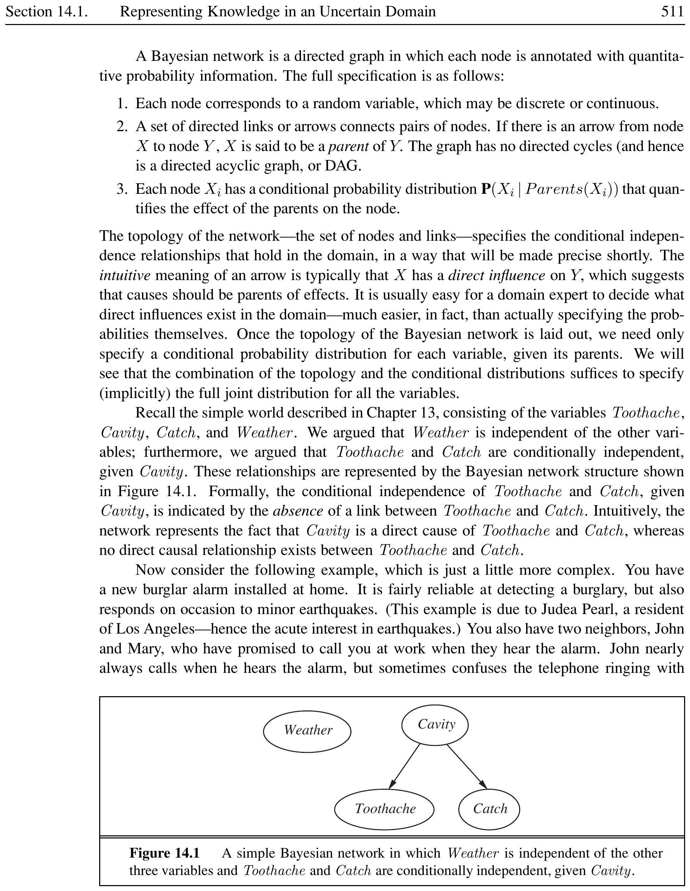

# Introduction to Prolog


% ==================== Section 15.1 ====================

## What Is Prolog?


Prolog (short for **PROGRAMMING IN LOGIC**) is a declarative programming language based on first-order logic. Unlike imperative languages (C, Java, Python) where the programmer specifies \emph{how} to compute a result, Prolog focuses on \emph{what} the result should be. The programmer declares facts and rules, and Prolog's built-in inference engine finds the answer automatically.


<div style="border-left: 4px solid #1a5c9e; background-color: #f0f4f8; padding: 15px; margin: 20px 0; border-radius: 4px;">
<strong>📖 Prolog</strong>


**PROLOG** is a logic programming language in which programs are expressed as a set of facts and rules, and computation is initiated by running a query. Prolog uses backward chaining with unification to find all solutions that satisfy the query.

</div>


<div style="border-left: 4px solid #1a5c9e; background-color: #f0f4f8; padding: 15px; margin: 20px 0; border-radius: 4px;">
<strong>📖 Declarative Programming</strong>


**DECLARATIVE PROGRAMMING** is a programming paradigm that expresses the logic of a computation without describing its control flow. The programmer states \emph{what} is true; the language's execution mechanism determines \emph{how} to derive the answer.

</div>


Prolog is restricted to **HORN CLAUSES** -- a subset of first-order logic where each clause has at most one positive literal. This restriction guarantees efficient, goal-directed inference.


<div style="border-left: 4px solid #1a5c9e; background-color: #f0f4f8; padding: 15px; margin: 20px 0; border-radius: 4px;">
<strong>📖 Horn Clause</strong>


A **HORN CLAUSE** is a logical clause with at most one positive literal (the head) and zero or more negative literals (the body). In Prolog syntax: \texttt{Head :- Body.} A clause with no body is a fact; a clause with a body is a rule.

</div>


[htbp]





*Caption: Prolog belongs to the logic programming sub-branch of the declarative paradigm.*


\end{figure}

\vspace{-0.3cm}


<div style="border-left: 4px solid #2e7d32; background-color: #e8f5e9; padding: 15px; margin: 20px 0; border-radius: 4px;">
<strong>💡 Prolog in Practice</strong>


Prolog is well-suited for:
\begin{itemize}
  \item **KNOWLEDGE-BASED SYSTEMS** -- expert systems, rule-based reasoning.
  \item **NATURAL LANGUAGE PROCESSING** -- parsing with definite clause grammars.
  \item **SEARCH AND PLANNING** -- state-space search, constraint satisfaction.
  \item **DATABASE QUERYING** -- logical queries over relational data.
\end{itemize}
Popular Prolog implementations include SWI-Prolog, GNU Prolog, and SICStus Prolog.

</div>


% ==================== Section 15.2 ====================

## Facts and Rules


A Prolog program consists of **CLAUSES**. There are two types: **FACTS** (unconditionally true) and **RULES** (conditionally true).


<div style="border-left: 4px solid #1a5c9e; background-color: #f0f4f8; padding: 15px; margin: 20px 0; border-radius: 4px;">
<strong>📖 Facts and Rules</strong>


A **FACT** is a clause with an empty body; it states something that is always true. Syntax: \texttt{predicate(arguments).}

A **RULE** has a head and a body separated by \texttt{:-}. It states: "Head is true if Body is true." Syntax: \texttt{Head :- Body.}

The **HEAD** is a single goal. The **BODY** contains one or more goals separated by commas (conjunction, ``and'') or semicolons (disjunction, ``or'').

</div>


```prolog
% Facts
cat(tom).
dog(pluto).
likes(mary, pizza).
likes(john, mary).

% Rule with conjunction (AND)
friend(X, Y) :- likes(X, Z), likes(Y, Z).

% Rule with disjunction (OR)
warm(X) :- cat(X); dog(X).
```


The comma \texttt{,} between goals means **CONJUNCTION** -- all goals must succeed. The semicolon \texttt{;} means **DISJUNCTION** -- at least one goal must succeed. A rule can be read logically:

\begin{quote}
\small
\texttt{friend(X, Y) :- likes(X, Z), likes(Y, Z).}\\
``X is a friend of Y if X likes Z and Y like the same Z.''
\end{quote}


<div style="border-left: 4px solid #2e7d32; background-color: #e8f5e9; padding: 15px; margin: 20px 0; border-radius: 4px;">
<strong>💡 Facts and Rules in Action</strong>


Program:

```prolog
likes(ali, football).
likes(bob, football).
likes(ali, chess).
friends(X, Y) :- likes(X, Z), likes(Y, Z).
```

Query: \texttt{friends(ali, bob).} succeeds (both like football).\\
Query: \texttt{friends(ali, X).} produces \texttt{X = bob}.

</div>


% ==================== Section 15.3 ====================

## Running Queries


Once facts and rules are loaded into Prolog, we ask questions using **QUERIES**. A query is a goal (or conjunction of goals) that Prolog attempts to satisfy.


<div style="border-left: 4px solid #1a5c9e; background-color: #f0f4f8; padding: 15px; margin: 20px 0; border-radius: 4px;">
<strong>📖 Query</strong>


A **QUERY** (or goal) is a question the user asks the Prolog system. Prolog uses backward chaining to find all bindings that make the query true. Queries are entered at the \texttt{?--} prompt in SWI-Prolog.

</div>


### SWI-Prolog Workflow

\begin{enumerate}
  \item Write Prolog code in a file (e.g., \texttt{family.pl}).
  \item Load the file: \texttt{?- [family].}
  \item Enter queries: \texttt{?- parentof(amy, bruce).}
  \item Prolog responds with \texttt{true}. or \texttt{false}.
  \item For variables, type \texttt{;} to see more solutions.
\end{enumerate}


```prolog
% Load a file
?- [family].

% Query with a constant
?- female(amy).
true.

% Query with a variable
?- female(X).
X = amy ;
X = johnette.

% Conjunction query
?- parentof(amy, X), male(X).
X = anthony ;
X = bruce.
```


<div style="border-left: 4px solid #2e7d32; background-color: #e8f5e9; padding: 15px; margin: 20px 0; border-radius: 4px;">
<strong>💡 Running Queries</strong>


Assume the family relationships from the next section are loaded.\\
Query: \texttt{?- siblingof(X, Y).} \\
Output: \texttt{X = johnette, Y = anthony ; X = johnette, Y = bruce ; ...}
Press \texttt{;} to cycle through all solutions.\\
Press \texttt{Enter} to stop.\\
Press \texttt{a} (SWI-Prolog) to see all solutions at once.

</div>


% ==================== Section 15.4 ====================

## Simple Programs


### Family Relationships


<div style="border-left: 4px solid #1a5c9e; background-color: #f0f4f8; padding: 15px; margin: 20px 0; border-radius: 4px;">
<strong>📖 Family Relationships</strong>


Family relationship programs model kinship using facts (e.g., \texttt{parentof/2}, \texttt{male/1}, \texttt{female/1}) and rules (e.g., \texttt{siblingof/2}, \texttt{brotherof/2}). The rules derive new relationships from the base facts.

</div>


We model a family using facts for \texttt{female/1}, \texttt{male/1}, and \texttt{parentof/2}. Rules define \texttt{siblingof/2} and \texttt{brotherof/2}.


```prolog
female(amy).
female(johnette).
male(anthony).
male(bruce).
male(ogden).
parentof(amy, johnette).
parentof(amy, anthony).
parentof(amy, bruce).
parentof(ogden, johnette).
parentof(ogden, anthony).
parentof(ogden, bruce).

siblingof(X, Y) :- parentof(Z, X), parentof(Z, Y).
brotherof(X, Y) :- parentof(Z, X), male(X), parentof(Z, Y).
```


**Explanation:** \texttt{siblingof(X, Y)} is true if there exists a parent Z such that Z is a parent of both X and Y. \texttt{brotherof(X, Y)} adds the condition that X is male.


<div style="border-left: 4px solid #2e7d32; background-color: #e8f5e9; padding: 15px; margin: 20px 0; border-radius: 4px;">
<strong>💡 Family Relationships</strong>


\begin{description}
  \item[Query:] \texttt{?- siblingof(johnette, anthony).}
  \item[Output:] \texttt{true.}
  \item[Query:] \texttt{?- brotherof(bruce, johnette).}
  \item[Output:] \texttt{true.}
  \item[Query:] \texttt{?- siblingof(X, Y).}
  \item[Output:] \texttt{X = johnette, Y = anthony ; X = johnette, Y = bruce ;} \newline
\texttt{X = anthony, Y = johnette ; X = anthony, Y = bruce ; ...}
\end{description}

</div>


### Printing a List of Items


<div style="border-left: 4px solid #1a5c9e; background-color: #f0f4f8; padding: 15px; margin: 20px 0; border-radius: 4px;">
<strong>📖 Loop-over-Failure Pattern</strong>


The **LOOP-OVER-FAILURE** pattern uses the built-in \texttt{fail/0} predicate to force backtracking. Combined with side-effect predicates (\texttt{write/1}, \texttt{nl/0}), it iterates over all solutions to a goal and performs an action for each one before eventually failing.

</div>


The fail predicate forces backtracking, and combined with \texttt{write/1} and \texttt{nl/0}, it produces a loop-over-failure pattern that prints all matching items.


```prolog
item(tshirt).
item(pant).
item(caps).
item(shirt).
item(shoe).
item(sunglass).

products :- item(X), write(X), nl, fail.
```


**Explanation:** \texttt{products} first binds X to \texttt{tshirt}, writes it, then \texttt{fail} forces backtracking. Prolog backtracks to \texttt{item(X)} and binds X to the next item. This repeats until all items are exhausted, then the rule fails silently.


<div style="border-left: 4px solid #2e7d32; background-color: #e8f5e9; padding: 15px; margin: 20px 0; border-radius: 4px;">
<strong>💡 Printing Items</strong>


Query: \texttt{?- products.} \\
Output:

```prolog
tshirt
pant
caps
shirt
shoe
sunglass
false.
```

The \texttt{false.} at the end is normal -- it signals that Prolog exhausted all alternatives.

</div>


### Maximum of Two Numbers


<div style="border-left: 4px solid #1a5c9e; background-color: #f0f4f8; padding: 15px; margin: 20px 0; border-radius: 4px;">
<strong>📖 Comparison Operators in Prolog</strong>


Prolog provides arithmetic comparison operators (\texttt{>}, \texttt{<}, \texttt{>=}, \texttt{=<}, \texttt{=:=}, \texttt{=\=}) that evaluate both sides and compare the numeric results. They succeed or fail based on the comparison, and both arguments must be fully instantiated (ground) at evaluation time.

</div>


Comparison operators (\texttt{>=}, \texttt{>}) determine which argument is larger.


```prolog
max(X, Y, X) :- X >= Y.
max(X, Y, Y) :- Y > X.
```


**Explanation:** Two rules define \texttt{max/3}. The first rule succeeds if X is greater than or equal to Y, unifying the third argument with X. The second rule handles the case where Y is greater than X.


<div style="border-left: 4px solid #2e7d32; background-color: #e8f5e9; padding: 15px; margin: 20px 0; border-radius: 4px;">
<strong>💡 Maximum of Two Numbers</strong>


\begin{description}
  \item[Query:] \texttt{?- max(10, 7, M).}
  \item[Output:] \texttt{M = 10.}
  \item[Query:] \texttt{?- max(3, 8, M).}
  \item[Output:] \texttt{M = 8.}
  \item[Query:] \texttt{?- max(5, 5, M).}
  \item[Output:] \texttt{M = 5.}
\end{description}

</div>


### GPA Lookup


<div style="border-left: 4px solid #1a5c9e; background-color: #f0f4f8; padding: 15px; margin: 20px 0; border-radius: 4px;">
<strong>📖 Interactive I/O Predicates</strong>


Prolog's \texttt{read/1} reads a term from the current input stream (terminated by a period), \texttt{write/1} outputs a term, and \texttt{nl/0} writes a newline. These predicates enable simple interactive programs that prompt the user and display results.

</div>


This program demonstrates interactive input/output using \texttt{read/1}, \texttt{write/1}, and \texttt{nl/0}.


```prolog
gpa(ashik, 3.45).
gpa(rukon, 3.50).
gpa(moni, 3.25).
gpa(zaman, 3.35).
gpa(abid, 3.55).

result :- write('Enter student name:'),
          read(X), gpa(X, Y), nl,
          write('GPA is '),
          write(Y).
```


**Explanation:** The \texttt{result} predicate prompts the user, reads a name, looks up the GPA from the facts, and prints it. If the name is not found, Prolog reports \texttt{false}.


<div style="border-left: 4px solid #2e7d32; background-color: #e8f5e9; padding: 15px; margin: 20px 0; border-radius: 4px;">
<strong>💡 GPA Lookup</strong>


Query: \texttt{?- result.} \\
Output:

```prolog
Enter student name: ashik.
GPA is 3.45
true.
```

The period \texttt{.} after the entered name is required (Prolog expects a term terminated by a period).

</div>


### Student-Professor Relationships


<div style="border-left: 4px solid #1a5c9e; background-color: #f0f4f8; padding: 15px; margin: 20px 0; border-radius: 4px;">
<strong>📖 Joining Facts via Shared Variables</strong>


In Prolog, two goals share a variable to express a relationship across predicates. For example, \texttt{teaches(X, Z), studies(Y, Z)} links professors and students who share the same course \texttt{Z}. This is equivalent to a SQL join on a common column.

</div>


This program models which students study which courses and which professors teach those courses.


```prolog
studies(tamanna, cse421).
studies(tirana, cse421).
studies(sayem, cse422).
studies(tamanna, cse452).
studies(tamanna, cse423).
teaches(selim_sir, cse452).
teaches(mijan_sir, cse421).
teaches(ujjal_sir, cse423).

professor(X, Y) :- teaches(X, Z), studies(Y, Z).
```


**Explanation:** \texttt{professor(X, Y)} is true if X teaches a course Z and Y studies that same course Z. The variable Z unifies both clauses, linking professors to students via shared courses.


<div style="border-left: 4px solid #2e7d32; background-color: #e8f5e9; padding: 15px; margin: 20px 0; border-radius: 4px;">
<strong>💡 Student-Professor Relationships</strong>


\begin{description}
  \item[Query:] \texttt{?- professor(selim\_sir, tamanna).}
  \item[Output:] \texttt{true.}
  \item[Query:] \texttt{?- professor(X, tamanna).}
  \item[Output:] \texttt{X = selim\_sir ; X = mijan\_sir ; X = ujjal\_sir.}
  \item[Query:] \texttt{?- professor(selim\_sir, Y).}
  \item[Output:] \texttt{Y = tamanna.}
\end{description}

</div>


% ==================== Section 15.5 ====================

## Arithmetic in Prolog


Prolog uses the \texttt{is/2} operator to evaluate arithmetic expressions. Unlike functional languages, \texttt{=} does not evaluate expressions; it performs unification only. The \texttt{is} predicate forces evaluation of the right-hand side.

### Fibonacci Series


<div style="border-left: 4px solid #1a5c9e; background-color: #f0f4f8; padding: 15px; margin: 20px 0; border-radius: 4px;">
<strong>📖 Recursion in Prolog</strong>


A predicate is **RECURSIVE** if it calls itself. A recursive predicate must have one or more **BASE CASES** (non-recursive rules that terminate the recursion) and one or more **RECURSIVE CASES** that reduce the problem toward a base case. Prolog's stack handles the recursion; deeply recursive calls may overflow.

</div>


The Fibonacci sequence is defined recursively: $F_1 = 1$, $F_2 = 1$, $F_n = F_{n-1} + F_{n-2}$ for $n > 2$.


```prolog
fib(1, 1).
fib(2, 1).
fib(N, F) :- N > 2,
             N1 is N - 1,
             N2 is N - 2,
             fib(N1, F1),
             fib(N2, F2),
             F is F1 + F2.
```


**Explanation:** Base cases: \texttt{fib(1,1)} and \texttt{fib(2,1)}. The recursive rule computes $n-1$ and $n-2$, recurses on both, then sums the results using \texttt{is/2}. Without the \texttt{N > 2} guard, the recursion would loop indefinitely.


<div style="border-left: 4px solid #2e7d32; background-color: #e8f5e9; padding: 15px; margin: 20px 0; border-radius: 4px;">
<strong>💡 Fibonacci Series</strong>


\begin{description}
  \item[Query:] \texttt{?- fib(6, F).}
  \item[Output:] \texttt{F = 8.}
  \item[Explanation:] The 6th Fibonacci number: 1, 1, 2, 3, 5, **8**.
  \item[Query:] \texttt{?- fib(10, F).}
  \item[Output:] \texttt{F = 55.}
\end{description}

</div>


### Factorial


<div style="border-left: 4px solid #1a5c9e; background-color: #f0f4f8; padding: 15px; margin: 20px 0; border-radius: 4px;">
<strong>📖 Accumulator Pattern</strong>


The **ACCUMULATOR PATTERN** uses an extra argument to carry intermediate results through recursive calls, enabling tail-recursive definitions. While the natural recursion shown below is simpler, an accumulator version would use a helper predicate: \texttt{fact(N, F) :- fact(N, 1, F).} with \texttt{fact(0, Acc, Acc).} as the base case.

</div>


Factorial is defined as $0! = 1$, $n! = n \times (n-1)!$ for $n > 0$.


```prolog
fact(0, 1).
fact(N, F) :- N > 0,
              N1 is N - 1,
              fact(N1, F1),
              F is N * F1.
```


**Explanation:** The base case \texttt{fact(0,1)} stops the recursion. The recursive rule decrements N, recurses, then multiplies the result by N. This is a natural recursion (not tail-recursive); each call pushes a stack frame.


<div style="border-left: 4px solid #2e7d32; background-color: #e8f5e9; padding: 15px; margin: 20px 0; border-radius: 4px;">
<strong>💡 Factorial</strong>


\begin{description}
  \item[Query:] \texttt{?- fact(5, F).}
  \item[Output:] \texttt{F = 120.}
  \item[Explanation:] $5! = 5 \times 4 \times 3 \times 2 \times 1 = 120$.
  \item[Query:] \texttt{?- fact(0, F).}
  \item[Output:] \texttt{F = 1.}
\end{description}

</div>


### GCD and LCM


<div style="border-left: 4px solid #1a5c9e; background-color: #f0f4f8; padding: 15px; margin: 20px 0; border-radius: 4px;">
<strong>📖 Euclidean Algorithm</strong>


The **EUCLIDEAN ALGORITHM** computes the greatest common divisor of two numbers: $\gcd(X, 0) = X$, $\gcd(X, Y) = \gcd(Y, X \bmod Y)$. Prolog implements it naturally via recursion with \texttt{is/2} for the modulo operation.

</div>


The GCD uses the Euclidean algorithm: $\gcd(X, 0) = X$, $\gcd(X, Y) = \gcd(Y, X \bmod Y)$. LCM is derived from GCD: $\operatorname{lcm}(X, Y) = (X \times Y) / \gcd(X, Y)$.


```prolog
gcd(X, 0, X).
gcd(X, Y, D) :- R is X mod Y, gcd(Y, R, D).

lcm(X, Y, M) :- gcd(X, Y, D), M is (X * Y) / D.
```


**Explanation:** The base case states that $\gcd(X, 0) = X$. The recursive rule computes $X \bmod Y$ and recurses with $(Y, R)$. The \texttt{lcm} rule first computes the GCD, then uses the formula to find the LCM.


<div style="border-left: 4px solid #2e7d32; background-color: #e8f5e9; padding: 15px; margin: 20px 0; border-radius: 4px;">
<strong>💡 GCD and LCM</strong>


\begin{description}
  \item[Query:] \texttt{?- gcd(12, 8, D).}
  \item[Output:] \texttt{D = 4.}
  \item[Query:] \texttt{?- lcm(12, 8, M).}
  \item[Output:] \texttt{M = 24.}
  \item[Query:] \texttt{?- gcd(100, 35, D).}
  \item[Output:] \texttt{D = 5.}
\end{description}

</div>


### Cube of a Number


<div style="border-left: 4px solid #1a5c9e; background-color: #f0f4f8; padding: 15px; margin: 20px 0; border-radius: 4px;">
<strong>📖 Read-Process Loop</strong>


A **READ-PROCESS LOOP** repeatedly reads input, processes it, and loops back for more input. A sentinel value (e.g., \texttt{stop}) terminates the loop. The cut (\texttt{!}) in the sentinel clause prevents backtracking into the processing clause.

</div>


This program demonstrates a read-process loop: it repeatedly reads numbers, computes their cubes, and continues until the user types \texttt{stop}.


```prolog
cube :- write('Enter a number: '),
        read(X), process(X).

process(stop) :- !.
process(N) :- C is N * N * N,
              write('Cube of '), write(N),
              write(' is '), write(C), nl,
              cube.
```


**Explanation:** \texttt{cube} prompts the user and reads a value. \texttt{process(stop)} uses the cut (\texttt{!}) to terminate when the user types \texttt{stop}. Otherwise, \texttt{process(N)} computes $N^3$, prints it, and calls \texttt{cube} again to continue the loop.


<div style="border-left: 4px solid #2e7d32; background-color: #e8f5e9; padding: 15px; margin: 20px 0; border-radius: 4px;">
<strong>💡 Cube of a Number</strong>


Query: \texttt{?- cube.} \\
Output:

```prolog
Enter a number: 3.
Cube of 3 is 27
Enter a number: 5.
Cube of 5 is 125
Enter a number: stop.
true.
```

The program loops until \texttt{stop} is entered.

</div>


% ==================== Section 15.6 ====================

## Satisfying a List of Goals


A predicate can be defined by multiple rules, each representing an alternative way to satisfy it. Prolog tries each rule in order; if one fails, it backtracks to the next.


<div style="border-left: 4px solid #1a5c9e; background-color: #f0f4f8; padding: 15px; margin: 20px 0; border-radius: 4px;">
<strong>📖 Multiple Rules (Disjunction by Backtracking)</strong>


When a predicate has multiple clauses, Prolog tries the first clause. If it fails (or the user requests another solution), Prolog backtracks and tries the next clause. This provides implicit disjunction without using the \texttt{;} operator.

</div>


```prolog
big(bear).
big(elephant).
small(cat).
small(dog).
brown(bear).
black(cat).
black(dog).
gray(elephant).

dark(Z) :- black(Z).
dark(Z) :- brown(Z).
dark(Z) :- gray(Z).
```


**Explanation:** \texttt{dark/1} succeeds if the argument is black, brown, or gray. Each rule represents an alternative condition. The query \texttt{?- dark(X).} enumerates all animals that satisfy at least one of the three colour conditions.


<div style="border-left: 4px solid #2e7d32; background-color: #e8f5e9; padding: 15px; margin: 20px 0; border-radius: 4px;">
<strong>💡 Satisfying a List of Goals</strong>


\begin{description}
  \item[Query:] \texttt{?- dark(X).}
  \item[Output:] \texttt{X = cat ; X = dog ; X = bear ; X = elephant.}
  \item[Explanation:] cat and dog are black; bear is brown; elephant is gray.
  \item[Query:] \texttt{?- dark(bear).}
  \item[Output:] \texttt{true.}
  \item[Query:] \texttt{?- dark(X), big(X).}
  \item[Output:] \texttt{X = bear ; X = elephant.}
\end{description}

</div>


% ==================== Section 15.7 ====================

## Cuts and Control


The **CUT** (\texttt{!}) is a built-in predicate that prunes backtracking. It commits Prolog to the choices made so far. Once a cut is encountered, Prolog cannot backtrack past it.


<div style="border-left: 4px solid #1a5c9e; background-color: #f0f4f8; padding: 15px; margin: 20px 0; border-radius: 4px;">
<strong>📖 Cut (!/0)</strong>


The **CUT** (\texttt{!}) is a goal that always succeeds but prevents backtracking across it. Specifically, it freezes all choices made before the cut in the current clause and in the goal that called this predicate.

</div>


### Uses of the Cut

\begin{enumerate}
  \item **Confirming a match:** Once a condition is satisfied, stop searching for alternatives.
  \item **Cut-fail combination:** Used to define negation or to terminate loops.
  \item **Preventing unwanted backtracking:** Improve efficiency by pruning impossible branches.
\end{enumerate}


```prolog
% Cut to confirm a match
max(X, Y, X) :- X >= Y, !.
max(_, Y, Y).

% Cut-fail: defining "not" manually
not(P) :- call(P), !, fail.
not(_).

% Cut to terminate recursion (from cube example)
process(stop) :- !.
```


**Explanation:** In the \texttt{max/3} with cut, if $X \ge Y$ succeeds, the cut prevents trying the second rule. If $X \ge Y$ fails, Prolog backtracks to the second rule. The anonymous variable in the second rule's first argument (\texttt{\_}) matches any value.

The cut-fail combination defines negation by elimination: if the goal P succeeds, cut then fail causes the entire call to fail. If P fails, the second clause succeeds.


<div style="border-left: 4px solid #2e7d32; background-color: #e8f5e9; padding: 15px; margin: 20px 0; border-radius: 4px;">
<strong>💡 Cuts and Control</strong>


\begin{description}
  \item[Query:] \texttt{?- max(7, 5, M).}
  \item[Output:] \texttt{M = 7.}
  \item[How it works:] $7 \ge 5$ succeeds, the cut prunes the second rule, $M = 7$.
  \item[Query:] \texttt{?- not(member(3, [1,2,4])).}
  \item[Output:] \texttt{true.}
  \item[Query:] \texttt{?- not(member(2, [1,2,4])).}
  \item[Output:] \texttt{false.}
\end{description}

</div>


<div style="border-left: 4px solid #ef6c00; background-color: #fff3e0; padding: 15px; margin: 20px 0; border-radius: 4px;">
<strong>⚠️ Warning: Green vs.\ Red Cuts</strong>


A **GREEN CUT** only improves efficiency; removing it does not change the program's answers. A **RED CUT** changes the program's logical meaning; removing it produces incorrect answers. Always prefer green cuts and use red cuts only when fully understanding the control flow.

</div>


<div style="border-left: 4px solid #0277bd; background-color: #e1f5fe; padding: 15px; margin: 20px 0; border-radius: 4px;">
<strong>ℹ️ Cut-Fail Combination</strong>


The pattern \texttt{!, fail} is a common Prolog idiom. The cut commits to the current branch, and \texttt{fail} forces failure. Because backtracking is blocked by the cut, the predicate cannot try alternative clauses. This effectively defines "not provable".

</div>


