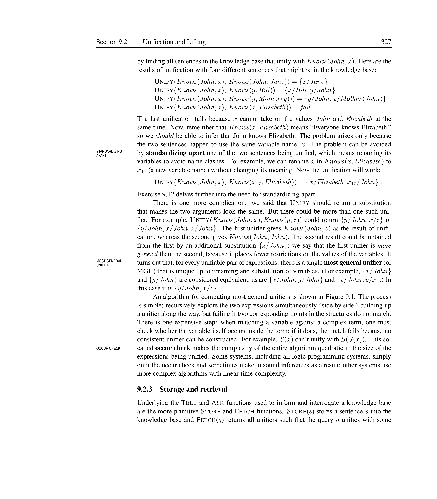


# Advanced Prolog

## Looping and Recursion

Prolog does not have traditional looping constructs (for, while). Instead, iteration is achieved through **RECURSION** – a predicate calls itself with a modified argument until a base case is reached.

<div markdown="1" style="border-left:4px solid #1a5c9e;background:#f0f4f8;padding:14px 18px;margin:18px 0;border-radius:6px;">

Recursive Loop

A recursive loop in Prolog is defined by: (1) a **BASE CASE** that stops the recursion, and (2) a **RECURSIVE CASE** that performs work and calls itself with a decreasing counter. The `is/2` operator evaluates arithmetic expressions.

</div>

```prolog
testloop(0) :- !.
testloop(N) :-
    N > 0,
    write('Number : '), write(N), nl,
    M is N - 1,
    testloop(M).
```

<div markdown="1" style="border-left:4px solid #2e7d32;background:#e8f5e9;padding:14px 18px;margin:18px 0;border-radius:6px;">

Counting Down

```prolog
?- testloop(5).
Number : 5
Number : 4
Number : 3
Number : 2
Number : 1
true
```

The cut in the base case ensures that once `N = 0` is reached, Prolog does not attempt to backtrack into the recursive clause.

</div>

## Menu-Driven Programs

<div markdown="1" style="border-left:4px solid #1a5c9e;background:#f0f4f8;padding:14px 18px;margin:18px 0;border-radius:6px;">

Menu-Driven Program

A **MENU-DRIVEN PROGRAM** presents a list of options, reads the user’s choice, performs the corresponding computation, and repeats. In Prolog, this is implemented as a recursive predicate that keeps control within the menu until the user chooses to exit.

</div>

```prolog
menu :-
    write('---- Area Calculation ----'), nl,
    write('1. Calculate area of circle'), nl,
    write('2. Calculate area of square'), nl,
    write('3. Calculate area of sphere'), nl,
    read(Choice),
    (
        Choice = 1,
        write('Enter radius: '), read(R),
        Result is 3.14 * R * R,
        write('Area of circle = '), write(Result), nl, menu ;
        Choice = 2,
        write('Enter side: '), read(A),
        Result is A * A,
        write('Area of square = '), write(Result), nl, menu ;
        Choice = 3,
        write('Enter radius: '), read(R),
        Result is 4 * 3.14 * R * R,
        write('Area of sphere = '), write(Result), nl, menu
    ).
```

<div markdown="1" style="border-left:4px solid #2e7d32;background:#e8f5e9;padding:14px 18px;margin:18px 0;border-radius:6px;">

Running the Menu

```prolog
?- menu.
---- Area Calculation ----
1. Calculate area of circle
2. Calculate area of square
3. Calculate area of sphere
|: 1.
Enter radius: 5.
Area of circle = 78.5
...
```

The menu loops indefinitely (no exit option in this version). Each choice recalculates and re-displays the menu via the recursive call at the end of each branch.

</div>

## Tree Traversal

<div markdown="1" style="border-left:4px solid #1a5c9e;background:#f0f4f8;padding:14px 18px;margin:18px 0;border-radius:6px;">

Tree Traversal

In Prolog, a tree can be represented as a set of `edge/2` facts. A traversal from node `A` to node `B` succeeds if there is a path following edges from `A` downward to `B`. This is a depth-first search on the tree structure.

</div>

```prolog
% Tree definition
edge(a, b).  edge(a, c).
edge(b, d).  edge(b, e).
edge(c, f).
edge(f, g).

% Route: reach B through an intermediate node
route(A, B) :- edge(A, C), route(C, B).
% Route: direct edge
route(A, B) :- edge(A, B).
```

<figure>

<figcaption>Tree represented by <code>edge/2</code> predicates</figcaption>
</figure>

<div markdown="1" style="border-left:4px solid #2e7d32;background:#e8f5e9;padding:14px 18px;margin:18px 0;border-radius:6px;">

Tree Traversal Example

```prolog
?- route(a, g).
true

?- route(a, X).
X = b ;
X = c ;
X = d ;
X = e ;
X = f ;
X = g
```

The query `route(a, g)` succeeds because there is a path `a `$\rightarrow$` c `$\rightarrow$` f `$\rightarrow$` g`. Backtracking enumerates all reachable nodes.

</div>

## Graph Problems

### Cyclic Graph Path Finding

Trees do not contain cycles, but general graphs do. When traversing a graph, Prolog can enter infinite loops by following a cycle repeatedly. To avoid this, we maintain a **VISITED LIST** of nodes already seen.

<div markdown="1" style="border-left:4px solid #1a5c9e;background:#f0f4f8;padding:14px 18px;margin:18px 0;border-radius:6px;">

Visited List

A **VISITED LIST** tracks nodes that have already been visited during a search. Before following an edge, we check that the target node is not already in the visited list. This prevents infinite loops in cyclic graphs.

</div>

```prolog
% Cyclic graph definition
edge(a, b).  edge(a, c).
edge(b, d).  edge(d, e).
edge(e, b).  % creates a cycle

path(A, B) :- nextRoute(A, B, []), write(B).

nextRoute(A, B, Visited) :-
    edge(A, X),
    not(member(X, Visited)),
    (
        B = X ;
        nextRoute(X, B, [A|Visited])
    ).
```

<div markdown="1" style="border-left:4px solid #2e7d32;background:#e8f5e9;padding:14px 18px;margin:18px 0;border-radius:6px;">

Cycle Avoidance

```prolog
?- path(a, d).
a -> b -> d
true

?- path(a, e).
a -> b -> d -> e
true
```

Without the visited list, the path `a `$\rightarrow$` b `$\rightarrow$` d `$\rightarrow$` e `$\rightarrow$` b `$\rightarrow$` d `$\rightarrow$` ...` would loop forever. The visited list ensures each node is visited at most once per path.

</div>

### Tree vs. Graph Traversal

<div markdown="1" style="border-left:4px solid #1a5c9e;background:#f0f4f8;padding:14px 18px;margin:18px 0;border-radius:6px;">

Tree vs Graph Traversal

**TREE TRAVERSAL** does not require a visited list because trees are acyclic — there is exactly one path between any two nodes. **GRAPH TRAVERSAL** on cyclic graphs requires a visited list to prevent infinite loops. Both use the same recursive depth-first pattern, but the graph version adds cycle detection.

</div>

```prolog
% Tree traversal (no visited list needed)
route(A, B) :- edge(A, B).
route(A, B) :- edge(A, C), route(C, B).

% Graph traversal (visited list required)
path(A, B) :- traverse(A, B, []).

traverse(A, B, Visited) :-
    edge(A, X),
    not(member(X, Visited)),
    (B = X ; traverse(X, B, [A|Visited])).
```

| Aspect         | Tree traversal     | Graph traversal                      |
|:---------------|:-------------------|:-------------------------------------|
| Data structure | Acyclic (tree)     | May contain cycles                   |
| Visited list   | Not required       | Required to prevent infinite loops   |
| Termination    | Always terminates  | Guaranteed only with visited list    |
| Complexity     | O(n)               | O(n + e) with visited list           |
| Redundancy     | No redundant paths | Multiple paths to same node possible |

Tree traversal vs. graph traversal comparison

<div markdown="1" style="border-left:4px solid #2e7d32;background:#e8f5e9;padding:14px 18px;margin:18px 0;border-radius:6px;">

When to Use Each

Use **tree traversal** when the data structure is guaranteed acyclic (e.g., family trees, parse trees). Use **graph traversal with a visited list** when cycles are possible (e.g., road networks, dependency graphs). The visited list adds O(n) space but guarantees termination.

</div>

## Finite Automata in Prolog

### DFA Simulation

<div markdown="1" style="border-left:4px solid #1a5c9e;background:#f0f4f8;padding:14px 18px;margin:18px 0;border-radius:6px;">

Deterministic Finite Automaton (DFA)

A **DETERMINISTIC FINITE AUTOMATON (DFA)** is a finite state machine with a unique transition for each state–symbol pair. In Prolog, it is represented with three kinds of facts: `start/1` (initial state), `delta/3` (transition function), and `final/1` (accepting states).

</div>

<figure>

<figcaption>DFA that accepts strings ending with <code>b</code></figcaption>
</figure>

```prolog
% DFA that accepts strings ending with 'b'
start(0).
delta(0, a, 0).
delta(0, b, 1).
delta(1, a, 0).
delta(1, b, 1).
final(1).

parse(L) :- start(S), trans(S, L).

trans(S, []) :- final(S), write(S), write(' '), write([]), nl.
trans(S, [A|B]) :-
    delta(S, A, S1),
    write(S), write(' '), write([A|B]), nl,
    trans(S1, B).
```

<div markdown="1" style="border-left:4px solid #2e7d32;background:#e8f5e9;padding:14px 18px;margin:18px 0;border-radius:6px;">

DFA Simulation

```prolog
?- testloop(5).
Number : 5
Number : 4
Number : 3
Number : 2
Number : 1
true
```0

The DFA starts in state 0 and processes each symbol. After reading `a b b`, it ends in the final state 1.

</div>

### NFA Simulation

<div markdown="1" style="border-left:4px solid #1a5c9e;background:#f0f4f8;padding:14px 18px;margin:18px 0;border-radius:6px;">

Nondeterministic Finite Automaton (NFA)

A **NONDETERMINISTIC FINITE AUTOMATON (NFA)** allows multiple possible transitions for the same state–symbol pair. In Prolog, this is modeled by multiple `t/3` (transition) facts with the same state and symbol but different target states. Prolog’s built-in backtracking explores all possible paths.

</div>

*Figure: NFA that accepts $a(a+b)^*b$*

```prolog
?- testloop(5).
Number : 5
Number : 4
Number : 3
Number : 2
Number : 1
true
```1

<div markdown="1" style="border-left:4px solid #2e7d32;background:#e8f5e9;padding:14px 18px;margin:18px 0;border-radius:6px;">

NFA Simulation

```prolog
?- testloop(5).
Number : 5
Number : 4
Number : 3
Number : 2
Number : 1
true
```2

The NFA explores multiple transition paths. Prolog’s backtracking finds the path that leads to a favorable state.

</div>

## File Handling

### Writing to Files

<div markdown="1" style="border-left:4px solid #1a5c9e;background:#f0f4f8;padding:14px 18px;margin:18px 0;border-radius:6px;">

Writing to a File

`tell(Filename)` redirects all subsequent output to the named file. `told` closes the file and restores output to the console. Between `tell` and `told`, any `write/1` or `nl/0` output goes to the file instead of the screen.

</div>

```prolog
?- testloop(5).
Number : 5
Number : 4
Number : 3
Number : 2
Number : 1
true
```3

<div markdown="1" style="border-left:4px solid #2e7d32;background:#e8f5e9;padding:14px 18px;margin:18px 0;border-radius:6px;">

File Writing

After running `write_to_file.`, the file `mfile.txt` contains the text `Start`. If the file does not exist, Prolog creates it. If it exists, its previous contents are overwritten.

</div>

### Reading from Files

<div markdown="1" style="border-left:4px solid #1a5c9e;background:#f0f4f8;padding:14px 18px;margin:18px 0;border-radius:6px;">

Reading from a File

`see(Filename)` redirects input from the named file. `seen` closes the file and restores input to the keyboard. `read/1` reads the next Prolog term from the current input stream.

</div>

```prolog
?- testloop(5).
Number : 5
Number : 4
Number : 3
Number : 2
Number : 1
true
```4

<div markdown="1" style="border-left:4px solid #2e7d32;background:#e8f5e9;padding:14px 18px;margin:18px 0;border-radius:6px;">

File Reading and Copying

`read_from_file(’data.txt’, ’output.txt’)` reads the first three Prolog terms from `data.txt` and writes them (one per line) to `output.txt`. The `see` and `seen` pair redirects input; the `tell` and `told` pair redirects output.

</div>

### Stream Control and Redirection

<div markdown="1" style="border-left:4px solid #1a5c9e;background:#f0f4f8;padding:14px 18px;margin:18px 0;border-radius:6px;">

Stream Control

A **STREAM** is a Prolog term representing an input/output source. Instead of global redirections with `tell/1` and `see/1`, modern Prolog supports `open/3`, `close/1`, `set_input/1`, and `set_output/1` for finer control. Named streams can be passed as arguments to predicates, allowing multiple open I/O channels simultaneously.

</div>

```prolog
?- testloop(5).
Number : 5
Number : 4
Number : 3
Number : 2
Number : 1
true
```5

<div markdown="1" style="border-left:4px solid #2e7d32;background:#e8f5e9;padding:14px 18px;margin:18px 0;border-radius:6px;">

Stream Redirection in Action

The predicate `with_output_to/2` temporarily redirects output:

```prolog
?- testloop(5).
Number : 5
Number : 4
Number : 3
Number : 2
Number : 1
true
```6

Using named streams instead of global `tell`/`see` allows multiple files to remain open at once and avoids global state changes that can interfere with other predicates.

</div>


