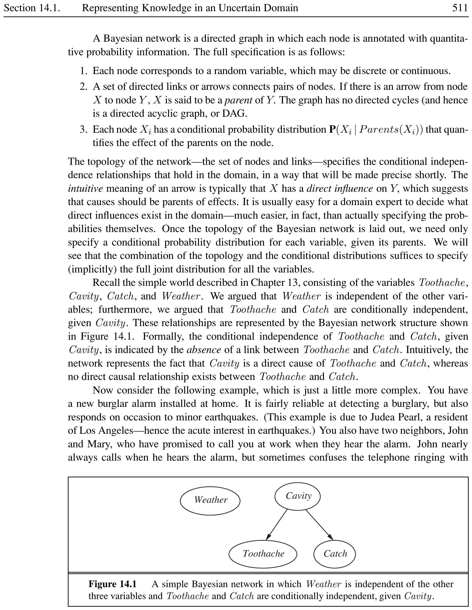
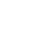
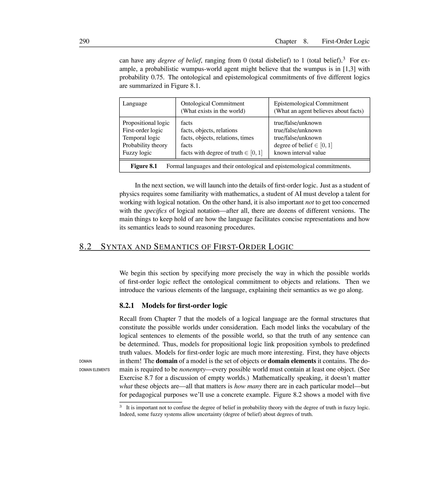
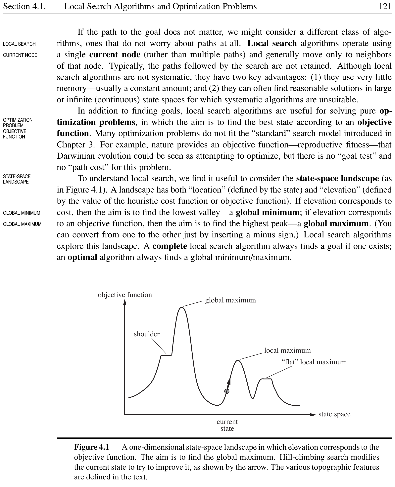
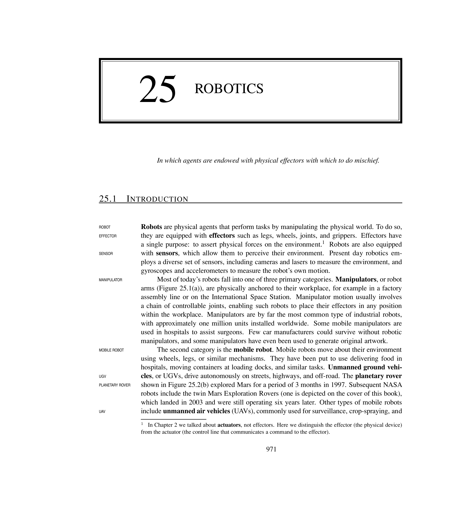

# C++ Implementations


This chapter presents complete C++ implementations of the core AI algorithms covered in earlier chapters: **BFS**, **DFS**, **A* search**, and **DFA construction**. Each section provides a definition box, a diagram, the full code, and a worked example.

% ==================== Section 19.1 ====================

## BFS Implementation in C++


<div style="border-left: 4px solid #1a5c9e; background-color: #f0f4f8; padding: 15px; margin: 20px 0; border-radius: 4px;">
<strong>📖 Breadth-First Search (BFS)</strong>


**BREADTH-FIRST SEARCH** explores a graph level by level. It visits all neighbours of the current node before moving to the next level. BFS uses a **FIFO queue** to maintain the frontier and guarantees the shortest path in unweighted graphs. It is **complete** (finds a solution if one exists) and **optimal** for unweighted graphs. Time complexity: $O(b^d)$; space complexity: $O(b^d)$.

</div>


[htbp]





*Caption: BFS traversal order on a sample graph. Nodes are visited level by level.*


\end{figure}


```cpp
#include <iostream>
#include <vector>
#include <queue>
using namespace std;

void bfs(int start, const vector<vector<int>>& graph) {
    vector<bool> visited(graph.size(), false);
    queue<int> q;

    visited[start] = true;
    q.push(start);

    while (!q.empty()) {
        int u = q.front();
        q.pop();
        cout << u << " ";

        for (int v : graph[u]) {
            if (!visited[v]) {
                visited[v] = true;
                q.push(v);
            }
        }
    }
}

int main() {
    vector<vector<int>> graph = {
        {1, 2},       // 0 -> 1, 2
        {0, 3, 4},    // 1 -> 0, 3, 4
        {0, 5, 6},    // 2 -> 0, 5, 6
        {1},          // 3 -> 1
        {1},          // 4 -> 1
        {2},          // 5 -> 2
        {2}           // 6 -> 2
    };

    cout << "BFS traversal starting from node 0: ";
    bfs(0, graph);
    cout << endl;

    return 0;
}
```


<div style="border-left: 4px solid #2e7d32; background-color: #e8f5e9; padding: 15px; margin: 20px 0; border-radius: 4px;">
<strong>💡 BFS Example</strong>


**Graph:** The graph shown in Figure~\ref{fig:cpp-bfs} with 7 nodes.

**Output:**

```cpp
BFS traversal starting from node 0: 0 1 2 3 4 5 6
```


BFS visits node 0 first, then its neighbours 1 and 2, then the neighbours of 1 (3, 4) followed by the neighbours of 2 (5, 6). This level-by-level order guarantees the shortest path in unweighted graphs.

</div>


% ==================== Section 19.2 ====================

## DFS Implementation in C++


<div style="border-left: 4px solid #1a5c9e; background-color: #f0f4f8; padding: 15px; margin: 20px 0; border-radius: 4px;">
<strong>📖 Depth-First Search (DFS)</strong>


**DEPTH-FIRST SEARCH** explores a graph by going as deep as possible along each branch before backtracking. DFS uses a **LIFO stack** (implicitly via recursion or explicitly). It is **complete** only in finite search spaces. Time complexity: $O(b^m)$; space complexity: $O(bm)$, which is far better than BFS for deep graphs.

</div>


[htbp]


*Caption: DFS traversal order on the same graph. DFS plunges deep before backtracking.*


\end{figure}

The implementation below provides both **recursive** (implicit stack via function call frames) and **iterative** (explicit stack) versions.


```cpp
#include <iostream>
#include <vector>
#include <stack>
using namespace std;

void dfsRecursive(int u, const vector<vector<int>>& graph,
                  vector<bool>& visited) {
    visited[u] = true;
    cout << u << " ";

    for (int v : graph[u]) {
        if (!visited[v]) {
            dfsRecursive(v, graph, visited);
        }
    }
}

void dfsIterative(int start, const vector<vector<int>>& graph) {
    vector<bool> visited(graph.size(), false);
    stack<int> s;
    s.push(start);

    while (!s.empty()) {
        int u = s.top();
        s.pop();

        if (!visited[u]) {
            visited[u] = true;
            cout << u << " ";
            for (int i = graph[u].size() - 1; i >= 0; --i) {
                int v = graph[u][i];
                if (!visited[v]) {
                    s.push(v);
                }
            }
        }
    }
}

int main() {
    vector<vector<int>> graph = {
        {1, 2},       // 0 -> 1, 2
        {0, 3, 4},    // 1 -> 0, 3, 4
        {0, 5, 6},    // 2 -> 0, 5, 6
        {1},          // 3 -> 1
        {1},          // 4 -> 1
        {2},          // 5 -> 2
        {2}           // 6 -> 2
    };

    vector<bool> visited(graph.size(), false);
    cout << "Recursive DFS starting from node 0: ";
    dfsRecursive(0, graph, visited);
    cout << endl;

    cout << "Iterative DFS starting from node 0: ";
    dfsIterative(0, graph);
    cout << endl;

    return 0;
}
```


<div style="border-left: 4px solid #2e7d32; background-color: #e8f5e9; padding: 15px; margin: 20px 0; border-radius: 4px;">
<strong>💡 DFS Example</strong>


**Graph:** The same graph as the BFS example (Figure~\ref{fig:cpp-dfs}).

**Output:**

```cpp
Recursive DFS starting from node 0: 0 1 3 4 2 5 6
Iterative DFS starting from node 0: 0 1 3 4 2 5 6
```


DFS visits 0, then immediately descends into 1, then 3 (deepest along the first edge). After backtracking from 3, it visits 4, backtracks to 0, then descends into 2, 5, and 6. The recursive version uses the call stack implicitly; the iterative version maintains an explicit \texttt{stack<int>} and pushes neighbours in reverse order to preserve traversal order. Both produce the same output.

</div>


% ==================== Section 19.3 ====================

## A* Search Implementation in C++


<div style="border-left: 4px solid #1a5c9e; background-color: #f0f4f8; padding: 15px; margin: 20px 0; border-radius: 4px;">
<strong>📖 A* Search Algorithm</strong>


**A* SEARCH** combines the cost-so-far $g(n)$ with a heuristic estimate $h(n)$ to guide the search. The evaluation function is:

\[
f(n) = g(n) + h(n)
\]

A* is **optimal** when $h(n)$ is **admissible** (never overestimates the true cost). It uses a **priority queue** (min-heap) ordered by $f(n)$. A* expands nodes in order of increasing $f$, guaranteeing that the first time a goal is popped, its path is optimal.

</div>


[htbp]





*Caption: A* search on a weighted graph. Each edge shows $(g, h)$ values. The algorithm expands nodes with the lowest $f$-value first.*


\end{figure}


```cpp
#include <iostream>
#include <vector>
#include <queue>
#include <cmath>
#include <unordered_map>
using namespace std;

struct Node {
    int id;
    int g;   // cost so far
    int f;   // g + h
    bool operator>(const Node& o) const { return f > o.f; }
};

int heuristic(int u, int goal) {
    return abs(u - goal);
}

void astar(int start, int goal,
           const vector<vector<pair<int,int>>>& graph) {
    priority_queue<Node, vector<Node>, greater<Node>> pq;
    unordered_map<int, int> gScore;

    gScore[start] = 0;
    pq.push({start, 0, heuristic(start, goal)});

    while (!pq.empty()) {
        Node cur = pq.top(); pq.pop();

        if (cur.id == goal) {
            cout << "Goal reached! Cost = " << cur.g << endl;
            return;
        }

        if (cur.g > gScore[cur.id]) continue;

        for (auto& edge : graph[cur.id]) {
            int v = edge.first;
            int w = edge.second;
            int newG = cur.g + w;
            if (!gScore.count(v) || newG < gScore[v]) {
                gScore[v] = newG;
                int f = newG + heuristic(v, goal);
                pq.push({v, newG, f});
                cout << "  Expand " << cur.id << " -> " << v
                     << " (g=" << newG << ", h="
                     << heuristic(v, goal) << ", f=" << f << ")"
                     << endl;
            }
        }
    }
    cout << "No path found." << endl;
}

int main() {
    vector<vector<pair<int,int>>> graph = {
        {{1, 1}, {2, 2}},             // S=0 -> A=1(cost1), B=2(cost2)
        {{3, 2}},                     // A=1 -> C=3(cost2)
        {{3, 2}},                     // B=2 -> C=3(cost2)
        {{4, 2}},                     // C=3 -> G=4(cost2)
        {}                            // G=4
    };

    cout << "A* search from S(0) to G(4):" << endl;
    astar(0, 4, graph);

    return 0;
}
```


<div style="border-left: 4px solid #2e7d32; background-color: #e8f5e9; padding: 15px; margin: 20px 0; border-radius: 4px;">
<strong>💡 A* Search Example</strong>


**Graph:** Nodes S(0), A(1), B(2), C(3), G(4) with edge costs as shown in Figure~\ref{fig:cpp-astar}. Heuristic $h(n) = |n - goal|$ (Manhattan distance).

**Output:**

```cpp
A* search from S(0) to G(4):
  Expand 0 -> 1 (g=1, h=3, f=4)
  Expand 0 -> 2 (g=2, h=2, f=4)
  Expand 1 -> 3 (g=3, h=1, f=4)
  Expand 2 -> 3 (g=4, h=1, f=5)
  Expand 3 -> 4 (g=5, h=0, f=5)
Goal reached! Cost = 5
```


A* first expands S, then A and B (both have $f=4$). It expands A before B (priority queue order), reaches C from A with $f=4$, then C from B with $f=5$, and finally reaches the goal G. The path S $\rightarrow$ A $\rightarrow$ C $\rightarrow$ G has total cost 5.

</div>


% ==================== Section 19.4 ====================

## DFA Construction in C++


This section presents C++ implementations of Deterministic Finite Automata for three regular languages. Each DFA is defined by:
\begin{itemize}
  \item A set of states $Q$
  \item An alphabet $\Sigma = \{0, 1\}$
  \item A transition function $\delta: Q \times \Sigma \to Q$
  \item A start state $q_0$
  \item A set of accepting (final) states $F \subseteq Q$
\end{itemize}

The program reads a binary string and reports whether it is accepted.

% -------- 19.4.1 --------

### DFA for Strings Starting with ``101''


<div style="border-left: 4px solid #1a5c9e; background-color: #f0f4f8; padding: 15px; margin: 20px 0; border-radius: 4px;">
<strong>📖 Language: Strings Starting with ``101''</strong>


The language $L = \{ w \in \{0,1\}^* \mid w \text{ starts with } 101 \}$ accepts all binary strings whose first three symbols are ``101''. The DFA requires five states: $q_0$ (start), $q_1$ (matched ``1''), $q_2$ (matched ``10''), $q_3$ (matched ``101'' -- accepting), and $q_4$ (dead/trap state).

</div>


[htbp]





*Caption: DFA for the language of strings starting with ``101''.*


\end{figure}


```cpp
#include <iostream>
#include <string>
using namespace std;

int delta(int state, char input) {
    if (state == 0 && input == '1') return 1;
    if (state == 0 && input == '0') return 4;
    if (state == 1 && input == '0') return 2;
    if (state == 1 && input == '1') return 1;
    if (state == 2 && input == '1') return 3;
    if (state == 2 && input == '0') return 4;
    if (state == 3) return 3;  // stay in accepting
    if (state == 4) return 4;  // stay in dead
    return 4;
}

bool accepts(const string& w) {
    int state = 0;
    for (char c : w) {
        state = delta(state, c);
    }
    return state == 3;
}

int main() {
    string input;
    cout << "Enter a binary string: ";
    cin >> input;

    for (char c : input) {
        if (c != '0' && c != '1') {
            cout << "Invalid input." << endl;
            return 1;
        }
    }

    if (accepts(input))
        cout << "Accepted: the string starts with \"101\"." << endl;
    else
        cout << "Rejected: the string does not start with \"101\"." << endl;

    return 0;
}
```


<div style="border-left: 4px solid #2e7d32; background-color: #e8f5e9; padding: 15px; margin: 20px 0; border-radius: 4px;">
<strong>💡 DFA for ``101'' Prefix</strong>


```cpp
Enter a binary string: 10110
Accepted: the string starts with "101".

Enter a binary string: 10010
Rejected: the string does not start with "101".

Enter a binary string: 101
Accepted: the string starts with "101".
```


The DFA moves from $q_0 \xrightarrow{1} q_1 \xrightarrow{0} q_2 \xrightarrow{1} q_3$ (accepting). Any deviation before completing ``101'' sends the machine to the dead state $q_4$.

</div>


% -------- 19.4.2 --------

### DFA for Strings with ``1 Followed by 0''


<div style="border-left: 4px solid #1a5c9e; background-color: #f0f4f8; padding: 15px; margin: 20px 0; border-radius: 4px;">
<strong>📖 Language: Strings Containing ``10''</strong>


The language $L = \{ w \in \{0,1\}^* \mid w \text{ contains the substring } 10 \}$ accepts any binary string that has a ``1'' immediately followed by a ``0''. The DFA uses three states: $q_0$ (start / no ``10'' seen), $q_1$ (last symbol was ``1''), and $q_2$ (``10'' found -- accepting).

</div>


[htbp]





*Caption: DFA for strings containing ``10'' as a substring.*


\end{figure}


```cpp
#include <iostream>
#include <string>
using namespace std;

int delta(int state, char input) {
    if (state == 0 && input == '0') return 0;
    if (state == 0 && input == '1') return 1;
    if (state == 1 && input == '0') return 2;
    if (state == 1 && input == '1') return 1;
    if (state == 2) return 2;
    return 0;
}

bool accepts(const string& w) {
    int state = 0;
    for (char c : w) {
        state = delta(state, c);
    }
    return state == 2;
}

int main() {
    string input;
    cout << "Enter a binary string: ";
    cin >> input;

    for (char c : input) {
        if (c != '0' && c != '1') {
            cout << "Invalid input." << endl;
            return 1;
        }
    }

    if (accepts(input))
        cout << "Accepted: the string contains \"10\"." << endl;
    else
        cout << "Rejected: the string does not contain \"10\"." << endl;

    return 0;
}
```


<div style="border-left: 4px solid #2e7d32; background-color: #e8f5e9; padding: 15px; margin: 20px 0; border-radius: 4px;">
<strong>💡 DFA for ``10'' Substring</strong>


```cpp
Enter a binary string: 0101
Accepted: the string contains "10".

Enter a binary string: 1111
Rejected: the string does not contain "10".

Enter a binary string: 110
Accepted: the string contains "10".
```


Once the DFA reads a ``1'' (state $q_1$) and then a ``0'' (transition to $q_2$), it stays in the accepting state forever.

</div>


% -------- 19.4.3 --------

### DFA for Odd Number of 0's or/and Even Number of 1's


<div style="border-left: 4px solid #1a5c9e; background-color: #f0f4f8; padding: 15px; margin: 20px 0; border-radius: 4px;">
<strong>📖 Language: Odd 0's or Even 1's</strong>


The language $L = \{ w \in \{0,1\}^* \mid w \text{ has an odd number of 0's or an even number of 1's} \}$ combines two parity conditions. The DFA tracks both parities simultaneously using four states, each encoding (parity of 0's, parity of 1's):
\begin{itemize}
  \item $q_{00}$: even 0's, even 1's (start)
  \item $q_{01}$: even 0's, odd 1's
  \item $q_{10}$: odd 0's, even 1's
  \item $q_{11}$: odd 0's, odd 1's
\end{itemize}
Accepting states are those where the number of 0's is odd **or** the number of 1's is even: $q_{00}$, $q_{10}$, $q_{01}$.

</div>


[htbp]





*Caption: DFA for odd number of 0's or even number of 1's. Accepting states are shaded.*


\end{figure}


```cpp
#include <iostream>
#include <string>
using namespace std;

// States: 0=q00, 1=q01, 2=q10, 3=q11
int delta(int state, char input) {
    switch (state) {
        case 0: return (input == '0') ? 2 : 1;
        case 1: return (input == '0') ? 3 : 0;
        case 2: return (input == '0') ? 0 : 3;
        case 3: return (input == '0') ? 1 : 2;
    }
    return 0;
}

bool accepts(const string& w) {
    int state = 0;  // start at q00
    for (char c : w) {
        state = delta(state, c);
    }
    // Accept if odd 0's (state 2 or 3) OR even 1's (state 0 or 2)
    return (state == 0 || state == 1 || state == 2);
}

int main() {
    string input;
    cout << "Enter a binary string: ";
    cin >> input;

    for (char c : input) {
        if (c != '0' && c != '1') {
            cout << "Invalid input." << endl;
            return 1;
        }
    }

    if (accepts(input))
        cout << "Accepted: odd 0's or even 1's." << endl;
    else
        cout << "Rejected: even 0's and odd 1's." << endl;

    return 0;
}
```


<div style="border-left: 4px solid #2e7d32; background-color: #e8f5e9; padding: 15px; margin: 20px 0; border-radius: 4px;">
<strong>💡 DFA for Parity Conditions</strong>


```cpp
Enter a binary string: 00
Accepted: odd 0's or even 1's.
(0's = 2 even, 1's = 0 even; condition satisfied)

Enter a binary string: 1
Accepted: odd 0's or even 1's.
(0's = 0 even, 1's = 1 odd; condition satisfied --- even 1's)

Enter a binary string: 01
Rejected: even 0's and odd 1's.
(0's = 1 odd, 1's = 1 odd; neither condition holds)

Enter a binary string: 0011
Accepted: odd 0's or even 1's.
(0's = 2 even, 1's = 2 even; condition satisfied)
```


The DFA encodes both parities. State $q_{00}$ (even, even) is accepting because 1's are even. State $q_{11}$ (odd, odd) is the only rejecting state because 0's are even (false) and 1's are odd (false).

</div>


